# Video breakdown: king_cobra.mp4

**Verdict**: Mixed production: code / template render 100% + screen recording / screenshot 0%; overlays: animated sticker / GIF, static sticker (composited in code / an editor); real material used: screen recording (1.0s); audio: voice + 256 sound effects; packaging: stickers / GIFs ×18, 11 sound effects land on text / sticker pops

- 781.333s · 1280×720 · 24.0fps · 16:9; 303 shots, 2.58s average; transitions: cut×215, jump cut×87
- Confidence (duration-weighted) 79%; decided by: deterministic forensics only; No VLM; live action / AI / 3D are told apart from pixel statistics only, so confidence is limited. An agent that can see images: run rea-video review, look at each shot and merge with apply-review; otherwise configure a VLM (any OpenAI-compatible multimodal model, e.g. Gemini / GPT-4o / Doubao / Qwen-VL): set REA_VLM_BASE_URL, REA_VLM_API_KEY and REA_VLM_MODEL (several models comma-separated as fallbacks), then rerun with --vlm
- Remake: code render / screen capture 303 shots → 1 code project (see “Remake plan”)
- ⚠️ 7 open questions, see “Open questions” first: Shot #58 (151.0–153.7s): code / template render at only 51% confidence, runner-u…

<!--mix-->

| Base picture | Duration | Share |
|---|---|---|
| code / template render | 780.33s | 100% |
| screen recording / screenshot | 1.0s | 0% |

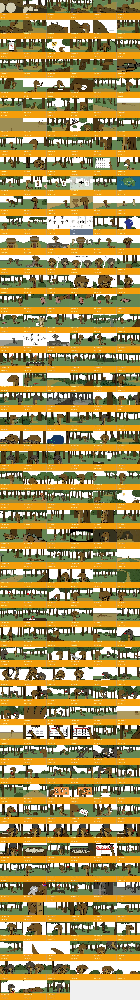

## Content and structure

- No whole-video summary (needs the VLM or an agent watching the full video); subtitle text is under “Packaging layer”

## Cast, scenes and props

- No cast extracted (needs the VLM whole-video pass, or an agent filling top-level `cast` in `review_answers.json`); shots where the face detector saw a face (person or character): #7, #75

## Sound

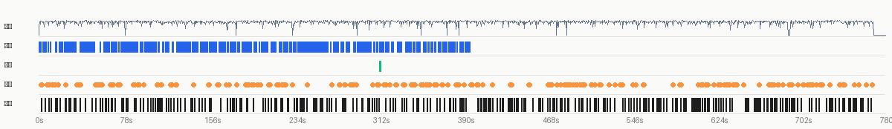

- loudness -24.4 dBFS, peak -0.7 dBFS; sound runs across cuts, laid in post as one bed (background changes 10.5dB at cuts vs 8.5dB within shots)
- Sources: Video type: voice-over / talking head + music → voice: TTS voice-over; SFX: added in post from an SFX library / editor (leaning, to confirm)

**Voice**

- 65% of the duration; pitch about 85.5Hz (male-leaning); sung
- Source: TTS voice-over (tts 64%, human_recording 27%, ai_video_native 9%)
  - Voice and background sound run across cuts: the voice-over was laid on separately in post (TTS or a human voice-over)
- Remake: capsule-cinema DoubaoTTSTool / UniversalTTSTool (or a MiniMax cloned voice); use duration-controlled TTS when it must fit the original time window

**Music**

- No sustained music bed detected

**Sound effects** (256)

all 60 sound effects

| Time | Type | Description | On screen | Basis |
|---|---|---|---|---|
| 2.59s | hit | animated sticker / GIF appears | animated sticker / GIF appears | deterministic_anchored |
| 2.84s | whoosh | — | — | signal candidate (low confidence) |
| 7.78s | hit | — | — | signal candidate (low confidence) |
| 7.98s | hit | — | — | signal candidate (low confidence) |
| 9.52s | pop | — | cut | signal candidate (low confidence) |
| 10.03s | pop | — | — | signal candidate (low confidence) |
| 12.81s | ding | — | — | signal candidate (low confidence) |
| 14.41s | ding | — | — | signal candidate (low confidence) |
| 14.58s | whoosh | — | — | signal candidate (low confidence) |
| 15.41s | ding | — | cut | signal candidate (low confidence) |
| 18.34s | whoosh | — | — | signal candidate (low confidence) |
| 25.26s | pop | — | cut | signal candidate (low confidence) |
| 35.48s | pop | — | — | signal candidate (low confidence) |
| 36.49s | pop | — | — | signal candidate (low confidence) |
| 38.68s | pop | animated sticker / GIF appears | animated sticker / GIF appears | deterministic_anchored |
| 52.33s | pop | — | cut | signal candidate (low confidence) |
| 53.52s | whoosh | — | — | signal candidate (low confidence) |
| 53.81s | ding | — | — | signal candidate (low confidence) |
| 54.74s | pop | — | — | signal candidate (low confidence) |
| 55.55s | whoosh | — | — | signal candidate (low confidence) |
| 56.30s | pop | — | — | signal candidate (low confidence) |
| 57.57s | hit | — | — | signal candidate (low confidence) |
| 57.89s | pop | — | — | signal candidate (low confidence) |
| 58.65s | ding | — | cut | signal candidate (low confidence) |
| 66.04s | whoosh | — | — | signal candidate (low confidence) |
| 68.21s | pop | — | — | signal candidate (low confidence) |
| 68.72s | pop | — | — | signal candidate (low confidence) |
| 73.40s | hit | — | — | signal candidate (low confidence) |
| 75.21s | whoosh | — | cut | signal candidate (low confidence) |
| 87.83s | pop | — | — | signal candidate (low confidence) |
| 88.92s | pop | animated sticker / GIF appears | animated sticker / GIF appears | deterministic_anchored |
| 91.79s | pop | — | — | signal candidate (low confidence) |
| 92.98s | pop | — | — | signal candidate (low confidence) |
| 97.30s | pop | — | — | signal candidate (low confidence) |
| 97.38s | ding | — | — | signal candidate (low confidence) |
| 109.18s | ding | — | — | signal candidate (low confidence) |
| 109.91s | pop | — | — | signal candidate (low confidence) |
| 112.83s | pop | — | — | signal candidate (low confidence) |
| 113.34s | pop | — | — | signal candidate (low confidence) |
| 121.80s | whoosh | — | — | signal candidate (low confidence) |
| 122.92s | pop | — | — | signal candidate (low confidence) |
| 126.70s | ding | — | — | signal candidate (low confidence) |
| 127.31s | whoosh | — | — | signal candidate (low confidence) |
| 143.20s | hit | — | — | signal candidate (low confidence) |
| 156.69s | ding | — | — | signal candidate (low confidence) |
| 157.29s | pop | — | cut | signal candidate (low confidence) |
| 165.01s | pop | — | — | signal candidate (low confidence) |
| 165.09s | pop | — | — | signal candidate (low confidence) |
| 166.47s | whoosh | — | — | signal candidate (low confidence) |
| 173.28s | pop | — | — | signal candidate (low confidence) |
| 173.52s | pop | — | — | signal candidate (low confidence) |
| 176.34s | whoosh | — | — | signal candidate (low confidence) |
| 182.79s | hit | — | — | signal candidate (low confidence) |
| 190.98s | whoosh | — | — | signal candidate (low confidence) |
| 193.20s | pop | — | — | signal candidate (low confidence) |
| 193.81s | whoosh | — | — | signal candidate (low confidence) |
| 196.57s | pop | — | — | signal candidate (low confidence) |
| 196.69s | pop | — | — | signal candidate (low confidence) |
| 198.77s | pop | — | — | signal candidate (low confidence) |
| 202.41s | ding | — | — | signal candidate (low confidence) |

- Source: added in post from an SFX library / editor (library_editor 57%, ai_native 29%, live_sync 14%)
- Remake: Place by timestamp: capsule-cinema SoundEffectsTool / an SFX library, or synthesise procedurally like the plush recipe (pitched to the music key)

- Separated stems: `stems/original.wav` (original), `stems/vocals.wav` (dry voice; transient sound effects land here too), `stems/music.wav` (music + ambience)
<!--stems-->

## Camera, lighting and editing

- Editing: 23.2 cuts per minute, 2.58s average shot; no live-action shots

- Note: lighting ratio, soft / hard, colour temperature and shot size are measured on the subject's pixels (the face when there is one, otherwise the in-focus region, which is an estimate); platform transcodes crush the shadows, so hardness and fill read conservative; camera angle, light source, catchlight and rim light follow the image readers. Where measurement and readers disagree, both are listed.

## Packaging layer (subtitles / styled text / stickers / sound-effect hits)

- Stickers / GIFs: animated sticker / GIF ×14, static sticker / image ×4
- SFX hits on: cut ×33, sticker in ×11
- 18 persistent layers (unchanged across cuts: lay each on once for its span, not per shot): animated sticker / GIF 2.6–9.1s, static sticker / image 33.0–37.8s, animated sticker / GIF 38.6–48.6s, animated sticker / GIF 89.0–93.3s …
- Exports: `packaging/timeline.json` (SRT is the subtitle timeline; ASS carries colour, outline, position and entrance animation, swap in the original font; timeline.json is the full timeline)

**Stickers / GIFs / picture-in-picture**

| Time | Kind | Position | Motion | Confidence | Crop |
|---|---|---|---|---|---|
| 2.60–9.12s | animated sticker / GIF | x45% y46% w15% h18% | animated | medium (unchanged across a cut) | 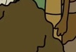 |
| 32.99–37.76s | static sticker / image | x80% y27% w20% h27% | static | medium (unchanged across a cut) | 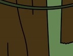 |
| 38.63–48.62s | animated sticker / GIF | x75% y36% w10% h18% | animated | medium (unchanged across a cut) | 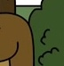 |
| 88.99–93.33s | animated sticker / GIF | x0% y64% w15% h18% | animated | medium (unchanged across a cut) | 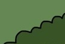 |
| 135.87–141.51s | animated sticker / GIF | x45% y18% w10% h27% | animated | medium (unchanged across a cut) |  |
| 150.62–153.23s | animated sticker / GIF | x85% y18% w15% h18% | animated | medium (unchanged across a cut) |  |
| 150.62–153.23s | animated sticker / GIF | x45% y18% w10% h18% | animated | medium (unchanged across a cut) |  |
| 312.53–319.91s | animated sticker / GIF | x45% y18% w30% h18% | animated | medium (unchanged across a cut) | 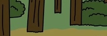 |
| 320.78–326.86s | static sticker / image | x65% y55% w15% h18% | static | medium (unchanged across a cut) | 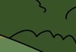 |
| 327.73–334.67s | static sticker / image | x35% y27% w10% h36% | static | medium (unchanged across a cut) | 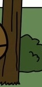 |
| 329.90–336.84s | animated sticker / GIF | x15% y46% w10% h18% | animated | medium (unchanged across a cut) | 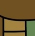 |
| 483.56–487.90s | static sticker / image | x35% y0% w15% h18% | static | medium (unchanged across a cut) | 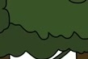 |
| 513.94–516.11s | animated sticker / GIF | x55% y55% w10% h18% | animated | medium (unchanged across a cut) | 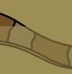 |
| 609.44–612.48s | animated sticker / GIF | x50% y27% w10% h27% | animated | medium (unchanged across a cut) | 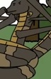 |
| 625.07–627.67s | animated sticker / GIF | x25% y64% w10% h18% | animated | medium (unchanged across a cut) | 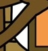 |
| 687.57–690.18s | animated sticker / GIF | x65% y36% w10% h18% | animated | medium (unchanged across a cut) | 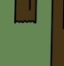 |
| 743.13–747.91s | animated sticker / GIF | x30% y46% w15% h55% | animated | medium (unchanged across a cut) | 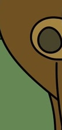 |
| 743.13–747.91s | animated sticker / GIF | x5% y73% w15% h18% | animated | medium (unchanged across a cut) | 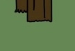 |
- 1 more things that pop up in the picture were not counted as stickers (elements appear on their own in 3D / animation / layout shots)

Remake: burn subtitles and styled text in with `packaging/overlays.ass` (ffmpeg -vf ass=overlays.ass), or rebuild them from timeline.json in CapCut / Remotion; stickers and GIFs need matching assets (meme / GIF libraries), crops are under packaging/.

## Remake plan

**code render / screen capture 303 shots → 1 code project**

### Code composition

One Remotion / HTML project rebuilt from the text tracks and layout (text and UI are 100% controllable; changing copy is a data change). An LLM can write this project directly.

- Part 1: shots #1, #2, #3, #4, #5, #6, #7, #8, #9, #10, #11, #12, #13, #14, #15, #16, #17, #18, #19, #20, #21, #22, #23, #24, #25, #26, #27, #28, #29, #30, #31, #32, #33, #34, #35, #36, #37, #38, #39, #40, #41, #42, #43, #44, #45, #46, #47, #48, #49, #50, #51, #52, #53, #54, #55, #56, #57, #58, #59, #60, #61, #62, #63, #64, #65, #66, #67, #68, #69, #70, #71, #72, #73, #74, #75, #76, #77, #78, #79, #80, #81, #82, #83, #84, #85, #86, #87, #88, #89, #90, #91, #92, #93, #94, #95, #96, #97, #98, #99, #100, #101, #102, #103, #104, #105, #106, #107, #108, #109, #110, #111, #112, #113, #114, #115, #116, #117, #118, #119, #120, #121, #122, #123, #124, #125, #126, #127, #128, #129, #130, #131, #132, #133, #134, #135, #136, #137, #138, #139, #140, #141, #142, #143, #144, #145, #146, #147, #148, #149, #150, #151, #152, #153, #154, #155, #156, #157, #158, #159, #160, #161, #162, #163, #164, #165, #166, #167, #168, #169, #170, #171, #172, #173, #174, #175, #176, #177, #178, #179, #180, #181, #182, #183, #184, #185, #186, #187, #188, #189, #190, #191, #192, #193, #194, #195, #196, #197, #198, #199, #200, #201, #202, #203, #204, #205, #206, #207, #208, #209, #210, #211, #212, #213, #214, #215, #216, #217, #218, #219, #220, #221, #222, #223, #224, #225, #226, #227, #228, #229, #230, #231, #232, #233, #234, #235, #236, #237, #238, #239, #240, #241, #242, #243, #244, #245, #246, #247, #248, #249, #250, #251, #252, #253, #254, #255, #256, #257, #258, #259, #260, #261, #262, #263, #264, #265, #266, #267, #268, #269, #270, #271, #272, #273, #274, #275, #276, #277, #278, #279, #280, #281, #282, #283, #284, #285, #286, #287, #288, #289, #290, #291, #292, #293, #294, #295, #296, #297, #298, #299, #300, #301, #302, #303 (0.0–781.3s); #70 use real screen recordings

Remake assets (all in the report folder; hand them over together with the data below to whoever writes the code, or to an LLM):
- `shots/shot_XXX_first.jpg` / `_last.jpg`: first / last frame of each shot at full size, for layout, type size and margins
- `shots/shot_XXX_strip.jpg`: key frames about every 0.5 s, to follow the animation
- `shots/shot_XXX_elements.jpg` and `_el_NN.jpg` / `_st_NN.jpg` / `_ly_NN.jpg`: full-size crop of every element once settled, numbered as in the motion timeline; redraw shapes from them, cut out icons, logos and illustrations that cannot be redrawn
- `packaging/overlays.ass`, `packaging/timeline.json`: timing, position and colour of the text

How to build the pictures (by the measured picture type):
- gradients / colour fields: CSS linear / radial gradients, or a few large circles with filter: blur() drifting slowly; glass cards with backdrop-filter
- UI / document: HTML / CSS cards and layout matched to the frame (radius, shadow, type sizes), elements enter with spring(); a real UI can be screen-recorded
- vector shapes: SVG shapes + interpolate() / spring() keyframes, positions and timing measured from the frame

| Shot | Time | Build | Picture | Camera | Colours | On-screen text |
|---|---|---|---|---|---|---|
| #1 | 0.0–2.3s | gradients / colour fields | (to fill from the images: what the elements form and how they move) | static | ground #392e1d · #5a4623 #d1c8b0 #2c2115 #714f21 | — |
| #2 | 2.3–5.5s | UI / document | (to fill from the images: what the elements form and how they move) | static | ground #362b1c · #574424 #d0c7af #fbfcfd #a17e3d | — |
| #3 | 5.5–9.6s | UI / document | (to fill from the images: what the elements form and how they move) | static | ground #384c29 · #627d53 #453216 #594725 #382b14 | — |
| #4 | 9.6–11.5s | UI / document | (to fill from the images: what the elements form and how they move) | static | ground #3d2f18 · #637e54 #5a4727 #374929 #958443 | — |
| #5 | 11.5–15.3s | gradients / colour fields | (to fill from the images: what the elements form and how they move) | static | ground #617f54 · #978341 #594623 #3f3119 #705122 | — |
| #6 | 15.3–16.0s | gradients / colour fields | (to fill from the images: what the elements form and how they move) | static | ground #627f52 · #594623 #978343 #70501f #372c1b | — |
| #7 | 16.0–16.7s | gradients / colour fields | (to fill from the images: what the elements form and how they move) | static | ground #617f54 · #594623 #978343 #6f5021 #362b19 | — |
| #8 | 16.7–19.9s | vector shapes | (to fill from the images: what the elements form and how they move) | static | ground #978343 · #5a4623 #3e2e16 #617f54 #374a29 | — |
| #9 | 19.9–24.0s | gradients / colour fields | (to fill from the images: what the elements form and how they move) | static | ground #fefcff · #5a4623 #725020 #49381f #866f53 | — |
| #10 | 24.0–24.8s | gradients / colour fields | (to fill from the images: what the elements form and how they move) | static | ground #fefcff · #5a4623 #725020 #3f2f1c #23190f | — |
| #11 | 24.8–25.2s | gradients / colour fields | (to fill from the images: what the elements form and how they move) | static | ground #fefcff · #594623 #4c3c21 #3a2b17 | — |
| #12 | 25.2–27.8s | UI / document | (to fill from the images: what the elements form and how they move) | static | ground #637e54 · #473114 #948342 #384a28 #362914 | — |
| #13 | 27.8–29.5s | vector shapes | (to fill from the images: what the elements form and how they move) | static | ground #978343 · #412f14 #fdfbfe #637e55 #3c4c2c | — |
| #14 | 29.5–32.8s | UI / document | (to fill from the images: what the elements form and how they move) | static | ground #637e54 · #473114 #968242 #384a28 #352a14 | — |
| #15 | 32.8–34.2s | UI / document | (to fill from the images: what the elements form and how they move) | static | ground #374c28 · #fcfdff #6d5126 #e9b94e #a48342 | — |
| #16 | 34.2–38.2s | vector shapes | (to fill from the images: what the elements form and how they move) | static | ground #637e54 · #483215 #968242 #362914 #394929 | — |
| #17 | 38.2–43.0s | UI / document | (to fill from the images: what the elements form and how they move) | static | ground #453216 · #617f54 #6f5021 #3a4b2d #262114 | — |
| #18 | 43.0–49.2s | UI / document | (to fill from the images: what the elements form and how they move) | static | ground #978343 · #402e15 #657e55 #fafbfc #5e5934 | — |
| #19 | 49.2–52.3s | UI / document | (to fill from the images: what the elements form and how they move) | static | ground #968242 · #637e55 #fafbfc #483518 #5d5b34 | — |
| #20 | 52.3–56.8s | vector shapes | (to fill from the images: what the elements form and how they move) | static | ground #617f54 · #473114 #968242 #372913 #394929 | — |
| #21 | 56.8–58.6s | UI / document | (to fill from the images: what the elements form and how they move) | static | ground #463116 · #607e53 #352813 #374528 #52513b | — |
| #22 | 58.6–61.4s | vector shapes | (to fill from the images: what the elements form and how they move) | static | ground #617f54 · #473114 #392813 #414629 #6d5024 | — |
| #23 | 61.4–62.4s | vector shapes | (to fill from the images: what the elements form and how they move) | static | ground #617f54 · #483215 #414d2e #392813 #6c5026 | — |
| #24 | 62.4–64.5s | gradients / colour fields | (to fill from the images: what the elements form and how they move) | static | ground #617f54 · #714f1f #4c4736 #080705 #312618 | — |
| #25 | 64.5–67.1s | vector shapes | (to fill from the images: what the elements form and how they move) | static | ground #617f54 · #483215 #fefcff #3a2813 #6c4d24 | — |
| #26 | 67.1–67.8s | vector shapes | (to fill from the images: what the elements form and how they move) | static | ground #fefcff · #463116 #657f53 #6e4f20 #6c7064 | — |
| #27 | 67.8–70.2s | gradients / colour fields | (to fill from the images: what the elements form and how they move) | static | ground #fefcff · #473114 #637b59 #704e20 #474c38 | — |
| #28 | 70.2–76.4s | gradients / colour fields | (to fill from the images: what the elements form and how they move) | static | ground #483215 · #714f21 #526642 #fdfbfe #302414 | — |
| #29 | 76.4–77.8s | UI / document | (to fill from the images: what the elements form and how they move) | static | ground #958443 · #637e54 #3e2c13 #fbfcfd #364427 | — |
| #30 | 77.8–80.6s | UI / document | (to fill from the images: what the elements form and how they move) | static | ground #617f54 · #fcfdff #6f5021 #46351a #435734 | — |
| #31 | 80.6–82.0s | UI / document | (to fill from the images: what the elements form and how they move) | static | ground #617f54 · #5d6c57 #3d2f17 #fcfdff #424c34 | — |
| #32 | 82.0–88.4s | vector shapes | (to fill from the images: what the elements form and how they move) | static | ground #978343 · #617f54 #473114 #364a28 #362812 | — |
| #33 | 88.4–89.8s | UI / document | (to fill from the images: what the elements form and how they move) | static | ground #412f14 · #fcfdff #637e54 #384b2a #4c633e | — |
| #34 | 89.8–93.6s | vector shapes | (to fill from the images: what the elements form and how they move) | static | ground #453216 · #fcfdff #627d54 #3a512e #6f5021 | — |
| #35 | 93.6–96.2s | vector shapes | (to fill from the images: what the elements form and how they move) | static | ground #617f54 · #9d8952 #384c29 #443115 #576542 | — |
| #36 | 96.2–100.5s | gradients / colour fields | (to fill from the images: what the elements form and how they move) | static | ground #9d8952 · #fefcff #8f7a49 #705124 #d6d3d2 | — |
| #37 | 100.5–103.4s | gradients / colour fields | (to fill from the images: what the elements form and how they move) | static | ground #9e8a51 · #a08953 | — |
| #38 | 103.4–105.2s | gradients / colour fields | (to fill from the images: what the elements form and how they move) | static | ground #9d8952 · #fffdff #9c8954 #8d7b4a #d7d4d4 | — |
| #39 | 105.2–107.5s | UI / document | (to fill from the images: what the elements form and how they move) | static | ground #412f14 · #968242 #394f2a #647d55 #fcfdff | — |
| #40 | 107.5–109.5s | UI / document | (to fill from the images: what the elements form and how they move) | static | ground #fcfdff · #384c29 #47633a #3d3221 #6e4f24 | — |
| #41 | 109.5–111.1s | UI / document | (to fill from the images: what the elements form and how they move) | static | ground #442f13 · #978343 #fbfcfd #6b805a #384829 | — |
| #42 | 111.1–112.6s | UI / document | (to fill from the images: what the elements form and how they move) | static | ground #628055 · #fbfcfd #3f2d14 #47633a #3c4c2c | — |
| #43 | 112.6–113.8s | vector shapes | (to fill from the images: what the elements form and how they move) | static | ground #617f54 · #fcfdff #3e2c15 #424228 #4a613c | — |
| #44 | 113.8–117.6s | vector shapes | (to fill from the images: what the elements form and how they move) | static | ground #617f54 · #fcfdff #6e4f20 #46351b #291f13 | — |
| #45 | 117.6–119.7s | UI / document | (to fill from the images: what the elements form and how they move) | static | ground #617f54 · #3e2e14 #fbfcfd #486239 #374528 | — |
| #46 | 119.7–121.6s | UI / document | (to fill from the images: what the elements form and how they move) | static | ground #617f54 · #fafbfc #47633a #402e15 #384e2b | — |
| #47 | 121.6–122.2s | vector shapes | (to fill from the images: what the elements form and how they move) | static | ground #617f54 · #453115 #2b1e11 #6f5021 #fefcff | — |
| #48 | 122.2–124.8s | gradients / colour fields | (to fill from the images: what the elements form and how they move) | static | ground #617f54 · #483215 #6e4f22 #384c29 #a27f3c | — |
| #49 | 124.8–127.8s | vector shapes | (to fill from the images: what the elements form and how they move) | static | ground #617f54 · #fbfcfd #473217 #372613 #6d4e23 | — |
| #50 | 127.8–130.9s | UI / document | (to fill from the images: what the elements form and how they move) | static | ground #647d53 · #fefcff #453117 #6f5021 #2a1f11 | — |
| #51 | 130.9–135.2s | vector shapes | (to fill from the images: what the elements form and how they move) | static | ground #617f54 · #fcfdff #453216 #382712 #3c492b | — |
| #52 | 135.2–140.2s | vector shapes | (to fill from the images: what the elements form and how they move) | static | ground #617f54 · #fcfdff #3e2e16 #4a623c #845f32 | — |
| #53 | 140.2–141.8s | UI / document | (to fill from the images: what the elements form and how they move) | static | ground #617f54 · #fcfdff #c1bfc2 #dedddf #865e2d | — |
| #54 | 141.8–144.1s | vector shapes | (to fill from the images: what the elements form and how they move) | static | ground #617f54 · #fcfdff #473218 #845f2f #332313 | — |
| #55 | 144.1–148.0s | UI / document | (to fill from the images: what the elements form and how they move) | static | ground #628055 · #fafbfc #47633a #3b2d17 #354628 | — |
| #56 | 148.0–150.4s | vector shapes | (to fill from the images: what the elements form and how they move) | static | ground #617f54 · #fefcff #3e2c17 #835e30 #5d442b | — |
| #57 | 150.4–151.0s | UI / document | (to fill from the images: what the elements form and how they move) | static | ground #628055 · #fafbfc #466239 #3b2d15 #354628 | — |
| #58 | 151.0–153.7s | UI / document | (to fill from the images: what the elements form and how they move) | static | ground #ced7cd · #fcfdff #c7cdc1 #c1c0b8 #a5a9a0 | — |
| #59 | 153.7–157.3s | UI / document | (to fill from the images: what the elements form and how they move) | static | ground #617f54 · #344626 #504033 #382d1c #fafbfc | — |
| #60 | 157.3–158.7s | UI / document | (to fill from the images: what the elements form and how they move) | static | ground #0e5d82 · #457042 #274d4a #185167 #395c40 | — |
| #61 | 158.7–167.8s | UI / document | (to fill from the images: what the elements form and how they move) | static | ground #fbfcfd · #617f54 #324527 #564544 #3f2f21 | — |
| #62 | 167.8–174.2s | vector shapes | (to fill from the images: what the elements form and how they move) | static | ground #fefcff · #617f54 #384e2b #6f5021 #613b28 | — |
| #63 | 174.2–176.9s | vector shapes | (to fill from the images: what the elements form and how they move) | static | ground #fefcff · #617f54 #af975d #6c5026 #563a25 | — |
| #64 | 176.9–178.6s | gradients / colour fields | (to fill from the images: what the elements form and how they move) | static | ground #b0965c · #617f54 #70501f #846635 #5d3c28 | — |
| #65 | 178.6–180.0s | vector shapes | (to fill from the images: what the elements form and how they move) | static | ground #fefcff · #617f54 #b0965c #6c5026 #573a26 | — |
| #66 | 180.0–182.4s | vector shapes | (to fill from the images: what the elements form and how they move) | static | ground #fefcff · #617f54 #af955d #614528 #696746 | — |
| #67 | 182.4–185.7s | UI / document | (to fill from the images: what the elements form and how they move) | static | ground #637e54 · #fcfdff #37361e #394d2a #563f2e | — |
| #68 | 185.7–187.0s | UI / document | (to fill from the images: what the elements form and how they move) | static | ground #617f54 · #fcfdff #344626 #4d3928 #665a3a | — |
| #69 | 187.0–191.7s | UI / document | (to fill from the images: what the elements form and how they move) | static | ground #fefcff · #d8d6d9 #4c443e #4e352b #afacad | — |
| #70 | 191.7–192.7s | UI / document | (to fill from the images: what the elements form and how they move) | static | ground #fcfdff · #c9c7c7 #eff0f2 #dedfe0 #000204 | — |
| #71 | 192.7–197.9s | UI / document | (to fill from the images: what the elements form and how they move) | static | ground #657e54 · #fcfdff #432f15 #394e29 #694c28 | — |
| #72 | 197.9–206.7s | UI / document | (to fill from the images: what the elements form and how they move) | static | ground #394d2a · #fcfdff #453115 #2f3d25 #342513 | — |
| #73 | 206.7–207.0s | vector shapes | (to fill from the images: what the elements form and how they move) | static | ground #fefcff · #617f54 #6f5021 #7f6c4f #948342 | — |
| #74 | 207.0–208.8s | vector shapes | (to fill from the images: what the elements form and how they move) | static | ground #fefcff · #627f52 #958443 #5a3d28 #6d4e1f | — |
| #75 | 208.8–211.9s | UI / document | (to fill from the images: what the elements form and how they move) | static | ground #fefcff · #504c43 #715837 #736f60 #5a432b | — |
| #76 | 211.9–214.9s | UI / document | (to fill from the images: what the elements form and how they move) | static | ground #fefcff · #617f54 #6f5021 #5f3e2a #8d9188 | — |
| #77 | 214.9–218.1s | UI / document | (to fill from the images: what the elements form and how they move) | static | ground #fefcff · #617f54 #704e20 #484233 #5c3c25 | — |
| #78 | 218.1–219.1s | vector shapes | (to fill from the images: what the elements form and how they move) | static | ground #fefcff · #617f54 #6f5021 #5a3c27 #362717 | — |
| #79 | 219.1–223.8s | vector shapes | (to fill from the images: what the elements form and how they move) | static | ground #617f54 · #fefcff #574f3c #4e3928 #67614f | — |
| #80 | 223.8–225.0s | vector shapes | (to fill from the images: what the elements form and how they move) | static | ground #617f54 · #fefcff #645e4c #6f5021 #544230 | — |
| #81 | 225.0–229.8s | UI / document | (to fill from the images: what the elements form and how they move) | static | ground #fcfdff · #617f54 #5b5341 #70501f #573d2a | — |
| #82 | 229.8–230.6s | UI / document | (to fill from the images: what the elements form and how they move) | static | ground #fcfdff · #617f54 #5c5442 #6f5021 #3a3021 | — |
| #83 | 230.6–235.8s | UI / document | (to fill from the images: what the elements form and how they move) | static | ground #fcfdff · #667e52 #5a5240 #593c29 #6f5021 | — |
| #84 | 235.8–237.9s | vector shapes | (to fill from the images: what the elements form and how they move) | static | ground #637e54 · #fcfdff #364c29 #443117 #282315 | — |
| #85 | 237.9–238.9s | UI / document | (to fill from the images: what the elements form and how they move) | static | ground #637e54 · #fbfcfd #374c28 #2c3b22 #3e2c17 | — |
| #86 | 238.9–241.2s | vector shapes | (to fill from the images: what the elements form and how they move) | static | ground #637e55 · #fefcff #364c29 #443117 #2a2315 | — |
| #87 | 241.2–242.4s | UI / document | (to fill from the images: what the elements form and how they move) | static | ground #617f54 · #fcfdff #3e2e17 #344527 #5e6553 | — |
| #88 | 242.4–243.2s | UI / document | (to fill from the images: what the elements form and how they move) | static | ground #fcfdff · #70501f #1f1811 #43311a #3e4a2d | — |
| #89 | 243.2–244.8s | UI / document | (to fill from the images: what the elements form and how they move) | static | ground #fcfdff · #70501f #48371d #997e42 #364c29 | — |
| #90 | 244.8–247.3s | UI / document | (to fill from the images: what the elements form and how they move) | static | ground #fcfdff · #687f51 #4b341b #6e4f20 #2b2215 | — |
| #91 | 247.3–253.8s | UI / document | (to fill from the images: what the elements form and how they move) | static | ground #627f52 · #412d15 #fbfcfd #394d2a #2e3b22 | — |
| #92 | 253.8–255.2s | vector shapes | (to fill from the images: what the elements form and how they move) | static | ground #617f54 · #374c28 #ab7d6e #45341c #704f25 | — |
| #93 | 255.2–255.6s | UI / document | (to fill from the images: what the elements form and how they move) | static | ground #617f54 · #384c29 #705124 #43331b #ac7e6c | — |
| #94 | 255.6–256.4s | vector shapes | (to fill from the images: what the elements form and how they move) | static | ground #617f54 · #374c28 #ad7e6c #43341a #262315 | — |
| #95 | 256.4–259.5s | UI / document | (to fill from the images: what the elements form and how they move) | static | ground #617f54 · #394d2a #fcfdff #6f5028 #4f371f | — |
| #96 | 259.5–260.9s | vector shapes | (to fill from the images: what the elements form and how they move) | static | ground #617f54 · #ad7e6c #415335 #3a3629 #493215 | — |
| #97 | 260.9–262.0s | UI / document | (to fill from the images: what the elements form and how they move) | static | ground #617f54 · #384c29 #fcfdff #3d3119 #6a4b26 | — |
| #98 | 262.0–265.8s | UI / document | (to fill from the images: what the elements form and how they move) | static | ground #637e54 · #354727 #fbfcfd #403018 #635c41 | — |
| #99 | 265.8–267.8s | vector shapes | (to fill from the images: what the elements form and how they move) | static | ground #617f54 · #fcfdff #3c2d17 #6f5025 #5a3d26 | — |
| #100 | 267.8–269.8s | UI / document | (to fill from the images: what the elements form and how they move) | static | ground #617f54 · #fcfdff #48371d #415532 #382913 | — |
| #101 | 269.8–274.6s | UI / document | (to fill from the images: what the elements form and how they move) | static | ground #617f54 · #476338 #fcfdff #2f4729 #3f2f17 | — |
| #102 | 274.6–280.4s | UI / document | (to fill from the images: what the elements form and how they move) | static | ground #637e54 · #fcfdff #433016 #47633a #374528 | — |
| #103 | 280.4–281.1s | vector shapes | (to fill from the images: what the elements form and how they move) | static | ground #fefcff · #70786d #9c9a91 #55514c #e0dee0 | — |
| #104 | 281.1–282.3s | UI / document | (to fill from the images: what the elements form and how they move) | static | ground #fcfdff · #4b4542 #d5d3d5 #eaebed #8e8c8c | — |
| #105 | 282.3–283.2s | UI / document | (to fill from the images: what the elements form and how they move) | static | ground #fefcff · #524e47 #666661 #49443e #a2a09c | — |
| #106 | 283.2–290.0s | vector shapes | (to fill from the images: what the elements form and how they move) | static | ground #617f54 · #fcfdff #3f321c #465434 #6f5027 | — |
| #107 | 290.0–293.7s | vector shapes | (to fill from the images: what the elements form and how they move) | static | ground #627f52 · #fcfdff #404024 #6f5023 #4d5f3d | — |
| #108 | 293.7–298.4s | UI / document | (to fill from the images: what the elements form and how they move) | static | ground #978341 · #3f2e15 #617f54 #344527 #fdfbfe | — |
| #109 | 298.4–298.7s | vector shapes | (to fill from the images: what the elements form and how they move) | static | ground #463317 · #637e55 #fdfbfe #6f5028 #312513 | — |
| #110 | 298.7–303.8s | vector shapes | (to fill from the images: what the elements form and how they move) | static | ground #463317 · #2f2718 #fcfafc #607e53 #445035 | — |
| #111 | 303.8–305.0s | UI / document | (to fill from the images: what the elements form and how they move) | static | ground #628055 · #3e2e18 #37462a #fdfbfe #704e20 | — |
| #112 | 305.0–308.0s | UI / document | (to fill from the images: what the elements form and how they move) | static | ground #617f54 · #3f2e15 #fcfdff #374a29 #4a623c | — |
| #113 | 308.0–310.2s | UI / document | (to fill from the images: what the elements form and how they move) | static | ground #617f54 · #303d23 #3b2c16 #fcfdff #394c2b | — |
| #114 | 310.2–312.0s | UI / document | (to fill from the images: what the elements form and how they move) | static | ground #617f54 · #fcfdff #354525 #3e2e17 #6e4f22 | — |
| #115 | 312.0–314.1s | vector shapes | (to fill from the images: what the elements form and how they move) | static | ground #fcfdff · #714f1f #2d1f15 #50391f #a17e3d | — |
| #116 | 314.1–320.4s | UI / document | (to fill from the images: what the elements form and how they move) | static | ground #617f54 · #3d2d13 #6f5021 #2e3b22 #394b29 | — |
| #117 | 320.4–324.2s | gradients / colour fields | (to fill from the images: what the elements form and how they move) | static | ground #fcfdff · #978343 #374c28 #627f52 #2a3b1f | — |
| #118 | 324.2–327.2s | UI / document | (to fill from the images: what the elements form and how they move) | static | ground #412f14 · #2b4428 #fafbfc #466239 #657c56 | — |
| #119 | 327.2–329.4s | UI / document | (to fill from the images: what the elements form and how they move) | static | ground #453115 · #fbfcfd #2b462b #5c754d #2d2312 | — |
| #120 | 329.4–335.2s | UI / document | (to fill from the images: what the elements form and how they move) | static | ground #2c4329 · #637e54 #3a2c16 #6e4f22 #978242 | — |
| #121 | 335.2–337.2s | UI / document | (to fill from the images: what the elements form and how they move) | static | ground #37502e · #637e54 #3c2e17 #fbfcfd #4c443c | — |
| #122 | 337.2–339.7s | UI / document | (to fill from the images: what the elements form and how they move) | static | ground #617f54 · #fcfdff #4c443c #433217 #3c522e | — |
| #123 | 339.7–345.7s | UI / document | (to fill from the images: what the elements form and how they move) | static | ground #38342d · #70786d #fcfdff #45453e #2a2623 | — |
| #124 | 345.7–349.0s | UI / document | (to fill from the images: what the elements form and how they move) | static | ground #38332e · #6f776c #464a41 #84847b #fafbfc | — |
| #125 | 349.0–350.4s | gradients / colour fields | (to fill from the images: what the elements form and how they move) | static | ground #fefcff · #463116 #364c29 #607e53 #6f5023 | — |
| #126 | 350.4–355.4s | vector shapes | (to fill from the images: what the elements form and how they move) | static | ground #fcfdff · #667c55 #6f5021 #4c443c #443317 | — |
| #127 | 355.4–358.8s | gradients / colour fields | (to fill from the images: what the elements form and how they move) | static | ground #fdfcff · #394d2a #6f5021 #627d53 #463318 | — |
| #128 | 358.8–361.3s | vector shapes | (to fill from the images: what the elements form and how they move) | static | ground #fefcff · #2d4729 #4d443b #617f54 #433017 | — |
| #129 | 361.3–367.8s | vector shapes | (to fill from the images: what the elements form and how they move) | static | ground #fbfcfd · #374c28 #483116 #473d37 #718051 | — |
| #130 | 367.8–370.2s | UI / document | (to fill from the images: what the elements form and how they move) | static | ground #617f54 · #fcfdff #483619 #394b29 #352815 | — |
| #131 | 370.2–374.3s | vector shapes | (to fill from the images: what the elements form and how they move) | static | ground #617f54 · #fcfdff #463116 #4c433a #2f2619 | — |
| #132 | 374.3–379.0s | UI / document | (to fill from the images: what the elements form and how they move) | static | ground #637e54 · #fbfcfd #314426 #362b16 #48351b | — |
| #133 | 379.0–379.5s | UI / document | (to fill from the images: what the elements form and how they move) | static | ground #fefcff · #6f5021 #483b22 #332819 #1d1710 | — |
| #134 | 379.5–380.0s | gradients / colour fields | (to fill from the images: what the elements form and how they move) | static | ground #fefcff · #6f5021 #443117 #231b13 #484737 | — |
| #135 | 380.0–383.0s | gradients / colour fields | (to fill from the images: what the elements form and how they move) | static | ground #fafcff · #0f3462 #453517 #5e896e #221b10 | — |
| #136 | 383.0–384.9s | UI / document | (to fill from the images: what the elements form and how they move) | static | ground #617f54 · #fcfdff #402e15 #3b4c2a #2e3b22 | — |
| #137 | 384.9–388.7s | UI / document | (to fill from the images: what the elements form and how they move) | static | ground #fefcff · #617f54 #6f5021 #384c29 #45341c | — |
| #138 | 388.7–390.4s | UI / document | (to fill from the images: what the elements form and how they move) | static | ground #2f462a · #463116 #968242 #637e54 #332a16 | — |
| #139 | 390.4–391.2s | vector shapes | (to fill from the images: what the elements form and how they move) | static | ground #627d53 · #473114 #3b4f2c #4a443b #231b13 | — |
| #140 | 391.2–391.7s | vector shapes | (to fill from the images: what the elements form and how they move) | static | ground #607e53 · #473114 #4b433b #3b4f2c #2e2819 | — |
| #141 | 391.7–392.2s | vector shapes | (to fill from the images: what the elements form and how they move) | static | ground #443115 · #617f54 #3b4f2c #241e14 #4a443b | — |
| #142 | 392.2–394.5s | UI / document | (to fill from the images: what the elements form and how they move) | static | ground #617f54 · #fcfdff #443117 #344728 #352612 | — |
| #143 | 394.5–405.5s | UI / document | (to fill from the images: what the elements form and how they move) | static | ground #627d53 · #fdfbfe #342a19 #443317 #445134 | — |
| #144 | 405.5–406.2s | vector shapes | (to fill from the images: what the elements form and how they move) | static | ground #617f54 · #473114 #384c29 #fbfcfd #342814 | — |
| #145 | 406.2–408.3s | UI / document | (to fill from the images: what the elements form and how they move) | static | ground #667f55 · #334426 #fafbfc #463116 #322715 | — |
| #146 | 408.3–408.7s | UI / document | (to fill from the images: what the elements form and how they move) | static | ground #fcfdff · #456338 #714f1f #3f2d14 #425838 | — |
| #147 | 408.7–410.9s | UI / document | (to fill from the images: what the elements form and how they move) | static | ground #fcfdff · #466239 #6f5023 #42371b #342513 | — |
| #148 | 410.9–412.2s | UI / document | (to fill from the images: what the elements form and how they move) | static | ground #fcfdff · #456338 #412f16 #3b4d2d #8a8e85 | — |
| #149 | 412.2–413.0s | UI / document | (to fill from the images: what the elements form and how they move) | static | ground #617f54 · #fcfdff #6f5021 #49623d #382b16 | — |
| #150 | 413.0–414.8s | UI / document | (to fill from the images: what the elements form and how they move) | static | ground #617f54 · #fcfdff #6f5021 #47633a #3c2d17 | — |
| #151 | 414.8–415.6s | UI / document | (to fill from the images: what the elements form and how they move) | static | ground #978343 · #3e3016 #657e55 #f8f9fb #405431 | — |
| #152 | 415.6–416.8s | UI / document | (to fill from the images: what the elements form and how they move) | static | ground #978343 · #3e3017 #647d55 #fafbfc #3f5330 | — |
| #153 | 416.8–419.0s | UI / document | (to fill from the images: what the elements form and how they move) | static | ground #637e54 · #3c2e16 #486239 #354727 #fbfcfd | — |
| #154 | 419.0–423.1s | UI / document | (to fill from the images: what the elements form and how they move) | static | ground #637e54 · #fbfcfd #394d2a #402e15 #2d3c22 | — |
| #155 | 423.1–426.0s | UI / document | (to fill from the images: what the elements form and how they move) | static | ground #617f54 · #384c29 #3f2d14 #2e3b22 #576646 | — |
| #156 | 426.0–428.2s | UI / document | (to fill from the images: what the elements form and how they move) | static | ground #374c28 · #fcfdff #6c4d24 #39361f #736f67 | — |
| #157 | 428.2–429.0s | vector shapes | (to fill from the images: what the elements form and how they move) | static | ground #657e54 · #fbfcfd #473114 #2f3d25 #2d2413 | — |
| #158 | 429.0–433.3s | UI / document | (to fill from the images: what the elements form and how they move) | static | ground #978343 · #667f56 #402e15 #384c29 #2f3c22 | — |
| #159 | 433.3–434.8s | vector shapes | (to fill from the images: what the elements form and how they move) | static | ground #617f54 · #fbfcfd #463317 #372611 #4d573b | — |
| #160 | 434.8–436.2s | gradients / colour fields | (to fill from the images: what the elements form and how they move) | static | ground #617f54 · #483215 #6f5021 #384c29 #21170c | — |
| #161 | 436.2–436.9s | gradients / colour fields | (to fill from the images: what the elements form and how they move) | static | ground #617f54 · #463116 #261c10 #384c29 #6e4f22 | — |
| #162 | 436.9–438.8s | vector shapes | (to fill from the images: what the elements form and how they move) | static | ground #617f54 · #fefcff #463317 #362711 #474f32 | — |
| #163 | 438.8–441.3s | vector shapes | (to fill from the images: what the elements form and how they move) | static | ground #617f54 · #483215 #6e4f20 #312a1b #776b4e | — |
| #164 | 441.3–442.7s | gradients / colour fields | (to fill from the images: what the elements form and how they move) | static | ground #617f54 · #473217 #6f5021 #826c4e #0b0a07 | — |
| #165 | 442.7–445.7s | UI / document | (to fill from the images: what the elements form and how they move) | static | ground #617f54 · #fefcff #463317 #362713 #694d23 | — |
| #166 | 445.7–447.8s | vector shapes | (to fill from the images: what the elements form and how they move) | static | ground #000100 · #627d53 #3d2d13 #fafbfc #3b4728 | — |
| #167 | 447.8–449.0s | vector shapes | (to fill from the images: what the elements form and how they move) | static | ground #342e1f · #714f1f #5b4523 #15100b #261f15 | — |
| #168 | 449.0–456.0s | gradients / colour fields | (to fill from the images: what the elements form and how they move) | static | ground #5a4623 · #352f1f #978343 #49381c #2b2519 | — |
| #169 | 456.0–461.4s | UI / document | (to fill from the images: what the elements form and how they move) | static | ground #617f54 · #402e15 #606d58 #fcfdff #435037 | — |
| #170 | 461.4–463.2s | vector shapes | (to fill from the images: what the elements form and how they move) | static | ground #617f54 · #fcfdff #453217 #342513 #6e4f24 | — |
| #171 | 463.2–465.0s | UI / document | (to fill from the images: what the elements form and how they move) | static | ground #617f54 · #fbfcfd #2f3c22 #3c2c14 #384c29 | — |
| #172 | 465.0–470.1s | UI / document | (to fill from the images: what the elements form and how they move) | static | ground #637e54 · #412f16 #fbfcfd #364626 #6e4f22 | — |
| #173 | 470.1–472.2s | UI / document | (to fill from the images: what the elements form and how they move) | static | ground #647e52 · #364427 #486239 #fbfcfd #43311a | — |
| #174 | 472.2–474.9s | vector shapes | (to fill from the images: what the elements form and how they move) | static | ground #fcfdff · #647e52 #546842 #988651 #ae965c | — |
| #175 | 474.9–476.3s | UI / document | (to fill from the images: what the elements form and how they move) | static | ground #9d8952 · #fcfdff #637e54 #3d2d15 #344527 | — |
| #176 | 476.3–477.9s | UI / document | (to fill from the images: what the elements form and how they move) | static | ground #637e54 · #483215 #fbfcfd #384c29 #2c3b22 | — |
| #177 | 477.9–478.3s | gradients / colour fields | (to fill from the images: what the elements form and how they move) | static | ground #443117 · #fcfdff #6e4f20 #251d12 #404c33 | — |
| #178 | 478.3–481.5s | gradients / colour fields | (to fill from the images: what the elements form and how they move) | static | ground #433016 · #fcfdff #3b4c2e #6f5021 #241d12 | — |
| #179 | 481.5–483.1s | UI / document | (to fill from the images: what the elements form and how they move) | static | ground #617f54 · #394c28 #2d3c22 #fcfdff #402e15 | — |
| #180 | 483.1–485.5s | UI / document | (to fill from the images: what the elements form and how they move) | static | ground #374c28 · #978343 #334725 #2e3f21 #607e53 | — |
| #181 | 485.5–488.5s | UI / document | (to fill from the images: what the elements form and how they move) | static | ground #617f54 · #354727 #fbfcfd #3c3019 #645838 | — |
| #182 | 488.5–489.5s | UI / document | (to fill from the images: what the elements form and how they move) | static | ground #637e54 · #fafbfc #3a4b29 #423018 #2d3c22 | — |
| #183 | 489.5–495.3s | UI / document | (to fill from the images: what the elements form and how they move) | static | ground #374d29 · #fcfdff #422e14 #2e3d23 #6a7e55 | — |
| #184 | 495.3–498.6s | UI / document | (to fill from the images: what the elements form and how they move) | static | ground #978343 · #637e54 #3e2c15 #fafbfc #6f5023 | — |
| #185 | 498.6–501.0s | vector shapes | (to fill from the images: what the elements form and how they move) | static | ground #fbfcfd · #70501f #617f54 #9b803e #423117 | — |
| #186 | 501.0–502.1s | UI / document | (to fill from the images: what the elements form and how they move) | static | ground #978343 · #667f56 #3f2d16 #fbfcfd #6f5021 | — |
| #187 | 502.1–506.1s | UI / document | (to fill from the images: what the elements form and how they move) | static | ground #617f54 · #3d2d15 #f8f9fb #47633a #384d2c | — |
| #188 | 506.1–509.3s | UI / document | (to fill from the images: what the elements form and how they move) | static | ground #36291a · #617f54 #4b613b #3d452c #faf9fb | — |
| #189 | 509.3–513.4s | UI / document | (to fill from the images: what the elements form and how they move) | static | ground #627f52 · #fbfcfd #3f2d14 #3c4d2b #2f3c22 | — |
| #190 | 513.4–514.3s | UI / document | (to fill from the images: what the elements form and how they move) | static | ground #637e54 · #fafbfc #3b4d2d #3a2b15 #6e4f22 | — |
| #191 | 514.3–516.7s | gradients / colour fields | (to fill from the images: what the elements form and how they move) | static | ground #9d8952 · #fefcff #8d7e5a #836c40 #8e7849 | — |
| #192 | 516.7–521.5s | UI / document | (to fill from the images: what the elements form and how they move) | static | ground #637e54 · #fbfcfd #384629 #3e2e17 #545e48 | — |
| #193 | 521.5–523.1s | vector shapes | (to fill from the images: what the elements form and how they move) | static | ground #657f53 · #fcfdff #453217 #6e4f20 #302413 | — |
| #194 | 523.1–524.6s | UI / document | (to fill from the images: what the elements form and how they move) | static | ground #627d54 · #fcfdff #402e15 #405035 #303d23 | — |
| #195 | 524.6–527.6s | UI / document | (to fill from the images: what the elements form and how they move) | static | ground #354628 · #473114 #637e55 #fbfcfd #6d5024 | — |
| #196 | 527.6–532.0s | vector shapes | (to fill from the images: what the elements form and how they move) | static | ground #628055 · #fcfdff #453216 #3b492a #352612 | — |
| #197 | 532.0–539.3s | UI / document | (to fill from the images: what the elements form and how they move) | static | ground #647f55 · #3a4b29 #fbfcfd #2f3c22 #3e2c15 | — |
| #198 | 539.3–541.6s | vector shapes | (to fill from the images: what the elements form and how they move) | static | ground #fcfdff · #4c443c #364b27 #647d53 #2c2b22 | — |
| #199 | 541.6–544.6s | UI / document | (to fill from the images: what the elements form and how they move) | static | ground #3e2e17 · #657e54 #fcfdff #494438 #405832 | — |
| #200 | 544.6–547.0s | UI / document | (to fill from the images: what the elements form and how they move) | static | ground #617f54 · #fbfcfd #374c28 #4f613d #2e3d22 | — |
| #201 | 547.0–549.5s | gradients / colour fields | (to fill from the images: what the elements form and how they move) | static | ground #334426 · #fcfdff #473217 #48633c #6e4f20 | — |
| #202 | 549.5–552.1s | UI / document | (to fill from the images: what the elements form and how they move) | static | ground #432f15 · #fcfdff #2c3b22 #49633a #6f5021 | — |
| #203 | 552.1–555.0s | UI / document | (to fill from the images: what the elements form and how they move) | static | ground #657f53 · #fbfcfd #48633c #705122 #3e492f | — |
| #204 | 555.0–558.7s | UI / document | (to fill from the images: what the elements form and how they move) | static | ground #6c7c57 · #fbfcfd #3f2e15 #456338 #344626 | — |
| #205 | 558.7–560.2s | UI / document | (to fill from the images: what the elements form and how they move) | static | ground #fcfdff · #6f5021 #4e453a #42331f #947748 | — |
| #206 | 560.2–560.3s | UI / document | (to fill from the images: what the elements form and how they move) | static | ground #fcfdff · #6f5023 #344527 #483319 #2b2214 | — |
| #207 | 560.3–561.6s | UI / document | (to fill from the images: what the elements form and how they move) | static | ground #fcfdff · #6f5023 #344527 #483319 #2b2214 | — |
| #208 | 561.6–563.5s | UI / document | (to fill from the images: what the elements form and how they move) | static | ground #fcfdff · #6f5021 #344527 #4a351b #2a2417 | — |
| #209 | 563.5–566.5s | vector shapes | (to fill from the images: what the elements form and how they move) | static | ground #fcfdff · #617f54 #3a4b2d #333120 #26241b | — |
| #210 | 566.5–567.5s | UI / document | (to fill from the images: what the elements form and how they move) | static | ground #637e54 · #fcfdff #402e17 #384a28 #4b4135 | — |
| #211 | 567.5–570.7s | UI / document | (to fill from the images: what the elements form and how they move) | static | ground #617f54 · #fcfdff #3e482e #47341b #6c5634 | — |
| #212 | 570.7–572.5s | UI / document | (to fill from the images: what the elements form and how they move) | static | ground #fcfdff · #463116 #6f5021 #364b27 #291f14 | — |
| #213 | 572.5–573.4s | UI / document | (to fill from the images: what the elements form and how they move) | static | ground #344626 · #627d54 #fafbfc #4d4439 #332b1b | — |
| #214 | 573.4–574.0s | UI / document | (to fill from the images: what the elements form and how they move) | static | ground #334525 · #637e55 #fafbfc #4c4338 #332b1b | — |
| #215 | 574.0–576.9s | UI / document | (to fill from the images: what the elements form and how they move) | static | ground #6c7c57 · #fbfcfd #3f2e15 #456338 #344626 | — |
| #216 | 576.9–577.3s | UI / document | (to fill from the images: what the elements form and how they move) | static | ground #fbfcfd · #3a3e28 #704e20 #374c28 #47633a | — |
| #217 | 577.3–579.5s | UI / document | (to fill from the images: what the elements form and how they move) | static | ground #456338 · #714f1f #334727 #fbfcfd #493418 | — |
| #218 | 579.5–580.1s | gradients / colour fields | (to fill from the images: what the elements form and how they move) | static | ground #714f1f · #13100a #324325 #2c2717 #f8f9fb | — |
| #219 | 580.1–585.4s | UI / document | (to fill from the images: what the elements form and how they move) | static | ground #617f54 · #fbfcfd #344826 #453115 #332a16 | — |
| #220 | 585.4–587.9s | UI / document | (to fill from the images: what the elements form and how they move) | static | ground #617f54 · #fbfcfd #334628 #6b532e #312a16 | — |
| #221 | 587.9–589.5s | UI / document | (to fill from the images: what the elements form and how they move) | static | ground #9c8851 · #627d53 #354628 #3d2d15 #4d633b | — |
| #222 | 589.5–592.9s | gradients / colour fields | (to fill from the images: what the elements form and how they move) | static | ground #b1975d · #fefcff #9a7e4b #9b9382 #a38956 | — |
| #223 | 592.9–595.4s | gradients / colour fields | (to fill from the images: what the elements form and how they move) | static | ground #fefcff · #b1975d #938465 #9d834e #705128 | — |
| #224 | 595.4–595.9s | UI / document | (to fill from the images: what the elements form and how they move) | static | ground #fefcff · #453118 #17110f #714f1f #535254 | — |
| #225 | 595.9–596.2s | vector shapes | (to fill from the images: what the elements form and how they move) | static | ground #fcfafc · #453117 #171210 #714f1f #545355 | — |
| #226 | 596.2–597.4s | vector shapes | (to fill from the images: what the elements form and how they move) | static | ground #fdfbfe · #453118 #17110f #565456 #e6d7dd | — |
| #227 | 597.4–603.1s | UI / document | (to fill from the images: what the elements form and how they move) | static | ground #402e15 · #637e54 #364826 #fbfcfd #4d453d | — |
| #228 | 603.1–603.9s | vector shapes | (to fill from the images: what the elements form and how they move) | static | ground #463116 · #638053 #fbfcfd #2a2111 #3d4c2e | — |
| #229 | 603.9–605.0s | UI / document | (to fill from the images: what the elements form and how they move) | static | ground #4a643b · #637e54 #433319 #354927 #f8f9fb | — |
| #230 | 605.0–606.8s | UI / document | (to fill from the images: what the elements form and how they move) | static | ground #637e54 · #fafbfc #715225 #2d3c22 #4a4034 | — |
| #231 | 606.8–608.2s | UI / document | (to fill from the images: what the elements form and how they move) | static | ground #617f54 · #fcfdff #47633a #364a28 #3c2e17 | — |
| #232 | 608.2–609.2s | UI / document | (to fill from the images: what the elements form and how they move) | static | ground #617f54 · #344626 #4b4239 #372e1e #fbfcfd | — |
| #233 | 609.2–610.6s | UI / document | (to fill from the images: what the elements form and how they move) | static | ground #4c443c · #fbfcfd #314123 #1b1b16 #302e25 | — |
| #234 | 610.6–612.7s | UI / document | (to fill from the images: what the elements form and how they move) | static | ground #617f54 · #fafbfc #725020 #394d29 #2e3c24 | — |
| #235 | 612.7–615.0s | UI / document | (to fill from the images: what the elements form and how they move) | static | ground #fcfdff · #627d54 #3b4f2c #483319 #735026 | — |
| #236 | 615.0–615.7s | vector shapes | (to fill from the images: what the elements form and how they move) | static | ground #fcfdff · #617f54 #362d1b #374a29 #6d4e21 | — |
| #237 | 615.7–617.5s | UI / document | (to fill from the images: what the elements form and how they move) | static | ground #637e54 · #fcfdff #343e27 #394c28 #3d2e17 | — |
| #238 | 617.5–618.4s | UI / document | (to fill from the images: what the elements form and how they move) | static | ground #334525 · #627d54 #f8f9fb #4d4439 #332b1b | — |
| #239 | 618.4–619.0s | UI / document | (to fill from the images: what the elements form and how they move) | static | ground #334525 · #627d53 #fafbfc #4c4338 #332b1b | — |
| #240 | 619.0–622.8s | UI / document | (to fill from the images: what the elements form and how they move) | static | ground #657e55 · #fbfcfd #3c4c2a #473217 #4d6238 #2e3d22 | — |
| #241 | 622.8–624.8s | UI / document | (to fill from the images: what the elements form and how they move) | static | ground #364a28 · #647f55 #443317 #372813 #fbfcfd | — |
| #242 | 624.8–625.8s | UI / document | (to fill from the images: what the elements form and how they move) | static | ground #9d8952 · #fcfdff #627d53 #354727 #362e17 | — |
| #243 | 625.8–628.0s | UI / document | (to fill from the images: what the elements form and how they move) | static | ground #fdfbfe · #f79843 #3f3117 #364a28 #50663f | — |
| #244 | 628.0–629.8s | UI / document | (to fill from the images: what the elements form and how they move) | static | ground #fefcff · #403117 #f59643 #374b29 #4d653d | — |
| #245 | 629.8–631.8s | UI / document | (to fill from the images: what the elements form and how they move) | static | ground #627f52 · #fcfdff #3f2d16 #47623b #364328 | — |
| #246 | 631.8–634.6s | UI / document | (to fill from the images: what the elements form and how they move) | static | ground #637e54 · #fbfcfd #463116 #466239 #374429 | — |
| #247 | 634.6–638.0s | vector shapes | (to fill from the images: what the elements form and how they move) | static | ground #fefcff · #637e55 #463117 #6b5024 #271d13 | — |
| #248 | 638.0–640.2s | UI / document | (to fill from the images: what the elements form and how they move) | static | ground #628055 · #fbfcfd #453115 #4b633d #352513 | — |
| #249 | 640.2–652.9s | vector shapes | (to fill from the images: what the elements form and how they move) | static | ground #617f54 · #fbfcfd #453216 #342513 #886234 | — |
| #250 | 652.9–654.2s | UI / document | (to fill from the images: what the elements form and how they move) | static | ground #617f54 · #6f5021 #faf9fb #3d2e1a #d3d2d4 | — |
| #251 | 654.2–655.2s | UI / document | (to fill from the images: what the elements form and how they move) | static | ground #617f54 · #fcfdff #453216 #7e5a2e #4a4c2f | — |
| #252 | 655.2–660.8s | UI / document | (to fill from the images: what the elements form and how they move) | static | ground #617f54 · #3f2d16 #fcfdff #37432b #466239 | — |
| #253 | 660.8–661.2s | UI / document | (to fill from the images: what the elements form and how they move) | static | ground #453115 · #fefcff #221d17 #704e20 #403e3b | — |
| #254 | 661.2–662.5s | UI / document | (to fill from the images: what the elements form and how they move) | static | ground #fefcff · #617f54 #453115 #714f21 #221d18 | — |
| #255 | 662.5–662.9s | UI / document | (to fill from the images: what the elements form and how they move) | static | ground #483114 · #fbfcfd #617f54 #714f21 #2d241a | — |
| #256 | 662.9–663.4s | UI / document | (to fill from the images: what the elements form and how they move) | static | ground #453115 · #fefcff #221b16 #637e55 #704e20 | — |
| #257 | 663.4–664.7s | UI / document | (to fill from the images: what the elements form and how they move) | static | ground #453115 · #fdfcff #704e22 #211b17 #647e57 | — |
| #258 | 664.7–665.1s | UI / document | (to fill from the images: what the elements form and how they move) | static | ground #453115 · #fefcff #211b15 #704e22 #3e3d3c | — |
| #259 | 665.1–665.7s | UI / document | (to fill from the images: what the elements form and how they move) | static | ground #fcfdff · #453115 #221a15 #704e22 #3f3d3a | — |
| #260 | 665.7–666.5s | UI / document | (to fill from the images: what the elements form and how they move) | static | ground #473114 · #fffdff #cec6b0 #617f54 #3f4033 | — |
| #261 | 666.5–669.9s | UI / document | (to fill from the images: what the elements form and how they move) | static | ground #637e54 · #fbfcfd #453115 #466239 #372813 | — |
| #262 | 669.9–672.4s | UI / document | (to fill from the images: what the elements form and how they move) | static | ground #473114 · #fefcff #372d1f #617853 #cdc5ad | — |
| #263 | 672.4–673.5s | UI / document | (to fill from the images: what the elements form and how they move) | static | ground #453117 · #fcfafc #625143 #17110f #dbc2c2 | — |
| #264 | 673.5–675.7s | UI / document | (to fill from the images: what the elements form and how they move) | static | ground #463116 · #637e54 #fbfcfd #364828 #352813 | — |
| #265 | 675.7–677.6s | UI / document | (to fill from the images: what the elements form and how they move) | static | ground #627f52 · #fbfcfd #344527 #3e2e16 #545b47 | — |
| #266 | 677.6–679.0s | UI / document | (to fill from the images: what the elements form and how they move) | static | ground #374828 · #617f54 #fcfdff #382c17 #6e4f22 | — |
| #267 | 679.0–680.6s | UI / document | (to fill from the images: what the elements form and how they move) | static | ground #617f54 · #4a4437 #3f2d17 #f8f9fb #62562e | — |
| #268 | 680.6–681.5s | vector shapes | (to fill from the images: what the elements form and how they move) | static | ground #637e54 · #fcfdff #453217 #6e4f22 #2f2413 | — |
| #269 | 681.5–685.0s | UI / document | (to fill from the images: what the elements form and how they move) | static | ground #647f55 · #453217 #352813 #fbfcfd #374828 | — |
| #270 | 685.0–687.0s | vector shapes | (to fill from the images: what the elements form and how they move) | static | ground #617f54 · #453217 #fcfdff #6e4f24 #2e2213 | — |
| #271 | 687.0–689.6s | UI / document | (to fill from the images: what the elements form and how they move) | static | ground #617f54 · #3a2c17 #535e3a #3c4829 #fdfbfe | — |
| #272 | 689.6–690.8s | UI / document | (to fill from the images: what the elements form and how they move) | static | ground #463116 · #714f21 #b5b4b6 #85878a #d7461d | — |
| #273 | 690.8–693.0s | UI / document | (to fill from the images: what the elements form and how they move) | static | ground #617f54 · #332918 #403519 #405633 #fcfdff | — |
| #274 | 693.0–695.4s | UI / document | (to fill from the images: what the elements form and how they move) | static | ground #617f54 · #3e2e16 #fafbfc #466239 #354628 | — |
| #275 | 695.4–696.6s | vector shapes | (to fill from the images: what the elements form and how they move) | static | ground #6f776c · #38332e #58534d #86827a #24211f | — |
| #276 | 696.6–698.0s | vector shapes | (to fill from the images: what the elements form and how they move) | static | ground #70786d · #fcfdff #38332e #595752 #2d2722 | — |
| #277 | 698.0–700.5s | UI / document | (to fill from the images: what the elements form and how they move) | static | ground #627f52 · #3f2d14 #fbfcfd #49633a #4e4e2e | — |
| #278 | 700.5–704.0s | gradients / colour fields | (to fill from the images: what the elements form and how they move) | static | ground #617f54 · #745222 #a5813d #fefcff #846c4b | — |
| #279 | 704.0–711.9s | vector shapes | (to fill from the images: what the elements form and how they move) | static | ground #627f52 · #fefcff #402e13 #3d4729 #696c51 | — |
| #280 | 711.9–713.9s | gradients / colour fields | (to fill from the images: what the elements form and how they move) | static | ground #473114 · #617f54 #70501f #f8f9fb #1d140b | — |
| #281 | 713.9–717.6s | UI / document | (to fill from the images: what the elements form and how they move) | static | ground #364828 · #617f54 #463116 #fcfdff #4a623a | — |
| #282 | 717.6–720.7s | UI / document | (to fill from the images: what the elements form and how they move) | static | ground #647e52 · #fbfcfd #2e3d23 #3c4d2b #4a361b | — |
| #283 | 720.7–727.6s | vector shapes | (to fill from the images: what the elements form and how they move) | static | ground #627d54 · #fcfdff #3d2b14 #6e4f22 #3c3e29 | — |
| #284 | 727.6–730.0s | gradients / colour fields | (to fill from the images: what the elements form and how they move) | static | ground #fcfdff · #714f1f #3b4c2e #19140e #3b2e1c | — |
| #285 | 730.0–731.9s | UI / document | (to fill from the images: what the elements form and how they move) | static | ground #324327 · #fcfdff #6e4f22 #677c5c #463116 | — |
| #286 | 731.9–733.2s | UI / document | (to fill from the images: what the elements form and how they move) | static | ground #364828 · #617f54 #463116 #fbfcfd #47633a | — |
| #287 | 733.2–736.0s | vector shapes | (to fill from the images: what the elements form and how they move) | static | ground #628055 · #fcfdff #41311b #474636 #2c2115 | — |
| #288 | 736.0–738.8s | UI / document | (to fill from the images: what the elements form and how they move) | static | ground #2e3d23 · #fcfdff #374d29 #607e53 #463113 | — |
| #289 | 738.8–742.6s | UI / document | (to fill from the images: what the elements form and how they move) | static | ground #617f54 · #fbfcfd #324527 #3b2d15 #6c542d | — |
| #290 | 742.6–743.4s | vector shapes | (to fill from the images: what the elements form and how they move) | static | ground #fcfdff · #725020 | — |
| #291 | 743.4–743.8s | vector shapes | (to fill from the images: what the elements form and how they move) | static | ground #fcfdff · #725020 | — |
| #292 | 743.8–748.4s | UI / document | (to fill from the images: what the elements form and how they move) | static | ground #617f54 · #466239 #3b2c16 #6f5021 #42462e | — |
| #293 | 748.4–749.3s | UI / document | (to fill from the images: what the elements form and how they move) | static | ground #647f56 · #4d4337 #3b2c19 #6f5023 #47633a | — |
| #294 | 749.3–751.8s | UI / document | (to fill from the images: what the elements form and how they move) | static | ground #617f54 · #47633a #3b2c16 #fafbfc #3e462d | — |
| #295 | 751.8–752.7s | UI / document | (to fill from the images: what the elements form and how they move) | static | ground #fbfcfd · #637e55 #6e4f20 #374c28 #3c301c | — |
| #296 | 752.7–753.5s | UI / document | (to fill from the images: what the elements form and how they move) | static | ground #fbfcfd · #637e55 #4a443b #6f5021 #2e281c | — |
| #297 | 753.5–754.8s | UI / document | (to fill from the images: what the elements form and how they move) | static | ground #fbfcfd · #6f5023 #4d443b #433319 #657f58 | — |
| #298 | 754.8–759.2s | UI / document | (to fill from the images: what the elements form and how they move) | static | ground #fcfdff · #735020 #374c28 #533f27 #322b19 | — |
| #299 | 759.2–759.8s | UI / document | (to fill from the images: what the elements form and how they move) | static | ground #fcfdff · #724f21 #374c28 #4f3c24 #2f2a19 | — |
| #300 | 759.8–761.3s | vector shapes | (to fill from the images: what the elements form and how they move) | static | ground #fefcff · #374c28 | — |
| #301 | 761.3–766.2s | vector shapes | (to fill from the images: what the elements form and how they move) | static | ground #fcfdff · #4f473d #3c552e #717d54 #41331f | — |
| #302 | 766.2–768.8s | vector shapes | (to fill from the images: what the elements form and how they move) | static | ground #fcfdff · #714f1f #617f54 #4e4333 #362b1f | — |
| #303 | 768.8–781.3s | UI / document | (to fill from the images: what the elements form and how they move) | static | ground #617f54 · #fbfcfd #354628 #463116 #47633a | — |

Per-shot motion timeline (measured: positions in % of frame width / height, colours sampled once the element settles; read together with the key-frame strip)

Motion #1 0.0–2.3s · 1 events

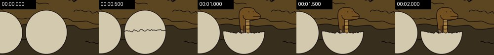

- Ground #392e1d; other main colours #5a4623 #d1c8b0 #2c2115 #714f21
Element crops (numbers match the motion list below; L = the continuously moving layer mid-shot and at the end, S = elements that never move), full-size files in `shots/`:

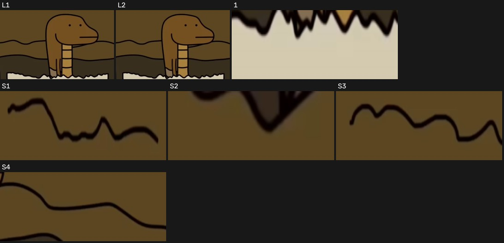

- S1. never moves: shape / text block · x 14%–50%, y 0%–9% · #1b0d03 · [crop](shots/shot_001_st_01.jpg)
- S2. never moves: shape / text block · x 69%–78%, y 0%–5% · #190b03 · [crop](shots/shot_001_st_02.jpg)
- S3. never moves: shape / text block · x 74%–100%, y 17%–26% · #1c0e02 · [crop](shots/shot_001_st_03.jpg)
- S4. never moves: shape / text block · x 64%–100%, y 32%–46% · #190c05 · [crop](shots/shot_001_st_04.jpg)
- [crop L1](shots/shot_001_ly_01.jpg) [crop L2](shots/shot_001_ly_02.jpg) · Continuous layer: 16% of the frame moves through the whole shot (x 24%–69%, y 12%–60%), e.g. drifting gradients, particle flow, breathing glow
1. 0.93–1.00s · middle (x 36%–58%, y 60%–64%) · appears, instant · #918979 · [crop](shots/shot_001_el_01.jpg)

Motion #2 2.3–5.5s · 2 events

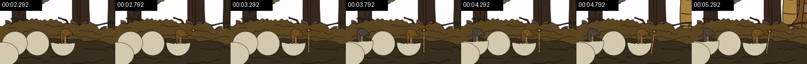

- Ground #362b1c; other main colours #574424 #d0c7af #fbfcfd #a17e3d
Element crops (numbers match the motion list below; L = the continuously moving layer mid-shot and at the end, S = elements that never move), full-size files in `shots/`:

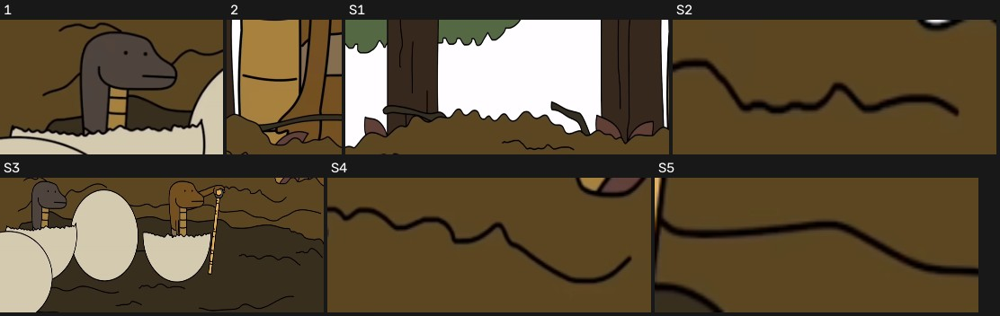

- S1. never moves: shape / text block · x 0%–78%, y 0%–42% · #fffdff · [crop](shots/shot_002_st_01.jpg)
- S2. never moves: shape / text block · x 42%–57%, y 38%–43% · #322312 · [crop](shots/shot_002_st_02.jpg)
- S3. never moves: shape / text block · x 0%–100%, y 45%–100% · #d3c9af · [crop](shots/shot_002_st_03.jpg)
- S4. never moves: shape / text block · x 71%–88%, y 46%–55% · #33230d · [crop](shots/shot_002_st_04.jpg)
- S5. never moves: shape / text block · x 69%–80%, y 56%–61% · #332413 · [crop](shots/shot_002_st_05.jpg)
1. 3.76–3.89s · middle left (x 2%–24%, y 44%–68%) · changes, instant · #4e4424 · [crop](shots/shot_002_el_01.jpg)
2. 4.96–5.16s · top right (x 78%–100%, y 0%–48%) · changes, ease-in-out · #7c683c · [crop](shots/shot_002_el_02.jpg)

Motion #3 5.5–9.6s · 3 events

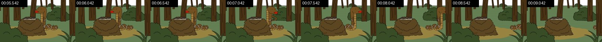

- Ground #384c29; other main colours #627d53 #453216 #594725 #382b14
Element crops (numbers match the motion list below; L = the continuously moving layer mid-shot and at the end, S = elements that never move), full-size files in `shots/`:

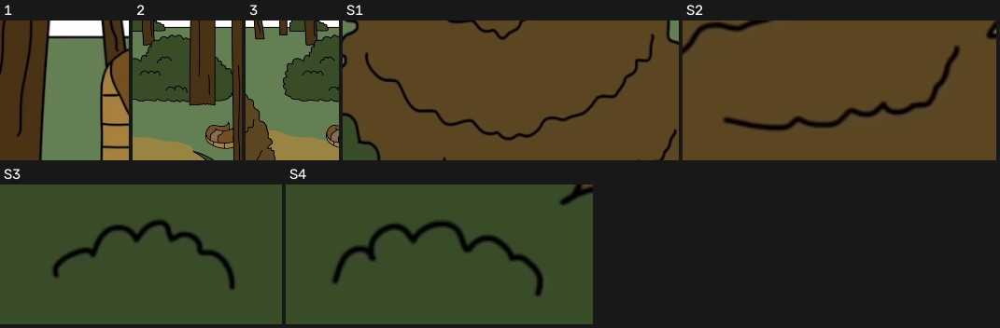

- S1. never moves: shape / text block · x 26%–55%, y 57%–76% · #33220b · [crop](shots/shot_003_st_01.jpg)
- S2. never moves: shape / text block · x 44%–57%, y 72%–81% · #332413 · [crop](shots/shot_003_st_02.jpg)
- S3. never moves: shape / text block · x 3%–14%, y 74%–83% · #1a2712 · [crop](shots/shot_003_st_03.jpg)
- S4. never moves: shape / text block · x 17%–28%, y 83%–91% · #1a290e · [crop](shots/shot_003_st_04.jpg)
- Continuous layer: 2% of the frame moves through the whole shot (x 56%–76%, y 20%–72%), e.g. drifting gradients, particle flow, breathing glow
1. 6.88–6.94s · top (x 44%–56%, y 12%–36%) · changes, instant · #637e52 · [crop](shots/shot_003_el_01.jpg)
2. 7.61–9.07s · middle right (x 67%–93%, y 12%–76%) · changes, moves downward, ease-in-out · #637e40 · [crop](shots/shot_003_el_02.jpg)
3. 7.61–8.41s · middle (x 53%–76%, y 12%–76%) · changes, moves downward, ease-out · #637f52 · [crop](shots/shot_003_el_03.jpg)

Motion #4 9.6–11.5s · 2 events

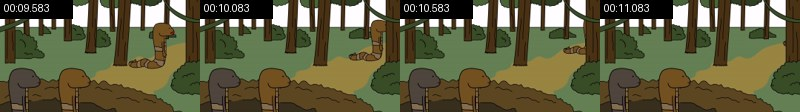

- Ground #3d2f18; other main colours #637e54 #5a4727 #374929 #958443
Element crops (numbers match the motion list below; L = the continuously moving layer mid-shot and at the end, S = elements that never move), full-size files in `shots/`:

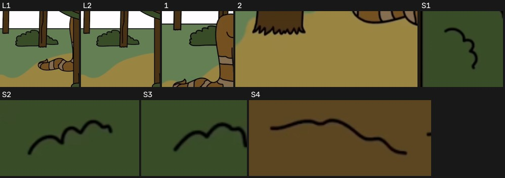

- S1. never moves: shape / text block · x 9%–14%, y 34%–44% · #19260e · [crop](shots/shot_004_st_01.jpg)
- S2. never moves: shape / text block · x 91%–98%, y 64%–71% · #1d2611 · [crop](shots/shot_004_st_02.jpg)
- S3. never moves: shape / text block · x 94%–100%, y 72%–78% · #1a2514 · [crop](shots/shot_004_st_03.jpg)
- S4. never moves: shape / text block · x 58%–71%, y 86%–93% · #342414 · [crop](shots/shot_004_st_04.jpg)
- [crop L1](shots/shot_004_ly_01.jpg) [crop L2](shots/shot_004_ly_02.jpg) · Continuous layer: 4% of the frame moves through the whole shot (x 71%–93%, y 16%–56%), e.g. drifting gradients, particle flow, breathing glow
1. 9.78–9.98s · middle right (x 69%–84%, y 20%–52%) · changes, ease-out · #637451 · [crop](shots/shot_004_el_01.jpg)
2. 9.78–9.98s · middle (x 56%–78%, y 56%–68%) · changes, ease-out · #978440 · [crop](shots/shot_004_el_02.jpg)

Motion #5 11.5–15.3s · 3 events

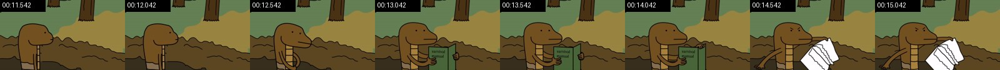

- Ground #617f54; other main colours #978341 #594623 #3f3119 #705122
Element crops (numbers match the motion list below; L = the continuously moving layer mid-shot and at the end, S = elements that never move), full-size files in `shots/`:

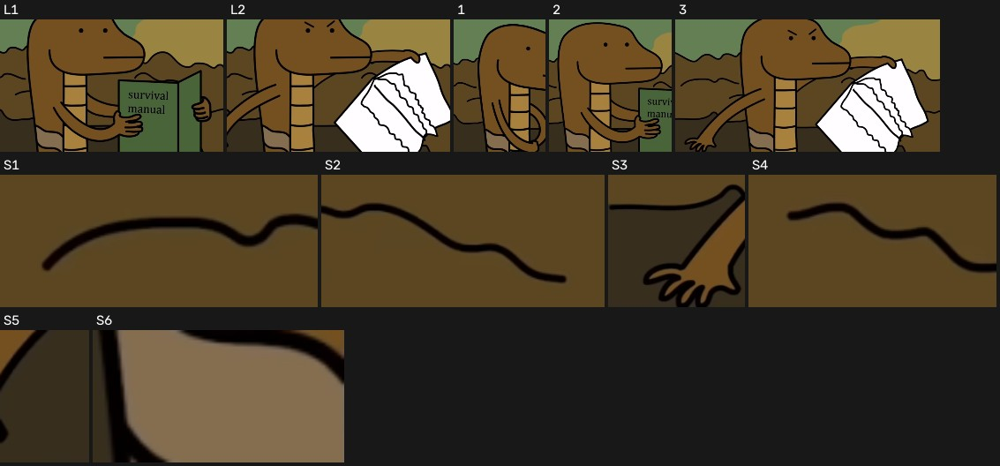

- S1. never moves: shape / text block · x 2%–13%, y 62%–69% · #1e140c · [crop](shots/shot_005_st_01.jpg)
- S2. never moves: shape / text block · x 73%–87%, y 78%–89% · #201205 · [crop](shots/shot_005_st_02.jpg)
- S3. never moves: shape / text block · x 0%–11%, y 80%–100% · #362d1c · [crop](shots/shot_005_st_03.jpg)
- S4. never moves: shape / text block · x 89%–100%, y 81%–90% · #1f1007 · [crop](shots/shot_005_st_04.jpg)
- S5. never moves: shape / text block · x 13%–16%, y 88%–100% · #362d1c · [crop](shots/shot_005_st_05.jpg)
- S6. never moves: shape / text block · x 22%–27%, y 92%–96% · #836d4e · [crop](shots/shot_005_st_06.jpg)
- [crop L1](shots/shot_005_ly_01.jpg) [crop L2](shots/shot_005_ly_02.jpg) · Continuous layer: 13% of the frame moves through the whole shot (x 13%–69%, y 40%–100%), e.g. drifting gradients, particle flow, breathing glow
1. 12.47–12.54s · middle left (x 13%–38%, y 32%–100%) · changes, instant · #5b4621 · [crop](shots/shot_005_el_01.jpg)
2. 13.01–13.07s · middle (x 18%–51%, y 32%–100%) · changes, instant · #484c1f · [crop](shots/shot_005_el_02.jpg)
3. 14.01–14.47s · bottom (x 2%–73%, y 36%–100%) · changes, moves downward, ease-in · #b8b6b8 · [crop](shots/shot_005_el_03.jpg)

Motion #6 15.3–16.0s · 1 events

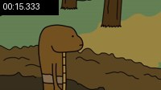

- Ground #627f52; other main colours #594623 #978343 #70501f #372c1b
Element crops (numbers match the motion list below; L = the continuously moving layer mid-shot and at the end, S = elements that never move), full-size files in `shots/`:

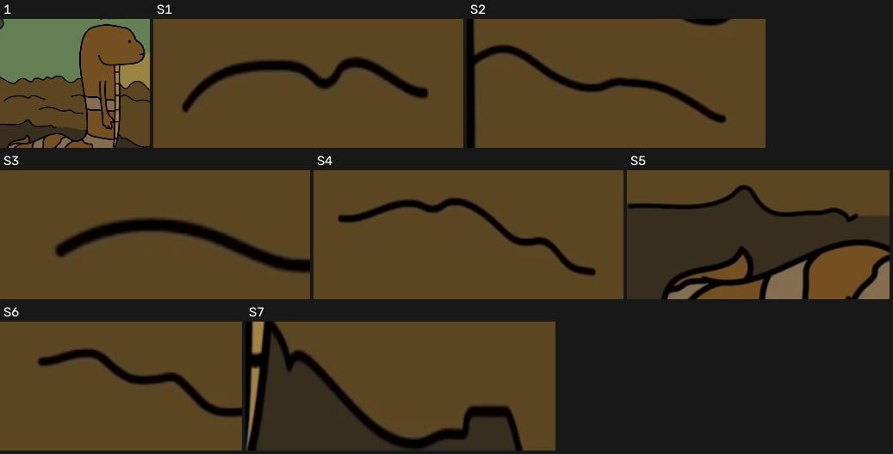

- S1. never moves: shape / text block · x 2%–20%, y 62%–69% · #22160a · [crop](shots/shot_006_st_01.jpg)
- S2. never moves: shape / text block · x 49%–63%, y 62%–72% · #211407 · [crop](shots/shot_006_st_02.jpg)
- S3. never moves: shape / text block · x 15%–24%, y 70%–75% · #22160b · [crop](shots/shot_006_st_03.jpg)
- S4. never moves: shape / text block · x 65%–87%, y 78%–89% · #1e1108 · [crop](shots/shot_006_st_04.jpg)
- S5. never moves: shape / text block · x 0%–24%, y 79%–100% · #362d1c · [crop](shots/shot_006_st_05.jpg)
- S6. never moves: shape / text block · x 89%–100%, y 81%–90% · #1f1108 · [crop](shots/shot_006_st_06.jpg)
- S7. never moves: shape / text block · x 47%–66%, y 92%–100% · #1e160d · [crop](shots/shot_006_st_07.jpg)
1. 15.73–15.80s · middle left (x 2%–58%, y 12%–100%) · changes, instant · #634f1f · [crop](shots/shot_006_el_01.jpg)

Motion #7 16.0–16.7s · 1 events

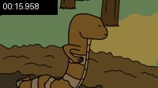

- Ground #617f54; other main colours #594623 #978343 #6f5021 #362b19
Element crops (numbers match the motion list below; L = the continuously moving layer mid-shot and at the end, S = elements that never move), full-size files in `shots/`:

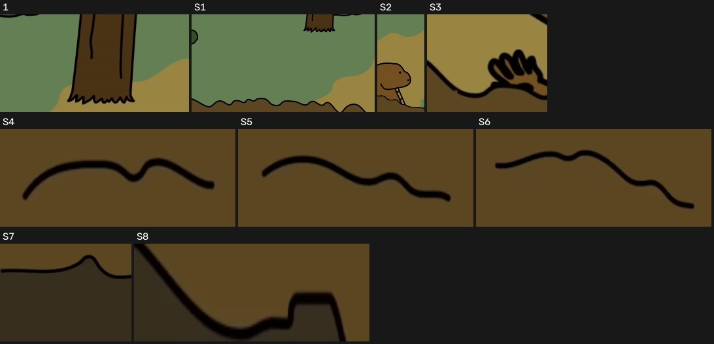

- S1. never moves: shape / text block · x 0%–60%, y 0%–57% · #637f53 · [crop](shots/shot_007_st_01.jpg)
- S2. never moves: shape / text block · x 80%–100%, y 0%–78% · #978440 · [crop](shots/shot_007_st_02.jpg)
- S3. never moves: shape / text block · x 58%–67%, y 48%–62% · #978440 · [crop](shots/shot_007_st_03.jpg)
- S4. never moves: shape / text block · x 2%–19%, y 62%–69% · #1e1409 · [crop](shots/shot_007_st_04.jpg)
- S5. never moves: shape / text block · x 15%–34%, y 70%–78% · #211607 · [crop](shots/shot_007_st_05.jpg)
- S6. never moves: shape / text block · x 65%–87%, y 78%–89% · #1b1007 · [crop](shots/shot_007_st_06.jpg)
- S7. never moves: shape / text block · x 0%–16%, y 79%–100% · #362d1c · [crop](shots/shot_007_st_07.jpg)
- S8. never moves: shape / text block · x 51%–66%, y 95%–100% · #191207 · [crop](shots/shot_007_st_08.jpg)
1. 16.36–16.49s · top right (x 51%–84%, y 0%–32%) · changes, instant · #637f52 · [crop](shots/shot_007_el_01.jpg)

Motion #8 16.7–19.9s · 3 events

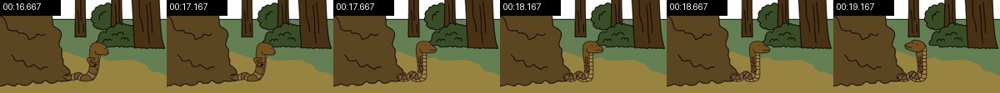

- Ground #978343; other main colours #5a4623 #3e2e16 #617f54 #374a29
Element crops (numbers match the motion list below; L = the continuously moving layer mid-shot and at the end, S = elements that never move), full-size files in `shots/`:

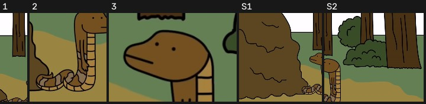

- S1. never moves: shape / text block · x 0%–49%, y 0%–94% · #5b4621 · [crop](shots/shot_008_st_01.jpg)
- S2. never moves: shape / text block · x 49%–100%, y 0%–82% · #374c25 · [crop](shots/shot_008_st_02.jpg)
- Continuous layer: 2% of the frame moves through the whole shot (x 47%–62%, y 44%–88%), e.g. drifting gradients, particle flow, breathing glow
1. 16.87–16.93s · middle (x 40%–51%, y 0%–80%) · changes, instant · #483215 · [crop](shots/shot_008_el_01.jpg)
2. 17.47–17.53s · bottom (x 38%–58%, y 48%–92%) · changes, instant · #6a4f25 · [crop](shots/shot_008_el_02.jpg)
3. 18.93–19.00s · middle (x 42%–58%, y 40%–60%) · changes, instant · #634f1f · [crop](shots/shot_008_el_03.jpg)

Motion #9 19.9–24.0s · 4 events

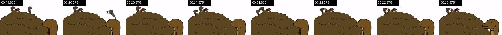

- Ground #fefcff; other main colours #5a4623 #725020 #49381f #866f53
Element crops (numbers match the motion list below; L = the continuously moving layer mid-shot and at the end, S = elements that never move), full-size files in `shots/`:

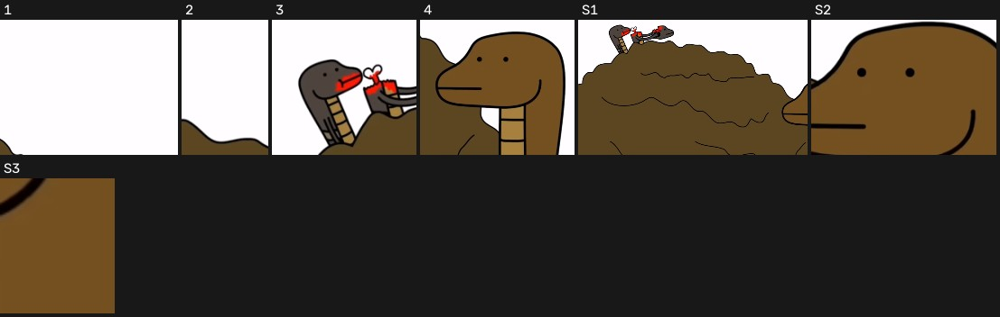

- S1. never moves: shape / text block · x 0%–76%, y 21%–100% · #5b4621 · [crop](shots/shot_009_st_01.jpg)
- S2. never moves: shape / text block · x 73%–91%, y 56%–80% · #734f1f · [crop](shots/shot_009_st_02.jpg)
- S3. never moves: shape / text block · x 89%–91%, y 80%–88% · #724f1f · [crop](shots/shot_009_st_03.jpg)
1. 20.41–20.74s · top right (x 56%–84%, y 4%–44%) · changes, moves downward, ease-out · #fffdff · [crop](shots/shot_009_el_01.jpg)
2. 20.41–20.48s · top (x 42%–49%, y 16%–40%) · changes, instant · #fffdff · [crop](shots/shot_009_el_02.jpg)
3. 22.14–22.34s · top left (x 9%–22%, y 16%–40%) · changes, ease-in-out · #b59186 · [crop](shots/shot_009_el_03.jpg)
4. 23.48–23.54s · bottom right (x 67%–96%, y 52%–100%) · changes, instant · #724f20 · [crop](shots/shot_009_el_04.jpg)

Motion #10 24.0–24.8s · 0 events

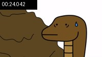

- Ground #fefcff; other main colours #5a4623 #725020 #3f2f1c #23190f
- No element motion measured (still picture or only slight changes)

Motion #11 24.8–25.2s · 3 events

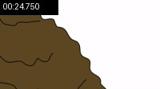

- Ground #fefcff; other main colours #594623 #4c3c21 #3a2b17
Element crops (numbers match the motion list below; L = the continuously moving layer mid-shot and at the end, S = elements that never move), full-size files in `shots/`:

1. 24.88–24.95s · middle right (x 69%–96%, y 48%–52%) · disappears, instant · #797779 · [crop](shots/shot_011_el_01.jpg)
2. 24.88–24.95s · middle right (x 67%–82%, y 64%–68%) · disappears, instant · #4e4c4e · [crop](shots/shot_011_el_02.jpg)
3. 24.88–24.95s · bottom right (x 64%–89%, y 80%–84%) · disappears, instant · #bdbbbd · [crop](shots/shot_011_el_03.jpg)

Motion #12 25.2–27.8s · 2 events

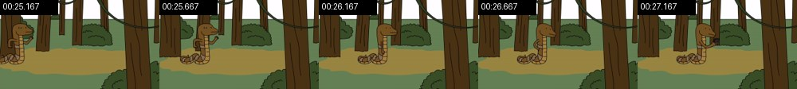

- Ground #637e54; other main colours #473114 #948342 #384a28 #362914
Element crops (numbers match the motion list below; L = the continuously moving layer mid-shot and at the end, S = elements that never move), full-size files in `shots/`:

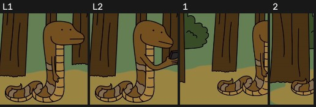

- [crop L1](shots/shot_012_ly_01.jpg) [crop L2](shots/shot_012_ly_02.jpg) · Continuous layer: 6% of the frame moves through the whole shot (x 24%–49%, y 24%–72%), e.g. drifting gradients, particle flow, breathing glow
1. 25.37–26.37s · middle left (x 13%–40%, y 24%–76%) · changes, moves rightward, ease-in-out · #694f22 · [crop](shots/shot_012_el_01.jpg)
2. 25.37–25.70s · middle left (x 0%–13%, y 24%–76%) · changes, moves downward, ease-in-out · #483213 · [crop](shots/shot_012_el_02.jpg)

Motion #13 27.8–29.5s · 0 events

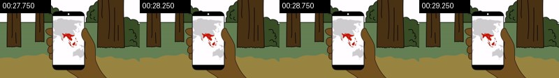

- Ground #978343; other main colours #412f14 #fdfbfe #637e55 #3c4c2c
- No element motion measured (still picture or only slight changes)

Motion #14 29.5–32.8s · 1 events

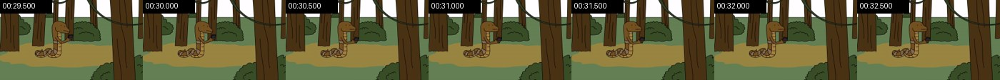

- Ground #637e54; other main colours #473114 #968242 #384a28 #352a14
Element crops (numbers match the motion list below; L = the continuously moving layer mid-shot and at the end, S = elements that never move), full-size files in `shots/`:

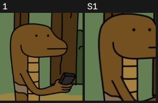

- S1. never moves: shape / text block · x 36%–44%, y 28%–51% · #724f1f · [crop](shots/shot_014_st_01.jpg)
1. 30.37–30.43s · middle (x 36%–51%, y 24%–56%) · changes, instant · #4b371d · [crop](shots/shot_014_el_01.jpg)

Motion #15 32.8–34.2s · 2 events

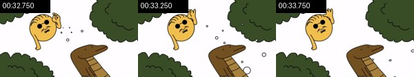

- Ground #374c28; other main colours #fcfdff #6d5126 #e9b94e #a48342
Element crops (numbers match the motion list below; L = the continuously moving layer mid-shot and at the end, S = elements that never move), full-size files in `shots/`:

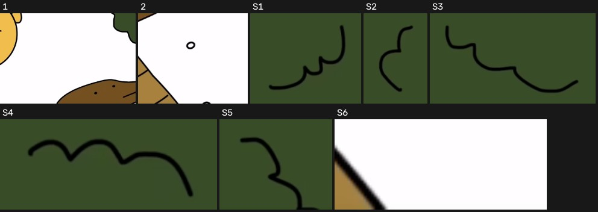

- S1. never moves: shape / text block · x 4%–13%, y 2%–17% · #0d1905 · [crop](shots/shot_015_st_01.jpg)
- S2. never moves: shape / text block · x 76%–81%, y 3%–20% · #101b06 · [crop](shots/shot_015_st_02.jpg)
- S3. never moves: shape / text block · x 81%–97%, y 24%–40% · #0f1907 · [crop](shots/shot_015_st_03.jpg)
- S4. never moves: shape / text block · x 5%–18%, y 84%–93% · #0d1905 · [crop](shots/shot_015_st_04.jpg)
- S5. never moves: shape / text block · x 22%–28%, y 88%–100% · #0e1909 · [crop](shots/shot_015_st_05.jpg)
- S6. never moves: shape / text block · x 80%–84%, y 96%–100% · #fdfdfd · [crop](shots/shot_015_st_06.jpg)
- Continuous layer: 2% of the frame moves through the whole shot (x 33%–44%, y 12%–40%), e.g. drifting gradients, particle flow, breathing glow
1. 32.95–33.62s · middle (x 38%–71%, y 28%–68%) · changes, moves rightward, ease-in-out · #fffdff · [crop](shots/shot_015_el_01.jpg)
2. 33.35–33.62s · bottom right (x 73%–93%, y 68%–100%) · changes, ease-in-out · #8d8b8d · [crop](shots/shot_015_el_02.jpg)

Motion #16 34.2–38.2s · 2 events

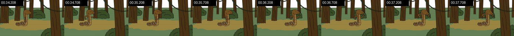

- Ground #637e54; other main colours #483215 #968242 #362914 #394929
Element crops (numbers match the motion list below; L = the continuously moving layer mid-shot and at the end, S = elements that never move), full-size files in `shots/`:

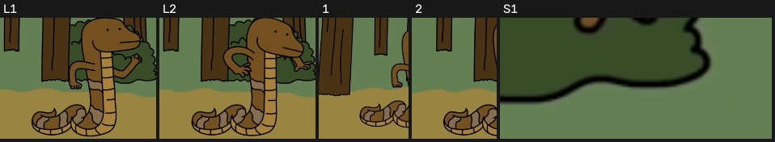

- S1. never moves: shape / text block · x 64%–72%, y 48%–53% · #24301a · [crop](shots/shot_016_st_01.jpg)
- [crop L1](shots/shot_016_ly_01.jpg) [crop L2](shots/shot_016_ly_02.jpg) · Continuous layer: 6% of the frame moves through the whole shot (x 38%–69%, y 28%–72%), e.g. drifting gradients, particle flow, breathing glow
1. 35.21–35.54s · middle (x 24%–44%, y 24%–76%) · changes, unfolds rightward (draw-on / grow / wipe), instant · #637f41 · [crop](shots/shot_016_el_01.jpg)
2. 35.81–35.88s · middle (x 33%–49%, y 28%–72%) · changes, instant · #636b40 · [crop](shots/shot_016_el_02.jpg)

Motion #17 38.2–43.0s · 2 events

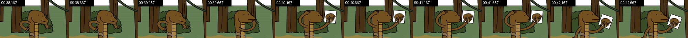

- Ground #453216; other main colours #617f54 #6f5021 #3a4b2d #262114
Element crops (numbers match the motion list below; L = the continuously moving layer mid-shot and at the end, S = elements that never move), full-size files in `shots/`:

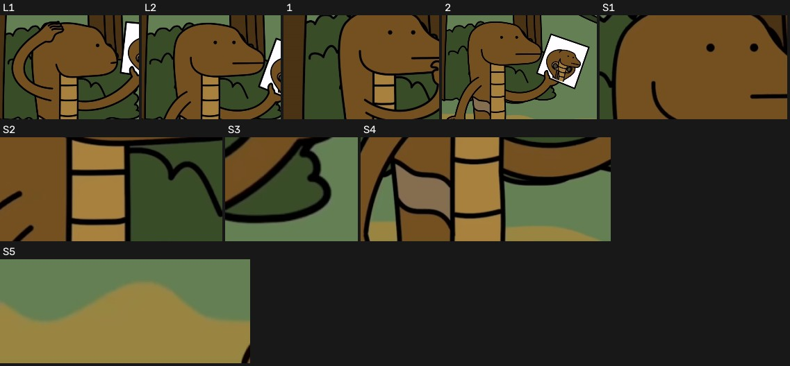

- S1. never moves: shape / text block · x 40%–64%, y 32%–56% · #724f1f · [crop](shots/shot_017_st_01.jpg)
- S2. never moves: shape / text block · x 44%–64%, y 60%–76% · #a6803c · [crop](shots/shot_017_st_02.jpg)
- S3. never moves: shape / text block · x 71%–78%, y 76%–87% · #0a1104 · [crop](shots/shot_017_st_03.jpg)
- S4. never moves: shape / text block · x 40%–68%, y 80%–100% · #a57f3b · [crop](shots/shot_017_st_04.jpg)
- S5. never moves: shape / text block · x 0%–31%, y 92%–100% · #978440 · [crop](shots/shot_017_st_05.jpg)
- [crop L1](shots/shot_017_ly_01.jpg) [crop L2](shots/shot_017_ly_02.jpg) · Continuous layer: 6% of the frame moves through the whole shot (x 31%–76%, y 24%–84%), e.g. drifting gradients, particle flow, breathing glow
1. 39.50–39.57s · middle (x 27%–67%, y 32%–80%) · changes, instant · #374c21 · [crop](shots/shot_017_el_01.jpg)
2. 42.37–42.43s · middle (x 31%–93%, y 24%–100%) · changes, instant · #624f25 · [crop](shots/shot_017_el_02.jpg)

Motion #18 43.0–49.2s · 6 events

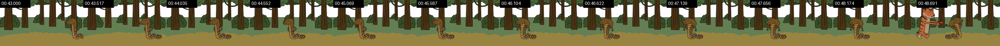

- Ground #978343; other main colours #402e15 #657e55 #fafbfc #5e5934
Element crops (numbers match the motion list below; L = the continuously moving layer mid-shot and at the end, S = elements that never move), full-size files in `shots/`:

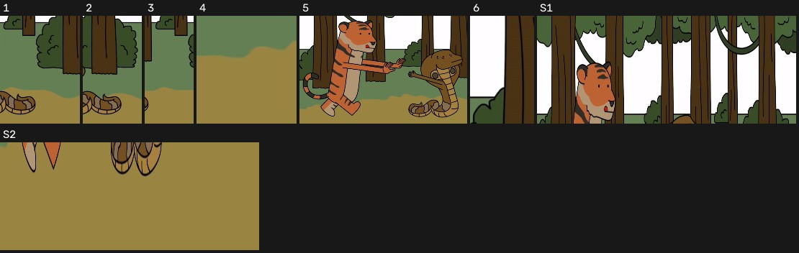

- S1. never moves: shape / text block · x 0%–100%, y 0%–40% · #fffdff · [crop](shots/shot_018_st_01.jpg)
- S2. never moves: horizontal line · x 0%–100%, y 80%–100% · #978440 · [crop](shots/shot_018_st_02.jpg)
1. 43.20–44.27s · middle right (x 69%–89%, y 36%–88%) · changes, moves leftward, ease-in-out · #57441f · [crop](shots/shot_018_el_01.jpg)
2. 43.20–43.60s · middle right (x 84%–100%, y 36%–88%) · changes, moves downward, ease-out · #564c2a · [crop](shots/shot_018_el_02.jpg)
3. 43.87–44.67s · middle right (x 67%–78%, y 36%–88%) · changes, moves downward, ease-out · #637f53 · [crop](shots/shot_018_el_03.jpg)
4. 45.07–49.07s · bottom (x 29%–40%, y 64%–88%) · changes, moves downward, ease-in-out · #978440 · [crop](shots/shot_018_el_04.jpg)
5. 48.47–49.07s · middle left (x 0%–64%, y 16%–88%) · changes, moves rightward, ease-in · #796131 · [crop](shots/shot_018_el_05.jpg)
6. 48.47–49.07s · top left (x 0%–9%, y 16%–44%) · changes, moves rightward, ease-in-out · #607452 · [crop](shots/shot_018_el_06.jpg)

Motion #19 49.2–52.3s · 5 events

- Ground #968242; other main colours #637e55 #fafbfc #483518 #5d5b34
Element crops (numbers match the motion list below; L = the continuously moving layer mid-shot and at the end, S = elements that never move), full-size files in `shots/`:

- S1. never moves: shape / text block · x 0%–100%, y 72%–100% · #978440 · [crop](shots/shot_019_st_01.jpg)
- [crop L1](shots/shot_019_ly_01.jpg) [crop L2](shots/shot_019_ly_02.jpg) · Continuous layer: 4% of the frame moves through the whole shot (x 31%–53%, y 32%–76%), e.g. drifting gradients, particle flow, breathing glow
- In sequence: 3 same-size elements, 0.80s apart, about 0.06s each (items 1, 3, 5 below)
1. 49.48–49.54s · middle right (x 73%–98%, y 32%–92%) · changes, instant · #637e4d · [crop](shots/shot_019_el_01.jpg)
2. 49.81–50.14s · middle (x 44%–89%, y 32%–92%) · changes, unfolds leftward (draw-on / grow / wipe), instant · #644f29 · [crop](shots/shot_019_el_02.jpg)
3. 50.41–50.48s · middle (x 38%–76%, y 36%–92%) · changes, instant · #655232 · [crop](shots/shot_019_el_03.jpg)
4. 50.41–50.48s · bottom left (x 9%–22%, y 68%–88%) · changes, instant · #696d4c · [crop](shots/shot_019_el_04.jpg)
5. 51.08–51.14s · middle (x 36%–56%, y 28%–72%) · changes, instant · #5b461f · [crop](shots/shot_019_el_05.jpg)

Motion #20 52.3–56.8s · 1 events

- Ground #617f54; other main colours #473114 #968242 #372913 #394929
Element crops (numbers match the motion list below; L = the continuously moving layer mid-shot and at the end, S = elements that never move), full-size files in `shots/`:

- S1. never moves: shape / text block · x 56%–60%, y 28%–36% · #734f1f · [crop](shots/shot_020_st_01.jpg)
- S2. never moves: shape / text block · x 67%–72%, y 37%–52% · #25351c · [crop](shots/shot_020_st_02.jpg)
1. 56.36–56.42s · middle (x 49%–69%, y 24%–44%) · changes, instant · #414c1f · [crop](shots/shot_020_el_01.jpg)

Motion #21 56.8–58.6s · 2 events

- Ground #463116; other main colours #607e53 #352813 #374528 #52513b
Element crops (numbers match the motion list below; L = the continuously moving layer mid-shot and at the end, S = elements that never move), full-size files in `shots/`:

- S1. never moves: shape / text block · x 7%–8%, y 0%–24% · #2c1a04 · [crop](shots/shot_021_st_01.jpg)
- S2. never moves: shape / text block · x 6%–8%, y 28%–41% · #2c1a04 · [crop](shots/shot_021_st_02.jpg)
- S3. never moves: shape / text block · x 71%–73%, y 39%–52% · #2d1a03 · [crop](shots/shot_021_st_03.jpg)
- S4. never moves: shape / text block · x 5%–7%, y 47%–57% · #2c1902 · [crop](shots/shot_021_st_04.jpg)
- S5. never moves: shape / text block · x 83%–98%, y 73%–82% · #2b1a0c · [crop](shots/shot_021_st_05.jpg)
- S6. never moves: shape / text block · x 56%–60%, y 76%–80% · #4e4a3a · [crop](shots/shot_021_st_06.jpg)
- S7. never moves: shape / text block · x 66%–78%, y 88%–95% · #2a190a · [crop](shots/shot_021_st_07.jpg)
- S8. never moves: shape / text block · x 48%–65%, y 93%–100% · #2b190c · [crop](shots/shot_021_st_08.jpg)
- [crop L1](shots/shot_021_ly_01.jpg) [crop L2](shots/shot_021_ly_02.jpg) · Continuous layer: 9% of the frame moves through the whole shot (x 16%–91%, y 60%–92%), e.g. drifting gradients, particle flow, breathing glow
1. 57.10–57.17s · bottom (x 62%–69%, y 72%–76%) · disappears, instant · #637f53 · [crop](shots/shot_021_el_01.jpg)
2. 57.10–57.17s · bottom left (x 7%–58%, y 88%–96%) · changes, instant · #483213 · [crop](shots/shot_021_el_02.jpg)

Motion #22 58.6–61.4s · 0 events

- Ground #617f54; other main colours #473114 #392813 #414629 #6d5024
Element crops (numbers match the motion list below; L = the continuously moving layer mid-shot and at the end, S = elements that never move), full-size files in `shots/`:

- [crop L1](shots/shot_022_ly_01.jpg) [crop L2](shots/shot_022_ly_02.jpg) · Continuous layer: 12% of the frame moves through the whole shot (x 0%–33%, y 28%–88%), e.g. drifting gradients, particle flow, breathing glow

Motion #23 61.4–62.4s · 0 events

- Ground #617f54; other main colours #483215 #414d2e #392813 #6c5026
Element crops (numbers match the motion list below; L = the continuously moving layer mid-shot and at the end, S = elements that never move), full-size files in `shots/`:

- S1. never moves: shape / text block · x 0%–100%, y 0%–52% · #483213 · [crop](shots/shot_023_st_01.jpg)
- S2. never moves: shape / text block · x 37%–68%, y 52%–85% · #483213 · [crop](shots/shot_023_st_02.jpg)
- S3. never moves: shape / text block · x 0%–14%, y 66%–85% · #978440 · [crop](shots/shot_023_st_03.jpg)

Motion #24 62.4–64.5s · 1 events

- Ground #617f54; other main colours #714f1f #4c4736 #080705 #312618
Element crops (numbers match the motion list below; L = the continuously moving layer mid-shot and at the end, S = elements that never move), full-size files in `shots/`:

- S1. never moves: shape / text block · x 0%–84%, y 0%–62% · #724f1f · [crop](shots/shot_024_st_01.jpg)
- S2. never moves: shape / text block · x 71%–100%, y 0%–44% · #637f53 · [crop](shots/shot_024_st_02.jpg)
- S3. never moves: shape / text block · x 88%–92%, y 38%–46% · #070401 · [crop](shots/shot_024_st_03.jpg)
- S4. never moves: shape / text block · x 95%–100%, y 49%–56% · #000000 · [crop](shots/shot_024_st_04.jpg)
- S5. never moves: shape / text block · x 0%–100%, y 52%–100% · #637f3c · [crop](shots/shot_024_st_05.jpg)
- Continuous layer: 2% of the frame moves through the whole shot (x 53%–80%, y 40%–84%), e.g. drifting gradients, particle flow, breathing glow
1. 62.84–62.91s · top (x 29%–89%, y 0%–56%) · changes, instant · #5d2715 · [crop](shots/shot_024_el_01.jpg)

Motion #25 64.5–67.1s · 1 events

- Ground #617f54; other main colours #483215 #fefcff #3a2813 #6c4d24
Element crops (numbers match the motion list below; L = the continuously moving layer mid-shot and at the end, S = elements that never move), full-size files in `shots/`:

- S1. never moves: shape / text block · x 0%–5%, y 15%–45% · #364725 · [crop](shots/shot_025_st_01.jpg)
1. 65.12–65.19s · middle (x 56%–71%, y 52%–72%) · changes, instant · #5c4520 · [crop](shots/shot_025_el_01.jpg)

Motion #26 67.1–67.8s · 2 events

- Ground #fefcff; other main colours #463116 #657f53 #6e4f20 #6c7064
Element crops (numbers match the motion list below; L = the continuously moving layer mid-shot and at the end, S = elements that never move), full-size files in `shots/`:

- S1. never moves: shape / text block · x 43%–73%, y 12%–56% · #724f1f · [crop](shots/shot_026_st_01.jpg)
- S2. never moves: shape / text block · x 69%–84%, y 24%–60% · #17100a · [crop](shots/shot_026_st_02.jpg)
- S3. never moves: shape / text block · x 0%–40%, y 64%–100% · #637f53 · [crop](shots/shot_026_st_03.jpg)
- S4. never moves: shape / text block · x 53%–67%, y 64%–72% · #a6803c · [crop](shots/shot_026_st_04.jpg)
- S5. never moves: shape / text block · x 87%–100%, y 64%–72% · #4e4f4d · [crop](shots/shot_026_st_05.jpg)
- S6. never moves: shape / text block · x 42%–47%, y 68%–80% · #627e52 · [crop](shots/shot_026_st_06.jpg)
1. 67.42–67.62s · bottom right (x 36%–100%, y 48%–100%) · changes, ease-in · #483213 · [crop](shots/shot_026_el_01.jpg)
2. 67.42–67.62s · middle (x 56%–78%, y 52%–64%) · changes, ease-in-out · #80793c · [crop](shots/shot_026_el_02.jpg)

Motion #27 67.8–70.2s · 2 events

- Ground #fefcff; other main colours #473114 #637b59 #704e20 #474c38
Element crops (numbers match the motion list below; L = the continuously moving layer mid-shot and at the end, S = elements that never move), full-size files in `shots/`:

- S1. never moves: shape / text block · x 43%–71%, y 16%–72% · #724f1f · [crop](shots/shot_027_st_01.jpg)
- S2. never moves: shape / text block · x 0%–100%, y 56%–100% · #483213 · [crop](shots/shot_027_st_02.jpg)
1. 68.17–68.23s · bottom (x 51%–80%, y 52%–88%) · changes, instant · #624d1f · [crop](shots/shot_027_el_01.jpg)
2. 68.43–68.50s · middle (x 22%–78%, y 12%–88%) · changes, instant · #727f54 · [crop](shots/shot_027_el_02.jpg)

Motion #28 70.2–76.4s · 3 events

- Ground #483215; other main colours #714f21 #526642 #fdfbfe #302414
Element crops (numbers match the motion list below; L = the continuously moving layer mid-shot and at the end, S = elements that never move), full-size files in `shots/`:

- S1. never moves: shape / text block · x 0%–21%, y 0%–52% · #546942 · [crop](shots/shot_028_st_01.jpg)
- S2. never moves: shape / text block · x 49%–100%, y 0%–18% · #546942 · [crop](shots/shot_028_st_02.jpg)
- S3. never moves: shape / text block · x 16%–31%, y 40%–76% · #734f1f · [crop](shots/shot_028_st_03.jpg)
- S4. never moves: shape / text block · x 49%–73%, y 48%–72% · #fffdff · [crop](shots/shot_028_st_04.jpg)
- S5. never moves: shape / text block · x 56%–64%, y 76%–88% · #fffdff · [crop](shots/shot_028_st_05.jpg)
- S6. never moves: shape / text block · x 3%–13%, y 80%–86% · #1e140b · [crop](shots/shot_028_st_06.jpg)
- S7. never moves: shape / text block · x 18%–24%, y 80%–96% · #734f1f · [crop](shots/shot_028_st_07.jpg)
- S8. never moves: shape / text block · x 0%–13%, y 83%–100% · #536942 · [crop](shots/shot_028_st_08.jpg)
1. 71.14–75.21s · bottom (x 0%–82%, y 36%–100%) · changes, unfolds leftward (draw-on / grow / wipe), ease-out · #483213 · [crop](shots/shot_028_el_01.jpg)
2. 73.14–73.21s · bottom left (x 16%–47%, y 40%–100%) · changes, instant · #50391e · [crop](shots/shot_028_el_02.jpg)
3. 73.14–75.14s · bottom (x 53%–67%, y 80%–96%) · changes, ease-in-out · #483213 · [crop](shots/shot_028_el_03.jpg)

Motion #29 76.4–77.8s · 0 events

- Ground #958443; other main colours #637e54 #3e2c13 #fbfcfd #364427
Element crops (numbers match the motion list below; L = the continuously moving layer mid-shot and at the end, S = elements that never move), full-size files in `shots/`:

- [crop L1](shots/shot_029_ly_01.jpg) [crop L2](shots/shot_029_ly_02.jpg) · Continuous layer: 4% of the frame moves through the whole shot (x 42%–62%, y 20%–52%), e.g. drifting gradients, particle flow, breathing glow

Motion #30 77.8–80.6s · 2 events

- Ground #617f54; other main colours #fcfdff #6f5021 #46351a #435734
Element crops (numbers match the motion list below; L = the continuously moving layer mid-shot and at the end, S = elements that never move), full-size files in `shots/`:

- S1. never moves: shape / text block · x 51%–57%, y 84%–100% · #a6803c · [crop](shots/shot_030_st_01.jpg)
- [crop L1](shots/shot_030_ly_01.jpg) [crop L2](shots/shot_030_ly_02.jpg) · Continuous layer: 4% of the frame moves through the whole shot (x 31%–51%, y 20%–84%), e.g. drifting gradients, particle flow, breathing glow
1. 78.62–78.68s · middle (x 29%–67%, y 28%–100%) · changes, instant · #6d4f1f · [crop](shots/shot_030_el_01.jpg)
2. 80.02–80.08s · middle (x 22%–62%, y 28%–84%) · changes, instant · #724f1f · [crop](shots/shot_030_el_02.jpg)

Motion #31 80.6–82.0s · 3 events

- Ground #617f54; other main colours #5d6c57 #3d2f17 #fcfdff #424c34
Element crops (numbers match the motion list below; L = the continuously moving layer mid-shot and at the end, S = elements that never move), full-size files in `shots/`:

- S1. never moves: shape / text block · x 51%–53%, y 52%–60% · #3a492c · [crop](shots/shot_031_st_01.jpg)
- [crop L1](shots/shot_031_ly_01.jpg) [crop L2](shots/shot_031_ly_02.jpg) · Continuous layer: 26% of the frame moves through the whole shot (x 44%–100%, y 24%–100%), e.g. drifting gradients, particle flow, breathing glow
1. 80.83–81.49s · top right (x 76%–100%, y 24%–40%) · changes, moves leftward, ease-in-out · #484b26 · [crop](shots/shot_031_el_01.jpg)
2. 80.83–81.22s · middle right (x 69%–78%, y 44%–52%) · disappears, ease-in-out · #374a25 · [crop](shots/shot_031_el_02.jpg)
3. 80.83–81.49s · bottom right (x 84%–93%, y 76%–100%) · changes, ease-in-out · #364231 · [crop](shots/shot_031_el_03.jpg)

Motion #32 82.0–88.4s · 2 events

- Ground #978343; other main colours #617f54 #473114 #364a28 #362812
Element crops (numbers match the motion list below; L = the continuously moving layer mid-shot and at the end, S = elements that never move), full-size files in `shots/`:

- S1. never moves: shape / text block · x 94%–100%, y 93%–100% · #627e51 · [crop](shots/shot_032_st_01.jpg)
1. 83.91–83.98s · middle (x 36%–58%, y 32%–80%) · changes, instant · #6b512b · [crop](shots/shot_032_el_01.jpg)
2. 87.78–87.84s · top right (x 73%–91%, y 16%–40%) · changes, instant · #6f4f1f · [crop](shots/shot_032_el_02.jpg)

Motion #33 88.4–89.8s · 0 events

- Ground #412f14; other main colours #fcfdff #637e54 #384b2a #4c633e
Element crops (numbers match the motion list below; L = the continuously moving layer mid-shot and at the end, S = elements that never move), full-size files in `shots/`:

- S1. never moves: shape / text block · x 14%–19%, y 5%–16% · #24381a · [crop](shots/shot_033_st_01.jpg)
- [crop L1](shots/shot_033_ly_01.jpg) [crop L2](shots/shot_033_ly_02.jpg) · Continuous layer: 3% of the frame moves through the whole shot (x 24%–44%, y 48%–72%), e.g. drifting gradients, particle flow, breathing glow

Motion #34 89.8–93.6s · 1 events

- Ground #453216; other main colours #fcfdff #627d54 #3a512e #6f5021
Element crops (numbers match the motion list below; L = the continuously moving layer mid-shot and at the end, S = elements that never move), full-size files in `shots/`:

- S1. never moves: shape / text block · x 85%–93%, y 74%–80% · #1a290d · [crop](shots/shot_034_st_01.jpg)
- S2. never moves: shape / text block · x 7%–16%, y 81%–87% · #17210f · [crop](shots/shot_034_st_02.jpg)
- S3. never moves: shape / text block · x 51%–59%, y 84%–100% · #a6803c · [crop](shots/shot_034_st_03.jpg)
- S4. never moves: shape / text block · x 4%–15%, y 91%–99% · #1b2612 · [crop](shots/shot_034_st_04.jpg)
1. 91.70–91.77s · middle (x 44%–89%, y 28%–100%) · changes, instant · #514a1f · [crop](shots/shot_034_el_01.jpg)

Motion #35 93.6–96.2s · 3 events

- Ground #617f54; other main colours #9d8952 #384c29 #443115 #576542
Element crops (numbers match the motion list below; L = the continuously moving layer mid-shot and at the end, S = elements that never move), full-size files in `shots/`:

- S1. never moves: shape / text block · x 8%–32%, y 0%–39% · #443113 · [crop](shots/shot_035_st_01.jpg)
- S2. never moves: shape / text block · x 22%–27%, y 0%–14% · #2f1e07 · [crop](shots/shot_035_st_02.jpg)
- S3. never moves: shape / text block · x 42%–49%, y 0%–28% · #332b0f · [crop](shots/shot_035_st_03.jpg)
- S4. never moves: shape / text block · x 74%–80%, y 0%–29% · #2e1e06 · [crop](shots/shot_035_st_04.jpg)
- S5. never moves: shape / text block · x 88%–100%, y 0%–65% · #463213 · [crop](shots/shot_035_st_05.jpg)
- S6. never moves: shape / text block · x 57%–73%, y 2%–20% · #303f23 · [crop](shots/shot_035_st_06.jpg)
- S7. never moves: shape / text block · x 0%–100%, y 45%–100% · #9f8b53 · [crop](shots/shot_035_st_07.jpg)
- [crop L1](shots/shot_035_ly_01.jpg) [crop L2](shots/shot_035_ly_02.jpg) · Continuous layer: 3% of the frame moves through the whole shot (x 36%–58%, y 28%–64%), e.g. drifting gradients, particle flow, breathing glow
1. 93.78–93.98s · middle right (x 67%–87%, y 16%–52%) · changes, ease-out · #637f53 · [crop](shots/shot_035_el_01.jpg)
2. 93.78–94.65s · middle (x 38%–69%, y 20%–60%) · changes, moves leftward, ease-in-out · #664f25 · [crop](shots/shot_035_el_02.jpg)
3. 95.18–95.92s · bottom left (x 7%–40%, y 60%–84%) · changes, moves leftward, ease-out · #8a7444 · [crop](shots/shot_035_el_03.jpg)

Motion #36 96.2–100.5s · 1 events

- Ground #9d8952; other main colours #fefcff #8f7a49 #705124 #d6d3d2
Element crops (numbers match the motion list below; L = the continuously moving layer mid-shot and at the end, S = elements that never move), full-size files in `shots/`:

- S1. never moves: shape / text block · x 0%–100%, y 0%–37% · #fffdff · [crop](shots/shot_036_st_01.jpg)
- [crop L1](shots/shot_036_ly_01.jpg) [crop L2](shots/shot_036_ly_02.jpg) · Continuous layer: 4% of the frame moves through the whole shot (x 36%–80%, y 40%–60%), e.g. drifting gradients, particle flow, breathing glow
1. 99.47–99.54s · middle (x 22%–64%, y 20%–96%) · changes, unfolds downward (draw-on / grow / wipe), instant · #735a3b · [crop](shots/shot_036_el_01.jpg)

Motion #37 100.5–103.4s · 2 events

- Ground #9e8a51; other main colours #a08953
Element crops (numbers match the motion list below; L = the continuously moving layer mid-shot and at the end, S = elements that never move), full-size files in `shots/`:

- Continuous layer: 1% of the frame moves through the whole shot (x 49%–53%, y 0%–60%), e.g. drifting gradients, particle flow, breathing glow
1. 100.70–101.77s · middle (x 47%–53%, y 48%–72%) · changes, moves upward, ease-in-out · #725d38 · [crop](shots/shot_037_el_01.jpg)
2. 101.57–102.57s · top (x 47%–53%, y 0%–32%) · changes, moves upward, ease-in-out · #735e34 · [crop](shots/shot_037_el_02.jpg)

Motion #38 103.4–105.2s · 4 events

- Ground #9d8952; other main colours #fffdff #9c8954 #8d7b4a #d7d4d4
Element crops (numbers match the motion list below; L = the continuously moving layer mid-shot and at the end, S = elements that never move), full-size files in `shots/`:

- S1. never moves: shape / text block · x 0%–100%, y 0%–37% · #fffdff · [crop](shots/shot_038_st_01.jpg)
- S2. never moves: shape / text block · x 44%–53%, y 24%–37% · #fffdff · [crop](shots/shot_038_st_02.jpg)
- [crop L1](shots/shot_038_ly_01.jpg) [crop L2](shots/shot_038_ly_02.jpg) · Continuous layer: 12% of the frame moves through the whole shot (x 0%–100%, y 36%–68%), e.g. drifting gradients, particle flow, breathing glow
1. 103.68–103.75s · top right (x 64%–91%, y 12%–48%) · changes, instant · #9f8b53 · [crop](shots/shot_038_el_01.jpg)
2. 103.68–104.95s · top left (x 0%–58%, y 16%–48%) · changes, unfolds leftward (draw-on / grow / wipe), ease-in-out · #d7d5d7 · [crop](shots/shot_038_el_02.jpg)
3. 104.22–104.48s · top left (x 20%–44%, y 20%–40%) · changes, ease-in-out · #a08b53 · [crop](shots/shot_038_el_03.jpg)
4. 104.48–104.95s · middle left (x 16%–40%, y 52%–68%) · changes, moves leftward, ease-out · #9f8b53 · [crop](shots/shot_038_el_04.jpg)

Motion #39 105.2–107.5s · 5 events

- Ground #412f14; other main colours #968242 #394f2a #647d55 #fcfdff
Element crops (numbers match the motion list below; L = the continuously moving layer mid-shot and at the end, S = elements that never move), full-size files in `shots/`:

- S1. never moves: shape / text block · x 4%–13%, y 79%–86% · #1b2910 · [crop](shots/shot_039_st_01.jpg)
- S2. never moves: shape / text block · x 6%–14%, y 90%–97% · #18260c · [crop](shots/shot_039_st_02.jpg)
- [crop L1](shots/shot_039_ly_01.jpg) [crop L2](shots/shot_039_ly_02.jpg) · Continuous layer: 20% of the frame moves through the whole shot (x 7%–87%, y 24%–84%), e.g. drifting gradients, particle flow, breathing glow
1. 105.43–107.10s · middle (x 24%–73%, y 16%–52%) · changes, moves leftward, ease-in-out · #627c53 · [crop](shots/shot_039_el_01.jpg)
2. 105.43–106.03s · middle right (x 60%–96%, y 16%–72%) · changes, moves downward, ease-out · #4e4c3c · [crop](shots/shot_039_el_02.jpg)
3. 105.43–107.30s · bottom (x 20%–58%, y 56%–88%) · changes, moves leftward, ease-in-out · #4d4435 · [crop](shots/shot_039_el_03.jpg)
4. 106.70–107.30s · middle left (x 0%–16%, y 16%–72%) · changes, moves upward, ease-in · #4e453c · [crop](shots/shot_039_el_04.jpg)
5. 106.70–107.30s · middle left (x 18%–36%, y 16%–52%) · changes, moves downward, ease-in-out · #374c25 · [crop](shots/shot_039_el_05.jpg)

Motion #40 107.5–109.5s · 0 events

- Ground #fcfdff; other main colours #384c29 #47633a #3d3221 #6e4f24
Element crops (numbers match the motion list below; L = the continuously moving layer mid-shot and at the end, S = elements that never move), full-size files in `shots/`:

- S1. never moves: shape / text block · x 44%–100%, y 37%–100% · #374c22 · [crop](shots/shot_040_st_01.jpg)
- Continuous layer: 2% of the frame moves through the whole shot (x 13%–27%, y 4%–24%), e.g. drifting gradients, particle flow, breathing glow

Motion #41 109.5–111.1s · 2 events

- Ground #442f13; other main colours #978343 #fbfcfd #6b805a #384829
Element crops (numbers match the motion list below; L = the continuously moving layer mid-shot and at the end, S = elements that never move), full-size files in `shots/`:

- S1. never moves: shape / text block · x 96%–100%, y 36%–41% · #1c2913 · [crop](shots/shot_041_st_01.jpg)
- [crop L1](shots/shot_041_ly_01.jpg) [crop L2](shots/shot_041_ly_02.jpg) · Continuous layer: 14% of the frame moves through the whole shot (x 0%–84%, y 32%–100%), e.g. drifting gradients, particle flow, breathing glow
1. 110.01–110.74s · bottom left (x 0%–27%, y 48%–100%) · changes, ease-in-out · #724f1f · [crop](shots/shot_041_el_01.jpg)
2. 110.28–110.88s · bottom left (x 0%–24%, y 48%–100%) · changes, moves upward, ease-in-out · #483213 · [crop](shots/shot_041_el_02.jpg)

Motion #42 111.1–112.6s · 3 events

- Ground #628055; other main colours #fbfcfd #3f2d14 #47633a #3c4c2c
Element crops (numbers match the motion list below; L = the continuously moving layer mid-shot and at the end, S = elements that never move), full-size files in `shots/`:

- [crop L1](shots/shot_042_ly_01.jpg) [crop L2](shots/shot_042_ly_02.jpg) · Continuous layer: 8% of the frame moves through the whole shot (x 44%–84%, y 36%–84%), e.g. drifting gradients, particle flow, breathing glow
1. 111.39–112.12s · middle (x 60%–67%, y 36%–72%) · changes, ease-in-out · #423113 · [crop](shots/shot_042_el_01.jpg)
2. 111.39–111.46s · middle right (x 71%–89%, y 36%–84%) · changes, instant · #637e52 · [crop](shots/shot_042_el_02.jpg)
3. 112.39–112.46s · middle (x 40%–58%, y 36%–84%) · changes, instant · #6a5736 · [crop](shots/shot_042_el_03.jpg)

Motion #43 112.6–113.8s · 0 events

- Ground #617f54; other main colours #fcfdff #3e2c15 #424228 #4a613c
- Continuous layer: 1% of the frame moves through the whole shot (x 36%–47%, y 48%–64%), e.g. drifting gradients, particle flow, breathing glow

Motion #44 113.8–117.6s · 2 events

- Ground #617f54; other main colours #fcfdff #6e4f20 #46351b #291f13
Element crops (numbers match the motion list below; L = the continuously moving layer mid-shot and at the end, S = elements that never move), full-size files in `shots/`:

- S1. never moves: shape / text block · x 42%–61%, y 56%–100% · #a6803c · [crop](shots/shot_044_st_01.jpg)
- S2. never moves: shape / text block · x 41%–49%, y 96%–100% · #a67f3c · [crop](shots/shot_044_st_02.jpg)
1. 115.63–115.70s · middle (x 22%–69%, y 8%–100%) · changes, instant · #6a4f1f · [crop](shots/shot_044_el_01.jpg)
2. 117.30–117.37s · bottom (x 33%–71%, y 44%–100%) · changes, instant · #634f1f · [crop](shots/shot_044_el_02.jpg)

Motion #45 117.6–119.7s · 1 events

- Ground #617f54; other main colours #3e2e14 #fbfcfd #486239 #374528
Element crops (numbers match the motion list below; L = the continuously moving layer mid-shot and at the end, S = elements that never move), full-size files in `shots/`:

- S1. never moves: shape / text block · x 47%–51%, y 40%–48% · #724f1f · [crop](shots/shot_045_st_01.jpg)
- S2. never moves: shape / text block · x 47%–67%, y 68%–85% · #46341a · [crop](shots/shot_045_st_02.jpg)
1. 118.12–118.18s · middle (x 40%–58%, y 36%–64%) · changes, instant · #6a5029 · [crop](shots/shot_045_el_01.jpg)

Motion #46 119.7–121.6s · 1 events

- Ground #617f54; other main colours #fafbfc #47633a #402e15 #384e2b
Element crops (numbers match the motion list below; L = the continuously moving layer mid-shot and at the end, S = elements that never move), full-size files in `shots/`:

- S1. never moves: shape / text block · x 70%–81%, y 52%–67% · #34250e · [crop](shots/shot_046_st_01.jpg)
- [crop L1](shots/shot_046_ly_01.jpg) [crop L2](shots/shot_046_ly_02.jpg) · Continuous layer: 8% of the frame moves through the whole shot (x 40%–98%, y 36%–84%), e.g. drifting gradients, particle flow, breathing glow
1. 120.31–120.44s · middle (x 51%–73%, y 44%–60%) · changes, instant · #c9cdc6 · [crop](shots/shot_046_el_01.jpg)

Motion #47 121.6–122.2s · 0 events

- Ground #617f54; other main colours #453115 #2b1e11 #6f5021 #fefcff
Element crops (numbers match the motion list below; L = the continuously moving layer mid-shot and at the end, S = elements that never move), full-size files in `shots/`:

- S1. never moves: shape / text block · x 40%–58%, y 16%–68% · #724f1f · [crop](shots/shot_047_st_01.jpg)
- S2. never moves: shape / text block · x 27%–42%, y 36%–77% · #483213 · [crop](shots/shot_047_st_02.jpg)
- S3. never moves: shape / text block · x 60%–78%, y 64%–100% · #483213 · [crop](shots/shot_047_st_03.jpg)
- S4. never moves: shape / text block · x 47%–51%, y 72%–76% · #a6803c · [crop](shots/shot_047_st_04.jpg)
- S5. never moves: shape / text block · x 53%–58%, y 84%–96% · #734f1f · [crop](shots/shot_047_st_05.jpg)
- S6. never moves: shape / text block · x 47%–51%, y 92%–100% · #a6803c · [crop](shots/shot_047_st_06.jpg)

Motion #48 122.2–124.8s · 2 events

- Ground #617f54; other main colours #483215 #6e4f22 #384c29 #a27f3c
Element crops (numbers match the motion list below; L = the continuously moving layer mid-shot and at the end, S = elements that never move), full-size files in `shots/`:

- S1. never moves: shape / text block · x 0%–24%, y 0%–100% · #637f53 · [crop](shots/shot_048_st_01.jpg)
- S2. never moves: shape / text block · x 49%–100%, y 0%–100% · #627e52 · [crop](shots/shot_048_st_02.jpg)
- S3. never moves: shape / text block · x 29%–33%, y 4%–8% · #a6803c · [crop](shots/shot_048_st_03.jpg)
- S4. never moves: shape / text block · x 29%–33%, y 20%–24% · #a6803c · [crop](shots/shot_048_st_04.jpg)
- S5. never moves: shape / text block · x 27%–33%, y 32%–40% · #a6803c · [crop](shots/shot_048_st_05.jpg)
- S6. never moves: shape / text block · x 27%–33%, y 48%–60% · #a6803c · [crop](shots/shot_048_st_06.jpg)
- S7. never moves: shape / text block · x 27%–33%, y 68%–76% · #a6803c · [crop](shots/shot_048_st_07.jpg)
- S8. never moves: shape / text block · x 27%–33%, y 84%–100% · #a6803c · [crop](shots/shot_048_st_08.jpg)
- [crop L1](shots/shot_048_ly_01.jpg) [crop L2](shots/shot_048_ly_02.jpg) · Continuous layer: 17% of the frame moves through the whole shot (x 22%–80%, y 0%–100%), e.g. drifting gradients, particle flow, breathing glow
1. 123.14–123.21s · middle (x 44%–62%, y 32%–96%) · changes, instant · #483213 · [crop](shots/shot_048_el_01.jpg)
2. 123.41–123.47s · middle (x 36%–67%, y 28%–100%) · changes, instant · #5d471f · [crop](shots/shot_048_el_02.jpg)

Motion #49 124.8–127.8s · 3 events

- Ground #617f54; other main colours #fbfcfd #473217 #372613 #6d4e23
Element crops (numbers match the motion list below; L = the continuously moving layer mid-shot and at the end, S = elements that never move), full-size files in `shots/`:

- S1. never moves: shape / text block · x 0%–38%, y 0%–57% · #fffdff · [crop](shots/shot_049_st_01.jpg)
- S2. never moves: shape / text block · x 58%–100%, y 0%–81% · #fffdff · [crop](shots/shot_049_st_02.jpg)
- [crop L1](shots/shot_049_ly_01.jpg) [crop L2](shots/shot_049_ly_02.jpg) · Continuous layer: 7% of the frame moves through the whole shot (x 33%–58%, y 24%–80%), e.g. drifting gradients, particle flow, breathing glow
1. 125.17–126.10s · top (x 36%–60%, y 0%–52%) · changes, unfolds downward (draw-on / grow / wipe), ease-out · #fffdff · [crop](shots/shot_049_el_01.jpg)
2. 125.17–125.77s · top (x 53%–58%, y 24%–32%) · disappears, ease-in-out · #724f20 · [crop](shots/shot_049_el_02.jpg)
3. 127.70–127.77s · middle (x 33%–62%, y 20%–84%) · changes, unfolds downward (draw-on / grow / wipe), instant · #644e22 · [crop](shots/shot_049_el_03.jpg)

Motion #50 127.8–130.9s · 2 events

- Ground #647d53; other main colours #fefcff #453117 #6f5021 #2a1f11
Element crops (numbers match the motion list below; L = the continuously moving layer mid-shot and at the end, S = elements that never move), full-size files in `shots/`:

- S1. never moves: shape / text block · x 47%–53%, y 36%–44% · #724f1f · [crop](shots/shot_050_st_01.jpg)
- S2. never moves: shape / text block · x 82%–87%, y 68%–80% · #734f1f · [crop](shots/shot_050_st_02.jpg)
1. 128.10–128.57s · middle (x 31%–76%, y 8%–80%) · changes, unfolds downward (draw-on / grow / wipe), ease-in-out · #fffdff · [crop](shots/shot_050_el_01.jpg)
2. 130.37–130.50s · middle (x 22%–84%, y 24%–88%) · changes, instant · #714f1f · [crop](shots/shot_050_el_02.jpg)

Motion #51 130.9–135.2s · 8 events

- Ground #617f54; other main colours #fcfdff #453216 #382712 #3c492b
Element crops (numbers match the motion list below; L = the continuously moving layer mid-shot and at the end, S = elements that never move), full-size files in `shots/`:

- [crop L1](shots/shot_051_ly_01.jpg) [crop L2](shots/shot_051_ly_02.jpg) · Continuous layer: 4% of the frame moves through the whole shot (x 0%–27%, y 32%–88%), e.g. drifting gradients, particle flow, breathing glow
- In sequence: 3 same-size elements, 0.30s apart, about 0.86s each (items 5, 6, 7 below)
1. 131.07–132.81s · middle left (x 13%–31%, y 28%–52%) · changes, moves downward, ease-in-out · #637f53 · [crop](shots/shot_051_el_01.jpg)
2. 131.07–131.21s · middle (x 33%–60%, y 28%–68%) · changes, instant · #637e53 · [crop](shots/shot_051_el_02.jpg)
3. 131.07–132.81s · bottom (x 27%–53%, y 60%–88%) · changes, moves leftward, ease-in-out · #637f53 · [crop](shots/shot_051_el_03.jpg)
4. 131.94–132.01s · middle left (x 29%–36%, y 40%–68%) · changes, instant · #637f53 · [crop](shots/shot_051_el_04.jpg)
5. 132.21–133.07s · middle left (x 7%–18%, y 28%–76%) · changes, ease-in-out · #707f54 · [crop](shots/shot_051_el_05.jpg)
6. 132.47–133.61s · middle left (x 0%–11%, y 28%–76%) · changes, moves downward, ease-in-out · #647f54 · [crop](shots/shot_051_el_06.jpg)
7. 132.81–133.61s · middle left (x 0%–7%, y 28%–76%) · changes, moves downward, ease-in-out · #fffdff · [crop](shots/shot_051_el_07.jpg)
8. 134.28–134.47s · middle right (x 58%–98%, y 40%–88%) · changes, ease-in-out · #635334 · [crop](shots/shot_051_el_08.jpg)

Motion #52 135.2–140.2s · 4 events

- Ground #617f54; other main colours #fcfdff #3e2e16 #4a623c #845f32
Element crops (numbers match the motion list below; L = the continuously moving layer mid-shot and at the end, S = elements that never move), full-size files in `shots/`:

- [crop L1](shots/shot_052_ly_01.jpg) [crop L2](shots/shot_052_ly_02.jpg) · Continuous layer: 7% of the frame moves through the whole shot (x 29%–62%, y 32%–92%), e.g. drifting gradients, particle flow, breathing glow
1. 135.45–135.65s · middle (x 38%–76%, y 32%–96%) · changes, ease-out · #637e4f · [crop](shots/shot_052_el_01.jpg)
2. 135.98–136.05s · middle (x 38%–60%, y 36%–96%) · changes, instant · #895f31 · [crop](shots/shot_052_el_02.jpg)
3. 138.18–138.25s · middle (x 36%–62%, y 32%–96%) · changes, instant · #785f3c · [crop](shots/shot_052_el_03.jpg)
4. 139.72–139.78s · middle (x 27%–44%, y 40%–68%) · changes, instant · #8a7d6c · [crop](shots/shot_052_el_04.jpg)

Motion #53 140.2–141.8s · 0 events

- Ground #617f54; other main colours #fcfdff #c1bfc2 #dedddf #865e2d
- No element motion measured (still picture or only slight changes)

Motion #54 141.8–144.1s · 1 events

- Ground #617f54; other main colours #fcfdff #473218 #845f2f #332313
Element crops (numbers match the motion list below; L = the continuously moving layer mid-shot and at the end, S = elements that never move), full-size files in `shots/`:

- Continuous layer: 3% of the frame moves through the whole shot (x 31%–58%, y 16%–48%), e.g. drifting gradients, particle flow, breathing glow
1. 142.62–142.68s · top (x 31%–55%, y 16%–44%) · changes, instant · #7b5e2c · [crop](shots/shot_054_el_01.jpg)

Motion #55 144.1–148.0s · 6 events

- Ground #628055; other main colours #fafbfc #47633a #3b2d17 #354628
Element crops (numbers match the motion list below; L = the continuously moving layer mid-shot and at the end, S = elements that never move), full-size files in `shots/`:

- S1. never moves: shape / text block · x 0%–69%, y 0%–72% · #fffdff · [crop](shots/shot_055_st_01.jpg)
- S2. never moves: shape / text block · x 91%–100%, y 12%–50% · #fffdff · [crop](shots/shot_055_st_02.jpg)
- S3. never moves: shape / text block · x 39%–60%, y 52%–84% · #a17b42 · [crop](shots/shot_055_st_03.jpg)
- Continuous layer: 2% of the frame moves through the whole shot (x 76%–100%, y 0%–40%), e.g. drifting gradients, particle flow, breathing glow
1. 145.28–145.35s · middle (x 33%–53%, y 36%–52%) · changes, instant · #896140 · [crop](shots/shot_055_el_01.jpg)
2. 145.48–146.48s · top right (x 73%–100%, y 4%–52%) · changes, moves upward, ease-in-out · #dccac1 · [crop](shots/shot_055_el_02.jpg)
3. 145.75–146.48s · top right (x 69%–93%, y 0%–40%) · changes, moves upward, ease-in-out · #476137 · [crop](shots/shot_055_el_03.jpg)
4. 145.75–145.82s · middle right (x 69%–82%, y 48%–68%) · appears, instant · #fffdff · [crop](shots/shot_055_el_04.jpg)
5. 146.02–146.28s · top right (x 64%–73%, y 0%–24%) · changes, ease-in-out · #476337 · [crop](shots/shot_055_el_05.jpg)
6. 146.02–146.08s · middle right (x 64%–84%, y 32%–84%) · changes, instant · #c8a691 · [crop](shots/shot_055_el_06.jpg)

Motion #56 148.0–150.4s · 4 events

- Ground #617f54; other main colours #fefcff #3e2c17 #835e30 #5d442b
Element crops (numbers match the motion list below; L = the continuously moving layer mid-shot and at the end, S = elements that never move), full-size files in `shots/`:

- S1. never moves: shape / text block · x 16%–22%, y 32%–44% · #885f2a · [crop](shots/shot_056_st_01.jpg)
- S2. never moves: shape / text block · x 12%–42%, y 48%–99% · #4a311b · [crop](shots/shot_056_st_02.jpg)
- [crop L1](shots/shot_056_ly_01.jpg) [crop L2](shots/shot_056_ly_02.jpg) · Continuous layer: 14% of the frame moves through the whole shot (x 58%–100%, y 16%–92%), e.g. drifting gradients, particle flow, breathing glow
1. 148.03–149.03s · bottom right (x 60%–100%, y 40%–100%) · changes, moves upward, ease-in · #d8b19e · [crop](shots/shot_056_el_01.jpg)
2. 148.23–149.03s · top right (x 71%–100%, y 12%–40%) · changes, ease-in-out · #d4afa0 · [crop](shots/shot_056_el_02.jpg)
3. 148.56–149.29s · top right (x 82%–100%, y 12%–36%) · disappears, ease-in-out · #c39b8a · [crop](shots/shot_056_el_03.jpg)
4. 150.16–150.23s · middle left (x 2%–33%, y 24%–52%) · changes, instant · #895f33 · [crop](shots/shot_056_el_04.jpg)

Motion #57 150.4–151.0s · 0 events

- Ground #628055; other main colours #fafbfc #466239 #3b2d15 #354628
- No element motion measured (still picture or only slight changes)

Motion #58 151.0–153.7s · 0 events

- Ground #ced7cd; other main colours #fcfdff #c7cdc1 #c1c0b8 #a5a9a0
Element crops (numbers match the motion list below; L = the continuously moving layer mid-shot and at the end, S = elements that never move), full-size files in `shots/`:

- S1. never moves: shape / text block · x 17%–85%, y 12%–57% · #fffdff · [crop](shots/shot_058_st_01.jpg)
- S2. never moves: shape / text block · x 84%–100%, y 18%–44% · #fffdff · [crop](shots/shot_058_st_02.jpg)
- S3. never moves: shape / text block · x 0%–13%, y 20%–36% · #fffdff · [crop](shots/shot_058_st_03.jpg)
- S4. never moves: shape / text block · x 12%–16%, y 32%–44% · #fffdff · [crop](shots/shot_058_st_04.jpg)
- S5. never moves: shape / text block · x 0%–7%, y 40%–60% · #fffdff · [crop](shots/shot_058_st_05.jpg)
- S6. never moves: shape / text block · x 89%–100%, y 44%–49% · #fffdff · [crop](shots/shot_058_st_06.jpg)
- S7. never moves: shape / text block · x 41%–44%, y 56%–75% · #eaddc8 · [crop](shots/shot_058_st_07.jpg)
- S8. never moves: shape / text block · x 64%–85%, y 60%–76% · #fffdff · [crop](shots/shot_058_st_08.jpg)

Motion #59 153.7–157.3s · 2 events

- Ground #617f54; other main colours #344626 #504033 #382d1c #fafbfc
Element crops (numbers match the motion list below; L = the continuously moving layer mid-shot and at the end, S = elements that never move), full-size files in `shots/`:

- S1. never moves: shape / text block · x 0%–100%, y 0%–40% · #fffdff · [crop](shots/shot_059_st_01.jpg)
- S2. never moves: shape / text block · x 38%–50%, y 0%–4% · #1b2813 · [crop](shots/shot_059_st_02.jpg)
- S3. never moves: shape / text block · x 87%–95%, y 4%–12% · #1a270f · [crop](shots/shot_059_st_03.jpg)
- S4. never moves: shape / text block · x 49%–100%, y 76%–100% · #637f53 · [crop](shots/shot_059_st_04.jpg)
- [crop L1](shots/shot_059_ly_01.jpg) [crop L2](shots/shot_059_ly_02.jpg) · Continuous layer: 28% of the frame moves through the whole shot (x 0%–100%, y 36%–100%), e.g. drifting gradients, particle flow, breathing glow
1. 155.51–156.11s · bottom left (x 0%–11%, y 72%–96%) · changes, moves downward, ease-in-out · #4d673f · [crop](shots/shot_059_el_01.jpg)
2. 156.98–157.04s · middle (x 4%–82%, y 32%–100%) · changes, unfolds rightward (draw-on / grow / wipe), instant · #4e442e · [crop](shots/shot_059_el_02.jpg)

Motion #60 157.3–158.7s · 0 events

- Ground #0e5d82; other main colours #457042 #274d4a #185167 #395c40
Element crops (numbers match the motion list below; L = the continuously moving layer mid-shot and at the end, S = elements that never move), full-size files in `shots/`:

- S1. never moves: shape / text block · x 12%–84%, y 5%–82% · #477142 · [crop](shots/shot_060_st_01.jpg)
- S2. never moves: shape / text block · x 16%–24%, y 53%–64% · #689bb5 · [crop](shots/shot_060_st_02.jpg)

Motion #61 158.7–167.8s · 2 events

- Ground #fbfcfd; other main colours #617f54 #324527 #564544 #3f2f21
Element crops (numbers match the motion list below; L = the continuously moving layer mid-shot and at the end, S = elements that never move), full-size files in `shots/`:

- S1. never moves: shape / text block · x 0%–58%, y 0%–28% · #fffdff · [crop](shots/shot_061_st_01.jpg)
- S2. never moves: shape / text block · x 93%–100%, y 0%–8% · #374c25 · [crop](shots/shot_061_st_02.jpg)
- S3. never moves: shape / text block · x 60%–71%, y 4%–16% · #2f3f23 · [crop](shots/shot_061_st_03.jpg)
- S4. never moves: shape / text block · x 67%–71%, y 4%–8% · #2f3f23 · [crop](shots/shot_061_st_04.jpg)
- S5. never moves: shape / text block · x 87%–91%, y 12%–20% · #374c25 · [crop](shots/shot_061_st_05.jpg)
- S6. never moves: shape / text block · x 62%–64%, y 28%–40% · #fffdff · [crop](shots/shot_061_st_06.jpg)
- S7. never moves: shape / text block · x 71%–73%, y 28%–36% · #fffdff · [crop](shots/shot_061_st_07.jpg)
1. 161.27–162.07s · top left (x 0%–22%, y 16%–40%) · changes, unfolds leftward (draw-on / grow / wipe), ease-out · #fffdff · [crop](shots/shot_061_el_01.jpg)
2. 161.27–161.67s · middle (x 24%–67%, y 20%–84%) · changes, moves leftward, ease-out · #fffdff · [crop](shots/shot_061_el_02.jpg)

Motion #62 167.8–174.2s · 2 events

- Ground #fefcff; other main colours #617f54 #384e2b #6f5021 #613b28
Element crops (numbers match the motion list below; L = the continuously moving layer mid-shot and at the end, S = elements that never move), full-size files in `shots/`:

- S1. never moves: shape / text block · x 56%–61%, y 64%–76% · #663b2a · [crop](shots/shot_062_st_01.jpg)
- S2. never moves: shape / text block · x 42%–88%, y 68%–100% · #663b2a · [crop](shots/shot_062_st_02.jpg)
1. 170.35–170.42s · middle (x 38%–60%, y 8%–92%) · changes, instant · #663b1f · [crop](shots/shot_062_el_01.jpg)
2. 172.55–172.62s · middle (x 24%–69%, y 8%–92%) · changes, instant · #634e20 · [crop](shots/shot_062_el_02.jpg)

Motion #63 174.2–176.9s · 4 events

- Ground #fefcff; other main colours #617f54 #af975d #6c5026 #563a25
Element crops (numbers match the motion list below; L = the continuously moving layer mid-shot and at the end, S = elements that never move), full-size files in `shots/`:

- S1. never moves: shape / text block · x 0%–100%, y 52%–100% · #637f53 · [crop](shots/shot_063_st_01.jpg)
- S2. never moves: shape / text block · x 89%–100%, y 52%–72% · #637f53 · [crop](shots/shot_063_st_02.jpg)
- [crop L1](shots/shot_063_ly_01.jpg) [crop L2](shots/shot_063_ly_02.jpg) · Continuous layer: 8% of the frame moves through the whole shot (x 40%–80%, y 28%–88%), e.g. drifting gradients, particle flow, breathing glow
1. 174.45–174.85s · middle right (x 71%–100%, y 28%–88%) · changes, moves downward, ease-out · #637f53 · [crop](shots/shot_063_el_01.jpg)
2. 174.45–175.12s · middle right (x 64%–73%, y 28%–64%) · changes, moves leftward, ease-in-out · #fffdff · [crop](shots/shot_063_el_02.jpg)
3. 175.12–175.32s · middle (x 49%–56%, y 32%–44%) · disappears, ease-in-out · #fffdff · [crop](shots/shot_063_el_03.jpg)
4. 176.45–176.52s · middle (x 40%–60%, y 24%–52%) · changes, instant · #714f25 · [crop](shots/shot_063_el_04.jpg)

Motion #64 176.9–178.6s · 0 events

- Ground #b0965c; other main colours #617f54 #70501f #846635 #5d3c28
- No element motion measured (still picture or only slight changes)

Motion #65 178.6–180.0s · 1 events

- Ground #fefcff; other main colours #617f54 #b0965c #6c5026 #573a26
Element crops (numbers match the motion list below; L = the continuously moving layer mid-shot and at the end, S = elements that never move), full-size files in `shots/`:

1. 179.03–179.36s · middle (x 44%–53%, y 48%–64%) · changes, ease-in-out · #6b4f2b · [crop](shots/shot_065_el_01.jpg)

Motion #66 180.0–182.4s · 1 events

- Ground #fefcff; other main colours #617f54 #af955d #614528 #696746
Element crops (numbers match the motion list below; L = the continuously moving layer mid-shot and at the end, S = elements that never move), full-size files in `shots/`:

1. 181.91–182.24s · middle right (x 64%–98%, y 24%–80%) · changes, moves rightward, ease-in-out · #af956c · [crop](shots/shot_066_el_01.jpg)

Motion #67 182.4–185.7s · 4 events

- Ground #637e54; other main colours #fcfdff #37361e #394d2a #563f2e
Element crops (numbers match the motion list below; L = the continuously moving layer mid-shot and at the end, S = elements that never move), full-size files in `shots/`:

- S1. never moves: shape / text block · x 73%–80%, y 36%–48% · #4e453c · [crop](shots/shot_067_st_01.jpg)
- S2. never moves: shape / text block · x 51%–56%, y 48%–52% · #ae9f9a · [crop](shots/shot_067_st_02.jpg)
- S3. never moves: shape / text block · x 71%–76%, y 52%–56% · #4e2d1e · [crop](shots/shot_067_st_03.jpg)
- S4. never moves: shape / text block · x 71%–93%, y 64%–84% · #433526 · [crop](shots/shot_067_st_04.jpg)
- S5. never moves: shape / text block · x 17%–22%, y 92%–100% · #653b29 · [crop](shots/shot_067_st_05.jpg)
- Continuous layer: 3% of the frame moves through the whole shot (x 11%–78%, y 52%–88%), e.g. drifting gradients, particle flow, breathing glow
1. 182.64–182.71s · bottom left (x 7%–33%, y 52%–96%) · changes, instant · #664f25 · [crop](shots/shot_067_el_01.jpg)
2. 182.97–183.04s · bottom left (x 9%–38%, y 44%–100%) · changes, instant · #644f22 · [crop](shots/shot_067_el_02.jpg)
3. 184.97–185.04s · middle (x 47%–87%, y 32%–64%) · changes, instant · #4e453c · [crop](shots/shot_067_el_03.jpg)
4. 184.97–185.04s · middle left (x 11%–40%, y 40%–92%) · changes, instant · #634f22 · [crop](shots/shot_067_el_04.jpg)

Motion #68 185.7–187.0s · 2 events

- Ground #617f54; other main colours #fcfdff #344626 #4d3928 #665a3a
Element crops (numbers match the motion list below; L = the continuously moving layer mid-shot and at the end, S = elements that never move), full-size files in `shots/`:

- S1. never moves: shape / text block · x 96%–100%, y 48%–55% · #304420 · [crop](shots/shot_068_st_01.jpg)
- [crop L1](shots/shot_068_ly_01.jpg) [crop L2](shots/shot_068_ly_02.jpg) · Continuous layer: 6% of the frame moves through the whole shot (x 58%–100%, y 52%–92%), e.g. drifting gradients, particle flow, breathing glow
1. 185.73–186.13s · middle right (x 62%–100%, y 36%–76%) · changes, moves leftward, ease-in-out · #4e453c · [crop](shots/shot_068_el_01.jpg)
2. 186.53–186.67s · bottom right (x 62%–89%, y 88%–92%) · appears, instant · #c84321 · [crop](shots/shot_068_el_02.jpg)

Motion #69 187.0–191.7s · 2 events

- Ground #fefcff; other main colours #d8d6d9 #4c443e #4e352b #afacad
Element crops (numbers match the motion list below; L = the continuously moving layer mid-shot and at the end, S = elements that never move), full-size files in `shots/`:

- S1. never moves: shape / text block · x 40%–42%, y 8%–17% · #b3b1b3 · [crop](shots/shot_069_st_01.jpg)
- S2. never moves: shape / text block · x 0%–7%, y 22%–36% · #5c5a5c · [crop](shots/shot_069_st_02.jpg)
- S3. never moves: shape / text block · x 16%–20%, y 27%–40% · #bbb9bb · [crop](shots/shot_069_st_03.jpg)
- S4. never moves: shape / text block · x 5%–9%, y 40%–50% · #b6b4b6 · [crop](shots/shot_069_st_04.jpg)
- S5. never moves: shape / text block · x 28%–31%, y 52%–60% · #aeacae · [crop](shots/shot_069_st_05.jpg)
1. 188.16–190.36s · middle (x 31%–89%, y 20%–96%) · changes, unfolds upward (draw-on / grow / wipe), ease-in-out · #664838 · [crop](shots/shot_069_el_01.jpg)
2. 189.83–191.03s · top (x 9%–91%, y 0%–52%) · changes, moves upward, ease-out · #4e453f · [crop](shots/shot_069_el_02.jpg)

Motion #70 191.7–192.7s · 2 events

- Ground #fcfdff; other main colours #c9c7c7 #eff0f2 #dedfe0 #000204
Element crops (numbers match the motion list below; L = the continuously moving layer mid-shot and at the end, S = elements that never move), full-size files in `shots/`:

- S1. never moves: shape / text block · x 32%–41%, y 0%–8% · #c8c6c3 · [crop](shots/shot_070_st_01.jpg)
- S2. never moves: shape / text block · x 61%–69%, y 0%–8% · #c8c6c4 · [crop](shots/shot_070_st_02.jpg)
- S3. never moves: shape / text block · x 32%–39%, y 12%–28% · #c8c0bd · [crop](shots/shot_070_st_03.jpg)
- S4. never moves: shape / text block · x 63%–69%, y 12%–24% · #c8c0bc · [crop](shots/shot_070_st_04.jpg)
- S5. never moves: shape / text block · x 83%–92%, y 28%–40% · #c7c6c3 · [crop](shots/shot_070_st_05.jpg)
- S6. never moves: shape / text block · x 53%–69%, y 35%–56% · #000000 · [crop](shots/shot_070_st_06.jpg)
- S7. never moves: shape / text block · x 42%–52%, y 37%–58% · #000000 · [crop](shots/shot_070_st_07.jpg)
- S8. never moves: shape / text block · x 48%–63%, y 64%–80% · #d2c9bb · [crop](shots/shot_070_st_08.jpg)
1. 191.87–192.53s · middle right (x 62%–100%, y 40%–48%) · changes, ease-in-out · #fffdff · [crop](shots/shot_070_el_01.jpg)
2. 191.87–192.53s · bottom (x 0%–100%, y 72%–96%) · changes, ease-in-out · #f0eef0 · [crop](shots/shot_070_el_02.jpg)

Motion #71 192.7–197.9s · 4 events

- Ground #657e54; other main colours #fcfdff #432f15 #394e29 #694c28
Element crops (numbers match the motion list below; L = the continuously moving layer mid-shot and at the end, S = elements that never move), full-size files in `shots/`:

- S1. never moves: shape / text block · x 28%–33%, y 0%–6% · #213015 · [crop](shots/shot_071_st_01.jpg)
- S2. never moves: shape / text block · x 69%–82%, y 0%–10% · #1f2c14 · [crop](shots/shot_071_st_02.jpg)
1. 192.87–193.27s · middle right (x 73%–100%, y 24%–88%) · changes, moves downward, ease-out · #97805c · [crop](shots/shot_071_el_01.jpg)
2. 192.87–193.73s · middle right (x 62%–73%, y 52%–64%) · changes, moves leftward, ease-in-out · #fffdff · [crop](shots/shot_071_el_02.jpg)
3. 193.53–193.93s · middle (x 42%–89%, y 28%–88%) · changes, moves leftward, ease-in-out · #727e4f · [crop](shots/shot_071_el_03.jpg)
4. 194.40–194.47s · middle (x 36%–60%, y 24%–80%) · changes, instant · #664a21 · [crop](shots/shot_071_el_04.jpg)

Motion #72 197.9–206.7s · 8 events

- Ground #394d2a; other main colours #fcfdff #453115 #2f3d25 #342513
Element crops (numbers match the motion list below; L = the continuously moving layer mid-shot and at the end, S = elements that never move), full-size files in `shots/`:

- S1. never moves: shape / text block · x 66%–74%, y 95%–100% · #131e08 · [crop](shots/shot_072_st_01.jpg)
- In sequence: 4 same-size elements, 0.29s apart, about 1.00s each (items 2, 3, 5, 6 below)
1. 204.32–204.38s · middle (x 47%–71%, y 24%–100%) · changes, instant · #927a4a · [crop](shots/shot_072_el_01.jpg)
2. 204.32–205.45s · middle left (x 22%–40%, y 28%–100%) · changes, moves upward, ease-in-out · #fffdff · [crop](shots/shot_072_el_02.jpg)
3. 204.65–205.65s · middle left (x 13%–36%, y 24%–100%) · changes, moves upward, ease-in-out · #fffdff · [crop](shots/shot_072_el_03.jpg)
4. 204.65–204.98s · middle (x 40%–62%, y 28%–100%) · changes, unfolds upward (draw-on / grow / wipe), instant · #9f9695 · [crop](shots/shot_072_el_04.jpg)
5. 204.92–205.92s · middle left (x 4%–27%, y 24%–100%) · changes, moves upward, ease-in-out · #fffdff · [crop](shots/shot_072_el_05.jpg)
6. 205.18–206.18s · middle left (x 0%–16%, y 24%–100%) · changes, moves upward, ease-out · #fffdff · [crop](shots/shot_072_el_06.jpg)
7. 205.18–205.25s · middle (x 33%–44%, y 36%–72%) · changes, instant · #fffdff · [crop](shots/shot_072_el_07.jpg)
8. 205.45–205.92s · middle left (x 0%–7%, y 24%–100%) · changes, moves downward, ease-out · #483214 · [crop](shots/shot_072_el_08.jpg)

Motion #73 206.7–207.0s · 0 events

- Ground #fefcff; other main colours #617f54 #6f5021 #7f6c4f #948342
- No element motion measured (still picture or only slight changes)

Motion #74 207.0–208.8s · 5 events

- Ground #fefcff; other main colours #627f52 #958443 #5a3d28 #6d4e1f
Element crops (numbers match the motion list below; L = the continuously moving layer mid-shot and at the end, S = elements that never move), full-size files in `shots/`:

- S1. never moves: shape / text block · x 0%–36%, y 0%–100% · #fffdff · [crop](shots/shot_074_st_01.jpg)
- S2. never moves: shape / text block · x 60%–100%, y 0%–100% · #fffdff · [crop](shots/shot_074_st_02.jpg)
- [crop L1](shots/shot_074_ly_01.jpg) [crop L2](shots/shot_074_ly_02.jpg) · Continuous layer: 23% of the frame moves through the whole shot (x 31%–67%, y 0%–100%), e.g. drifting gradients, particle flow, breathing glow
1. 207.38–207.44s · middle (x 60%–69%, y 20%–52%) · changes, instant · #f5f2f4 · [crop](shots/shot_074_el_01.jpg)
2. 207.38–207.44s · middle left (x 27%–36%, y 20%–52%) · changes, instant · #fffdff · [crop](shots/shot_074_el_02.jpg)
3. 207.38–207.44s · bottom (x 31%–42%, y 68%–100%) · changes, instant · #978440 · [crop](shots/shot_074_el_03.jpg)
4. 207.71–207.77s · top left (x 29%–33%, y 16%–36%) · disappears, instant · #816d4e · [crop](shots/shot_074_el_04.jpg)
5. 208.44–208.51s · middle (x 40%–56%, y 28%–40%) · changes, instant · #664d24 · [crop](shots/shot_074_el_05.jpg)

Motion #75 208.8–211.9s · 1 events

- Ground #fefcff; other main colours #504c43 #715837 #736f60 #5a432b
Element crops (numbers match the motion list below; L = the continuously moving layer mid-shot and at the end, S = elements that never move), full-size files in `shots/`:

- S1. never moves: shape / text block · x 33%–38%, y 20%–24% · #724f1f · [crop](shots/shot_075_st_01.jpg)
- S2. never moves: shape / text block · x 0%–100%, y 55%–100% · #514d43 · [crop](shots/shot_075_st_02.jpg)
1. 210.26–210.32s · top (x 22%–58%, y 4%–60%) · changes, instant · #73553b · [crop](shots/shot_075_el_01.jpg)

Motion #76 211.9–214.9s · 3 events

- Ground #fefcff; other main colours #617f54 #6f5021 #5f3e2a #8d9188
Element crops (numbers match the motion list below; L = the continuously moving layer mid-shot and at the end, S = elements that never move), full-size files in `shots/`:

- S1. never moves: shape / text block · x 33%–51%, y 16%–24% · #724f1f · [crop](shots/shot_076_st_01.jpg)
- S2. never moves: shape / text block · x 53%–62%, y 44%–52% · #724f1f · [crop](shots/shot_076_st_02.jpg)
- S3. never moves: shape / text block · x 0%–36%, y 59%–100% · #637f53 · [crop](shots/shot_076_st_03.jpg)
- S4. never moves: shape / text block · x 56%–100%, y 59%–100% · #637f53 · [crop](shots/shot_076_st_04.jpg)
- S5. never moves: shape / text block · x 49%–53%, y 64%–68% · #724f1f · [crop](shots/shot_076_st_05.jpg)
- S6. never moves: shape / text block · x 40%–44%, y 76%–88% · #663b2a · [crop](shots/shot_076_st_06.jpg)
- S7. never moves: shape / text block · x 56%–58%, y 76%–84% · #637f53 · [crop](shots/shot_076_st_07.jpg)
- S8. never moves: shape / text block · x 47%–51%, y 80%–100% · #663b2a · [crop](shots/shot_076_st_08.jpg)
- [crop L1](shots/shot_076_ly_01.jpg) [crop L2](shots/shot_076_ly_02.jpg) · Continuous layer: 10% of the frame moves through the whole shot (x 7%–100%, y 24%–76%), e.g. drifting gradients, particle flow, breathing glow
1. 213.54–213.61s · middle (x 4%–89%, y 24%–80%) · changes, instant · #857f5f · [crop](shots/shot_076_el_01.jpg)
2. 213.88–214.07s · middle (x 7%–96%, y 24%–76%) · changes, ease-out · #fffdff · [crop](shots/shot_076_el_02.jpg)
3. 214.28–214.34s · middle (x 24%–67%, y 12%–100%) · changes, instant · #724f28 · [crop](shots/shot_076_el_03.jpg)

Motion #77 214.9–218.1s · 1 events

- Ground #fefcff; other main colours #617f54 #704e20 #484233 #5c3c25
Element crops (numbers match the motion list below; L = the continuously moving layer mid-shot and at the end, S = elements that never move), full-size files in `shots/`:

- S1. never moves: shape / text block · x 56%–76%, y 24%–44% · #724f1f · [crop](shots/shot_077_st_01.jpg)
1. 215.61–215.68s · middle (x 51%–82%, y 20%–96%) · changes, instant · #664c21 · [crop](shots/shot_077_el_01.jpg)

Motion #78 218.1–219.1s · 1 events

- Ground #fefcff; other main colours #617f54 #6f5021 #5a3c27 #362717
Element crops (numbers match the motion list below; L = the continuously moving layer mid-shot and at the end, S = elements that never move), full-size files in `shots/`:

- S1. never moves: shape / text block · x 28%–38%, y 20%–36% · #22150d · [crop](shots/shot_078_st_01.jpg)
1. 218.32–218.39s · middle (x 27%–47%, y 20%–72%) · changes, instant · #48331a · [crop](shots/shot_078_el_01.jpg)

Motion #79 219.1–223.8s · 3 events

- Ground #617f54; other main colours #fefcff #574f3c #4e3928 #67614f
Element crops (numbers match the motion list below; L = the continuously moving layer mid-shot and at the end, S = elements that never move), full-size files in `shots/`:

- S1. never moves: shape / text block · x 0%–100%, y 0%–44% · #fffdff · [crop](shots/shot_079_st_01.jpg)
- S2. never moves: shape / text block · x 67%–76%, y 32%–40% · #5e523f · [crop](shots/shot_079_st_02.jpg)
- S3. never moves: shape / text block · x 77%–93%, y 72%–83% · #5e523f · [crop](shots/shot_079_st_03.jpg)
1. 221.62–221.68s · middle right (x 51%–96%, y 28%–80%) · changes, instant · #5e513f · [crop](shots/shot_079_el_01.jpg)
2. 222.28–223.02s · middle left (x 0%–20%, y 24%–76%) · changes, moves rightward, ease-in-out · #625e4e · [crop](shots/shot_079_el_02.jpg)
3. 222.75–223.42s · middle (x 13%–55%, y 20%–76%) · changes, unfolds rightward (draw-on / grow / wipe), ease-out · #fffdff · [crop](shots/shot_079_el_03.jpg)

Motion #80 223.8–225.0s · 0 events

- Ground #617f54; other main colours #fefcff #645e4c #6f5021 #544230
- No element motion measured (still picture or only slight changes)

Motion #81 225.0–229.8s · 4 events

- Ground #fcfdff; other main colours #617f54 #5b5341 #70501f #573d2a
Element crops (numbers match the motion list below; L = the continuously moving layer mid-shot and at the end, S = elements that never move), full-size files in `shots/`:

- S1. never moves: shape / text block · x 16%–55%, y 0%–100% · #724f1f · [crop](shots/shot_081_st_01.jpg)
- S2. never moves: shape / text block · x 45%–87%, y 0%–100% · #5e523f · [crop](shots/shot_081_st_02.jpg)
- S3. never moves: shape / text block · x 0%–24%, y 47%–100% · #627e51 · [crop](shots/shot_081_st_03.jpg)
- S4. never moves: shape / text block · x 73%–100%, y 64%–100% · #663b2a · [crop](shots/shot_081_st_04.jpg)
- Continuous layer: 2% of the frame moves through the whole shot (x 11%–96%, y 44%–80%), e.g. drifting gradients, particle flow, breathing glow
1. 227.53–227.60s · middle right (x 60%–93%, y 20%–76%) · changes, instant · #5d523f · [crop](shots/shot_081_el_01.jpg)
2. 227.53–227.60s · bottom left (x 9%–29%, y 40%–100%) · changes, instant · #634c20 · [crop](shots/shot_081_el_02.jpg)
3. 228.93–229.00s · middle right (x 67%–100%, y 20%–100%) · changes, instant · #5d523f · [crop](shots/shot_081_el_03.jpg)
4. 228.93–229.00s · middle left (x 2%–31%, y 24%–88%) · changes, instant · #684f1f · [crop](shots/shot_081_el_04.jpg)

Motion #82 229.8–230.6s · 0 events

- Ground #fcfdff; other main colours #617f54 #5c5442 #6f5021 #3a3021
Element crops (numbers match the motion list below; L = the continuously moving layer mid-shot and at the end, S = elements that never move), full-size files in `shots/`:

- S1. never moves: horizontal line · x 22%–77%, y 8%–17% · #232123 · [crop](shots/shot_082_st_01.jpg)

Motion #83 230.6–235.8s · 4 events

- Ground #fcfdff; other main colours #667e52 #5a5240 #593c29 #6f5021
Element crops (numbers match the motion list below; L = the continuously moving layer mid-shot and at the end, S = elements that never move), full-size files in `shots/`:

- S1. never moves: shape / text block · x 33%–54%, y 0%–96% · #637f53 · [crop](shots/shot_083_st_01.jpg)
- S2. never moves: shape / text block · x 45%–67%, y 0%–100% · #637f53 · [crop](shots/shot_083_st_02.jpg)
- S3. never moves: shape / text block · x 20%–27%, y 28%–48% · #724f1f · [crop](shots/shot_083_st_03.jpg)
- S4. never moves: shape / text block · x 64%–82%, y 28%–52% · #5e523f · [crop](shots/shot_083_st_04.jpg)
- S5. never moves: shape / text block · x 9%–16%, y 32%–48% · #724f1f · [crop](shots/shot_083_st_05.jpg)
- S6. never moves: shape / text block · x 29%–36%, y 40%–52% · #734f1f · [crop](shots/shot_083_st_06.jpg)
- S7. never moves: shape / text block · x 0%–38%, y 47%–100% · #663b2a · [crop](shots/shot_083_st_07.jpg)
- S8. never moves: shape / text block · x 64%–100%, y 47%–100% · #663b2a · [crop](shots/shot_083_st_08.jpg)
1. 234.49–234.56s · middle right (x 56%–100%, y 20%–100%) · changes, instant · #5e523f · [crop](shots/shot_083_el_01.jpg)
2. 234.49–234.56s · middle left (x 0%–44%, y 24%–100%) · changes, instant · #634f22 · [crop](shots/shot_083_el_02.jpg)
3. 235.22–235.29s · middle (x 27%–44%, y 28%–72%) · changes, instant · #523d1f · [crop](shots/shot_083_el_03.jpg)
4. 235.22–235.29s · middle (x 58%–76%, y 28%–68%) · changes, instant · #42392d · [crop](shots/shot_083_el_04.jpg)

Motion #84 235.8–237.9s · 3 events

- Ground #637e54; other main colours #fcfdff #364c29 #443117 #282315
Element crops (numbers match the motion list below; L = the continuously moving layer mid-shot and at the end, S = elements that never move), full-size files in `shots/`:

- S1. never moves: shape / text block · x 26%–36%, y 52%–63% · #483213 · [crop](shots/shot_084_st_01.jpg)
- [crop L1](shots/shot_084_ly_01.jpg) [crop L2](shots/shot_084_ly_02.jpg) · Continuous layer: 6% of the frame moves through the whole shot (x 38%–69%, y 20%–56%), e.g. drifting gradients, particle flow, breathing glow
1. 236.10–236.17s · bottom (x 38%–69%, y 52%–100%) · changes, instant · #664f1f · [crop](shots/shot_084_el_01.jpg)
2. 236.43–236.50s · middle (x 31%–60%, y 24%–100%) · changes, instant · #664f1f · [crop](shots/shot_084_el_02.jpg)
3. 237.30–237.37s · middle (x 22%–56%, y 20%–56%) · changes, instant · #724f1f · [crop](shots/shot_084_el_03.jpg)

Motion #85 237.9–238.9s · 0 events

- Ground #637e54; other main colours #fbfcfd #374c28 #2c3b22 #3e2c17
Element crops (numbers match the motion list below; L = the continuously moving layer mid-shot and at the end, S = elements that never move), full-size files in `shots/`:

- S1. never moves: shape / text block · x 55%–75%, y 0%–5% · #1a260f · [crop](shots/shot_085_st_01.jpg)
- S2. never moves: shape / text block · x 8%–13%, y 2%–13% · #17220f · [crop](shots/shot_085_st_02.jpg)
- S3. never moves: shape / text block · x 84%–94%, y 3%–12% · #1c2315 · [crop](shots/shot_085_st_03.jpg)
- S4. never moves: shape / text block · x 95%–100%, y 4%–11% · #1a2512 · [crop](shots/shot_085_st_04.jpg)
- S5. never moves: shape / text block · x 41%–45%, y 57%–64% · #1b2510 · [crop](shots/shot_085_st_05.jpg)
- S6. never moves: shape / text block · x 20%–26%, y 58%–63% · #19280e · [crop](shots/shot_085_st_06.jpg)
- S7. never moves: shape / text block · x 21%–26%, y 65%–70% · #1b270f · [crop](shots/shot_085_st_07.jpg)

Motion #86 238.9–241.2s · 1 events

- Ground #637e55; other main colours #fefcff #364c29 #443117 #2a2315
Element crops (numbers match the motion list below; L = the continuously moving layer mid-shot and at the end, S = elements that never move), full-size files in `shots/`:

- S1. never moves: shape / text block · x 40%–51%, y 24%–52% · #724f1f · [crop](shots/shot_086_st_01.jpg)
- S2. never moves: shape / text block · x 29%–36%, y 52%–63% · #201a09 · [crop](shots/shot_086_st_02.jpg)
- S3. never moves: shape / text block · x 44%–55%, y 52%–72% · #41220f · [crop](shots/shot_086_st_03.jpg)
- S4. never moves: shape / text block · x 39%–44%, y 76%–100% · #663b2a · [crop](shots/shot_086_st_04.jpg)
- S5. never moves: shape / text block · x 49%–56%, y 80%–100% · #663b2a · [crop](shots/shot_086_st_05.jpg)
- S6. never moves: shape / text block · x 30%–37%, y 97%–100% · #080f02 · [crop](shots/shot_086_st_06.jpg)
1. 239.52–239.58s · middle (x 22%–69%, y 20%–100%) · changes, instant · #664f1f · [crop](shots/shot_086_el_01.jpg)

Motion #87 241.2–242.4s · 3 events

- Ground #617f54; other main colours #fcfdff #3e2e17 #344527 #5e6553
Element crops (numbers match the motion list below; L = the continuously moving layer mid-shot and at the end, S = elements that never move), full-size files in `shots/`:

- S1. never moves: shape / text block · x 53%–57%, y 60%–66% · #293a1b · [crop](shots/shot_087_st_01.jpg)
- [crop L1](shots/shot_087_ly_01.jpg) [crop L2](shots/shot_087_ly_02.jpg) · Continuous layer: 23% of the frame moves through the whole shot (x 11%–100%, y 28%–80%), e.g. drifting gradients, particle flow, breathing glow
1. 241.41–242.08s · middle (x 27%–60%, y 28%–48%) · changes, moves rightward, ease-in-out · #724f1f · [crop](shots/shot_087_el_01.jpg)
2. 241.41–242.28s · middle right (x 80%–100%, y 36%–80%) · changes, moves rightward, ease-in-out · #5d695b · [crop](shots/shot_087_el_02.jpg)
3. 241.41–241.54s · middle right (x 67%–73%, y 36%–44%) · disappears, instant · #666e64 · [crop](shots/shot_087_el_03.jpg)

Motion #88 242.4–243.2s · 0 events

- Ground #fcfdff; other main colours #70501f #1f1811 #43311a #3e4a2d
- No element motion measured (still picture or only slight changes)

Motion #89 243.2–244.8s · 0 events

- Ground #fcfdff; other main colours #70501f #48371d #997e42 #364c29
- Continuous layer: 2% of the frame moves through the whole shot (x 82%–93%, y 16%–44%), e.g. drifting gradients, particle flow, breathing glow

Motion #90 244.8–247.3s · 1 events

- Ground #fcfdff; other main colours #687f51 #4b341b #6e4f20 #2b2215
Element crops (numbers match the motion list below; L = the continuously moving layer mid-shot and at the end, S = elements that never move), full-size files in `shots/`:

- S1. never moves: shape / text block · x 49%–53%, y 52%–56% · #a6803c · [crop](shots/shot_090_st_01.jpg)
- S2. never moves: shape / text block · x 49%–53%, y 60%–64% · #a6803c · [crop](shots/shot_090_st_02.jpg)
- S3. never moves: shape / text block · x 51%–58%, y 68%–76% · #a6803c · [crop](shots/shot_090_st_03.jpg)
1. 245.70–245.77s · middle (x 31%–80%, y 16%–96%) · changes, instant · #50411f · [crop](shots/shot_090_el_01.jpg)

Motion #91 247.3–253.8s · 6 events

- Ground #627f52; other main colours #412d15 #fbfcfd #394d2a #2e3b22
Element crops (numbers match the motion list below; L = the continuously moving layer mid-shot and at the end, S = elements that never move), full-size files in `shots/`:

- In sequence: 3 same-size elements, 0.44s apart, about 0.07s each (items 2, 3, 4 below)
1. 247.62–247.96s · middle right (x 80%–100%, y 28%–88%) · changes, unfolds downward (draw-on / grow / wipe), instant · #634f2a · [crop](shots/shot_091_el_01.jpg)
2. 248.22–248.29s · middle right (x 76%–93%, y 32%–88%) · changes, instant · #637d52 · [crop](shots/shot_091_el_02.jpg)
3. 248.49–248.56s · middle right (x 73%–87%, y 36%–88%) · changes, instant · #636644 · [crop](shots/shot_091_el_03.jpg)
4. 249.09–249.16s · middle (x 42%–71%, y 28%–88%) · changes, instant · #634d26 · [crop](shots/shot_091_el_04.jpg)
5. 250.22–250.82s · bottom (x 38%–47%, y 84%–88%) · appears, ease-in-out · #5d6032 · [crop](shots/shot_091_el_05.jpg)
6. 251.09–251.16s · middle (x 40%–56%, y 28%–52%) · changes, instant · #724f21 · [crop](shots/shot_091_el_06.jpg)

Motion #92 253.8–255.2s · 2 events

- Ground #617f54; other main colours #374c28 #ab7d6e #45341c #704f25
Element crops (numbers match the motion list below; L = the continuously moving layer mid-shot and at the end, S = elements that never move), full-size files in `shots/`:

- S1. never moves: shape / text block · x 0%–71%, y 0%–45% · #483213 · [crop](shots/shot_092_st_01.jpg)
- [crop L1](shots/shot_092_ly_01.jpg) [crop L2](shots/shot_092_ly_02.jpg) · Continuous layer: 23% of the frame moves through the whole shot (x 42%–100%, y 0%–80%), e.g. drifting gradients, particle flow, breathing glow
1. 254.02–254.62s · middle right (x 67%–78%, y 48%–76%) · changes, ease-in-out · #637e53 · [crop](shots/shot_092_el_01.jpg)
2. 254.35–255.02s · middle (x 33%–82%, y 0%–84%) · changes, unfolds upward (draw-on / grow / wipe), ease-out · #637f53 · [crop](shots/shot_092_el_02.jpg)

Motion #93 255.2–255.6s · 1 events

- Ground #617f54; other main colours #384c29 #705124 #43331b #ac7e6c
Element crops (numbers match the motion list below; L = the continuously moving layer mid-shot and at the end, S = elements that never move), full-size files in `shots/`:

1. 255.37–255.43s · middle (x 31%–62%, y 16%–80%) · changes, instant · #5c5b45 · [crop](shots/shot_093_el_01.jpg)

Motion #94 255.6–256.4s · 0 events

- Ground #617f54; other main colours #374c28 #ad7e6c #43341a #262315
Element crops (numbers match the motion list below; L = the continuously moving layer mid-shot and at the end, S = elements that never move), full-size files in `shots/`:

- S1. never moves: shape / text block · x 0%–71%, y 0%–45% · #483213 · [crop](shots/shot_094_st_01.jpg)
- S2. never moves: shape / text block · x 44%–51%, y 32%–40% · #af7e6e · [crop](shots/shot_094_st_02.jpg)
- S3. never moves: shape / text block · x 42%–55%, y 48%–68% · #ae7d6d · [crop](shots/shot_094_st_03.jpg)

Motion #95 256.4–259.5s · 3 events

- Ground #617f54; other main colours #394d2a #fcfdff #6f5028 #4f371f
Element crops (numbers match the motion list below; L = the continuously moving layer mid-shot and at the end, S = elements that never move), full-size files in `shots/`:

1. 256.62–258.08s · top (x 47%–67%, y 4%–32%) · changes, ease-in-out · #724f20 · [crop](shots/shot_095_el_01.jpg)
2. 256.62–256.68s · middle left (x 7%–36%, y 40%–80%) · changes, instant · #637e53 · [crop](shots/shot_095_el_02.jpg)
3. 259.35–259.42s · bottom left (x 7%–31%, y 64%–84%) · changes, instant · #53553b · [crop](shots/shot_095_el_03.jpg)

Motion #96 259.5–260.9s · 0 events

- Ground #617f54; other main colours #ad7e6c #415335 #3a3629 #493215
Element crops (numbers match the motion list below; L = the continuously moving layer mid-shot and at the end, S = elements that never move), full-size files in `shots/`:

- S1. never moves: shape / text block · x 0%–24%, y 0%–17% · #483213 · [crop](shots/shot_096_st_01.jpg)
- S2. never moves: shape / text block · x 18%–57%, y 35%–62% · #af7d6d · [crop](shots/shot_096_st_02.jpg)

Motion #97 260.9–262.0s · 1 events

- Ground #617f54; other main colours #384c29 #fcfdff #3d3119 #6a4b26
Element crops (numbers match the motion list below; L = the continuously moving layer mid-shot and at the end, S = elements that never move), full-size files in `shots/`:

- S1. never moves: shape / text block · x 8%–22%, y 64%–79% · #af7d6d · [crop](shots/shot_097_st_01.jpg)
1. 261.12–261.85s · bottom left (x 7%–31%, y 60%–84%) · changes, ease-in-out · #637e53 · [crop](shots/shot_097_el_01.jpg)

Motion #98 262.0–265.8s · 1 events

- Ground #637e54; other main colours #354727 #fbfcfd #403018 #635c41
Element crops (numbers match the motion list below; L = the continuously moving layer mid-shot and at the end, S = elements that never move), full-size files in `shots/`:

- S1. never moves: shape / text block · x 71%–76%, y 80%–84% · #d5c09d · [crop](shots/shot_098_st_01.jpg)
1. 263.73–264.00s · bottom right (x 53%–93%, y 60%–96%) · changes, scales up, ease-in · #a29567 · [crop](shots/shot_098_el_01.jpg)

Motion #99 265.8–267.8s · 1 events

- Ground #617f54; other main colours #fcfdff #3c2d17 #6f5025 #5a3d26
Element crops (numbers match the motion list below; L = the continuously moving layer mid-shot and at the end, S = elements that never move), full-size files in `shots/`:

- S1. never moves: shape / text block · x 42%–44%, y 52%–64% · #663b2a · [crop](shots/shot_099_st_01.jpg)
- [crop L1](shots/shot_099_ly_01.jpg) [crop L2](shots/shot_099_ly_02.jpg) · Continuous layer: 17% of the frame moves through the whole shot (x 29%–73%, y 8%–88%), e.g. drifting gradients, particle flow, breathing glow
1. 267.59–267.66s · middle (x 38%–62%, y 16%–68%) · changes, instant · #664b22 · [crop](shots/shot_099_el_01.jpg)

Motion #100 267.8–269.8s · 2 events

- Ground #617f54; other main colours #fcfdff #48371d #415532 #382913
Element crops (numbers match the motion list below; L = the continuously moving layer mid-shot and at the end, S = elements that never move), full-size files in `shots/`:

- S1. never moves: shape / text block · x 44%–49%, y 52%–64% · #663b2a · [crop](shots/shot_100_st_01.jpg)
1. 267.86–267.93s · middle (x 36%–67%, y 16%–84%) · changes, instant · #664f24 · [crop](shots/shot_100_el_01.jpg)
2. 268.39–268.46s · top (x 33%–49%, y 16%–36%) · changes, instant · #724f21 · [crop](shots/shot_100_el_02.jpg)

Motion #101 269.8–274.6s · 8 events

- Ground #617f54; other main colours #476338 #fcfdff #2f4729 #3f2f17
Element crops (numbers match the motion list below; L = the continuously moving layer mid-shot and at the end, S = elements that never move), full-size files in `shots/`:

1. 270.77–270.83s · middle (x 33%–44%, y 36%–48%) · changes, instant · #6f4f23 · [crop](shots/shot_101_el_01.jpg)
2. 272.37–272.57s · middle right (x 60%–76%, y 32%–56%) · changes, ease-in-out · #918b75 · [crop](shots/shot_101_el_02.jpg)
3. 272.37–273.57s · middle right (x 91%–100%, y 36%–88%) · changes, moves downward, ease-in-out · #637f53 · [crop](shots/shot_101_el_03.jpg)
4. 272.37–272.83s · bottom (x 60%–67%, y 76%–100%) · changes, moves upward, ease-out · #637f53 · [crop](shots/shot_101_el_04.jpg)
5. 272.83–273.57s · middle right (x 91%–100%, y 32%–96%) · changes, moves downward, ease-in-out · #627e52 · [crop](shots/shot_101_el_05.jpg)
6. 272.83–272.90s · middle right (x 69%–82%, y 32%–92%) · changes, instant · #627e53 · [crop](shots/shot_101_el_06.jpg)
7. 273.10–273.57s · bottom right (x 96%–100%, y 36%–100%) · changes, moves downward, ease-in-out · #637f53 · [crop](shots/shot_101_el_07.jpg)
8. 273.10–273.43s · bottom right (x 71%–91%, y 36%–100%) · changes, unfolds downward (draw-on / grow / wipe), instant · #637e53 · [crop](shots/shot_101_el_08.jpg)

Motion #102 274.6–280.4s · 4 events

- Ground #637e54; other main colours #fcfdff #433016 #47633a #374528
Element crops (numbers match the motion list below; L = the continuously moving layer mid-shot and at the end, S = elements that never move), full-size files in `shots/`:

- S1. never moves: shape / text block · x 77%–85%, y 2%–10% · #273b1d · [crop](shots/shot_102_st_01.jpg)
- S2. never moves: shape / text block · x 12%–19%, y 7%–19% · #2a3f20 · [crop](shots/shot_102_st_02.jpg)
- S3. never moves: shape / text block · x 0%–9%, y 9%–16% · #2b3d21 · [crop](shots/shot_102_st_03.jpg)
1. 276.36–276.43s · middle (x 47%–56%, y 44%–60%) · disappears, instant · #4e6040 · [crop](shots/shot_102_el_01.jpg)
2. 277.62–278.36s · middle (x 38%–80%, y 16%–64%) · changes, moves rightward, ease-in-out · #fffdff · [crop](shots/shot_102_el_02.jpg)
3. 277.96–278.36s · middle left (x 9%–44%, y 28%–76%) · changes, moves downward, ease-in-out · #634f29 · [crop](shots/shot_102_el_03.jpg)
4. 278.82–278.89s · middle left (x 20%–33%, y 36%–64%) · changes, instant · #513a1b · [crop](shots/shot_102_el_04.jpg)

Motion #103 280.4–281.1s · 1 events

- Ground #fefcff; other main colours #70786d #9c9a91 #55514c #e0dee0
Element crops (numbers match the motion list below; L = the continuously moving layer mid-shot and at the end, S = elements that never move), full-size files in `shots/`:

- S1. never moves: shape / text block · x 56%–62%, y 36%–44% · #59524c · [crop](shots/shot_103_st_01.jpg)
- S2. never moves: shape / text block · x 0%–100%, y 52%–100% · #71796c · [crop](shots/shot_103_st_02.jpg)
1. 280.64–280.71s · middle (x 49%–76%, y 28%–80%) · changes, instant · #504c47 · [crop](shots/shot_103_el_01.jpg)

Motion #104 281.1–282.3s · 3 events

- Ground #fcfdff; other main colours #4b4542 #d5d3d5 #eaebed #8e8c8c
Element crops (numbers match the motion list below; L = the continuously moving layer mid-shot and at the end, S = elements that never move), full-size files in `shots/`:

- S1. never moves: shape / text block · x 40%–42%, y 8%–17% · #b3b1b3 · [crop](shots/shot_104_st_01.jpg)
- S2. never moves: shape / text block · x 0%–7%, y 22%–36% · #5b595b · [crop](shots/shot_104_st_02.jpg)
- S3. never moves: shape / text block · x 16%–20%, y 28%–40% · #b7b5b7 · [crop](shots/shot_104_st_03.jpg)
- S4. never moves: shape / text block · x 5%–9%, y 40%–50% · #b3b1b3 · [crop](shots/shot_104_st_04.jpg)
- S5. never moves: shape / text block · x 28%–31%, y 52%–60% · #aeacae · [crop](shots/shot_104_st_05.jpg)
- [crop L1](shots/shot_104_ly_01.jpg) [crop L2](shots/shot_104_ly_02.jpg) · Continuous layer: 12% of the frame moves through the whole shot (x 0%–100%, y 0%–92%), e.g. drifting gradients, particle flow, breathing glow
1. 281.39–281.99s · middle (x 31%–71%, y 40%–84%) · changes, moves upward, ease-out · #fffdff · [crop](shots/shot_104_el_01.jpg)
2. 281.39–281.46s · bottom (x 40%–42%, y 80%–92%) · disappears, instant · #aaa9a9 · [crop](shots/shot_104_el_02.jpg)
3. 281.66–281.99s · top (x 16%–80%, y 4%–52%) · changes, ease-in-out · #5a5655 · [crop](shots/shot_104_el_03.jpg)

Motion #105 282.3–283.2s · 1 events

- Ground #fefcff; other main colours #524e47 #666661 #49443e #a2a09c
Element crops (numbers match the motion list below; L = the continuously moving layer mid-shot and at the end, S = elements that never move), full-size files in `shots/`:

- S1. never moves: shape / text block · x 33%–38%, y 20%–24% · #59524c · [crop](shots/shot_105_st_01.jpg)
- S2. never moves: shape / text block · x 0%–100%, y 55%–100% · #514d43 · [crop](shots/shot_105_st_02.jpg)
1. 282.69–282.76s · top (x 22%–58%, y 4%–60%) · changes, instant · #706d68 · [crop](shots/shot_105_el_01.jpg)

Motion #106 283.2–290.0s · 2 events

- Ground #617f54; other main colours #fcfdff #3f321c #465434 #6f5027
Element crops (numbers match the motion list below; L = the continuously moving layer mid-shot and at the end, S = elements that never move), full-size files in `shots/`:

- S1. never moves: shape / text block · x 40%–47%, y 12%–24% · #724f1f · [crop](shots/shot_106_st_01.jpg)
- S2. never moves: shape / text block · x 42%–47%, y 32%–40% · #a6803f · [crop](shots/shot_106_st_02.jpg)
- S3. never moves: shape / text block · x 34%–40%, y 36%–44% · #2d341b · [crop](shots/shot_106_st_03.jpg)
- S4. never moves: shape / text block · x 40%–42%, y 56%–64% · #734f1f · [crop](shots/shot_106_st_04.jpg)
1. 283.85–285.12s · middle (x 27%–47%, y 24%–76%) · changes, ease-in-out · #6c4f20 · [crop](shots/shot_106_el_01.jpg)
2. 286.85–286.92s · top (x 36%–60%, y 8%–52%) · changes, instant · #644f28 · [crop](shots/shot_106_el_02.jpg)

Motion #107 290.0–293.7s · 4 events

- Ground #627f52; other main colours #fcfdff #404024 #6f5023 #4d5f3d
Element crops (numbers match the motion list below; L = the continuously moving layer mid-shot and at the end, S = elements that never move), full-size files in `shots/`:

- [crop L1](shots/shot_107_ly_01.jpg) [crop L2](shots/shot_107_ly_02.jpg) · Continuous layer: 4% of the frame moves through the whole shot (x 0%–20%, y 24%–68%), e.g. drifting gradients, particle flow, breathing glow
1. 290.31–291.44s · middle (x 13%–56%, y 12%–96%) · changes, unfolds downward (draw-on / grow / wipe), instant · #624f29 · [crop](shots/shot_107_el_01.jpg)
2. 290.58–290.98s · middle left (x 16%–47%, y 20%–92%) · changes, moves downward, ease-out · #637f53 · [crop](shots/shot_107_el_02.jpg)
3. 290.58–291.64s · bottom left (x 0%–22%, y 80%–100%) · changes, moves downward, ease-in-out · #637f53 · [crop](shots/shot_107_el_03.jpg)
4. 291.98–292.11s · middle left (x 0%–22%, y 24%–80%) · changes, instant · #724f1f · [crop](shots/shot_107_el_04.jpg)

Motion #108 293.7–298.4s · 4 events

- Ground #978341; other main colours #3f2e15 #617f54 #344527 #fdfbfe
Element crops (numbers match the motion list below; L = the continuously moving layer mid-shot and at the end, S = elements that never move), full-size files in `shots/`:

- S1. never moves: shape / text block · x 40%–47%, y 56%–84% · #637f53 · [crop](shots/shot_108_st_01.jpg)
1. 293.91–294.24s · middle (x 49%–84%, y 24%–92%) · changes, moves downward, ease-out · #647940 · [crop](shots/shot_108_el_01.jpg)
2. 294.51–294.57s · bottom (x 47%–71%, y 44%–92%) · changes, instant · #634f26 · [crop](shots/shot_108_el_02.jpg)
3. 294.97–296.38s · bottom (x 36%–40%, y 60%–88%) · changes, moves downward, ease-in-out · #637f53 · [crop](shots/shot_108_el_03.jpg)
4. 296.38–296.44s · middle (x 40%–56%, y 24%–56%) · changes, instant · #8d5737 · [crop](shots/shot_108_el_04.jpg)

Motion #109 298.4–298.7s · 0 events

- Ground #463317; other main colours #637e55 #fdfbfe #6f5028 #312513
- No element motion measured (still picture or only slight changes)

Motion #110 298.7–303.8s · 3 events

- Ground #463317; other main colours #2f2718 #fcfafc #607e53 #445035
Element crops (numbers match the motion list below; L = the continuously moving layer mid-shot and at the end, S = elements that never move), full-size files in `shots/`:

- S1. never moves: shape / text block · x 49%–56%, y 36%–44% · #724f1f · [crop](shots/shot_110_st_01.jpg)
1. 299.04–299.11s · middle right (x 58%–87%, y 52%–72%) · changes, instant · #637f53 · [crop](shots/shot_110_el_01.jpg)
2. 300.24–300.31s · middle (x 36%–69%, y 8%–68%) · changes, instant · #6c4b1f · [crop](shots/shot_110_el_02.jpg)
3. 303.04–303.11s · top (x 36%–69%, y 4%–56%) · changes, instant · #724f2a · [crop](shots/shot_110_el_03.jpg)

Motion #111 303.8–305.0s · 1 events

- Ground #628055; other main colours #3e2e18 #37462a #fdfbfe #704e20
Element crops (numbers match the motion list below; L = the continuously moving layer mid-shot and at the end, S = elements that never move), full-size files in `shots/`:

- [crop L1](shots/shot_111_ly_01.jpg) [crop L2](shots/shot_111_ly_02.jpg) · Continuous layer: 12% of the frame moves through the whole shot (x 0%–100%, y 24%–100%), e.g. drifting gradients, particle flow, breathing glow
1. 303.99–304.33s · middle right (x 76%–87%, y 24%–60%) · changes, moves leftward, ease-out · #647060 · [crop](shots/shot_111_el_01.jpg)

Motion #112 305.0–308.0s · 3 events

- Ground #617f54; other main colours #3f2e15 #fcfdff #374a29 #4a623c
Element crops (numbers match the motion list below; L = the continuously moving layer mid-shot and at the end, S = elements that never move), full-size files in `shots/`:

- [crop L1](shots/shot_112_ly_01.jpg) [crop L2](shots/shot_112_ly_02.jpg) · Continuous layer: 8% of the frame moves through the whole shot (x 31%–58%, y 24%–72%), e.g. drifting gradients, particle flow, breathing glow
1. 305.13–305.47s · middle left (x 7%–33%, y 24%–76%) · changes, moves rightward, ease-out · #637f53 · [crop](shots/shot_112_el_01.jpg)
2. 305.13–306.60s · middle (x 38%–47%, y 24%–60%) · changes, moves downward, ease-out · #654b21 · [crop](shots/shot_112_el_02.jpg)
3. 307.80–307.87s · middle (x 51%–73%, y 24%–76%) · changes, instant · #58451f · [crop](shots/shot_112_el_03.jpg)

Motion #113 308.0–310.2s · 0 events

- Ground #617f54; other main colours #303d23 #3b2c16 #fcfdff #394c2b
- No element motion measured (still picture or only slight changes)

Motion #114 310.2–312.0s · 5 events

- Ground #617f54; other main colours #fcfdff #354525 #3e2e17 #6e4f22
Element crops (numbers match the motion list below; L = the continuously moving layer mid-shot and at the end, S = elements that never move), full-size files in `shots/`:

- S1. never moves: shape / text block · x 78%–82%, y 60%–70% · #483214 · [crop](shots/shot_114_st_01.jpg)
- [crop L1](shots/shot_114_ly_01.jpg) [crop L2](shots/shot_114_ly_02.jpg) · Continuous layer: 8% of the frame moves through the whole shot (x 20%–71%, y 40%–100%), e.g. drifting gradients, particle flow, breathing glow
1. 310.52–310.98s · middle (x 44%–64%, y 36%–80%) · changes, moves downward, ease-in-out · #fffdff · [crop](shots/shot_114_el_01.jpg)
2. 310.78–311.52s · bottom (x 47%–76%, y 52%–100%) · changes, moves downward, ease-in-out · #637f53 · [crop](shots/shot_114_el_02.jpg)
3. 311.25–311.78s · bottom (x 36%–53%, y 44%–100%) · changes, unfolds leftward (draw-on / grow / wipe), ease-in-out · #704f20 · [crop](shots/shot_114_el_03.jpg)
4. 311.25–311.32s · middle right (x 67%–76%, y 52%–76%) · changes, instant · #637f53 · [crop](shots/shot_114_el_04.jpg)
5. 311.78–311.85s · bottom left (x 7%–33%, y 48%–100%) · changes, instant · #724f21 · [crop](shots/shot_114_el_05.jpg)

Motion #115 312.0–314.1s · 1 events

- Ground #fcfdff; other main colours #714f1f #2d1f15 #50391f #a17e3d
Element crops (numbers match the motion list below; L = the continuously moving layer mid-shot and at the end, S = elements that never move), full-size files in `shots/`:

- S1. never moves: shape / text block · x 29%–82%, y 16%–100% · #724f1f · [crop](shots/shot_115_st_01.jpg)
1. 312.47–312.67s · middle left (x 20%–38%, y 56%–72%) · changes, ease-in-out · #661b0d · [crop](shots/shot_115_el_01.jpg)

Motion #116 314.1–320.4s · 6 events

- Ground #617f54; other main colours #3d2d13 #6f5021 #2e3b22 #394b29
Element crops (numbers match the motion list below; L = the continuously moving layer mid-shot and at the end, S = elements that never move), full-size files in `shots/`:

- S1. never moves: shape / text block · x 4%–29%, y 40%–84% · #734f1f · [crop](shots/shot_116_st_01.jpg)
- S2. never moves: shape / text block · x 34%–44%, y 52%–56% · #637f53 · [crop](shots/shot_116_st_02.jpg)
- S3. never moves: shape / text block · x 22%–100%, y 62%–100% · #637f53 · [crop](shots/shot_116_st_03.jpg)
- S4. never moves: shape / text block · x 62%–67%, y 64%–68% · #637f53 · [crop](shots/shot_116_st_04.jpg)
- S5. never moves: shape / text block · x 22%–47%, y 68%–80% · #637f53 · [crop](shots/shot_116_st_05.jpg)
- S6. never moves: shape / text block · x 76%–91%, y 68%–72% · #637f53 · [crop](shots/shot_116_st_06.jpg)
1. 314.39–314.99s · bottom (x 22%–96%, y 60%–92%) · changes, unfolds rightward (draw-on / grow / wipe), linear · #637e52 · [crop](shots/shot_116_el_01.jpg)
2. 314.66–314.73s · bottom (x 49%–62%, y 64%–72%) · disappears, instant · #756a41 · [crop](shots/shot_116_el_02.jpg)
3. 314.99–315.32s · middle (x 49%–67%, y 48%–64%) · disappears, unfolds upward (draw-on / grow / wipe), instant · #8d5434 · [crop](shots/shot_116_el_03.jpg)
4. 315.52–315.59s · middle right (x 60%–76%, y 40%–52%) · changes, instant · #6b7140 · [crop](shots/shot_116_el_04.jpg)
5. 315.86–316.06s · middle right (x 71%–82%, y 32%–44%) · changes, ease-out · #76683d · [crop](shots/shot_116_el_05.jpg)
6. 318.66–318.73s · bottom left (x 2%–40%, y 36%–100%) · changes, instant · #634f27 · [crop](shots/shot_116_el_06.jpg)

Motion #117 320.4–324.2s · 4 events

- Ground #fcfdff; other main colours #978343 #374c28 #627f52 #2a3b1f
Element crops (numbers match the motion list below; L = the continuously moving layer mid-shot and at the end, S = elements that never move), full-size files in `shots/`:

- S1. never moves: shape / text block · x 18%–20%, y 40%–56% · #324029 · [crop](shots/shot_117_st_01.jpg)
- S2. never moves: shape / text block · x 33%–38%, y 40%–52% · #364c26 · [crop](shots/shot_117_st_02.jpg)
- S3. never moves: shape / text block · x 44%–47%, y 40%–52% · #e3e2e3 · [crop](shots/shot_117_st_03.jpg)
- S4. never moves: shape / text block · x 2%–4%, y 44%–59% · #364c25 · [crop](shots/shot_117_st_04.jpg)
- S5. never moves: shape / text block · x 60%–64%, y 52%–56% · #364c26 · [crop](shots/shot_117_st_05.jpg)
1. 320.68–321.15s · middle right (x 60%–82%, y 40%–72%) · changes, unfolds leftward (draw-on / grow / wipe), instant · #364c25 · [crop](shots/shot_117_el_01.jpg)
2. 320.95–323.48s · middle left (x 0%–64%, y 20%–80%) · changes, unfolds leftward (draw-on / grow / wipe), ease-in-out · #454c25 · [crop](shots/shot_117_el_02.jpg)
3. 321.42–321.95s · middle (x 33%–47%, y 24%–64%) · changes, moves downward, ease-out · #fffdff · [crop](shots/shot_117_el_03.jpg)
4. 321.95–323.15s · middle left (x 0%–29%, y 24%–76%) · changes, unfolds leftward (draw-on / grow / wipe), ease-out · #7e693d · [crop](shots/shot_117_el_04.jpg)

Motion #118 324.2–327.2s · 1 events

- Ground #412f14; other main colours #2b4428 #fafbfc #466239 #657c56
Element crops (numbers match the motion list below; L = the continuously moving layer mid-shot and at the end, S = elements that never move), full-size files in `shots/`:

- S1. never moves: shape / text block · x 86%–90%, y 0%–7% · #213615 · [crop](shots/shot_118_st_01.jpg)
- S2. never moves: shape / text block · x 58%–69%, y 1%–10% · #233519 · [crop](shots/shot_118_st_02.jpg)
- S3. never moves: shape / text block · x 8%–14%, y 68%–73% · #1f2d14 · [crop](shots/shot_118_st_03.jpg)
- S4. never moves: shape / text block · x 0%–5%, y 70%–79% · #1e2b13 · [crop](shots/shot_118_st_04.jpg)
- S5. never moves: shape / text block · x 8%–15%, y 74%–80% · #212d16 · [crop](shots/shot_118_st_05.jpg)
1. 324.94–325.01s · middle (x 42%–53%, y 28%–60%) · changes, instant · #714f2c · [crop](shots/shot_118_el_01.jpg)

Motion #119 327.2–329.4s · 0 events

- Ground #453115; other main colours #fbfcfd #2b462b #5c754d #2d2312
Element crops (numbers match the motion list below; L = the continuously moving layer mid-shot and at the end, S = elements that never move), full-size files in `shots/`:

- S1. never moves: vertical line · x 37%–39%, y 0%–42% · #210f00 · [crop](shots/shot_119_st_01.jpg)
- S2. never moves: shape / text block · x 0%–4%, y 83%–89% · #0e1805 · [crop](shots/shot_119_st_02.jpg)
- S3. never moves: shape / text block · x 0%–5%, y 92%–99% · #0f190a · [crop](shots/shot_119_st_03.jpg)

Motion #120 329.4–335.2s · 4 events

- Ground #2c4329; other main colours #637e54 #3a2c16 #6e4f22 #978242
Element crops (numbers match the motion list below; L = the continuously moving layer mid-shot and at the end, S = elements that never move), full-size files in `shots/`:

- S1. never moves: shape / text block · x 9%–36%, y 24%–80% · #734f1f · [crop](shots/shot_120_st_01.jpg)
- S2. never moves: shape / text block · x 76%–80%, y 41%–48% · #1d2711 · [crop](shots/shot_120_st_02.jpg)
- S3. never moves: shape / text block · x 0%–4%, y 49%–68% · #978440 · [crop](shots/shot_120_st_03.jpg)
1. 330.08–331.35s · middle right (x 76%–87%, y 28%–48%) · changes, moves downward, ease-in-out · #424c2c · [crop](shots/shot_120_el_01.jpg)
2. 330.48–330.88s · middle right (x 82%–96%, y 28%–52%) · changes, ease-in-out · #483628 · [crop](shots/shot_120_el_02.jpg)
3. 331.35–331.42s · bottom left (x 0%–36%, y 64%–96%) · changes, instant · #4a461f · [crop](shots/shot_120_el_03.jpg)
4. 333.02–333.08s · middle left (x 0%–40%, y 20%–100%) · changes, instant · #50462b · [crop](shots/shot_120_el_04.jpg)

Motion #121 335.2–337.2s · 0 events

- Ground #37502e; other main colours #637e54 #3c2e17 #fbfcfd #4c443c
Element crops (numbers match the motion list below; L = the continuously moving layer mid-shot and at the end, S = elements that never move), full-size files in `shots/`:

- S1. never moves: shape / text block · x 0%–8%, y 0%–7% · #28391c · [crop](shots/shot_121_st_01.jpg)

Motion #122 337.2–339.7s · 0 events

- Ground #617f54; other main colours #fcfdff #4c443c #433217 #3c522e
Element crops (numbers match the motion list below; L = the continuously moving layer mid-shot and at the end, S = elements that never move), full-size files in `shots/`:

- S1. never moves: shape / text block · x 51%–59%, y 88%–100% · #a6803c · [crop](shots/shot_122_st_01.jpg)
- [crop L1](shots/shot_122_ly_01.jpg) [crop L2](shots/shot_122_ly_02.jpg) · Continuous layer: 5% of the frame moves through the whole shot (x 44%–76%, y 52%–100%), e.g. drifting gradients, particle flow, breathing glow

Motion #123 339.7–345.7s · 6 events

- Ground #38342d; other main colours #70786d #fcfdff #45453e #2a2623
Element crops (numbers match the motion list below; L = the continuously moving layer mid-shot and at the end, S = elements that never move), full-size files in `shots/`:

- S1. never moves: shape / text block · x 7%–100%, y 0%–64% · #fffdff · [crop](shots/shot_123_st_01.jpg)
- S2. never moves: shape / text block · x 92%–98%, y 0%–5% · #181e16 · [crop](shots/shot_123_st_02.jpg)
- S3. never moves: shape / text block · x 0%–8%, y 1%–24% · #fffdff · [crop](shots/shot_123_st_03.jpg)
- S4. never moves: shape / text block · x 8%–14%, y 3%–7% · #1e251c · [crop](shots/shot_123_st_04.jpg)
- S5. never moves: shape / text block · x 0%–9%, y 72%–100% · #71796c · [crop](shots/shot_123_st_05.jpg)
- S6. never moves: shape / text block · x 62%–100%, y 72%–100% · #160f0d · [crop](shots/shot_123_st_06.jpg)
- S7. never moves: shape / text block · x 44%–48%, y 76%–92% · #71796c · [crop](shots/shot_123_st_07.jpg)
1. 341.93–345.40s · middle (x 33%–76%, y 24%–76%) · changes, unfolds leftward (draw-on / grow / wipe), ease-out · #71786c · [crop](shots/shot_123_el_01.jpg)
2. 342.20–345.20s · middle (x 56%–76%, y 20%–60%) · changes, moves leftward, ease-in-out · #71786c · [crop](shots/shot_123_el_02.jpg)
3. 342.20–342.27s · middle (x 44%–64%, y 60%–72%) · appears, instant · #71786c · [crop](shots/shot_123_el_03.jpg)
4. 342.80–345.20s · middle right (x 60%–82%, y 20%–88%) · changes, unfolds upward (draw-on / grow / wipe), ease-in-out · #72796c · [crop](shots/shot_123_el_04.jpg)
5. 345.20–345.53s · middle left (x 0%–31%, y 20%–100%) · changes, moves downward, ease-in · #4c453f · [crop](shots/shot_123_el_05.jpg)
6. 345.20–345.53s · bottom (x 27%–44%, y 76%–96%) · changes, moves leftward, ease-in-out · #71796c · [crop](shots/shot_123_el_06.jpg)

Motion #124 345.7–349.0s · 6 events

- Ground #38332e; other main colours #6f776c #464a41 #84847b #fafbfc
Element crops (numbers match the motion list below; L = the continuously moving layer mid-shot and at the end, S = elements that never move), full-size files in `shots/`:

- S1. never moves: shape / text block · x 6%–14%, y 0%–32% · #fffdff · [crop](shots/shot_124_st_01.jpg)
- S2. never moves: shape / text block · x 14%–95%, y 0%–43% · #fffdff · [crop](shots/shot_124_st_02.jpg)
- S3. never moves: shape / text block · x 34%–37%, y 12%–32% · #231c17 · [crop](shots/shot_124_st_03.jpg)
- S4. never moves: shape / text block · x 3%–11%, y 19%–100% · #221b15 · [crop](shots/shot_124_st_04.jpg)
- S5. never moves: vertical line · x 98%–100%, y 23%–87% · #211b16 · [crop](shots/shot_124_st_05.jpg)
- S6. never moves: shape / text block · x 51%–62%, y 48%–68% · #71796c · [crop](shots/shot_124_st_06.jpg)
- S7. never moves: vertical line · x 2%–3%, y 57%–84% · #221b16 · [crop](shots/shot_124_st_07.jpg)
- S8. never moves: shape / text block · x 13%–87%, y 76%–100% · #868479 · [crop](shots/shot_124_st_08.jpg)
- In sequence: 3 same-size elements, 1.00s apart, about 0.80s each (items 1, 3, 5 below)
1. 345.87–346.93s · middle left (x 20%–38%, y 32%–80%) · changes, moves downward, ease-in-out · #4b4742 · [crop](shots/shot_124_el_01.jpg)
2. 345.87–346.27s · middle (x 36%–62%, y 32%–80%) · changes, moves downward, ease-out · #71796c · [crop](shots/shot_124_el_02.jpg)
3. 346.53–347.33s · middle left (x 7%–29%, y 32%–80%) · changes, moves downward, ease-in-out · #42473d · [crop](shots/shot_124_el_03.jpg)
4. 346.53–346.60s · bottom (x 42%–49%, y 68%–80%) · disappears, instant · #494843 · [crop](shots/shot_124_el_04.jpg)
5. 347.87–348.67s · middle right (x 76%–93%, y 32%–80%) · changes, moves downward, ease-out · #46433d · [crop](shots/shot_124_el_05.jpg)
6. 348.27–348.87s · middle right (x 53%–84%, y 32%–80%) · changes, moves leftward, ease-in · #4b453f · [crop](shots/shot_124_el_06.jpg)

Motion #125 349.0–350.4s · 0 events

- Ground #fefcff; other main colours #463116 #364c29 #607e53 #6f5023
Element crops (numbers match the motion list below; L = the continuously moving layer mid-shot and at the end, S = elements that never move), full-size files in `shots/`:

- S1. never moves: shape / text block · x 0%–4%, y 85%–100% · #172210 · [crop](shots/shot_125_st_01.jpg)

Motion #126 350.4–355.4s · 1 events

- Ground #fcfdff; other main colours #667c55 #6f5021 #4c443c #443317
Element crops (numbers match the motion list below; L = the continuously moving layer mid-shot and at the end, S = elements that never move), full-size files in `shots/`:

- S1. never moves: shape / text block · x 13%–33%, y 32%–56% · #724f1f · [crop](shots/shot_126_st_01.jpg)
- S2. never moves: shape / text block · x 11%–16%, y 56%–72% · #734f1f · [crop](shots/shot_126_st_02.jpg)
- S3. never moves: shape / text block · x 0%–4%, y 85%–100% · #172210 · [crop](shots/shot_126_st_03.jpg)
- S4. never moves: shape / text block · x 53%–58%, y 96%–100% · #fdfdfd · [crop](shots/shot_126_st_04.jpg)
1. 352.62–352.68s · bottom left (x 22%–27%, y 68%–100%) · changes, instant · #724f1f · [crop](shots/shot_126_el_01.jpg)

Motion #127 355.4–358.8s · 2 events

- Ground #fdfcff; other main colours #394d2a #6f5021 #627d53 #463318
Element crops (numbers match the motion list below; L = the continuously moving layer mid-shot and at the end, S = elements that never move), full-size files in `shots/`:

1. 357.44–357.51s · bottom right (x 58%–78%, y 56%–92%) · changes, instant · #584f25 · [crop](shots/shot_127_el_01.jpg)
2. 357.44–357.51s · bottom (x 20%–47%, y 60%–96%) · changes, instant · #36321b · [crop](shots/shot_127_el_02.jpg)

Motion #128 358.8–361.3s · 2 events

- Ground #fefcff; other main colours #2d4729 #4d443b #617f54 #433017
Element crops (numbers match the motion list below; L = the continuously moving layer mid-shot and at the end, S = elements that never move), full-size files in `shots/`:

- S1. never moves: shape / text block · x 40%–42%, y 28%–36% · #724f1f · [crop](shots/shot_128_st_01.jpg)
- S2. never moves: shape / text block · x 49%–65%, y 72%–88% · #978440 · [crop](shots/shot_128_st_02.jpg)
- [crop L1](shots/shot_128_ly_01.jpg) [crop L2](shots/shot_128_ly_02.jpg) · Continuous layer: 30% of the frame moves through the whole shot (x 24%–100%, y 16%–100%), e.g. drifting gradients, particle flow, breathing glow
1. 360.79–360.86s · middle right (x 62%–93%, y 12%–100%) · changes, unfolds downward (draw-on / grow / wipe), instant · #4a433b · [crop](shots/shot_128_el_01.jpg)
2. 360.79–360.86s · middle (x 27%–60%, y 20%–92%) · changes, instant · #6c5130 · [crop](shots/shot_128_el_02.jpg)

Motion #129 361.3–367.8s · 2 events

- Ground #fbfcfd; other main colours #374c28 #483116 #473d37 #718051
Element crops (numbers match the motion list below; L = the continuously moving layer mid-shot and at the end, S = elements that never move), full-size files in `shots/`:

1. 361.83–361.89s · middle (x 33%–76%, y 12%–88%) · changes, instant · #714f1f · [crop](shots/shot_129_el_01.jpg)
2. 363.83–363.89s · middle (x 33%–78%, y 12%–100%) · changes, instant · #4c4038 · [crop](shots/shot_129_el_02.jpg)

Motion #130 367.8–370.2s · 0 events

- Ground #617f54; other main colours #fcfdff #483619 #394b29 #352815
- No element motion measured (still picture or only slight changes)

Motion #131 370.2–374.3s · 1 events

- Ground #617f54; other main colours #fcfdff #463116 #4c433a #2f2619
Element crops (numbers match the motion list below; L = the continuously moving layer mid-shot and at the end, S = elements that never move), full-size files in `shots/`:

- S1. never moves: shape / text block · x 24%–33%, y 48%–71% · #483213 · [crop](shots/shot_131_st_01.jpg)
- S2. never moves: shape / text block · x 40%–42%, y 64%–72% · #110b08 · [crop](shots/shot_131_st_02.jpg)
- S3. never moves: shape / text block · x 37%–53%, y 76%–100% · #a6803c · [crop](shots/shot_131_st_03.jpg)
- S4. never moves: shape / text block · x 25%–37%, y 94%–100% · #12120c · [crop](shots/shot_131_st_04.jpg)
1. 371.88–371.94s · middle (x 24%–62%, y 16%–92%) · changes, instant · #4e443c · [crop](shots/shot_131_el_01.jpg)

Motion #132 374.3–379.0s · 6 events

- Ground #637e54; other main colours #fbfcfd #314426 #362b16 #48351b
Element crops (numbers match the motion list below; L = the continuously moving layer mid-shot and at the end, S = elements that never move), full-size files in `shots/`:

- S1. never moves: shape / text block · x 0%–100%, y 0%–36% · #fffdff · [crop](shots/shot_132_st_01.jpg)
- S2. never moves: shape / text block · x 39%–51%, y 64%–72% · #483213 · [crop](shots/shot_132_st_02.jpg)
- [crop L1](shots/shot_132_ly_01.jpg) [crop L2](shots/shot_132_ly_02.jpg) · Continuous layer: 15% of the frame moves through the whole shot (x 0%–98%, y 32%–84%), e.g. drifting gradients, particle flow, breathing glow
1. 374.56–375.89s · middle right (x 93%–100%, y 32%–64%) · changes, moves leftward, ease-in-out · #fffdff · [crop](shots/shot_132_el_01.jpg)
2. 374.83–377.16s · middle right (x 87%–100%, y 32%–88%) · changes, moves downward, ease-out · #394c2c · [crop](shots/shot_132_el_02.jpg)
3. 375.36–377.43s · middle right (x 80%–98%, y 32%–88%) · changes, moves downward, ease-out · #3f4c27 · [crop](shots/shot_132_el_03.jpg)
4. 377.69–378.23s · top (x 24%–44%, y 24%–36%) · changes, moves leftward, ease-in-out · #fffdff · [crop](shots/shot_132_el_04.jpg)
5. 377.69–378.23s · middle (x 0%–78%, y 32%–88%) · changes, moves leftward, ease-in-out · #624f3c · [crop](shots/shot_132_el_05.jpg)
6. 377.83–378.03s · bottom (x 20%–56%, y 72%–88%) · changes, ease-in-out · #637f53 · [crop](shots/shot_132_el_06.jpg)

Motion #133 379.0–379.5s · 0 events

- Ground #fefcff; other main colours #6f5021 #483b22 #332819 #1d1710
Element crops (numbers match the motion list below; L = the continuously moving layer mid-shot and at the end, S = elements that never move), full-size files in `shots/`:

- S1. never moves: shape / text block · x 80%–100%, y 0%–100% · #483213 · [crop](shots/shot_133_st_01.jpg)
- S2. never moves: shape / text block · x 38%–78%, y 24%–64% · #724f1f · [crop](shots/shot_133_st_02.jpg)
- S3. never moves: shape / text block · x 0%–71%, y 56%–100% · #31291a · [crop](shots/shot_133_st_03.jpg)
- S4. never moves: shape / text block · x 53%–58%, y 68%–72% · #a6803c · [crop](shots/shot_133_st_04.jpg)

Motion #134 379.5–380.0s · 0 events

- Ground #fefcff; other main colours #6f5021 #443117 #231b13 #484737
- No element motion measured (still picture or only slight changes)

Motion #135 380.0–383.0s · 1 events

- Ground #fafcff; other main colours #0f3462 #453517 #5e896e #221b10
Element crops (numbers match the motion list below; L = the continuously moving layer mid-shot and at the end, S = elements that never move), full-size files in `shots/`:

1. 380.58–380.91s · bottom (x 0%–71%, y 64%–92%) · changes, unfolds rightward (draw-on / grow / wipe), instant · #079b6a · [crop](shots/shot_135_el_01.jpg)

Motion #136 383.0–384.9s · 2 events

- Ground #617f54; other main colours #fcfdff #402e15 #3b4c2a #2e3b22
Element crops (numbers match the motion list below; L = the continuously moving layer mid-shot and at the end, S = elements that never move), full-size files in `shots/`:

- [crop L1](shots/shot_136_ly_01.jpg) [crop L2](shots/shot_136_ly_02.jpg) · Continuous layer: 6% of the frame moves through the whole shot (x 29%–78%, y 32%–88%), e.g. drifting gradients, particle flow, breathing glow
1. 383.18–383.98s · middle (x 29%–93%, y 24%–92%) · changes, unfolds downward (draw-on / grow / wipe), instant · #634f3c · [crop](shots/shot_136_el_01.jpg)
2. 383.78–383.84s · middle (x 36%–78%, y 32%–84%) · changes, instant · #637f53 · [crop](shots/shot_136_el_02.jpg)

Motion #137 384.9–388.7s · 3 events

- Ground #fefcff; other main colours #617f54 #6f5021 #384c29 #45341c
Element crops (numbers match the motion list below; L = the continuously moving layer mid-shot and at the end, S = elements that never move), full-size files in `shots/`:

- S1. never moves: shape / text block · x 44%–53%, y 24%–48% · #724f1f · [crop](shots/shot_137_st_01.jpg)
- S2. never moves: shape / text block · x 53%–67%, y 28%–52% · #724f1f · [crop](shots/shot_137_st_02.jpg)
- S3. never moves: shape / text block · x 36%–40%, y 40%–44% · #724f1f · [crop](shots/shot_137_st_03.jpg)
- S4. never moves: shape / text block · x 44%–51%, y 60%–64% · #a6803c · [crop](shots/shot_137_st_04.jpg)
- S5. never moves: shape / text block · x 60%–62%, y 60%–68% · #724f1f · [crop](shots/shot_137_st_05.jpg)
- S6. never moves: shape / text block · x 35%–42%, y 68%–76% · #724f1f · [crop](shots/shot_137_st_06.jpg)
- S7. never moves: shape / text block · x 51%–59%, y 76%–100% · #724f1f · [crop](shots/shot_137_st_07.jpg)
- S8. never moves: shape / text block · x 59%–67%, y 97%–100% · #131a0c · [crop](shots/shot_137_st_08.jpg)
- [crop L1](shots/shot_137_ly_01.jpg) [crop L2](shots/shot_137_ly_02.jpg) · Continuous layer: 8% of the frame moves through the whole shot (x 29%–69%, y 20%–96%), e.g. drifting gradients, particle flow, breathing glow
1. 385.21–385.27s · bottom (x 27%–56%, y 76%–92%) · changes, instant · #637f53 · [crop](shots/shot_137_el_01.jpg)
2. 385.94–386.01s · bottom (x 53%–73%, y 64%–96%) · changes, instant · #4f411f · [crop](shots/shot_137_el_02.jpg)
3. 387.74–387.81s · middle (x 27%–58%, y 32%–92%) · changes, unfolds downward (draw-on / grow / wipe), instant · #724f1f · [crop](shots/shot_137_el_03.jpg)

Motion #138 388.7–390.4s · 3 events

- Ground #2f462a; other main colours #463116 #968242 #637e54 #332a16
Element crops (numbers match the motion list below; L = the continuously moving layer mid-shot and at the end, S = elements that never move), full-size files in `shots/`:

- S1. never moves: vertical line · x 7%–8%, y 11%–55% · #2c1a04 · [crop](shots/shot_138_st_01.jpg)
- [crop L1](shots/shot_138_ly_01.jpg) [crop L2](shots/shot_138_ly_02.jpg) · Continuous layer: 9% of the frame moves through the whole shot (x 38%–80%, y 28%–72%), e.g. drifting gradients, particle flow, breathing glow
1. 388.97–389.04s · middle right (x 67%–78%, y 28%–60%) · changes, instant · #637e52 · [crop](shots/shot_138_el_01.jpg)
2. 389.24–389.84s · middle (x 51%–62%, y 28%–60%) · changes, ease-in-out · #374c25 · [crop](shots/shot_138_el_02.jpg)
3. 389.57–390.17s · middle (x 31%–58%, y 28%–76%) · changes, unfolds leftward (draw-on / grow / wipe), ease-out · #627e40 · [crop](shots/shot_138_el_03.jpg)

Motion #139 390.4–391.2s · 1 events

- Ground #627d53; other main colours #473114 #3b4f2c #4a443b #231b13
Element crops (numbers match the motion list below; L = the continuously moving layer mid-shot and at the end, S = elements that never move), full-size files in `shots/`:

- S1. never moves: shape / text block · x 9%–27%, y 0%–100% · #483213 · [crop](shots/shot_139_st_01.jpg)
- S2. never moves: vertical line · x 16%–18%, y 0%–44% · #483213 · [crop](shots/shot_139_st_02.jpg)
- S3. never moves: vertical line · x 78%–80%, y 0%–56% · #483213 · [crop](shots/shot_139_st_03.jpg)
- S4. never moves: shape / text block · x 87%–100%, y 0%–13% · #fffdff · [crop](shots/shot_139_st_04.jpg)
- S5. never moves: shape / text block · x 87%–100%, y 28%–44% · #364c26 · [crop](shots/shot_139_st_05.jpg)
- S6. never moves: shape / text block · x 29%–69%, y 32%–100% · #4d443c · [crop](shots/shot_139_st_06.jpg)
- S7. never moves: shape / text block · x 87%–100%, y 52%–88% · #364c25 · [crop](shots/shot_139_st_07.jpg)
- S8. never moves: shape / text block · x 71%–78%, y 64%–88% · #483213 · [crop](shots/shot_139_st_08.jpg)
1. 390.68–390.75s · middle left (x 0%–33%, y 0%–100%) · changes, instant · #483213 · [crop](shots/shot_139_el_01.jpg)

Motion #140 391.2–391.7s · 0 events

- Ground #607e53; other main colours #473114 #4b433b #3b4f2c #2e2819
Element crops (numbers match the motion list below; L = the continuously moving layer mid-shot and at the end, S = elements that never move), full-size files in `shots/`:

- S1. never moves: shape / text block · x 51%–57%, y 38%–47% · #120c0b · [crop](shots/shot_140_st_01.jpg)
- S2. never moves: shape / text block · x 43%–47%, y 41%–48% · #1d150f · [crop](shots/shot_140_st_02.jpg)
- S3. never moves: shape / text block · x 37%–41%, y 42%–49% · #0f0802 · [crop](shots/shot_140_st_03.jpg)
- S4. never moves: shape / text block · x 0%–4%, y 46%–55% · #020900 · [crop](shots/shot_140_st_04.jpg)
- S5. never moves: shape / text block · x 42%–46%, y 49%–61% · #120a06 · [crop](shots/shot_140_st_05.jpg)
- S6. never moves: shape / text block · x 57%–62%, y 62%–70% · #110a06 · [crop](shots/shot_140_st_06.jpg)

Motion #141 391.7–392.2s · 0 events

- Ground #443115; other main colours #617f54 #3b4f2c #241e14 #4a443b
Element crops (numbers match the motion list below; L = the continuously moving layer mid-shot and at the end, S = elements that never move), full-size files in `shots/`:

- S1. never moves: vertical line · x 73%–76%, y 0%–51% · #0e0000 · [crop](shots/shot_141_st_01.jpg)
- S2. never moves: vertical line · x 98%–100%, y 0%–80% · #100300 · [crop](shots/shot_141_st_02.jpg)

Motion #142 392.2–394.5s · 2 events

- Ground #617f54; other main colours #fcfdff #443117 #344728 #352612
Element crops (numbers match the motion list below; L = the continuously moving layer mid-shot and at the end, S = elements that never move), full-size files in `shots/`:

- S1. never moves: shape / text block · x 0%–53%, y 0%–64% · #fffdff · [crop](shots/shot_142_st_01.jpg)
- S2. never moves: shape / text block · x 93%–100%, y 0%–8% · #fffdff · [crop](shots/shot_142_st_02.jpg)
- S3. never moves: shape / text block · x 78%–100%, y 20%–55% · #3a3115 · [crop](shots/shot_142_st_03.jpg)
- S4. never moves: shape / text block · x 76%–83%, y 40%–52% · #453213 · [crop](shots/shot_142_st_04.jpg)
- [crop L1](shots/shot_142_ly_01.jpg) [crop L2](shots/shot_142_ly_02.jpg) · Continuous layer: 17% of the frame moves through the whole shot (x 40%–98%, y 0%–84%), e.g. drifting gradients, particle flow, breathing glow
1. 392.70–393.37s · top (x 49%–56%, y 0%–12%) · appears, ease-out · #f6d7c3 · [crop](shots/shot_142_el_01.jpg)
2. 393.50–394.10s · middle right (x 53%–100%, y 8%–64%) · changes, unfolds upward (draw-on / grow / wipe), ease-out · #637f53 · [crop](shots/shot_142_el_02.jpg)

Motion #143 394.5–405.5s · 8 events

- Ground #627d53; other main colours #fdfbfe #342a19 #443317 #445134
Element crops (numbers match the motion list below; L = the continuously moving layer mid-shot and at the end, S = elements that never move), full-size files in `shots/`:

- S1. never moves: shape / text block · x 18%–100%, y 0%–57% · #fffdff · [crop](shots/shot_143_st_01.jpg)
- S2. never moves: shape / text block · x 71%–76%, y 8%–12% · #fffdff · [crop](shots/shot_143_st_02.jpg)
- S3. never moves: shape / text block · x 64%–69%, y 16%–20% · #fffdff · [crop](shots/shot_143_st_03.jpg)
- S4. never moves: shape / text block · x 73%–78%, y 20%–32% · #fffdff · [crop](shots/shot_143_st_04.jpg)
- S5. never moves: shape / text block · x 69%–80%, y 40%–48% · #fffdff · [crop](shots/shot_143_st_05.jpg)
- S6. never moves: shape / text block · x 56%–78%, y 48%–80% · #fffdff · [crop](shots/shot_143_st_06.jpg)
- S7. never moves: shape / text block · x 0%–13%, y 80%–100% · #362d1c · [crop](shots/shot_143_st_07.jpg)
- S8. never moves: shape / text block · x 20%–48%, y 80%–100% · #2d2618 · [crop](shots/shot_143_st_08.jpg)
1. 394.59–395.06s · middle left (x 0%–22%, y 0%–100%) · changes, moves upward, ease-in-out · #724f1f · [crop](shots/shot_143_el_01.jpg)
2. 394.59–394.92s · middle left (x 9%–29%, y 0%–68%) · changes, moves upward, ease-out · #724f1f · [crop](shots/shot_143_el_02.jpg)
3. 399.99–400.39s · top right (x 56%–82%, y 4%–16%) · changes, moves rightward, ease-in-out · #18191a · [crop](shots/shot_143_el_03.jpg)
4. 399.99–400.39s · top right (x 58%–82%, y 16%–40%) · changes, moves rightward, ease-out · #72505d · [crop](shots/shot_143_el_04.jpg)
5. 399.99–400.19s · middle (x 49%–53%, y 20%–48%) · changes, ease-in-out · #637e53 · [crop](shots/shot_143_el_05.jpg)
6. 400.19–400.39s · top right (x 84%–100%, y 16%–32%) · changes, ease-in-out · #473222 · [crop](shots/shot_143_el_06.jpg)
7. 401.72–401.79s · middle right (x 58%–100%, y 32%–60%) · changes, instant · #a39082 · [crop](shots/shot_143_el_07.jpg)
8. 404.39–404.46s · bottom left (x 0%–22%, y 40%–100%) · changes, instant · #684f1f · [crop](shots/shot_143_el_08.jpg)

Motion #144 405.5–406.2s · 0 events

- Ground #617f54; other main colours #473114 #384c29 #fbfcfd #342814
Element crops (numbers match the motion list below; L = the continuously moving layer mid-shot and at the end, S = elements that never move), full-size files in `shots/`:

- S1. never moves: shape / text block · x 24%–87%, y 47%–67% · #2d2921 · [crop](shots/shot_144_st_01.jpg)

Motion #145 406.2–408.3s · 5 events

- Ground #667f55; other main colours #334426 #fafbfc #463116 #322715
Element crops (numbers match the motion list below; L = the continuously moving layer mid-shot and at the end, S = elements that never move), full-size files in `shots/`:

- S1. never moves: shape / text block · x 1%–11%, y 0%–6% · #1e2b12 · [crop](shots/shot_145_st_01.jpg)
- S2. never moves: shape / text block · x 4%–7%, y 64%–72% · #637f53 · [crop](shots/shot_145_st_02.jpg)
- S3. never moves: shape / text block · x 85%–92%, y 70%–75% · #1c2711 · [crop](shots/shot_145_st_03.jpg)
- S4. never moves: shape / text block · x 0%–7%, y 88%–100% · #637f53 · [crop](shots/shot_145_st_04.jpg)
- [crop L1](shots/shot_145_ly_01.jpg) [crop L2](shots/shot_145_ly_02.jpg) · Continuous layer: 28% of the frame moves through the whole shot (x 7%–69%, y 28%–100%), e.g. drifting gradients, particle flow, breathing glow
1. 406.78–407.38s · bottom (x 58%–76%, y 64%–92%) · changes, ease-in-out · #201d11 · [crop](shots/shot_145_el_01.jpg)
2. 407.25–407.58s · bottom (x 60%–69%, y 64%–80%) · changes, ease-in-out · #637f53 · [crop](shots/shot_145_el_02.jpg)
3. 407.65–407.85s · middle left (x 4%–16%, y 36%–60%) · disappears, ease-in · #444a25 · [crop](shots/shot_145_el_03.jpg)
4. 408.12–408.18s · middle left (x 0%–22%, y 28%–100%) · changes, instant · #724f1f · [crop](shots/shot_145_el_04.jpg)
5. 408.12–408.18s · bottom (x 33%–40%, y 68%–80%) · appears, instant · #333023 · [crop](shots/shot_145_el_05.jpg)

Motion #146 408.3–408.7s · 0 events

- Ground #fcfdff; other main colours #456338 #714f1f #3f2d14 #425838
- No element motion measured (still picture or only slight changes)

Motion #147 408.7–410.9s · 1 events

- Ground #fcfdff; other main colours #466239 #6f5023 #42371b #342513
Element crops (numbers match the motion list below; L = the continuously moving layer mid-shot and at the end, S = elements that never move), full-size files in `shots/`:

- Continuous layer: 3% of the frame moves through the whole shot (x 47%–67%, y 44%–80%), e.g. drifting gradients, particle flow, breathing glow
1. 409.04–409.91s · middle (x 42%–64%, y 40%–84%) · changes, ease-in-out · #704f1f · [crop](shots/shot_147_el_01.jpg)

Motion #148 410.9–412.2s · 1 events

- Ground #fcfdff; other main colours #456338 #412f16 #3b4d2d #8a8e85
Element crops (numbers match the motion list below; L = the continuously moving layer mid-shot and at the end, S = elements that never move), full-size files in `shots/`:

- S1. never moves: shape / text block · x 0%–27%, y 9%–24% · #476337 · [crop](shots/shot_148_st_01.jpg)
- S2. never moves: shape / text block · x 62%–100%, y 9%–100% · #476337 · [crop](shots/shot_148_st_02.jpg)
- [crop L1](shots/shot_148_ly_01.jpg) [crop L2](shots/shot_148_ly_02.jpg) · Continuous layer: 22% of the frame moves through the whole shot (x 0%–64%, y 24%–100%), e.g. drifting gradients, particle flow, breathing glow
1. 411.12–411.98s · middle left (x 0%–42%, y 24%–100%) · changes, moves leftward, ease-in-out · #496337 · [crop](shots/shot_148_el_01.jpg)

Motion #149 412.2–413.0s · 2 events

- Ground #617f54; other main colours #fcfdff #6f5021 #49623d #382b16
Element crops (numbers match the motion list below; L = the continuously moving layer mid-shot and at the end, S = elements that never move), full-size files in `shots/`:

- S1. never moves: shape / text block · x 4%–7%, y 32%–44% · #724f1f · [crop](shots/shot_149_st_01.jpg)
1. 412.43–412.77s · middle left (x 0%–36%, y 16%–100%) · changes, unfolds downward (draw-on / grow / wipe), instant · #724f1f · [crop](shots/shot_149_el_01.jpg)
2. 412.43–412.90s · middle right (x 62%–100%, y 24%–60%) · changes, unfolds leftward (draw-on / grow / wipe), instant · #637f53 · [crop](shots/shot_149_el_02.jpg)

Motion #150 413.0–414.8s · 0 events

- Ground #617f54; other main colours #fcfdff #6f5021 #47633a #3c2d17
Element crops (numbers match the motion list below; L = the continuously moving layer mid-shot and at the end, S = elements that never move), full-size files in `shots/`:

- S1. never moves: shape / text block · x 16%–33%, y 20%–64% · #724f1f · [crop](shots/shot_150_st_01.jpg)
- S2. never moves: shape / text block · x 22%–27%, y 68%–76% · #734f1f · [crop](shots/shot_150_st_02.jpg)
- [crop L1](shots/shot_150_ly_01.jpg) [crop L2](shots/shot_150_ly_02.jpg) · Continuous layer: 20% of the frame moves through the whole shot (x 11%–80%, y 16%–100%), e.g. drifting gradients, particle flow, breathing glow

Motion #151 414.8–415.6s · 1 events

- Ground #978343; other main colours #3e3016 #657e55 #f8f9fb #405431
Element crops (numbers match the motion list below; L = the continuously moving layer mid-shot and at the end, S = elements that never move), full-size files in `shots/`:

- S1. never moves: shape / text block · x 0%–100%, y 68%–100% · #978440 · [crop](shots/shot_151_st_01.jpg)
1. 414.95–415.35s · middle right (x 44%–100%, y 16%–88%) · changes, moves leftward, ease-in-out · #776031 · [crop](shots/shot_151_el_01.jpg)

Motion #152 415.6–416.8s · 4 events

- Ground #978343; other main colours #3e3017 #647d55 #fafbfc #3f5330
Element crops (numbers match the motion list below; L = the continuously moving layer mid-shot and at the end, S = elements that never move), full-size files in `shots/`:

- S1. never moves: shape / text block · x 0%–100%, y 74%–100% · #978440 · [crop](shots/shot_152_st_01.jpg)
- [crop L1](shots/shot_152_ly_01.jpg) [crop L2](shots/shot_152_ly_02.jpg) · Continuous layer: 34% of the frame moves through the whole shot (x 2%–100%, y 16%–88%), e.g. drifting gradients, particle flow, breathing glow
1. 415.78–416.65s · middle (x 51%–76%, y 16%–52%) · changes, moves leftward, ease-in-out · #494b27 · [crop](shots/shot_152_el_01.jpg)
2. 415.78–416.65s · middle left (x 18%–40%, y 36%–88%) · changes, moves leftward, ease-in-out · #644e27 · [crop](shots/shot_152_el_02.jpg)
3. 415.78–416.65s · bottom right (x 58%–78%, y 56%–88%) · changes, moves leftward, ease-in-out · #494127 · [crop](shots/shot_152_el_03.jpg)
4. 416.45–416.65s · middle left (x 11%–22%, y 36%–88%) · changes, ease-in-out · #634e22 · [crop](shots/shot_152_el_04.jpg)

Motion #153 416.8–419.0s · 4 events

- Ground #637e54; other main colours #3c2e16 #486239 #354727 #fbfcfd
Element crops (numbers match the motion list below; L = the continuously moving layer mid-shot and at the end, S = elements that never move), full-size files in `shots/`:

- S1. never moves: shape / text block · x 12%–18%, y 0%–12% · #223516 · [crop](shots/shot_153_st_01.jpg)
- S2. never moves: shape / text block · x 82%–93%, y 4%–14% · #24351e · [crop](shots/shot_153_st_02.jpg)
- [crop L1](shots/shot_153_ly_01.jpg) [crop L2](shots/shot_153_ly_02.jpg) · Continuous layer: 12% of the frame moves through the whole shot (x 24%–71%, y 36%–88%), e.g. drifting gradients, particle flow, breathing glow
1. 416.93–417.26s · middle left (x 9%–38%, y 36%–88%) · changes, moves downward, ease-out · #63502e · [crop](shots/shot_153_el_01.jpg)
2. 416.93–417.26s · middle right (x 64%–87%, y 36%–88%) · changes, moves leftward, ease-out · #4e463c · [crop](shots/shot_153_el_02.jpg)
3. 417.53–417.59s · bottom right (x 60%–78%, y 72%–88%) · changes, instant · #4f453a · [crop](shots/shot_153_el_03.jpg)
4. 418.26–418.59s · middle (x 24%–47%, y 36%–84%) · changes, ease-in-out · #624d1f · [crop](shots/shot_153_el_04.jpg)

Motion #154 419.0–423.1s · 6 events

- Ground #637e54; other main colours #fbfcfd #394d2a #402e15 #2d3c22
Element crops (numbers match the motion list below; L = the continuously moving layer mid-shot and at the end, S = elements that never move), full-size files in `shots/`:

- S1. never moves: shape / text block · x 6%–18%, y 0%–5% · #1c2813 · [crop](shots/shot_154_st_01.jpg)
- S2. never moves: shape / text block · x 22%–31%, y 0%–6% · #1a260f · [crop](shots/shot_154_st_02.jpg)
- S3. never moves: shape / text block · x 46%–57%, y 0%–5% · #18260d · [crop](shots/shot_154_st_03.jpg)
- S4. never moves: shape / text block · x 92%–100%, y 5%–11% · #172111 · [crop](shots/shot_154_st_04.jpg)
- S5. never moves: shape / text block · x 11%–16%, y 50%–58% · #1b2614 · [crop](shots/shot_154_st_05.jpg)
- S6. never moves: shape / text block · x 5%–9%, y 51%–58% · #1b290e · [crop](shots/shot_154_st_06.jpg)
- S7. never moves: shape / text block · x 93%–100%, y 52%–72% · #637f53 · [crop](shots/shot_154_st_07.jpg)
- S8. never moves: shape / text block · x 83%–90%, y 83%–96% · #1b2910 · [crop](shots/shot_154_st_08.jpg)
- Continuous layer: 2% of the frame moves through the whole shot (x 51%–64%, y 36%–60%), e.g. drifting gradients, particle flow, breathing glow
1. 419.31–419.38s · middle right (x 84%–100%, y 32%–72%) · changes, instant · #635b4c · [crop](shots/shot_154_el_01.jpg)
2. 419.64–420.58s · middle right (x 62%–76%, y 32%–60%) · changes, moves downward, ease-in-out · #fffdff · [crop](shots/shot_154_el_02.jpg)
3. 419.64–419.71s · middle right (x 80%–93%, y 36%–72%) · changes, instant · #fffdfd · [crop](shots/shot_154_el_03.jpg)
4. 419.98–420.04s · middle right (x 76%–87%, y 40%–60%) · changes, instant · #493c2e · [crop](shots/shot_154_el_04.jpg)
5. 420.84–420.91s · middle (x 47%–71%, y 40%–84%) · changes, instant · #664f2b · [crop](shots/shot_154_el_05.jpg)
6. 421.18–421.24s · middle (x 42%–64%, y 36%–80%) · changes, instant · #624d24 · [crop](shots/shot_154_el_06.jpg)

Motion #155 423.1–426.0s · 4 events

- Ground #617f54; other main colours #384c29 #3f2d14 #2e3b22 #576646
Element crops (numbers match the motion list below; L = the continuously moving layer mid-shot and at the end, S = elements that never move), full-size files in `shots/`:

- S1. never moves: shape / text block · x 93%–100%, y 1%–7% · #1b2414 · [crop](shots/shot_155_st_01.jpg)
- S2. never moves: shape / text block · x 94%–99%, y 81%–85% · #16270e · [crop](shots/shot_155_st_02.jpg)
- S3. never moves: shape / text block · x 80%–87%, y 84%–97% · #18250d · [crop](shots/shot_155_st_03.jpg)
- S4. never moves: shape / text block · x 0%–7%, y 88%–100% · #637f53 · [crop](shots/shot_155_st_04.jpg)
- S5. never moves: shape / text block · x 96%–100%, y 92%–97% · #19280c · [crop](shots/shot_155_st_05.jpg)
- [crop L1](shots/shot_155_ly_01.jpg) [crop L2](shots/shot_155_ly_02.jpg) · Continuous layer: 17% of the frame moves through the whole shot (x 16%–60%, y 28%–100%), e.g. drifting gradients, particle flow, breathing glow
1. 423.46–423.52s · bottom left (x 0%–16%, y 48%–100%) · changes, instant · #637f53 · [crop](shots/shot_155_el_01.jpg)
2. 423.73–423.79s · bottom left (x 7%–24%, y 48%–92%) · changes, instant · #384c26 · [crop](shots/shot_155_el_02.jpg)
3. 424.06–424.12s · middle left (x 18%–31%, y 48%–80%) · changes, instant · #374c25 · [crop](shots/shot_155_el_03.jpg)
4. 425.73–425.79s · middle (x 51%–76%, y 24%–72%) · changes, instant · #634f29 · [crop](shots/shot_155_el_04.jpg)

Motion #156 426.0–428.2s · 2 events

- Ground #374c28; other main colours #fcfdff #6c4d24 #39361f #736f67
Element crops (numbers match the motion list below; L = the continuously moving layer mid-shot and at the end, S = elements that never move), full-size files in `shots/`:

- S1. never moves: shape / text block · x 4%–13%, y 2%–17% · #0d1906 · [crop](shots/shot_156_st_01.jpg)
- S2. never moves: shape / text block · x 76%–81%, y 3%–20% · #101b07 · [crop](shots/shot_156_st_02.jpg)
- S3. never moves: shape / text block · x 81%–97%, y 24%–40% · #0f1907 · [crop](shots/shot_156_st_03.jpg)
- S4. never moves: shape / text block · x 5%–18%, y 84%–93% · #0d1906 · [crop](shots/shot_156_st_04.jpg)
- S5. never moves: shape / text block · x 93%–100%, y 84%–100% · #fffdff · [crop](shots/shot_156_st_05.jpg)
- S6. never moves: shape / text block · x 22%–28%, y 88%–100% · #0d1906 · [crop](shots/shot_156_st_06.jpg)
- [crop L1](shots/shot_156_ly_01.jpg) [crop L2](shots/shot_156_ly_02.jpg) · Continuous layer: 22% of the frame moves through the whole shot (x 33%–100%, y 28%–100%), e.g. drifting gradients, particle flow, breathing glow
1. 426.22–426.56s · bottom right (x 78%–100%, y 72%–100%) · changes, unfolds leftward (draw-on / grow / wipe), instant · #fffdff · [crop](shots/shot_156_el_01.jpg)
2. 426.76–426.82s · bottom right (x 78%–84%, y 72%–88%) · disappears, instant · #6e4f1f · [crop](shots/shot_156_el_02.jpg)

Motion #157 428.2–429.0s · 1 events

- Ground #657e54; other main colours #fbfcfd #473114 #2f3d25 #2d2413
Element crops (numbers match the motion list below; L = the continuously moving layer mid-shot and at the end, S = elements that never move), full-size files in `shots/`:

- S1. never moves: shape / text block · x 87%–91%, y 57%–68% · #142108 · [crop](shots/shot_157_st_01.jpg)
- S2. never moves: shape / text block · x 40%–43%, y 60%–70% · #0e1c02 · [crop](shots/shot_157_st_02.jpg)
1. 428.52–428.85s · middle (x 36%–87%, y 28%–100%) · changes, unfolds leftward (draw-on / grow / wipe), instant · #634f1f · [crop](shots/shot_157_el_01.jpg)

Motion #158 429.0–433.3s · 1 events

- Ground #978343; other main colours #667f56 #402e15 #384c29 #2f3c22
Element crops (numbers match the motion list below; L = the continuously moving layer mid-shot and at the end, S = elements that never move), full-size files in `shots/`:

- S1. never moves: shape / text block · x 36%–38%, y 40%–61% · #fffdff · [crop](shots/shot_158_st_01.jpg)
1. 429.53–429.93s · middle (x 31%–42%, y 28%–60%) · changes, unfolds downward (draw-on / grow / wipe), ease-out · #634c20 · [crop](shots/shot_158_el_01.jpg)

Motion #159 433.3–434.8s · 3 events

- Ground #617f54; other main colours #fbfcfd #463317 #372611 #4d573b
Element crops (numbers match the motion list below; L = the continuously moving layer mid-shot and at the end, S = elements that never move), full-size files in `shots/`:

- [crop L1](shots/shot_159_ly_01.jpg) [crop L2](shots/shot_159_ly_02.jpg) · Continuous layer: 9% of the frame moves through the whole shot (x 11%–58%, y 28%–84%), e.g. drifting gradients, particle flow, breathing glow
1. 433.56–434.56s · middle (x 29%–64%, y 28%–84%) · changes, unfolds rightward (draw-on / grow / wipe), ease-in-out · #637f53 · [crop](shots/shot_159_el_01.jpg)
2. 433.56–433.62s · middle left (x 4%–27%, y 28%–84%) · changes, instant · #637e52 · [crop](shots/shot_159_el_02.jpg)
3. 433.83–434.56s · middle (x 33%–47%, y 28%–60%) · changes, moves rightward, ease-in-out · #637f53 · [crop](shots/shot_159_el_03.jpg)

Motion #160 434.8–436.2s · 0 events

- Ground #617f54; other main colours #483215 #6f5021 #384c29 #21170c
Element crops (numbers match the motion list below; L = the continuously moving layer mid-shot and at the end, S = elements that never move), full-size files in `shots/`:

- S1. never moves: shape / text block · x 0%–31%, y 0%–100% · #637f53 · [crop](shots/shot_160_st_01.jpg)
- S2. never moves: shape / text block · x 58%–100%, y 0%–100% · #627e52 · [crop](shots/shot_160_st_02.jpg)
- S3. never moves: shape / text block · x 38%–42%, y 44%–48% · #a6803c · [crop](shots/shot_160_st_03.jpg)
- S4. never moves: shape / text block · x 36%–40%, y 60%–64% · #a6803c · [crop](shots/shot_160_st_04.jpg)
- S5. never moves: shape / text block · x 36%–40%, y 96%–100% · #a57f3b · [crop](shots/shot_160_st_05.jpg)
- [crop L1](shots/shot_160_ly_01.jpg) [crop L2](shots/shot_160_ly_02.jpg) · Continuous layer: 17% of the frame moves through the whole shot (x 13%–71%, y 0%–100%), e.g. drifting gradients, particle flow, breathing glow

Motion #161 436.2–436.9s · 0 events

- Ground #617f54; other main colours #463116 #261c10 #384c29 #6e4f22
Element crops (numbers match the motion list below; L = the continuously moving layer mid-shot and at the end, S = elements that never move), full-size files in `shots/`:

- S1. never moves: shape / text block · x 60%–100%, y 0%–100% · #627e52 · [crop](shots/shot_161_st_01.jpg)
- S2. never moves: shape / text block · x 0%–44%, y 4%–100% · #637f53 · [crop](shots/shot_161_st_02.jpg)
- S3. never moves: shape / text block · x 36%–42%, y 76%–80% · #a6803c · [crop](shots/shot_161_st_03.jpg)
- S4. never moves: shape / text block · x 44%–56%, y 80%–96% · #836d4e · [crop](shots/shot_161_st_04.jpg)
- S5. never moves: shape / text block · x 38%–42%, y 88%–96% · #a6803c · [crop](shots/shot_161_st_05.jpg)

Motion #162 436.9–438.8s · 1 events

- Ground #617f54; other main colours #fefcff #463317 #362711 #474f32
Element crops (numbers match the motion list below; L = the continuously moving layer mid-shot and at the end, S = elements that never move), full-size files in `shots/`:

- [crop L1](shots/shot_162_ly_01.jpg) [crop L2](shots/shot_162_ly_02.jpg) · Continuous layer: 3% of the frame moves through the whole shot (x 16%–40%, y 32%–64%), e.g. drifting gradients, particle flow, breathing glow
1. 437.07–437.27s · middle (x 22%–98%, y 28%–88%) · changes, moves leftward, ease-in-out · #635d3a · [crop](shots/shot_162_el_01.jpg)

Motion #163 438.8–441.3s · 1 events

- Ground #617f54; other main colours #483215 #6e4f20 #312a1b #776b4e
Element crops (numbers match the motion list below; L = the continuously moving layer mid-shot and at the end, S = elements that never move), full-size files in `shots/`:

- Continuous layer: 2% of the frame moves through the whole shot (x 47%–78%, y 40%–60%), e.g. drifting gradients, particle flow, breathing glow
1. 440.77–440.83s · middle (x 47%–80%, y 36%–64%) · changes, instant · #363730 · [crop](shots/shot_163_el_01.jpg)

Motion #164 441.3–442.7s · 0 events

- Ground #617f54; other main colours #473217 #6f5021 #826c4e #0b0a07
- No element motion measured (still picture or only slight changes)

Motion #165 442.7–445.7s · 3 events

- Ground #617f54; other main colours #fefcff #463317 #362713 #694d23
Element crops (numbers match the motion list below; L = the continuously moving layer mid-shot and at the end, S = elements that never move), full-size files in `shots/`:

- [crop L1](shots/shot_165_ly_01.jpg) [crop L2](shots/shot_165_ly_02.jpg) · Continuous layer: 10% of the frame moves through the whole shot (x 7%–42%, y 32%–88%), e.g. drifting gradients, particle flow, breathing glow
- In sequence: 3 same-size elements, 0.34s apart, about 0.07s each (items 1, 2, 3 below)
1. 443.00–443.07s · middle (x 36%–49%, y 28%–88%) · changes, instant · #625f42 · [crop](shots/shot_165_el_01.jpg)
2. 443.33–443.40s · middle (x 33%–49%, y 28%–88%) · changes, instant · #625134 · [crop](shots/shot_165_el_02.jpg)
3. 443.67–443.73s · middle (x 29%–44%, y 32%–88%) · changes, instant · #635e3c · [crop](shots/shot_165_el_03.jpg)

Motion #166 445.7–447.8s · 0 events

- Ground #000100; other main colours #627d53 #3d2d13 #fafbfc #3b4728
- No element motion measured (still picture or only slight changes)

Motion #167 447.8–449.0s · 0 events

- Ground #342e1f; other main colours #714f1f #5b4523 #15100b #261f15
Element crops (numbers match the motion list below; L = the continuously moving layer mid-shot and at the end, S = elements that never move), full-size files in `shots/`:

- S1. never moves: shape / text block · x 0%–8%, y 0%–36% · #5b4621 · [crop](shots/shot_167_st_01.jpg)
- S2. never moves: vertical line · x 25%–32%, y 0%–100% · #040000 · [crop](shots/shot_167_st_02.jpg)
- S3. never moves: shape / text block · x 32%–70%, y 0%–100% · #734f1f · [crop](shots/shot_167_st_03.jpg)
- S4. never moves: shape / text block · x 86%–100%, y 0%–25% · #5b4621 · [crop](shots/shot_167_st_04.jpg)

Motion #168 449.0–456.0s · 1 events

- Ground #5a4623; other main colours #352f1f #978343 #49381c #2b2519
Element crops (numbers match the motion list below; L = the continuously moving layer mid-shot and at the end, S = elements that never move), full-size files in `shots/`:

- S1. never moves: shape / text block · x 73%–88%, y 0%–48% · #2d1c03 · [crop](shots/shot_168_st_01.jpg)
- S2. never moves: shape / text block · x 13%–22%, y 6%–32% · #2d1b03 · [crop](shots/shot_168_st_02.jpg)
- S3. never moves: shape / text block · x 1%–16%, y 39%–70% · #2d1c08 · [crop](shots/shot_168_st_03.jpg)
- S4. never moves: shape / text block · x 92%–97%, y 39%–83% · #2d1d05 · [crop](shots/shot_168_st_04.jpg)
- S5. never moves: shape / text block · x 47%–51%, y 40%–52% · #967336 · [crop](shots/shot_168_st_05.jpg)
1. 454.38–454.44s · middle (x 38%–51%, y 28%–72%) · changes, instant · #372e1e · [crop](shots/shot_168_el_01.jpg)

Motion #169 456.0–461.4s · 4 events

- Ground #617f54; other main colours #402e15 #606d58 #fcfdff #435037
Element crops (numbers match the motion list below; L = the continuously moving layer mid-shot and at the end, S = elements that never move), full-size files in `shots/`:

- [crop L1](shots/shot_169_ly_01.jpg) [crop L2](shots/shot_169_ly_02.jpg) · Continuous layer: 8% of the frame moves through the whole shot (x 11%–47%, y 24%–100%), e.g. drifting gradients, particle flow, breathing glow
1. 456.24–459.31s · middle left (x 16%–31%, y 24%–52%) · changes, moves upward, ease-in-out · #637f53 · [crop](shots/shot_169_el_01.jpg)
2. 456.24–456.64s · middle left (x 0%–11%, y 24%–100%) · changes, moves downward, ease-out · #637f53 · [crop](shots/shot_169_el_02.jpg)
3. 456.24–459.04s · bottom left (x 11%–29%, y 92%–100%) · changes, moves rightward, ease-in-out · #627e52 · [crop](shots/shot_169_el_03.jpg)
4. 459.31–459.64s · middle (x 24%–60%, y 12%–84%) · changes, unfolds rightward (draw-on / grow / wipe), instant · #627160 · [crop](shots/shot_169_el_04.jpg)

Motion #170 461.4–463.2s · 0 events

- Ground #617f54; other main colours #fcfdff #453217 #342513 #6e4f24
- No element motion measured (still picture or only slight changes)

Motion #171 463.2–465.0s · 0 events

- Ground #617f54; other main colours #fbfcfd #2f3c22 #3c2c14 #384c29
- No element motion measured (still picture or only slight changes)

Motion #172 465.0–470.1s · 1 events

- Ground #637e54; other main colours #412f16 #fbfcfd #364626 #6e4f22
Element crops (numbers match the motion list below; L = the continuously moving layer mid-shot and at the end, S = elements that never move), full-size files in `shots/`:

- S1. never moves: shape / text block · x 42%–58%, y 28%–44% · #724f1f · [crop](shots/shot_172_st_01.jpg)
1. 467.07–467.20s · middle (x 31%–73%, y 16%–100%) · changes, instant · #724f1f · [crop](shots/shot_172_el_01.jpg)

Motion #173 470.1–472.2s · 1 events

- Ground #647e52; other main colours #364427 #486239 #fbfcfd #43311a
Element crops (numbers match the motion list below; L = the continuously moving layer mid-shot and at the end, S = elements that never move), full-size files in `shots/`:

1. 470.39–470.46s · middle (x 24%–44%, y 24%–44%) · changes, instant · #6b4d1f · [crop](shots/shot_173_el_01.jpg)

Motion #174 472.2–474.9s · 3 events

- Ground #fcfdff; other main colours #647e52 #546842 #988651 #ae965c
Element crops (numbers match the motion list below; L = the continuously moving layer mid-shot and at the end, S = elements that never move), full-size files in `shots/`:

- S1. never moves: shape / text block · x 0%–100%, y 61%–100% · #546942 · [crop](shots/shot_174_st_01.jpg)
1. 473.10–474.57s · bottom right (x 60%–100%, y 48%–92%) · changes, unfolds rightward (draw-on / grow / wipe), ease-in-out · #9f8b53 · [crop](shots/shot_174_el_01.jpg)
2. 474.57–474.77s · middle left (x 24%–31%, y 36%–56%) · changes, moves leftward, ease-in-out · #fffdff · [crop](shots/shot_174_el_02.jpg)
3. 474.57–474.77s · middle left (x 9%–29%, y 40%–76%) · changes, moves leftward, ease-in · #72502c · [crop](shots/shot_174_el_03.jpg)

Motion #175 474.9–476.3s · 0 events

- Ground #9d8952; other main colours #fcfdff #637e54 #3d2d15 #344527
- Continuous layer: 2% of the frame moves through the whole shot (x 51%–82%, y 68%–88%), e.g. drifting gradients, particle flow, breathing glow

Motion #176 476.3–477.9s · 1 events

- Ground #637e54; other main colours #483215 #fbfcfd #384c29 #2c3b22
Element crops (numbers match the motion list below; L = the continuously moving layer mid-shot and at the end, S = elements that never move), full-size files in `shots/`:

- S1. never moves: shape / text block · x 27%–35%, y 0%–3% · #1d2712 · [crop](shots/shot_176_st_01.jpg)
- S2. never moves: shape / text block · x 22%–27%, y 45%–54% · #1c2713 · [crop](shots/shot_176_st_02.jpg)
- [crop L1](shots/shot_176_ly_01.jpg) [crop L2](shots/shot_176_ly_02.jpg) · Continuous layer: 6% of the frame moves through the whole shot (x 64%–93%, y 28%–72%), e.g. drifting gradients, particle flow, breathing glow
1. 477.60–477.67s · middle right (x 58%–82%, y 24%–76%) · changes, instant · #634f27 · [crop](shots/shot_176_el_01.jpg)

Motion #177 477.9–478.3s · 1 events

- Ground #443117; other main colours #fcfdff #6e4f20 #251d12 #404c33
Element crops (numbers match the motion list below; L = the continuously moving layer mid-shot and at the end, S = elements that never move), full-size files in `shots/`:

- S1. never moves: vertical line · x 0%–2%, y 0%–55% · #1c0b00 · [crop](shots/shot_177_st_01.jpg)
- S2. never moves: vertical line · x 3%–6%, y 0%–100% · #170900 · [crop](shots/shot_177_st_02.jpg)
- S3. never moves: shape / text block · x 7%–50%, y 0%–100% · #fffdff · [crop](shots/shot_177_st_03.jpg)
- S4. never moves: shape / text block · x 54%–57%, y 0%–36% · #0c0000 · [crop](shots/shot_177_st_04.jpg)
- S5. never moves: shape / text block · x 62%–100%, y 0%–68% · #fffdff · [crop](shots/shot_177_st_05.jpg)
- S6. never moves: shape / text block · x 62%–80%, y 36%–64% · #734f1f · [crop](shots/shot_177_st_06.jpg)
- S7. never moves: shape / text block · x 58%–64%, y 80%–100% · #0c0400 · [crop](shots/shot_177_st_07.jpg)
- S8. never moves: shape / text block · x 96%–99%, y 80%–100% · #637e53 · [crop](shots/shot_177_st_08.jpg)
1. 478.07–478.14s · middle right (x 44%–100%, y 28%–100%) · changes, instant · #724f23 · [crop](shots/shot_177_el_01.jpg)

Motion #178 478.3–481.5s · 4 events

- Ground #433016; other main colours #fcfdff #3b4c2e #6f5021 #241d12
Element crops (numbers match the motion list below; L = the continuously moving layer mid-shot and at the end, S = elements that never move), full-size files in `shots/`:

- S1. never moves: vertical line · x 0%–2%, y 0%–55% · #1c0b00 · [crop](shots/shot_178_st_01.jpg)
- S2. never moves: vertical line · x 3%–6%, y 0%–100% · #170900 · [crop](shots/shot_178_st_02.jpg)
- S3. never moves: shape / text block · x 7%–50%, y 0%–100% · #fffdff · [crop](shots/shot_178_st_03.jpg)
- S4. never moves: shape / text block · x 54%–57%, y 0%–24% · #0e0100 · [crop](shots/shot_178_st_04.jpg)
- S5. never moves: shape / text block · x 62%–100%, y 0%–100% · #fffdff · [crop](shots/shot_178_st_05.jpg)
- S6. never moves: shape / text block · x 44%–51%, y 36%–56% · #724f1f · [crop](shots/shot_178_st_06.jpg)
- S7. never moves: shape / text block · x 31%–36%, y 68%–72% · #fffdff · [crop](shots/shot_178_st_07.jpg)
- S8. never moves: shape / text block · x 69%–75%, y 80%–100% · #364c25 · [crop](shots/shot_178_st_08.jpg)
- [crop L1](shots/shot_178_ly_01.jpg) [crop L2](shots/shot_178_ly_02.jpg) · Continuous layer: 4% of the frame moves through the whole shot (x 24%–60%, y 28%–68%), e.g. drifting gradients, particle flow, breathing glow
1. 478.60–479.73s · middle (x 18%–82%, y 28%–100%) · changes, unfolds leftward (draw-on / grow / wipe), instant · #484c1f · [crop](shots/shot_178_el_01.jpg)
2. 478.60–478.87s · bottom left (x 24%–31%, y 72%–96%) · changes, ease-in-out · #637f53 · [crop](shots/shot_178_el_02.jpg)
3. 478.87–478.93s · bottom (x 36%–69%, y 40%–100%) · changes, instant · #724f23 · [crop](shots/shot_178_el_03.jpg)
4. 480.20–480.27s · middle (x 31%–80%, y 20%–68%) · changes, instant · #734f20 · [crop](shots/shot_178_el_04.jpg)

Motion #179 481.5–483.1s · 0 events

- Ground #617f54; other main colours #394c28 #2d3c22 #fcfdff #402e15
- No element motion measured (still picture or only slight changes)

Motion #180 483.1–485.5s · 0 events

- Ground #374c28; other main colours #978343 #334725 #2e3f21 #607e53
Element crops (numbers match the motion list below; L = the continuously moving layer mid-shot and at the end, S = elements that never move), full-size files in `shots/`:

- S1. never moves: shape / text block · x 49%–58%, y 9%–19% · #213015 · [crop](shots/shot_180_st_01.jpg)
- S2. never moves: shape / text block · x 82%–99%, y 12%–18% · #233018 · [crop](shots/shot_180_st_02.jpg)
- S3. never moves: shape / text block · x 0%–9%, y 21%–27% · #25321a · [crop](shots/shot_180_st_03.jpg)
- S4. never moves: shape / text block · x 20%–28%, y 23%–33% · #233317 · [crop](shots/shot_180_st_04.jpg)
- S5. never moves: shape / text block · x 71%–79%, y 24%–30% · #233217 · [crop](shots/shot_180_st_05.jpg)
- S6. never moves: shape / text block · x 71%–80%, y 46%–54% · #213015 · [crop](shots/shot_180_st_06.jpg)
- S7. never moves: shape / text block · x 0%–10%, y 59%–74% · #202f13 · [crop](shots/shot_180_st_07.jpg)
- S8. never moves: shape / text block · x 4%–14%, y 92%–98% · #26321b · [crop](shots/shot_180_st_08.jpg)

Motion #181 485.5–488.5s · 4 events

- Ground #617f54; other main colours #354727 #fbfcfd #3c3019 #645838
Element crops (numbers match the motion list below; L = the continuously moving layer mid-shot and at the end, S = elements that never move), full-size files in `shots/`:

- S1. never moves: shape / text block · x 49%–53%, y 40%–44% · #724f1f · [crop](shots/shot_181_st_01.jpg)
- S2. never moves: shape / text block · x 0%–2%, y 50%–62% · #314426 · [crop](shots/shot_181_st_02.jpg)
- S3. never moves: shape / text block · x 47%–67%, y 68%–83% · #47341a · [crop](shots/shot_181_st_03.jpg)
- Continuous layer: 1% of the frame moves through the whole shot (x 36%–49%, y 48%–64%), e.g. drifting gradients, particle flow, breathing glow
1. 485.77–485.83s · middle (x 29%–44%, y 24%–84%) · changes, instant · #7c4925 · [crop](shots/shot_181_el_01.jpg)
2. 486.90–486.97s · middle (x 38%–58%, y 52%–72%) · changes, instant · #3d3b27 · [crop](shots/shot_181_el_02.jpg)
3. 487.63–487.70s · middle (x 40%–62%, y 36%–52%) · changes, instant · #574c24 · [crop](shots/shot_181_el_03.jpg)
4. 488.50–488.57s · middle right (x 82%–100%, y 36%–84%) · changes, instant · #626f60 · [crop](shots/shot_181_el_04.jpg)

Motion #182 488.5–489.5s · 0 events

- Ground #637e54; other main colours #fafbfc #3a4b29 #423018 #2d3c22
Element crops (numbers match the motion list below; L = the continuously moving layer mid-shot and at the end, S = elements that never move), full-size files in `shots/`:

- S1. never moves: shape / text block · x 30%–41%, y 0%–3% · #263219 · [crop](shots/shot_182_st_01.jpg)
- S2. never moves: shape / text block · x 49%–56%, y 1%–6% · #26321a · [crop](shots/shot_182_st_02.jpg)

Motion #183 489.5–495.3s · 3 events

- Ground #374d29; other main colours #fcfdff #422e14 #2e3d23 #6a7e55
Element crops (numbers match the motion list below; L = the continuously moving layer mid-shot and at the end, S = elements that never move), full-size files in `shots/`:

- S1. never moves: shape / text block · x 4%–14%, y 0%–5% · #192710 · [crop](shots/shot_183_st_01.jpg)
- S2. never moves: shape / text block · x 19%–26%, y 0%–9% · #1d2813 · [crop](shots/shot_183_st_02.jpg)
- S3. never moves: shape / text block · x 63%–70%, y 0%–15% · #15200e · [crop](shots/shot_183_st_03.jpg)
- S4. never moves: shape / text block · x 92%–100%, y 13%–19% · #1a2112 · [crop](shots/shot_183_st_04.jpg)
- S5. never moves: shape / text block · x 47%–56%, y 48%–64% · #734f1f · [crop](shots/shot_183_st_05.jpg)
- S6. never moves: shape / text block · x 47%–51%, y 68%–72% · #a6803e · [crop](shots/shot_183_st_06.jpg)
1. 490.26–490.39s · bottom left (x 22%–36%, y 64%–92%) · changes, instant · #394c29 · [crop](shots/shot_183_el_01.jpg)
2. 492.12–492.19s · bottom (x 31%–55%, y 44%–92%) · changes, instant · #6d4c1f · [crop](shots/shot_183_el_02.jpg)
3. 494.52–494.59s · middle (x 33%–69%, y 40%–72%) · changes, instant · #7f603c · [crop](shots/shot_183_el_03.jpg)

Motion #184 495.3–498.6s · 2 events

- Ground #978343; other main colours #637e54 #3e2c15 #fafbfc #6f5023
Element crops (numbers match the motion list below; L = the continuously moving layer mid-shot and at the end, S = elements that never move), full-size files in `shots/`:

- S1. never moves: shape / text block · x 0%–100%, y 0%–59% · #fffdff · [crop](shots/shot_184_st_01.jpg)
- S2. never moves: shape / text block · x 3%–7%, y 60%–71% · #3d462c · [crop](shots/shot_184_st_02.jpg)
- S3. never moves: shape / text block · x 29%–100%, y 72%–100% · #978440 · [crop](shots/shot_184_st_03.jpg)
- S4. never moves: shape / text block · x 20%–24%, y 76%–100% · #724f1f · [crop](shots/shot_184_st_04.jpg)
- S5. never moves: shape / text block · x 0%–18%, y 77%–100% · #978440 · [crop](shots/shot_184_st_05.jpg)
- [crop L1](shots/shot_184_ly_01.jpg) [crop L2](shots/shot_184_ly_02.jpg) · Continuous layer: 5% of the frame moves through the whole shot (x 76%–100%, y 32%–68%), e.g. drifting gradients, particle flow, breathing glow
1. 498.20–498.27s · middle left (x 2%–42%, y 28%–100%) · changes, instant · #6d4f1f · [crop](shots/shot_184_el_01.jpg)
2. 498.20–498.27s · middle right (x 62%–84%, y 28%–72%) · changes, instant · #4f463a · [crop](shots/shot_184_el_02.jpg)

Motion #185 498.6–501.0s · 1 events

- Ground #fbfcfd; other main colours #70501f #617f54 #9b803e #423117
Element crops (numbers match the motion list below; L = the continuously moving layer mid-shot and at the end, S = elements that never move), full-size files in `shots/`:

- S1. never moves: shape / text block · x 24%–76%, y 24%–92% · #724f1f · [crop](shots/shot_185_st_01.jpg)
- S2. never moves: shape / text block · x 40%–44%, y 68%–76% · #49412b · [crop](shots/shot_185_st_02.jpg)
- [crop L1](shots/shot_185_ly_01.jpg) [crop L2](shots/shot_185_ly_02.jpg) · Continuous layer: 24% of the frame moves through the whole shot (x 22%–84%, y 20%–100%), e.g. drifting gradients, particle flow, breathing glow
1. 500.09–500.23s · bottom right (x 56%–82%, y 64%–100%) · changes, instant · #724f1f · [crop](shots/shot_185_el_01.jpg)

Motion #186 501.0–502.1s · 1 events

- Ground #978343; other main colours #667f56 #3f2d16 #fbfcfd #6f5021
Element crops (numbers match the motion list below; L = the continuously moving layer mid-shot and at the end, S = elements that never move), full-size files in `shots/`:

1. 501.58–501.64s · middle right (x 62%–89%, y 28%–72%) · changes, instant · #4e4539 · [crop](shots/shot_186_el_01.jpg)

Motion #187 502.1–506.1s · 7 events

- Ground #617f54; other main colours #3d2d15 #f8f9fb #47633a #384d2c
Element crops (numbers match the motion list below; L = the continuously moving layer mid-shot and at the end, S = elements that never move), full-size files in `shots/`:

- [crop L1](shots/shot_187_ly_01.jpg) [crop L2](shots/shot_187_ly_02.jpg) · Continuous layer: 8% of the frame moves through the whole shot (x 29%–60%, y 28%–84%), e.g. drifting gradients, particle flow, breathing glow
- In sequence: 3 same-size elements, 0.37s apart, about 2.00s each (items 2, 3, 4 below)
1. 502.35–502.42s · middle right (x 67%–80%, y 36%–84%) · changes, instant · #637a52 · [crop](shots/shot_187_el_01.jpg)
2. 502.62–505.35s · middle (x 44%–56%, y 24%–72%) · changes, moves downward, ease-in-out · #3d3a26 · [crop](shots/shot_187_el_02.jpg)
3. 503.08–505.08s · middle (x 38%–47%, y 24%–72%) · changes, moves downward, ease-in-out · #657b52 · [crop](shots/shot_187_el_03.jpg)
4. 503.35–504.82s · middle (x 36%–42%, y 24%–72%) · changes, moves downward, ease-in-out · #6d7e53 · [crop](shots/shot_187_el_04.jpg)
5. 503.62–504.62s · middle left (x 24%–36%, y 24%–84%) · changes, moves downward, ease-in-out · #534825 · [crop](shots/shot_187_el_05.jpg)
6. 504.08–504.82s · middle left (x 16%–31%, y 36%–84%) · changes, moves downward, ease-out · #637f53 · [crop](shots/shot_187_el_06.jpg)
7. 505.62–505.82s · middle (x 53%–71%, y 24%–84%) · changes, ease-in-out · #53452d · [crop](shots/shot_187_el_07.jpg)

Motion #188 506.1–509.3s · 2 events

- Ground #36291a; other main colours #617f54 #4b613b #3d452c #faf9fb
Element crops (numbers match the motion list below; L = the continuously moving layer mid-shot and at the end, S = elements that never move), full-size files in `shots/`:

- S1. never moves: shape / text block · x 28%–31%, y 1%–10% · #213118 · [crop](shots/shot_188_st_01.jpg)
- S2. never moves: shape / text block · x 73%–80%, y 5%–12% · #223416 · [crop](shots/shot_188_st_02.jpg)
- [crop L1](shots/shot_188_ly_01.jpg) [crop L2](shots/shot_188_ly_02.jpg) · Continuous layer: 4% of the frame moves through the whole shot (x 62%–84%, y 24%–64%), e.g. drifting gradients, particle flow, breathing glow
1. 506.79–508.52s · middle right (x 71%–87%, y 24%–56%) · changes, moves downward, ease-in-out · #554622 · [crop](shots/shot_188_el_01.jpg)
2. 508.52–509.12s · middle (x 56%–67%, y 24%–64%) · changes, moves downward, ease-in · #5b492e · [crop](shots/shot_188_el_02.jpg)

Motion #189 509.3–513.4s · 6 events

- Ground #627f52; other main colours #fbfcfd #3f2d14 #3c4d2b #2f3c22
Element crops (numbers match the motion list below; L = the continuously moving layer mid-shot and at the end, S = elements that never move), full-size files in `shots/`:

- S1. never moves: shape / text block · x 0%–100%, y 0%–36% · #fffdff · [crop](shots/shot_189_st_01.jpg)
- [crop L1](shots/shot_189_ly_01.jpg) [crop L2](shots/shot_189_ly_02.jpg) · Continuous layer: 16% of the frame moves through the whole shot (x 7%–82%, y 36%–80%), e.g. drifting gradients, particle flow, breathing glow
1. 509.49–510.76s · middle right (x 89%–100%, y 28%–80%) · changes, moves upward, ease-in-out · #50452d · [crop](shots/shot_189_el_01.jpg)
2. 509.49–512.23s · middle (x 47%–62%, y 56%–72%) · changes, moves leftward, ease-in-out · #493f26 · [crop](shots/shot_189_el_02.jpg)
3. 510.16–511.56s · middle right (x 64%–93%, y 36%–80%) · changes, moves leftward, ease-in-out · #454c26 · [crop](shots/shot_189_el_03.jpg)
4. 510.16–513.02s · middle (x 24%–47%, y 52%–72%) · changes, moves leftward, ease-in-out · #4a4522 · [crop](shots/shot_189_el_04.jpg)
5. 511.83–512.83s · top (x 27%–51%, y 28%–36%) · changes, moves leftward, ease-in-out · #fffdff · [crop](shots/shot_189_el_05.jpg)
6. 512.43–513.23s · middle left (x 0%–29%, y 28%–80%) · changes, unfolds leftward (draw-on / grow / wipe), ease-in · #694f25 · [crop](shots/shot_189_el_06.jpg)

Motion #190 513.4–514.3s · 2 events

- Ground #637e54; other main colours #fafbfc #3b4d2d #3a2b15 #6e4f22
Element crops (numbers match the motion list below; L = the continuously moving layer mid-shot and at the end, S = elements that never move), full-size files in `shots/`:

1. 513.64–513.84s · middle left (x 0%–56%, y 20%–100%) · changes, ease-out · #63502d · [crop](shots/shot_190_el_01.jpg)
2. 514.11–514.17s · middle (x 20%–76%, y 20%–100%) · changes, instant · #63502f · [crop](shots/shot_190_el_02.jpg)

Motion #191 514.3–516.7s · 4 events

- Ground #9d8952; other main colours #fefcff #8d7e5a #836c40 #8e7849
Element crops (numbers match the motion list below; L = the continuously moving layer mid-shot and at the end, S = elements that never move), full-size files in `shots/`:

- S1. never moves: shape / text block · x 0%–100%, y 0%–44% · #fffdff · [crop](shots/shot_191_st_01.jpg)
- S2. never moves: shape / text block · x 22%–27%, y 54%–60% · #3f2912 · [crop](shots/shot_191_st_02.jpg)
1. 514.60–516.07s · middle left (x 18%–29%, y 32%–52%) · changes, ease-in-out · #dddbdd · [crop](shots/shot_191_el_01.jpg)
2. 514.87–516.33s · middle (x 31%–44%, y 28%–44%) · changes, ease-in-out · #fffdff · [crop](shots/shot_191_el_02.jpg)
3. 515.87–515.93s · bottom left (x 16%–29%, y 60%–76%) · changes, instant · #9f8b53 · [crop](shots/shot_191_el_03.jpg)
4. 516.60–516.67s · middle (x 27%–82%, y 52%–80%) · changes, instant · #8c7341 · [crop](shots/shot_191_el_04.jpg)

Motion #192 516.7–521.5s · 8 events

- Ground #637e54; other main colours #fbfcfd #384629 #3e2e17 #545e48
Element crops (numbers match the motion list below; L = the continuously moving layer mid-shot and at the end, S = elements that never move), full-size files in `shots/`:

- S1. never moves: shape / text block · x 56%–100%, y 80%–91% · #3d3d3b · [crop](shots/shot_192_st_01.jpg)
- S2. never moves: shape / text block · x 50%–57%, y 84%–91% · #3d3d39 · [crop](shots/shot_192_st_02.jpg)
- S3. never moves: shape / text block · x 0%–6%, y 88%–91% · #3d3d3a · [crop](shots/shot_192_st_03.jpg)
- S4. never moves: shape / text block · x 16%–23%, y 88%–92% · #3c3d3a · [crop](shots/shot_192_st_04.jpg)
- S5. never moves: shape / text block · x 24%–32%, y 88%–92% · #3d3c3a · [crop](shots/shot_192_st_05.jpg)
- S6. never moves: shape / text block · x 42%–50%, y 88%–92% · #3d3c3a · [crop](shots/shot_192_st_06.jpg)
- In sequence: 5 same-size elements, 0.30s apart, about 1.13s each (items 1, 2, 4, 5, 6 below)
1. 516.98–518.18s · middle left (x 0%–16%, y 40%–88%) · changes, moves downward, ease-in-out · #5b4d28 · [crop](shots/shot_192_el_01.jpg)
2. 517.31–518.44s · middle left (x 4%–22%, y 28%–88%) · changes, moves downward, ease-in-out · #604d2a · [crop](shots/shot_192_el_02.jpg)
3. 517.31–517.38s · middle left (x 0%–4%, y 32%–64%) · appears, instant · #626f52 · [crop](shots/shot_192_el_03.jpg)
4. 517.58–518.78s · middle left (x 11%–29%, y 28%–88%) · changes, moves downward, ease-out · #635239 · [crop](shots/shot_192_el_04.jpg)
5. 517.91–519.04s · middle left (x 18%–36%, y 28%–88%) · changes, moves downward, ease-out · #636a44 · [crop](shots/shot_192_el_05.jpg)
6. 518.18–519.04s · middle left (x 24%–40%, y 28%–88%) · changes, moves downward, ease-in-out · #483d20 · [crop](shots/shot_192_el_06.jpg)
7. 519.31–519.38s · middle (x 31%–55%, y 32%–88%) · changes, instant · #634f25 · [crop](shots/shot_192_el_07.jpg)
8. 519.64–519.71s · middle (x 42%–64%, y 28%–84%) · changes, instant · #624e25 · [crop](shots/shot_192_el_08.jpg)

Motion #193 521.5–523.1s · 0 events

- Ground #657f53; other main colours #fcfdff #453217 #6e4f20 #302413
Element crops (numbers match the motion list below; L = the continuously moving layer mid-shot and at the end, S = elements that never move), full-size files in `shots/`:

- S1. never moves: shape / text block · x 42%–51%, y 36%–56% · #724f1f · [crop](shots/shot_193_st_01.jpg)
- S2. never moves: shape / text block · x 42%–64%, y 60%–80% · #374c25 · [crop](shots/shot_193_st_02.jpg)
- S3. never moves: shape / text block · x 0%–2%, y 62%–75% · #13250c · [crop](shots/shot_193_st_03.jpg)
- S4. never moves: shape / text block · x 42%–47%, y 72%–84% · #724f1f · [crop](shots/shot_193_st_04.jpg)
- S5. never moves: shape / text block · x 42%–54%, y 80%–100% · #a6803c · [crop](shots/shot_193_st_05.jpg)
- S6. never moves: shape / text block · x 36%–41%, y 88%–95% · #221607 · [crop](shots/shot_193_st_06.jpg)
- S7. never moves: shape / text block · x 32%–41%, y 96%–100% · #191e11 · [crop](shots/shot_193_st_07.jpg)
- [crop L1](shots/shot_193_ly_01.jpg) [crop L2](shots/shot_193_ly_02.jpg) · Continuous layer: 16% of the frame moves through the whole shot (x 29%–78%, y 28%–96%), e.g. drifting gradients, particle flow, breathing glow

Motion #194 523.1–524.6s · 4 events

- Ground #627d54; other main colours #fcfdff #402e15 #405035 #303d23
Element crops (numbers match the motion list below; L = the continuously moving layer mid-shot and at the end, S = elements that never move), full-size files in `shots/`:

- S1. never moves: shape / text block · x 0%–7%, y 48%–74% · #483213 · [crop](shots/shot_194_st_01.jpg)
- S2. never moves: shape / text block · x 62%–100%, y 80%–91% · #3d3c3a · [crop](shots/shot_194_st_02.jpg)
- S3. never moves: shape / text block · x 0%–7%, y 83%–91% · #3d3c39 · [crop](shots/shot_194_st_03.jpg)
- S4. never moves: shape / text block · x 16%–23%, y 88%–92% · #3d3d3a · [crop](shots/shot_194_st_04.jpg)
- S5. never moves: shape / text block · x 24%–32%, y 88%–92% · #3d3c3a · [crop](shots/shot_194_st_05.jpg)
- S6. never moves: shape / text block · x 42%–50%, y 88%–92% · #3d3c3a · [crop](shots/shot_194_st_06.jpg)
- S7. never moves: shape / text block · x 50%–57%, y 88%–91% · #3d3e3b · [crop](shots/shot_194_st_07.jpg)
- [crop L1](shots/shot_194_ly_01.jpg) [crop L2](shots/shot_194_ly_02.jpg) · Continuous layer: 10% of the frame moves through the whole shot (x 4%–58%, y 28%–88%), e.g. drifting gradients, particle flow, breathing glow
1. 523.39–524.12s · middle left (x 24%–38%, y 28%–76%) · changes, moves leftward, ease-in-out · #fffdff · [crop](shots/shot_194_el_01.jpg)
2. 523.39–523.46s · middle (x 40%–64%, y 28%–88%) · changes, instant · #635a3e · [crop](shots/shot_194_el_02.jpg)
3. 523.66–524.39s · middle left (x 16%–33%, y 28%–64%) · changes, moves leftward, ease-in-out · #fffdff · [crop](shots/shot_194_el_03.jpg)
4. 524.39–524.46s · middle left (x 0%–13%, y 28%–88%) · changes, instant · #724f28 · [crop](shots/shot_194_el_04.jpg)

Motion #195 524.6–527.6s · 8 events

- Ground #354628; other main colours #473114 #637e55 #fbfcfd #6d5024
Element crops (numbers match the motion list below; L = the continuously moving layer mid-shot and at the end, S = elements that never move), full-size files in `shots/`:

- S1. never moves: shape / text block · x 87%–100%, y 52%–100% · #637f53 · [crop](shots/shot_195_st_01.jpg)
- S2. never moves: shape / text block · x 89%–93%, y 56%–65% · #1b2612 · [crop](shots/shot_195_st_02.jpg)
- S3. never moves: shape / text block · x 0%–38%, y 72%–100% · #1f0f02 · [crop](shots/shot_195_st_03.jpg)
- [crop L1](shots/shot_195_ly_01.jpg) [crop L2](shots/shot_195_ly_02.jpg) · Continuous layer: 13% of the frame moves through the whole shot (x 29%–76%, y 20%–88%), e.g. drifting gradients, particle flow, breathing glow
1. 525.36–525.42s · middle (x 24%–47%, y 20%–60%) · changes, instant · #666d52 · [crop](shots/shot_195_el_01.jpg)
2. 525.36–525.42s · bottom (x 27%–40%, y 72%–88%) · changes, instant · #483215 · [crop](shots/shot_195_el_02.jpg)
3. 526.69–527.23s · bottom (x 51%–60%, y 72%–92%) · changes, ease-out · #637f53 · [crop](shots/shot_195_el_03.jpg)
4. 526.96–527.02s · middle (x 44%–51%, y 28%–60%) · changes, instant · #483213 · [crop](shots/shot_195_el_04.jpg)
5. 526.96–527.02s · middle right (x 71%–76%, y 36%–52%) · disappears, instant · #43321c · [crop](shots/shot_195_el_05.jpg)
6. 526.96–527.49s · bottom (x 60%–67%, y 76%–96%) · changes, moves rightward, ease-out · #637f53 · [crop](shots/shot_195_el_06.jpg)
7. 527.23–527.29s · middle right (x 73%–89%, y 28%–52%) · disappears, instant · #fefcfe · [crop](shots/shot_195_el_07.jpg)
8. 527.49–527.56s · middle right (x 69%–100%, y 20%–100%) · changes, instant · #6f4f20 · [crop](shots/shot_195_el_08.jpg)

Motion #196 527.6–532.0s · 8 events

- Ground #628055; other main colours #fcfdff #453216 #3b492a #352612
Element crops (numbers match the motion list below; L = the continuously moving layer mid-shot and at the end, S = elements that never move), full-size files in `shots/`:

- S1. never moves: shape / text block · x 0%–100%, y 0%–57% · #fffdff · [crop](shots/shot_196_st_01.jpg)
- [crop L1](shots/shot_196_ly_01.jpg) [crop L2](shots/shot_196_ly_02.jpg) · Continuous layer: 7% of the frame moves through the whole shot (x 0%–58%, y 52%–80%), e.g. drifting gradients, particle flow, breathing glow
- In sequence: 7 same-size elements, 0.30s apart, about 1.07s each (items 1, 2, 3, 4, 5, 6, 7 below)
1. 527.85–529.18s · middle left (x 0%–9%, y 44%–68%) · changes, moves downward, ease-out · #4f4528 · [crop](shots/shot_196_el_01.jpg)
2. 528.18–529.58s · middle left (x 2%–16%, y 40%–68%) · changes, moves downward, ease-out · #637f53 · [crop](shots/shot_196_el_02.jpg)
3. 528.45–529.65s · middle left (x 9%–22%, y 40%–68%) · changes, moves downward, ease-out · #637f53 · [crop](shots/shot_196_el_03.jpg)
4. 528.78–529.85s · middle left (x 18%–29%, y 40%–60%) · changes, moves downward, ease-out · #627e52 · [crop](shots/shot_196_el_04.jpg)
5. 529.05–529.92s · middle left (x 24%–36%, y 40%–60%) · changes, moves downward, ease-in-out · #637f53 · [crop](shots/shot_196_el_05.jpg)
6. 529.32–530.25s · middle (x 29%–42%, y 40%–60%) · changes, moves downward, ease-in-out · #637f53 · [crop](shots/shot_196_el_06.jpg)
7. 529.65–530.58s · middle (x 38%–47%, y 40%–60%) · changes, moves downward, ease-in-out · #637f53 · [crop](shots/shot_196_el_07.jpg)
8. 530.92–531.32s · middle (x 36%–80%, y 20%–84%) · changes, unfolds leftward (draw-on / grow / wipe), ease-in-out · #637f53 · [crop](shots/shot_196_el_08.jpg)

Motion #197 532.0–539.3s · 6 events

- Ground #647f55; other main colours #3a4b29 #fbfcfd #2f3c22 #3e2c15
Element crops (numbers match the motion list below; L = the continuously moving layer mid-shot and at the end, S = elements that never move), full-size files in `shots/`:

- S1. never moves: shape / text block · x 0%–8%, y 0%–6% · #19260f · [crop](shots/shot_197_st_01.jpg)
- S2. never moves: shape / text block · x 87%–93%, y 0%–7% · #19230e · [crop](shots/shot_197_st_02.jpg)
- S3. never moves: shape / text block · x 11%–21%, y 1%–7% · #1e2a12 · [crop](shots/shot_197_st_03.jpg)
- S4. never moves: shape / text block · x 96%–100%, y 2%–7% · #1d2913 · [crop](shots/shot_197_st_04.jpg)
- S5. never moves: shape / text block · x 77%–83%, y 65%–70% · #18250e · [crop](shots/shot_197_st_05.jpg)
- S6. never moves: shape / text block · x 86%–91%, y 67%–76% · #1b2a0d · [crop](shots/shot_197_st_06.jpg)
- S7. never moves: shape / text block · x 77%–82%, y 72%–77% · #1a260d · [crop](shots/shot_197_st_07.jpg)
1. 532.71–535.44s · bottom (x 49%–56%, y 72%–100%) · changes, ease-out · #637f53 · [crop](shots/shot_197_el_01.jpg)
2. 533.11–535.44s · bottom (x 49%–64%, y 72%–100%) · changes, ease-in-out · #637f53 · [crop](shots/shot_197_el_02.jpg)
3. 535.44–535.64s · bottom left (x 0%–13%, y 44%–100%) · changes, ease-in-out · #637f53 · [crop](shots/shot_197_el_03.jpg)
4. 535.91–536.24s · middle left (x 11%–38%, y 40%–84%) · changes, unfolds rightward (draw-on / grow / wipe), instant · #637c52 · [crop](shots/shot_197_el_04.jpg)
5. 536.44–536.84s · middle left (x 2%–53%, y 28%–100%) · changes, moves rightward, ease-in-out · #63502f · [crop](shots/shot_197_el_05.jpg)
6. 538.64–538.71s · middle (x 38%–78%, y 28%–64%) · changes, instant · #4e453d · [crop](shots/shot_197_el_06.jpg)

Motion #198 539.3–541.6s · 1 events

- Ground #fcfdff; other main colours #4c443c #364b27 #647d53 #2c2b22
Element crops (numbers match the motion list below; L = the continuously moving layer mid-shot and at the end, S = elements that never move), full-size files in `shots/`:

- S1. never moves: shape / text block · x 38%–69%, y 20%–88% · #4e453c · [crop](shots/shot_198_st_01.jpg)
- S2. never moves: shape / text block · x 0%–47%, y 48%–100% · #364c25 · [crop](shots/shot_198_st_02.jpg)
- S3. never moves: shape / text block · x 69%–84%, y 54%–80% · #364c25 · [crop](shots/shot_198_st_03.jpg)
- S4. never moves: shape / text block · x 33%–47%, y 60%–80% · #364c25 · [crop](shots/shot_198_st_04.jpg)
- S5. never moves: shape / text block · x 69%–100%, y 67%–100% · #617e51 · [crop](shots/shot_198_st_05.jpg)
- S6. never moves: shape / text block · x 51%–56%, y 68%–72% · #a6803c · [crop](shots/shot_198_st_06.jpg)
- S7. never moves: shape / text block · x 51%–56%, y 80%–84% · #a6803c · [crop](shots/shot_198_st_07.jpg)
- S8. never moves: shape / text block · x 51%–56%, y 92%–100% · #a6803c · [crop](shots/shot_198_st_08.jpg)
- [crop L1](shots/shot_198_ly_01.jpg) [crop L2](shots/shot_198_ly_02.jpg) · Continuous layer: 22% of the frame moves through the whole shot (x 27%–91%, y 12%–100%), e.g. drifting gradients, particle flow, breathing glow
1. 540.42–540.49s · middle (x 42%–51%, y 48%–56%) · appears, instant · #070505 · [crop](shots/shot_198_el_01.jpg)

Motion #199 541.6–544.6s · 1 events

- Ground #3e2e17; other main colours #657e54 #fcfdff #494438 #405832
Element crops (numbers match the motion list below; L = the continuously moving layer mid-shot and at the end, S = elements that never move), full-size files in `shots/`:

- S1. never moves: shape / text block · x 47%–55%, y 94%–99% · #1b2710 · [crop](shots/shot_199_st_01.jpg)
1. 543.98–544.05s · middle right (x 58%–78%, y 24%–44%) · changes, instant · #714f21 · [crop](shots/shot_199_el_01.jpg)

Motion #200 544.6–547.0s · 2 events

- Ground #617f54; other main colours #fbfcfd #374c28 #4f613d #2e3d22
Element crops (numbers match the motion list below; L = the continuously moving layer mid-shot and at the end, S = elements that never move), full-size files in `shots/`:

- S1. never moves: shape / text block · x 12%–31%, y 66%–82% · #364c25 · [crop](shots/shot_200_st_01.jpg)
- Continuous layer: 2% of the frame moves through the whole shot (x 69%–87%, y 40%–64%), e.g. drifting gradients, particle flow, breathing glow
1. 544.78–545.18s · middle right (x 82%–91%, y 40%–64%) · changes, moves downward, ease-out · #484d2b · [crop](shots/shot_200_el_01.jpg)
2. 546.45–546.52s · middle right (x 64%–73%, y 40%–64%) · changes, instant · #4d4439 · [crop](shots/shot_200_el_02.jpg)

Motion #201 547.0–549.5s · 0 events

- Ground #334426; other main colours #fcfdff #473217 #48633c #6e4f20
Element crops (numbers match the motion list below; L = the continuously moving layer mid-shot and at the end, S = elements that never move), full-size files in `shots/`:

- S1. never moves: shape / text block · x 13%–18%, y 0%–12% · #213416 · [crop](shots/shot_201_st_01.jpg)
- S2. never moves: shape / text block · x 74%–94%, y 0%–8% · #1a2810 · [crop](shots/shot_201_st_02.jpg)
- S3. never moves: shape / text block · x 0%–5%, y 6%–14% · #233518 · [crop](shots/shot_201_st_03.jpg)
- S4. never moves: shape / text block · x 0%–40%, y 25%–100% · #fffdff · [crop](shots/shot_201_st_04.jpg)
- S5. never moves: shape / text block · x 44%–60%, y 92%–100% · #fdfdfd · [crop](shots/shot_201_st_05.jpg)
- Continuous layer: 1% of the frame moves through the whole shot (x 60%–67%, y 76%–100%), e.g. drifting gradients, particle flow, breathing glow

Motion #202 549.5–552.1s · 1 events

- Ground #432f15; other main colours #fcfdff #2c3b22 #49633a #6f5021
Element crops (numbers match the motion list below; L = the continuously moving layer mid-shot and at the end, S = elements that never move), full-size files in `shots/`:

- S1. never moves: shape / text block · x 0%–21%, y 0%–52% · #263415 · [crop](shots/shot_202_st_01.jpg)
- S2. never moves: shape / text block · x 74%–94%, y 0%–8% · #1a2810 · [crop](shots/shot_202_st_02.jpg)
- S3. never moves: shape / text block · x 0%–5%, y 6%–14% · #233518 · [crop](shots/shot_202_st_03.jpg)
- S4. never moves: shape / text block · x 91%–98%, y 44%–56% · #483213 · [crop](shots/shot_202_st_04.jpg)
- S5. never moves: shape / text block · x 0%–29%, y 60%–100% · #fffdff · [crop](shots/shot_202_st_05.jpg)
- S6. never moves: shape / text block · x 58%–100%, y 68%–100% · #fffdff · [crop](shots/shot_202_st_06.jpg)
- [crop L1](shots/shot_202_ly_01.jpg) [crop L2](shots/shot_202_ly_02.jpg) · Continuous layer: 15% of the frame moves through the whole shot (x 0%–91%, y 52%–100%), e.g. drifting gradients, particle flow, breathing glow
1. 550.59–550.93s · middle right (x 84%–100%, y 20%–72%) · changes, moves downward, ease-out · #59421f · [crop](shots/shot_202_el_01.jpg)

Motion #203 552.1–555.0s · 1 events

- Ground #657f53; other main colours #fbfcfd #48633c #705122 #3e492f
Element crops (numbers match the motion list below; L = the continuously moving layer mid-shot and at the end, S = elements that never move), full-size files in `shots/`:

- S1. never moves: shape / text block · x 9%–31%, y 32%–80% · #724f1f · [crop](shots/shot_203_st_01.jpg)
- S2. never moves: shape / text block · x 24%–30%, y 64%–72% · #2f1f0f · [crop](shots/shot_203_st_02.jpg)
1. 553.68–553.75s · middle left (x 4%–38%, y 28%–100%) · changes, instant · #634f2b · [crop](shots/shot_203_el_01.jpg)

Motion #204 555.0–558.7s · 4 events

- Ground #6c7c57; other main colours #fbfcfd #3f2e15 #456338 #344626
Element crops (numbers match the motion list below; L = the continuously moving layer mid-shot and at the end, S = elements that never move), full-size files in `shots/`:

- S1. never moves: shape / text block · x 0%–42%, y 64%–99% · #fffdff · [crop](shots/shot_204_st_01.jpg)
- S2. never moves: shape / text block · x 62%–100%, y 72%–97% · #fffdff · [crop](shots/shot_204_st_02.jpg)
- [crop L1](shots/shot_204_ly_01.jpg) [crop L2](shots/shot_204_ly_02.jpg) · Continuous layer: 13% of the frame moves through the whole shot (x 36%–69%, y 32%–100%), e.g. drifting gradients, particle flow, breathing glow
1. 555.13–556.07s · middle left (x 20%–42%, y 32%–72%) · changes, moves upward, ease-in-out · #6f4f21 · [crop](shots/shot_204_el_01.jpg)
2. 555.13–555.60s · bottom right (x 76%–100%, y 56%–80%) · changes, ease-in-out · #fffdff · [crop](shots/shot_204_el_02.jpg)
3. 555.13–555.60s · bottom left (x 0%–18%, y 56%–80%) · changes, ease-in-out · #fffdff · [crop](shots/shot_204_el_03.jpg)
4. 556.73–556.80s · middle (x 36%–71%, y 28%–72%) · changes, instant · #55453b · [crop](shots/shot_204_el_04.jpg)

Motion #205 558.7–560.2s · 3 events

- Ground #fcfdff; other main colours #6f5021 #4e453a #42331f #947748
Element crops (numbers match the motion list below; L = the continuously moving layer mid-shot and at the end, S = elements that never move), full-size files in `shots/`:

- S1. never moves: shape / text block · x 18%–31%, y 32%–40% · #724f1f · [crop](shots/shot_205_st_01.jpg)
- S2. never moves: shape / text block · x 11%–20%, y 36%–68% · #724f1f · [crop](shots/shot_205_st_02.jpg)
- S3. never moves: shape / text block · x 0%–18%, y 72%–100% · #fffdff · [crop](shots/shot_205_st_03.jpg)
- S4. never moves: shape / text block · x 31%–38%, y 84%–96% · #734f1f · [crop](shots/shot_205_st_04.jpg)
- S5. never moves: shape / text block · x 78%–82%, y 88%–100% · #734f1f · [crop](shots/shot_205_st_05.jpg)
- S6. never moves: shape / text block · x 73%–76%, y 92%–100% · #836d4e · [crop](shots/shot_205_st_06.jpg)
- S7. never moves: shape / text block · x 27%–31%, y 96%–100% · #3e2d10 · [crop](shots/shot_205_st_07.jpg)
- S8. never moves: shape / text block · x 47%–51%, y 96%–100% · #71501e · [crop](shots/shot_205_st_08.jpg)
- [crop L1](shots/shot_205_ly_01.jpg) [crop L2](shots/shot_205_ly_02.jpg) · Continuous layer: 23% of the frame moves through the whole shot (x 7%–84%, y 12%–100%), e.g. drifting gradients, particle flow, breathing glow
1. 558.84–559.11s · middle left (x 7%–49%, y 20%–48%) · changes, moves upward, ease-out · #724f1f · [crop](shots/shot_205_el_01.jpg)
2. 558.84–558.98s · bottom left (x 0%–13%, y 56%–96%) · changes, instant · #724f1f · [crop](shots/shot_205_el_02.jpg)
3. 558.84–559.11s · bottom (x 11%–56%, y 64%–92%) · changes, moves rightward, ease-in-out · #724f1f · [crop](shots/shot_205_el_03.jpg)

Motion #206 560.2–560.3s · 0 events

- Ground #fcfdff; other main colours #6f5023 #344527 #483319 #2b2214
- No element motion measured (still picture or only slight changes)

Motion #207 560.3–561.6s · 0 events

- Ground #fcfdff; other main colours #6f5023 #344527 #483319 #2b2214
- No element motion measured (still picture or only slight changes)

Motion #208 561.6–563.5s · 0 events

- Ground #fcfdff; other main colours #6f5021 #344527 #4a351b #2a2417
- No element motion measured (still picture or only slight changes)

Motion #209 563.5–566.5s · 5 events

- Ground #fcfdff; other main colours #617f54 #3a4b2d #333120 #26241b
Element crops (numbers match the motion list below; L = the continuously moving layer mid-shot and at the end, S = elements that never move), full-size files in `shots/`:

- S1. never moves: shape / text block · x 0%–9%, y 0%–8% · #476337 · [crop](shots/shot_209_st_01.jpg)
- S2. never moves: shape / text block · x 87%–100%, y 0%–10% · #476337 · [crop](shots/shot_209_st_02.jpg)
- S3. never moves: shape / text block · x 64%–100%, y 52%–100% · #354223 · [crop](shots/shot_209_st_03.jpg)
- S4. never moves: shape / text block · x 47%–53%, y 84%–98% · #1b1710 · [crop](shots/shot_209_st_04.jpg)
- S5. never moves: horizontal line · x 0%–32%, y 96%–100% · #332e1c · [crop](shots/shot_209_st_05.jpg)
- [crop L1](shots/shot_209_ly_01.jpg) [crop L2](shots/shot_209_ly_02.jpg) · Continuous layer: 7% of the frame moves through the whole shot (x 0%–49%, y 32%–92%), e.g. drifting gradients, particle flow, breathing glow
1. 564.70–565.50s · middle (x 24%–44%, y 24%–96%) · changes, moves upward, ease-out · #fffdff · [crop](shots/shot_209_el_01.jpg)
2. 564.70–564.77s · middle (x 47%–67%, y 36%–96%) · changes, instant · #374b26 · [crop](shots/shot_209_el_02.jpg)
3. 564.97–566.43s · middle left (x 0%–33%, y 24%–96%) · changes, unfolds leftward (draw-on / grow / wipe), ease-out · #4e453d · [crop](shots/shot_209_el_03.jpg)
4. 564.97–565.03s · middle (x 38%–49%, y 36%–96%) · changes, instant · #fffdff · [crop](shots/shot_209_el_04.jpg)
5. 565.23–566.10s · middle left (x 0%–20%, y 24%–96%) · changes, moves upward, ease-out · #fffdff · [crop](shots/shot_209_el_05.jpg)

Motion #210 566.5–567.5s · 1 events

- Ground #637e54; other main colours #fcfdff #402e17 #384a28 #4b4135
Element crops (numbers match the motion list below; L = the continuously moving layer mid-shot and at the end, S = elements that never move), full-size files in `shots/`:

1. 567.01–567.21s · middle right (x 69%–100%, y 36%–92%) · changes, ease-in-out · #4e443a · [crop](shots/shot_210_el_01.jpg)

Motion #211 567.5–570.7s · 5 events

- Ground #617f54; other main colours #fcfdff #3e482e #47341b #6c5634
Element crops (numbers match the motion list below; L = the continuously moving layer mid-shot and at the end, S = elements that never move), full-size files in `shots/`:

- S1. never moves: shape / text block · x 47%–53%, y 40%–48% · #4e443d · [crop](shots/shot_211_st_01.jpg)
- S2. never moves: shape / text block · x 33%–44%, y 48%–76% · #3d2c13 · [crop](shots/shot_211_st_02.jpg)
- S3. never moves: shape / text block · x 58%–67%, y 52%–76% · #fffdff · [crop](shots/shot_211_st_03.jpg)
- Continuous layer: 2% of the frame moves through the whole shot (x 0%–27%, y 76%–88%), e.g. drifting gradients, particle flow, breathing glow
1. 567.77–568.23s · middle left (x 4%–20%, y 36%–76%) · changes, unfolds leftward (draw-on / grow / wipe), instant · #453216 · [crop](shots/shot_211_el_01.jpg)
2. 569.57–570.37s · middle (x 11%–98%, y 32%–92%) · changes, unfolds rightward (draw-on / grow / wipe), instant · #64533c · [crop](shots/shot_211_el_02.jpg)
3. 569.83–570.57s · middle right (x 91%–100%, y 36%–68%) · changes, moves upward, ease-in-out · #473214 · [crop](shots/shot_211_el_03.jpg)
4. 570.10–570.57s · middle right (x 96%–100%, y 36%–64%) · disappears, moves downward, ease-in-out · #4e443c · [crop](shots/shot_211_el_04.jpg)
5. 570.37–570.57s · bottom right (x 80%–100%, y 72%–88%) · changes, ease-in-out · #626d4e · [crop](shots/shot_211_el_05.jpg)

Motion #212 570.7–572.5s · 0 events

- Ground #fcfdff; other main colours #463116 #6f5021 #364b27 #291f14
Element crops (numbers match the motion list below; L = the continuously moving layer mid-shot and at the end, S = elements that never move), full-size files in `shots/`:

- S1. never moves: vertical line · x 0%–2%, y 0%–83% · #170700 · [crop](shots/shot_212_st_01.jpg)
- S2. never moves: vertical line · x 4%–8%, y 12%–100% · #110200 · [crop](shots/shot_212_st_02.jpg)
- S3. never moves: shape / text block · x 63%–66%, y 81%–100% · #120500 · [crop](shots/shot_212_st_03.jpg)
- S4. never moves: shape / text block · x 0%–1%, y 85%–100% · #1a0a00 · [crop](shots/shot_212_st_04.jpg)
- S5. never moves: shape / text block · x 24%–34%, y 88%–96% · #070d02 · [crop](shots/shot_212_st_05.jpg)

Motion #213 572.5–573.4s · 4 events

- Ground #344626; other main colours #627d54 #fafbfc #4d4439 #332b1b
Element crops (numbers match the motion list below; L = the continuously moving layer mid-shot and at the end, S = elements that never move), full-size files in `shots/`:

- S1. never moves: shape / text block · x 28%–43%, y 0%–8% · #1e2c13 · [crop](shots/shot_213_st_01.jpg)
- S2. never moves: shape / text block · x 0%–6%, y 1%–8% · #1b280f · [crop](shots/shot_213_st_02.jpg)
- S3. never moves: shape / text block · x 3%–7%, y 11%–16% · #eaeee6 · [crop](shots/shot_213_st_03.jpg)
- S4. never moves: shape / text block · x 11%–20%, y 32%–40% · #724f1f · [crop](shots/shot_213_st_04.jpg)
- S5. never moves: shape / text block · x 11%–16%, y 44%–48% · #734f1f · [crop](shots/shot_213_st_05.jpg)
- S6. never moves: shape / text block · x 49%–55%, y 56%–66% · #1d2814 · [crop](shots/shot_213_st_06.jpg)
- S7. never moves: shape / text block · x 58%–63%, y 57%–66% · #19270d · [crop](shots/shot_213_st_07.jpg)
1. 572.77–572.83s · middle left (x 0%–29%, y 16%–96%) · changes, instant · #724f1f · [crop](shots/shot_213_el_01.jpg)
2. 572.77–572.83s · middle right (x 73%–100%, y 16%–96%) · changes, instant · #4e453c · [crop](shots/shot_213_el_02.jpg)
3. 573.10–573.17s · middle right (x 60%–100%, y 16%–100%) · changes, instant · #4e443c · [crop](shots/shot_213_el_03.jpg)
4. 573.10–573.17s · middle left (x 0%–40%, y 16%–100%) · changes, instant · #724f29 · [crop](shots/shot_213_el_04.jpg)

Motion #214 573.4–574.0s · 0 events

- Ground #334525; other main colours #637e55 #fafbfc #4c4338 #332b1b
Element crops (numbers match the motion list below; L = the continuously moving layer mid-shot and at the end, S = elements that never move), full-size files in `shots/`:

- S1. never moves: shape / text block · x 28%–43%, y 0%–8% · #1e2c13 · [crop](shots/shot_214_st_01.jpg)
- S2. never moves: shape / text block · x 0%–6%, y 1%–8% · #1b280f · [crop](shots/shot_214_st_02.jpg)
- S3. never moves: shape / text block · x 64%–69%, y 26%–32% · #1f1611 · [crop](shots/shot_214_st_03.jpg)
- S4. never moves: shape / text block · x 8%–13%, y 56%–65% · #1d2b10 · [crop](shots/shot_214_st_04.jpg)

Motion #215 574.0–576.9s · 1 events

- Ground #6c7c57; other main colours #fbfcfd #3f2e15 #456338 #344626
Element crops (numbers match the motion list below; L = the continuously moving layer mid-shot and at the end, S = elements that never move), full-size files in `shots/`:

- S1. never moves: shape / text block · x 51%–58%, y 36%–44% · #4e453c · [crop](shots/shot_215_st_01.jpg)
- S2. never moves: shape / text block · x 42%–53%, y 56%–64% · #fffdff · [crop](shots/shot_215_st_02.jpg)
1. 574.44–576.64s · middle (x 29%–62%, y 24%–100%) · changes, ease-in-out · #574c2d · [crop](shots/shot_215_el_01.jpg)

Motion #216 576.9–577.3s · 0 events

- Ground #fbfcfd; other main colours #3a3e28 #704e20 #374c28 #47633a
Element crops (numbers match the motion list below; L = the continuously moving layer mid-shot and at the end, S = elements that never move), full-size files in `shots/`:

- S1. never moves: shape / text block · x 3%–13%, y 0%–21% · #18270e · [crop](shots/shot_216_st_01.jpg)
- S2. never moves: shape / text block · x 97%–100%, y 9%–20% · #112009 · [crop](shots/shot_216_st_02.jpg)

Motion #217 577.3–579.5s · 1 events

- Ground #456338; other main colours #714f1f #334727 #fbfcfd #493418
Element crops (numbers match the motion list below; L = the continuously moving layer mid-shot and at the end, S = elements that never move), full-size files in `shots/`:

- S1. never moves: shape / text block · x 3%–13%, y 0%–21% · #1b2b13 · [crop](shots/shot_217_st_01.jpg)
- S2. never moves: shape / text block · x 27%–36%, y 0%–24% · #313e24 · [crop](shots/shot_217_st_02.jpg)
- S3. never moves: shape / text block · x 51%–62%, y 0%–12% · #2f3f23 · [crop](shots/shot_217_st_03.jpg)
- S4. never moves: shape / text block · x 76%–89%, y 0%–32% · #364c26 · [crop](shots/shot_217_st_04.jpg)
- S5. never moves: shape / text block · x 97%–100%, y 8%–20% · #122209 · [crop](shots/shot_217_st_05.jpg)
- S6. never moves: shape / text block · x 80%–100%, y 35%–100% · #fffdff · [crop](shots/shot_217_st_06.jpg)
- S7. never moves: shape / text block · x 0%–11%, y 37%–100% · #fefcfe · [crop](shots/shot_217_st_07.jpg)
- [crop L1](shots/shot_217_ly_01.jpg) [crop L2](shots/shot_217_ly_02.jpg) · Continuous layer: 29% of the frame moves through the whole shot (x 16%–78%, y 28%–100%), e.g. drifting gradients, particle flow, breathing glow
1. 578.82–579.02s · middle (x 22%–71%, y 12%–100%) · changes, ease-in-out · #724f1f · [crop](shots/shot_217_el_01.jpg)

Motion #218 579.5–580.1s · 5 events

- Ground #714f1f; other main colours #13100a #324325 #2c2717 #f8f9fb
Element crops (numbers match the motion list below; L = the continuously moving layer mid-shot and at the end, S = elements that never move), full-size files in `shots/`:

- S1. never moves: shape / text block · x 49%–53%, y 0%–28% · #2f3f23 · [crop](shots/shot_218_st_01.jpg)
1. 579.81–579.88s · middle right (x 69%–100%, y 0%–72%) · changes, instant · #724f1f · [crop](shots/shot_218_el_01.jpg)
2. 579.81–579.88s · middle (x 42%–58%, y 0%–68%) · changes, instant · #724f1f · [crop](shots/shot_218_el_02.jpg)
3. 579.81–579.88s · top left (x 16%–27%, y 0%–60%) · changes, instant · #724f1f · [crop](shots/shot_218_el_03.jpg)
4. 579.81–579.88s · middle left (x 0%–4%, y 0%–100%) · changes, instant · #724f1f · [crop](shots/shot_218_el_04.jpg)
5. 579.81–579.88s · bottom right (x 78%–100%, y 44%–100%) · disappears, instant · #e3e0e2 · [crop](shots/shot_218_el_05.jpg)

Motion #219 580.1–585.4s · 2 events

- Ground #617f54; other main colours #fbfcfd #344826 #453115 #332a16
Element crops (numbers match the motion list below; L = the continuously moving layer mid-shot and at the end, S = elements that never move), full-size files in `shots/`:

- S1. never moves: shape / text block · x 24%–28%, y 0%–8% · #1d2a12 · [crop](shots/shot_219_st_01.jpg)
- S2. never moves: shape / text block · x 64%–76%, y 1%–11% · #1a270f · [crop](shots/shot_219_st_02.jpg)
- S3. never moves: shape / text block · x 51%–56%, y 67%–72% · #15210b · [crop](shots/shot_219_st_03.jpg)
- S4. never moves: shape / text block · x 43%–48%, y 69%–77% · #1b280f · [crop](shots/shot_219_st_04.jpg)
- S5. never moves: shape / text block · x 51%–56%, y 73%–78% · #192410 · [crop](shots/shot_219_st_05.jpg)
1. 581.28–581.35s · middle (x 16%–87%, y 32%–92%) · changes, instant · #4e4c3f · [crop](shots/shot_219_el_01.jpg)
2. 583.35–583.42s · middle (x 49%–64%, y 44%–76%) · changes, instant · #4c433c · [crop](shots/shot_219_el_02.jpg)

Motion #220 585.4–587.9s · 2 events

- Ground #617f54; other main colours #fbfcfd #334628 #6b532e #312a16
Element crops (numbers match the motion list below; L = the continuously moving layer mid-shot and at the end, S = elements that never move), full-size files in `shots/`:

- [crop L1](shots/shot_220_ly_01.jpg) [crop L2](shots/shot_220_ly_02.jpg) · Continuous layer: 17% of the frame moves through the whole shot (x 16%–60%, y 16%–88%), e.g. drifting gradients, particle flow, breathing glow
1. 585.75–586.08s · middle (x 29%–67%, y 24%–80%) · changes, unfolds leftward (draw-on / grow / wipe), instant · #637f53 · [crop](shots/shot_220_el_01.jpg)
2. 586.68–587.15s · top left (x 11%–22%, y 16%–40%) · changes, ease-in-out · #42321f · [crop](shots/shot_220_el_02.jpg)

Motion #221 587.9–589.5s · 1 events

- Ground #9c8851; other main colours #627d53 #354628 #3d2d15 #4d633b
Element crops (numbers match the motion list below; L = the continuously moving layer mid-shot and at the end, S = elements that never move), full-size files in `shots/`:

- S1. never moves: shape / text block · x 0%–100%, y 69%–100% · #9f8b53 · [crop](shots/shot_221_st_01.jpg)
- Continuous layer: 3% of the frame moves through the whole shot (x 22%–91%, y 60%–100%), e.g. drifting gradients, particle flow, breathing glow
1. 588.27–589.08s · middle (x 20%–73%, y 36%–96%) · changes, unfolds rightward (draw-on / grow / wipe), instant · #4d4c2e · [crop](shots/shot_221_el_01.jpg)

Motion #222 589.5–592.9s · 3 events

- Ground #b1975d; other main colours #fefcff #9a7e4b #9b9382 #a38956
Element crops (numbers match the motion list below; L = the continuously moving layer mid-shot and at the end, S = elements that never move), full-size files in `shots/`:

- S1. never moves: shape / text block · x 0%–100%, y 0%–43% · #fffdff · [crop](shots/shot_222_st_01.jpg)
- [crop L1](shots/shot_222_ly_01.jpg) [crop L2](shots/shot_222_ly_02.jpg) · Continuous layer: 10% of the frame moves through the whole shot (x 33%–100%, y 44%–72%), e.g. drifting gradients, particle flow, breathing glow
1. 589.81–590.14s · middle right (x 80%–100%, y 36%–60%) · changes, unfolds leftward (draw-on / grow / wipe), instant · #b2975c · [crop](shots/shot_222_el_01.jpg)
2. 590.07–590.94s · middle right (x 64%–73%, y 36%–56%) · changes, moves downward, ease-in-out · #b2975c · [crop](shots/shot_222_el_02.jpg)
3. 592.67–592.74s · middle left (x 9%–53%, y 36%–76%) · changes, instant · #9f804a · [crop](shots/shot_222_el_03.jpg)

Motion #223 592.9–595.4s · 1 events

- Ground #fefcff; other main colours #b1975d #938465 #9d834e #705128
Element crops (numbers match the motion list below; L = the continuously moving layer mid-shot and at the end, S = elements that never move), full-size files in `shots/`:

- S1. never moves: shape / text block · x 0%–100%, y 53%–100% · #b2975c · [crop](shots/shot_223_st_01.jpg)
- Continuous layer: 2% of the frame moves through the whole shot (x 47%–60%, y 32%–68%), e.g. drifting gradients, particle flow, breathing glow
1. 594.78–595.18s · middle (x 38%–76%, y 32%–96%) · changes, moves rightward, ease-in-out · #b2975c · [crop](shots/shot_223_el_01.jpg)

Motion #224 595.4–595.9s · 0 events

- Ground #fefcff; other main colours #453118 #17110f #714f1f #535254
- No element motion measured (still picture or only slight changes)

Motion #225 595.9–596.2s · 1 events

- Ground #fcfafc; other main colours #453117 #171210 #714f1f #545355
Element crops (numbers match the motion list below; L = the continuously moving layer mid-shot and at the end, S = elements that never move), full-size files in `shots/`:

- S1. never moves: shape / text block · x 9%–60%, y 0%–100% · #fffdff · [crop](shots/shot_225_st_01.jpg)
- S2. never moves: shape / text block · x 45%–48%, y 0%–8% · #000000 · [crop](shots/shot_225_st_02.jpg)
- S3. never moves: shape / text block · x 51%–67%, y 0%–20% · #fffdff · [crop](shots/shot_225_st_03.jpg)
- S4. never moves: shape / text block · x 68%–100%, y 0%–100% · #fffdff · [crop](shots/shot_225_st_04.jpg)
- S5. never moves: vertical line · x 1%–4%, y 25%–100% · #000000 · [crop](shots/shot_225_st_05.jpg)
- S6. never moves: shape / text block · x 58%–69%, y 28%–56% · #fffdff · [crop](shots/shot_225_st_06.jpg)
1. 596.08–596.14s · middle (x 36%–89%, y 8%–100%) · changes, instant · #734f30 · [crop](shots/shot_225_el_01.jpg)

Motion #226 596.2–597.4s · 3 events

- Ground #fdfbfe; other main colours #453118 #17110f #565456 #e6d7dd
Element crops (numbers match the motion list below; L = the continuously moving layer mid-shot and at the end, S = elements that never move), full-size files in `shots/`:

- S1. never moves: shape / text block · x 69%–80%, y 52%–100% · #fffdff · [crop](shots/shot_226_st_01.jpg)
- [crop L1](shots/shot_226_ly_01.jpg) [crop L2](shots/shot_226_ly_02.jpg) · Continuous layer: 15% of the frame moves through the whole shot (x 36%–100%, y 12%–100%), e.g. drifting gradients, particle flow, breathing glow
1. 596.41–596.54s · middle right (x 91%–100%, y 24%–88%) · disappears, instant · #724f1f · [crop](shots/shot_226_el_01.jpg)
2. 596.41–597.28s · bottom (x 36%–84%, y 56%–100%) · changes, moves leftward, ease-in · #fffdff · [crop](shots/shot_226_el_02.jpg)
3. 596.54–597.01s · middle (x 33%–76%, y 44%–52%) · changes, moves leftward, ease-in-out · #f62716 · [crop](shots/shot_226_el_03.jpg)

Motion #227 597.4–603.1s · 6 events

- Ground #402e15; other main colours #637e54 #364826 #fbfcfd #4d453d
Element crops (numbers match the motion list below; L = the continuously moving layer mid-shot and at the end, S = elements that never move), full-size files in `shots/`:

1. 599.35–600.35s · middle (x 51%–78%, y 36%–80%) · changes, moves rightward, ease-in-out · #a79695 · [crop](shots/shot_227_el_01.jpg)
2. 600.15–601.02s · middle right (x 87%–100%, y 36%–68%) · changes, moves rightward, ease-in-out · #48321c · [crop](shots/shot_227_el_02.jpg)
3. 600.62–601.28s · middle right (x 93%–100%, y 36%–68%) · changes, moves downward, ease-in-out · #44311b · [crop](shots/shot_227_el_03.jpg)
4. 601.82–601.88s · middle left (x 9%–20%, y 40%–64%) · disappears, instant · #404c26 · [crop](shots/shot_227_el_04.jpg)
5. 602.08–602.15s · middle left (x 7%–36%, y 24%–76%) · changes, instant · #4e443c · [crop](shots/shot_227_el_05.jpg)
6. 602.08–602.62s · middle right (x 53%–87%, y 36%–76%) · changes, moves upward, ease-out · #534a3d · [crop](shots/shot_227_el_06.jpg)

Motion #228 603.1–603.9s · 1 events

- Ground #463116; other main colours #638053 #fbfcfd #2a2111 #3d4c2e
Element crops (numbers match the motion list below; L = the continuously moving layer mid-shot and at the end, S = elements that never move), full-size files in `shots/`:

- S1. never moves: shape / text block · x 3%–9%, y 30%–41% · #081200 · [crop](shots/shot_228_st_01.jpg)
- S2. never moves: shape / text block · x 58%–64%, y 56%–62% · #0f1605 · [crop](shots/shot_228_st_02.jpg)
1. 603.28–603.62s · middle (x 24%–55%, y 28%–96%) · changes, moves upward, ease-out · #63673c · [crop](shots/shot_228_el_01.jpg)

Motion #229 603.9–605.0s · 0 events

- Ground #4a643b; other main colours #637e54 #433319 #354927 #f8f9fb
Element crops (numbers match the motion list below; L = the continuously moving layer mid-shot and at the end, S = elements that never move), full-size files in `shots/`:

- S1. never moves: shape / text block · x 23%–27%, y 0%–8% · #213515 · [crop](shots/shot_229_st_01.jpg)
- S2. never moves: shape / text block · x 89%–93%, y 0%–8% · #19280c · [crop](shots/shot_229_st_02.jpg)
- S3. never moves: shape / text block · x 73%–82%, y 1%–10% · #223418 · [crop](shots/shot_229_st_03.jpg)
- S4. never moves: shape / text block · x 2%–11%, y 2%–10% · #243519 · [crop](shots/shot_229_st_04.jpg)
- S5. never moves: shape / text block · x 89%–97%, y 9%–16% · #1e2b14 · [crop](shots/shot_229_st_05.jpg)
- S6. never moves: shape / text block · x 1%–8%, y 79%–86% · #1d2b11 · [crop](shots/shot_229_st_06.jpg)
- S7. never moves: shape / text block · x 1%–9%, y 89%–95% · #1b2a11 · [crop](shots/shot_229_st_07.jpg)
- [crop L1](shots/shot_229_ly_01.jpg) [crop L2](shots/shot_229_ly_02.jpg) · Continuous layer: 11% of the frame moves through the whole shot (x 0%–47%, y 48%–80%), e.g. drifting gradients, particle flow, breathing glow

Motion #230 605.0–606.8s · 0 events

- Ground #637e54; other main colours #fafbfc #715225 #2d3c22 #4a4034
- No element motion measured (still picture or only slight changes)

Motion #231 606.8–608.2s · 3 events

- Ground #617f54; other main colours #fcfdff #47633a #364a28 #3c2e17
Element crops (numbers match the motion list below; L = the continuously moving layer mid-shot and at the end, S = elements that never move), full-size files in `shots/`:

- [crop L1](shots/shot_231_ly_01.jpg) [crop L2](shots/shot_231_ly_02.jpg) · Continuous layer: 15% of the frame moves through the whole shot (x 31%–89%, y 24%–80%), e.g. drifting gradients, particle flow, breathing glow
1. 606.95–607.42s · middle (x 56%–71%, y 32%–60%) · changes, moves upward, ease-in-out · #374c27 · [crop](shots/shot_231_el_01.jpg)
2. 606.95–607.08s · middle right (x 78%–93%, y 32%–80%) · changes, instant · #637f53 · [crop](shots/shot_231_el_02.jpg)
3. 606.95–607.42s · bottom (x 56%–69%, y 60%–76%) · disappears, ease-in-out · #2f2d1e · [crop](shots/shot_231_el_03.jpg)

Motion #232 608.2–609.2s · 0 events

- Ground #617f54; other main colours #344626 #4b4239 #372e1e #fbfcfd
Element crops (numbers match the motion list below; L = the continuously moving layer mid-shot and at the end, S = elements that never move), full-size files in `shots/`:

- S1. never moves: shape / text block · x 0%–100%, y 0%–60% · #fffdff · [crop](shots/shot_232_st_01.jpg)
- S2. never moves: shape / text block · x 31%–38%, y 28%–40% · #4e453c · [crop](shots/shot_232_st_02.jpg)
- S3. never moves: shape / text block · x 40%–44%, y 64%–68% · #4e443d · [crop](shots/shot_232_st_03.jpg)
- S4. never moves: shape / text block · x 42%–55%, y 76%–80% · #4e453c · [crop](shots/shot_232_st_04.jpg)
- S5. never moves: shape / text block · x 44%–49%, y 84%–92% · #4e443d · [crop](shots/shot_232_st_05.jpg)

Motion #233 609.2–610.6s · 3 events

- Ground #4c443c; other main colours #fbfcfd #314123 #1b1b16 #302e25
Element crops (numbers match the motion list below; L = the continuously moving layer mid-shot and at the end, S = elements that never move), full-size files in `shots/`:

- S1. never moves: shape / text block · x 12%–18%, y 48%–60% · #070000 · [crop](shots/shot_233_st_01.jpg)
- S2. never moves: shape / text block · x 33%–100%, y 51%–100% · #927a3b · [crop](shots/shot_233_st_02.jpg)
- S3. never moves: shape / text block · x 0%–22%, y 76%–100% · #a6803c · [crop](shots/shot_233_st_03.jpg)
- [crop L1](shots/shot_233_ly_01.jpg) [crop L2](shots/shot_233_ly_02.jpg) · Continuous layer: 6% of the frame moves through the whole shot (x 7%–58%, y 20%–96%), e.g. drifting gradients, particle flow, breathing glow
1. 610.10–610.37s · middle left (x 11%–24%, y 24%–60%) · changes, ease-in-out · #fffdff · [crop](shots/shot_233_el_01.jpg)
2. 610.37–610.43s · middle (x 31%–84%, y 16%–60%) · changes, instant · #a6624f · [crop](shots/shot_233_el_02.jpg)
3. 610.37–610.43s · bottom left (x 9%–44%, y 80%–100%) · changes, instant · #4c443b · [crop](shots/shot_233_el_03.jpg)

Motion #234 610.6–612.7s · 0 events

- Ground #617f54; other main colours #fafbfc #725020 #394d29 #2e3c24
- No element motion measured (still picture or only slight changes)

Motion #235 612.7–615.0s · 1 events

- Ground #fcfdff; other main colours #627d54 #3b4f2c #483319 #735026
Element crops (numbers match the motion list below; L = the continuously moving layer mid-shot and at the end, S = elements that never move), full-size files in `shots/`:

1. 612.98–614.71s · middle (x 40%–56%, y 24%–60%) · changes, ease-in-out · #bf977d · [crop](shots/shot_235_el_01.jpg)

Motion #236 615.0–615.7s · 1 events

- Ground #fcfdff; other main colours #617f54 #362d1b #374a29 #6d4e21
Element crops (numbers match the motion list below; L = the continuously moving layer mid-shot and at the end, S = elements that never move), full-size files in `shots/`:

- S1. never moves: shape / text block · x 0%–4%, y 60%–74% · #27331f · [crop](shots/shot_236_st_01.jpg)
1. 615.16–615.56s · middle left (x 0%–60%, y 28%–100%) · changes, moves leftward, ease-in-out · #727f52 · [crop](shots/shot_236_el_01.jpg)

Motion #237 615.7–617.5s · 0 events

- Ground #637e54; other main colours #fcfdff #343e27 #394c28 #3d2e17
- Continuous layer: 3% of the frame moves through the whole shot (x 38%–58%, y 32%–80%), e.g. drifting gradients, particle flow, breathing glow

Motion #238 617.5–618.4s · 4 events

- Ground #334525; other main colours #627d54 #f8f9fb #4d4439 #332b1b
Element crops (numbers match the motion list below; L = the continuously moving layer mid-shot and at the end, S = elements that never move), full-size files in `shots/`:

- S1. never moves: shape / text block · x 0%–6%, y 0%–8% · #1a2711 · [crop](shots/shot_238_st_01.jpg)
- S2. never moves: shape / text block · x 28%–43%, y 0%–8% · #1e2a11 · [crop](shots/shot_238_st_02.jpg)
- S3. never moves: shape / text block · x 3%–7%, y 11%–16% · #eef1e9 · [crop](shots/shot_238_st_03.jpg)
- S4. never moves: shape / text block · x 82%–89%, y 32%–40% · #734f1f · [crop](shots/shot_238_st_04.jpg)
- S5. never moves: shape / text block · x 49%–55%, y 55%–66% · #1b2711 · [crop](shots/shot_238_st_05.jpg)
- S6. never moves: shape / text block · x 58%–63%, y 57%–66% · #1a290d · [crop](shots/shot_238_st_06.jpg)
1. 617.81–617.88s · middle left (x 0%–29%, y 16%–96%) · changes, instant · #4e453c · [crop](shots/shot_238_el_01.jpg)
2. 617.81–617.88s · middle right (x 73%–100%, y 16%–96%) · changes, instant · #724f1f · [crop](shots/shot_238_el_02.jpg)
3. 618.14–618.21s · middle right (x 60%–100%, y 16%–100%) · changes, instant · #654f1f · [crop](shots/shot_238_el_03.jpg)
4. 618.14–618.21s · middle left (x 0%–40%, y 16%–100%) · changes, instant · #4e493c · [crop](shots/shot_238_el_04.jpg)

Motion #239 618.4–619.0s · 0 events

- Ground #334525; other main colours #627d53 #fafbfc #4c4338 #332b1b
Element crops (numbers match the motion list below; L = the continuously moving layer mid-shot and at the end, S = elements that never move), full-size files in `shots/`:

- S1. never moves: shape / text block · x 0%–6%, y 0%–8% · #1a2711 · [crop](shots/shot_239_st_01.jpg)
- S2. never moves: shape / text block · x 28%–43%, y 0%–8% · #1e2b11 · [crop](shots/shot_239_st_02.jpg)
- S3. never moves: shape / text block · x 31%–35%, y 26%–32% · #19110d · [crop](shots/shot_239_st_03.jpg)
- S4. never moves: shape / text block · x 8%–13%, y 56%–65% · #1a2a0f · [crop](shots/shot_239_st_04.jpg)

Motion #240 619.0–622.8s · 5 events

- Ground #657e55; other main colours #fbfcfd #3c4c2a #473217 #4d6238 #2e3d22
Element crops (numbers match the motion list below; L = the continuously moving layer mid-shot and at the end, S = elements that never move), full-size files in `shots/`:

- S1. never moves: shape / text block · x 40%–53%, y 64%–94% · #37341d · [crop](shots/shot_240_st_01.jpg)
- S2. never moves: shape / text block · x 64%–67%, y 64%–80% · #fffdff · [crop](shots/shot_240_st_02.jpg)
- Continuous layer: 2% of the frame moves through the whole shot (x 4%–78%, y 84%–96%), e.g. drifting gradients, particle flow, breathing glow
1. 619.60–620.73s · bottom left (x 0%–27%, y 48%–100%) · changes, moves downward, ease-in-out · #46492e · [crop](shots/shot_240_el_01.jpg)
2. 619.60–620.27s · bottom (x 18%–56%, y 48%–100%) · changes, moves downward, ease-out · #647f53 · [crop](shots/shot_240_el_02.jpg)
3. 621.07–622.27s · middle right (x 71%–91%, y 48%–84%) · changes, moves rightward, ease-out · #321e09 · [crop](shots/shot_240_el_03.jpg)
4. 621.07–621.47s · bottom (x 51%–69%, y 48%–100%) · changes, moves downward, ease-out · #fffdff · [crop](shots/shot_240_el_04.jpg)
5. 622.53–622.60s · bottom right (x 82%–100%, y 48%–100%) · changes, instant · #55421f · [crop](shots/shot_240_el_05.jpg)

Motion #241 622.8–624.8s · 2 events

- Ground #364a28; other main colours #647f55 #443317 #372813 #fbfcfd
Element crops (numbers match the motion list below; L = the continuously moving layer mid-shot and at the end, S = elements that never move), full-size files in `shots/`:

- S1. never moves: shape / text block · x 86%–96%, y 80%–88% · #1f2c13 · [crop](shots/shot_241_st_01.jpg)
- S2. never moves: shape / text block · x 67%–77%, y 85%–100% · #1f2c13 · [crop](shots/shot_241_st_02.jpg)
- S3. never moves: shape / text block · x 87%–97%, y 94%–100% · #1d2a14 · [crop](shots/shot_241_st_03.jpg)
- [crop L1](shots/shot_241_ly_01.jpg) [crop L2](shots/shot_241_ly_02.jpg) · Continuous layer: 12% of the frame moves through the whole shot (x 47%–82%, y 20%–88%), e.g. drifting gradients, particle flow, breathing glow
1. 623.42–624.15s · middle right (x 71%–87%, y 24%–64%) · changes, moves rightward, ease-in-out · #714f1f · [crop](shots/shot_241_el_01.jpg)
2. 623.95–624.15s · middle right (x 69%–89%, y 16%–68%) · changes, ease-in-out · #635027 · [crop](shots/shot_241_el_02.jpg)

Motion #242 624.8–625.8s · 1 events

- Ground #9d8952; other main colours #fcfdff #627d53 #354727 #362e17
Element crops (numbers match the motion list below; L = the continuously moving layer mid-shot and at the end, S = elements that never move), full-size files in `shots/`:

1. 625.32–625.52s · middle (x 36%–69%, y 52%–68%) · changes, ease-in-out · #8f7946 · [crop](shots/shot_242_el_01.jpg)

Motion #243 625.8–628.0s · 1 events

- Ground #fdfbfe; other main colours #f79843 #3f3117 #364a28 #50663f
Element crops (numbers match the motion list below; L = the continuously moving layer mid-shot and at the end, S = elements that never move), full-size files in `shots/`:

- Continuous layer: 2% of the frame moves through the whole shot (x 11%–27%, y 44%–80%), e.g. drifting gradients, particle flow, breathing glow
1. 626.48–626.55s · bottom left (x 18%–38%, y 56%–84%) · changes, instant · #734f28 · [crop](shots/shot_243_el_01.jpg)

Motion #244 628.0–629.8s · 0 events

- Ground #fefcff; other main colours #403117 #f59643 #374b29 #4d653d
- No element motion measured (still picture or only slight changes)

Motion #245 629.8–631.8s · 4 events

- Ground #627f52; other main colours #fcfdff #3f2d16 #47623b #364328
Element crops (numbers match the motion list below; L = the continuously moving layer mid-shot and at the end, S = elements that never move), full-size files in `shots/`:

- S1. never moves: shape / text block · x 87%–97%, y 0%–5% · #222f19 · [crop](shots/shot_245_st_01.jpg)
- S2. never moves: shape / text block · x 42%–58%, y 36%–60% · #734f1f · [crop](shots/shot_245_st_02.jpg)
- S3. never moves: shape / text block · x 38%–67%, y 84%–92% · #fffdff · [crop](shots/shot_245_st_03.jpg)
- [crop L1](shots/shot_245_ly_01.jpg) [crop L2](shots/shot_245_ly_02.jpg) · Continuous layer: 12% of the frame moves through the whole shot (x 29%–76%, y 32%–100%), e.g. drifting gradients, particle flow, breathing glow
1. 629.88–630.28s · bottom (x 42%–64%, y 92%–100%) · changes, ease-in-out · #fffdff · [crop](shots/shot_245_el_01.jpg)
2. 630.28–630.62s · middle (x 33%–73%, y 32%–68%) · changes, unfolds downward (draw-on / grow / wipe), instant · #644f1f · [crop](shots/shot_245_el_02.jpg)
3. 630.88–630.95s · middle (x 44%–62%, y 32%–68%) · changes, instant · #653e1c · [crop](shots/shot_245_el_03.jpg)
4. 630.88–630.95s · bottom (x 49%–56%, y 84%–88%) · appears, instant · #7f7d7f · [crop](shots/shot_245_el_04.jpg)

Motion #246 631.8–634.6s · 2 events

- Ground #637e54; other main colours #fbfcfd #463116 #466239 #374429
Element crops (numbers match the motion list below; L = the continuously moving layer mid-shot and at the end, S = elements that never move), full-size files in `shots/`:

- S1. never moves: shape / text block · x 87%–97%, y 0%–5% · #222f19 · [crop](shots/shot_246_st_01.jpg)
- [crop L1](shots/shot_246_ly_01.jpg) [crop L2](shots/shot_246_ly_02.jpg) · Continuous layer: 7% of the frame moves through the whole shot (x 38%–64%, y 52%–96%), e.g. drifting gradients, particle flow, breathing glow
1. 631.95–632.82s · middle left (x 0%–58%, y 28%–92%) · changes, moves rightward, ease-in-out · #5e4d1f · [crop](shots/shot_246_el_01.jpg)
2. 631.95–632.82s · middle left (x 16%–33%, y 28%–64%) · changes, moves upward, ease-in-out · #637f53 · [crop](shots/shot_246_el_02.jpg)

Motion #247 634.6–638.0s · 2 events

- Ground #fefcff; other main colours #637e55 #463117 #6b5024 #271d13
Element crops (numbers match the motion list below; L = the continuously moving layer mid-shot and at the end, S = elements that never move), full-size files in `shots/`:

- S1. never moves: shape / text block · x 42%–55%, y 72%–92% · #1a1b0a · [crop](shots/shot_247_st_01.jpg)
1. 634.76–637.02s · middle (x 44%–71%, y 16%–64%) · changes, ease-in-out · #734f1f · [crop](shots/shot_247_el_01.jpg)
2. 637.62–637.69s · bottom (x 31%–67%, y 64%–100%) · changes, instant · #463114 · [crop](shots/shot_247_el_02.jpg)

Motion #248 638.0–640.2s · 2 events

- Ground #628055; other main colours #fbfcfd #453115 #4b633d #352513
Element crops (numbers match the motion list below; L = the continuously moving layer mid-shot and at the end, S = elements that never move), full-size files in `shots/`:

- [crop L1](shots/shot_248_ly_01.jpg) [crop L2](shots/shot_248_ly_02.jpg) · Continuous layer: 6% of the frame moves through the whole shot (x 0%–27%, y 36%–84%), e.g. drifting gradients, particle flow, breathing glow
1. 638.23–638.29s · middle left (x 18%–38%, y 36%–88%) · changes, instant · #637e53 · [crop](shots/shot_248_el_01.jpg)
2. 638.56–638.62s · middle left (x 13%–31%, y 36%–84%) · changes, instant · #637e52 · [crop](shots/shot_248_el_02.jpg)

Motion #249 640.2–652.9s · 10 events

- Ground #617f54; other main colours #fbfcfd #453216 #342513 #886234
Element crops (numbers match the motion list below; L = the continuously moving layer mid-shot and at the end, S = elements that never move), full-size files in `shots/`:

- S1. never moves: shape / text block · x 0%–24%, y 0%–72% · #473118 · [crop](shots/shot_249_st_01.jpg)
- S2. never moves: shape / text block · x 49%–100%, y 0%–45% · #fffdff · [crop](shots/shot_249_st_02.jpg)
1. 640.48–640.54s · middle right (x 60%–91%, y 16%–92%) · changes, instant · #636d4e · [crop](shots/shot_249_el_01.jpg)
2. 640.74–646.81s · top (x 24%–49%, y 16%–44%) · changes, moves leftward, ease-in-out · #364b25 · [crop](shots/shot_249_el_02.jpg)
3. 640.74–640.94s · middle right (x 53%–82%, y 16%–92%) · changes, ease-out · #637f53 · [crop](shots/shot_249_el_03.jpg)
4. 646.21–646.81s · top (x 22%–53%, y 0%–32%) · changes, moves leftward, ease-in · #71504d · [crop](shots/shot_249_el_04.jpg)
5. 646.21–646.81s · bottom left (x 9%–40%, y 44%–96%) · changes, ease-in-out · #4e3f1f · [crop](shots/shot_249_el_05.jpg)
6. 647.08–647.14s · middle (x 27%–78%, y 20%–92%) · changes, instant · #635131 · [crop](shots/shot_249_el_06.jpg)
7. 647.74–647.81s · middle (x 42%–78%, y 24%–92%) · changes, instant · #895f2f · [crop](shots/shot_249_el_07.jpg)
8. 650.21–650.28s · middle (x 56%–67%, y 16%–76%) · changes, instant · #685f33 · [crop](shots/shot_249_el_08.jpg)
9. 651.08–651.14s · middle (x 58%–76%, y 16%–72%) · changes, instant · #634f2a · [crop](shots/shot_249_el_09.jpg)
10. 652.28–652.34s · middle right (x 62%–84%, y 20%–72%) · changes, instant · #835f38 · [crop](shots/shot_249_el_10.jpg)

Motion #250 652.9–654.2s · 0 events

- Ground #617f54; other main colours #6f5021 #faf9fb #3d2e1a #d3d2d4
- No element motion measured (still picture or only slight changes)

Motion #251 654.2–655.2s · 1 events

- Ground #617f54; other main colours #fcfdff #453216 #7e5a2e #4a4c2f
Element crops (numbers match the motion list below; L = the continuously moving layer mid-shot and at the end, S = elements that never move), full-size files in `shots/`:

1. 654.30–655.10s · middle (x 0%–89%, y 16%–92%) · changes, unfolds rightward (draw-on / grow / wipe), ease-in-out · #484a25 · [crop](shots/shot_251_el_01.jpg)

Motion #252 655.2–660.8s · 6 events

- Ground #617f54; other main colours #3f2d16 #fcfdff #37432b #466239
Element crops (numbers match the motion list below; L = the continuously moving layer mid-shot and at the end, S = elements that never move), full-size files in `shots/`:

- S1. never moves: shape / text block · x 76%–100%, y 0%–20% · #263013 · [crop](shots/shot_252_st_01.jpg)
- S2. never moves: shape / text block · x 87%–97%, y 0%–5% · #222f19 · [crop](shots/shot_252_st_02.jpg)
- S3. never moves: shape / text block · x 98%–100%, y 21%–44% · #fffdff · [crop](shots/shot_252_st_03.jpg)
- [crop L1](shots/shot_252_ly_01.jpg) [crop L2](shots/shot_252_ly_02.jpg) · Continuous layer: 3% of the frame moves through the whole shot (x 53%–87%, y 24%–88%), e.g. drifting gradients, particle flow, breathing glow
1. 656.21–656.54s · top (x 40%–51%, y 12%–48%) · changes, moves upward, ease-out · #fffdff · [crop](shots/shot_252_el_01.jpg)
2. 656.21–656.28s · middle left (x 9%–38%, y 36%–88%) · changes, instant · #637f53 · [crop](shots/shot_252_el_02.jpg)
3. 657.74–660.34s · middle right (x 71%–87%, y 24%–68%) · changes, moves downward, ease-in-out · #6f4f21 · [crop](shots/shot_252_el_03.jpg)
4. 658.48–659.94s · middle right (x 76%–89%, y 20%–68%) · changes, moves downward, ease-in-out · #3b2f22 · [crop](shots/shot_252_el_04.jpg)
5. 659.08–660.14s · middle right (x 80%–100%, y 20%–92%) · changes, moves downward, ease-in-out · #4d4324 · [crop](shots/shot_252_el_05.jpg)
6. 659.74–660.54s · middle (x 51%–78%, y 20%–92%) · changes, unfolds leftward (draw-on / grow / wipe), ease-in · #533f29 · [crop](shots/shot_252_el_06.jpg)

Motion #253 660.8–661.2s · 0 events

- Ground #453115; other main colours #fefcff #221d17 #704e20 #403e3b
Element crops (numbers match the motion list below; L = the continuously moving layer mid-shot and at the end, S = elements that never move), full-size files in `shots/`:

- S1. never moves: shape / text block · x 92%–98%, y 0%–96% · #0a0000 · [crop](shots/shot_253_st_01.jpg)

Motion #254 661.2–662.5s · 3 events

- Ground #fefcff; other main colours #617f54 #453115 #714f21 #221d18
Element crops (numbers match the motion list below; L = the continuously moving layer mid-shot and at the end, S = elements that never move), full-size files in `shots/`:

- S1. never moves: shape / text block · x 22%–27%, y 84%–92% · #483213 · [crop](shots/shot_254_st_01.jpg)
- S2. never moves: shape / text block · x 18%–31%, y 92%–100% · #483112 · [crop](shots/shot_254_st_02.jpg)
- [crop L1](shots/shot_254_ly_01.jpg) [crop L2](shots/shot_254_ly_02.jpg) · Continuous layer: 24% of the frame moves through the whole shot (x 0%–100%, y 0%–100%), e.g. drifting gradients, particle flow, breathing glow
1. 661.57–662.03s · bottom left (x 18%–42%, y 84%–100%) · changes, ease-in-out · #483213 · [crop](shots/shot_254_el_01.jpg)
2. 662.03–662.10s · top left (x 0%–2%, y 0%–20%) · appears, instant · #706e70 · [crop](shots/shot_254_el_02.jpg)
3. 662.03–662.10s · middle right (x 98%–100%, y 36%–60%) · disappears, instant · #292019 · [crop](shots/shot_254_el_03.jpg)

Motion #255 662.5–662.9s · 0 events

- Ground #483114; other main colours #fbfcfd #617f54 #714f21 #2d241a
- No element motion measured (still picture or only slight changes)

Motion #256 662.9–663.4s · 0 events

- Ground #453115; other main colours #fefcff #221b16 #637e55 #704e20
- No element motion measured (still picture or only slight changes)

Motion #257 663.4–664.7s · 1 events

- Ground #453115; other main colours #fdfcff #704e22 #211b17 #647e57
Element crops (numbers match the motion list below; L = the continuously moving layer mid-shot and at the end, S = elements that never move), full-size files in `shots/`:

- S1. never moves: shape / text block · x 18%–31%, y 84%–92% · #483213 · [crop](shots/shot_257_st_01.jpg)
- S2. never moves: shape / text block · x 13%–24%, y 92%–100% · #483112 · [crop](shots/shot_257_st_02.jpg)
- [crop L1](shots/shot_257_ly_01.jpg) [crop L2](shots/shot_257_ly_02.jpg) · Continuous layer: 25% of the frame moves through the whole shot (x 0%–100%, y 0%–100%), e.g. drifting gradients, particle flow, breathing glow
1. 664.24–664.31s · top right (x 96%–98%, y 0%–12%) · appears, instant · #fffdff · [crop](shots/shot_257_el_01.jpg)

Motion #258 664.7–665.1s · 0 events

- Ground #453115; other main colours #fefcff #211b15 #704e22 #3e3d3c
Element crops (numbers match the motion list below; L = the continuously moving layer mid-shot and at the end, S = elements that never move), full-size files in `shots/`:

- S1. never moves: shape / text block · x 88%–95%, y 0%–96% · #0a0000 · [crop](shots/shot_258_st_01.jpg)
- S2. never moves: vertical line · x 96%–99%, y 0%–50% · #090000 · [crop](shots/shot_258_st_02.jpg)
- S3. never moves: vertical line · x 98%–100%, y 59%–100% · #0a0000 · [crop](shots/shot_258_st_03.jpg)

Motion #259 665.1–665.7s · 2 events

- Ground #fcfdff; other main colours #453115 #221a15 #704e22 #3f3d3a
Element crops (numbers match the motion list below; L = the continuously moving layer mid-shot and at the end, S = elements that never move), full-size files in `shots/`:

- S1. never moves: shape / text block · x 0%–18%, y 0%–64% · #fffdff · [crop](shots/shot_259_st_01.jpg)
- S2. never moves: shape / text block · x 80%–82%, y 0%–16% · #483213 · [crop](shots/shot_259_st_02.jpg)
- S3. never moves: shape / text block · x 89%–91%, y 0%–16% · #483213 · [crop](shots/shot_259_st_03.jpg)
- S4. never moves: vertical line · x 96%–100%, y 0%–100% · #fffdff · [crop](shots/shot_259_st_04.jpg)
- S5. never moves: vertical line · x 24%–27%, y 16%–64% · #483213 · [crop](shots/shot_259_st_05.jpg)
- S6. never moves: shape / text block · x 22%–29%, y 76%–88% · #483213 · [crop](shots/shot_259_st_06.jpg)
- S7. never moves: shape / text block · x 0%–20%, y 80%–96% · #483213 · [crop](shots/shot_259_st_07.jpg)
- S8. never moves: shape / text block · x 76%–82%, y 88%–100% · #483112 · [crop](shots/shot_259_st_08.jpg)
1. 665.52–665.59s · middle right (x 67%–100%, y 0%–100%) · changes, instant · #493221 · [crop](shots/shot_259_el_01.jpg)
2. 665.52–665.59s · middle left (x 0%–36%, y 0%–100%) · changes, instant · #483213 · [crop](shots/shot_259_el_02.jpg)

Motion #260 665.7–666.5s · 3 events

- Ground #473114; other main colours #fffdff #cec6b0 #617f54 #3f4033
Element crops (numbers match the motion list below; L = the continuously moving layer mid-shot and at the end, S = elements that never move), full-size files in `shots/`:

- S1. never moves: shape / text block · x 0%–100%, y 0%–50% · #fffdff · [crop](shots/shot_260_st_01.jpg)
- S2. never moves: shape / text block · x 4%–57%, y 35%–79% · #d3c9af · [crop](shots/shot_260_st_02.jpg)
- S3. never moves: shape / text block · x 53%–90%, y 39%–75% · #d3c9af · [crop](shots/shot_260_st_03.jpg)
- S4. never moves: shape / text block · x 65%–73%, y 39%–44% · #d4c9b0 · [crop](shots/shot_260_st_04.jpg)
- S5. never moves: shape / text block · x 6%–25%, y 76%–100% · #0f0200 · [crop](shots/shot_260_st_05.jpg)
- S6. never moves: shape / text block · x 80%–98%, y 77%–100% · #0f0300 · [crop](shots/shot_260_st_06.jpg)
1. 665.91–666.31s · middle left (x 7%–24%, y 36%–60%) · changes, moves upward, ease-in-out · #4b4237 · [crop](shots/shot_260_el_01.jpg)
2. 665.91–666.31s · middle right (x 67%–84%, y 40%–68%) · changes, moves upward, ease-in-out · #584b3e · [crop](shots/shot_260_el_02.jpg)
3. 665.91–666.31s · middle (x 42%–60%, y 40%–72%) · changes, moves upward, ease-in-out · #4f453e · [crop](shots/shot_260_el_03.jpg)

Motion #261 666.5–669.9s · 3 events

- Ground #637e54; other main colours #fbfcfd #453115 #466239 #372813
Element crops (numbers match the motion list below; L = the continuously moving layer mid-shot and at the end, S = elements that never move), full-size files in `shots/`:

- S1. never moves: shape / text block · x 0%–13%, y 0%–52% · #fffdff · [crop](shots/shot_261_st_01.jpg)
- S2. never moves: shape / text block · x 20%–53%, y 0%–52% · #fffdff · [crop](shots/shot_261_st_02.jpg)
- S3. never moves: shape / text block · x 56%–71%, y 0%–24% · #476337 · [crop](shots/shot_261_st_03.jpg)
- S4. never moves: shape / text block · x 67%–87%, y 0%–16% · #476337 · [crop](shots/shot_261_st_04.jpg)
- S5. never moves: shape / text block · x 93%–100%, y 0%–16% · #476337 · [crop](shots/shot_261_st_05.jpg)
- S6. never moves: shape / text block · x 47%–56%, y 16%–44% · #fffdff · [crop](shots/shot_261_st_06.jpg)
- S7. never moves: shape / text block · x 93%–100%, y 20%–28% · #fffdff · [crop](shots/shot_261_st_07.jpg)
- S8. never moves: shape / text block · x 22%–53%, y 60%–88% · #483213 · [crop](shots/shot_261_st_08.jpg)
- [crop L1](shots/shot_261_ly_01.jpg) [crop L2](shots/shot_261_ly_02.jpg) · Continuous layer: 8% of the frame moves through the whole shot (x 58%–93%, y 40%–88%), e.g. drifting gradients, particle flow, breathing glow
1. 666.81–666.88s · middle (x 47%–71%, y 24%–64%) · changes, instant · #634f29 · [crop](shots/shot_261_el_01.jpg)
2. 667.81–667.88s · middle (x 51%–64%, y 44%–76%) · changes, instant · #637e52 · [crop](shots/shot_261_el_02.jpg)
3. 669.54–669.81s · middle right (x 84%–100%, y 44%–84%) · changes, ease-in-out · #4b5737 · [crop](shots/shot_261_el_03.jpg)

Motion #262 669.9–672.4s · 1 events

- Ground #473114; other main colours #fefcff #372d1f #617853 #cdc5ad
Element crops (numbers match the motion list below; L = the continuously moving layer mid-shot and at the end, S = elements that never move), full-size files in `shots/`:

- S1. never moves: shape / text block · x 2%–20%, y 80%–100% · #0f0200 · [crop](shots/shot_262_st_01.jpg)
- S2. never moves: shape / text block · x 73%–88%, y 80%–100% · #0d0200 · [crop](shots/shot_262_st_02.jpg)
1. 670.52–670.58s · middle (x 56%–67%, y 40%–64%) · changes, instant · #352e25 · [crop](shots/shot_262_el_01.jpg)

Motion #263 672.4–673.5s · 3 events

- Ground #453117; other main colours #fcfafc #625143 #17110f #dbc2c2
Element crops (numbers match the motion list below; L = the continuously moving layer mid-shot and at the end, S = elements that never move), full-size files in `shots/`:

- S1. never moves: vertical line · x 1%–4%, y 25%–100% · #010000 · [crop](shots/shot_263_st_01.jpg)
1. 672.51–673.31s · middle right (x 78%–100%, y 12%–100%) · changes, unfolds downward (draw-on / grow / wipe), ease-out · #fffdff · [crop](shots/shot_263_el_01.jpg)
2. 672.51–672.98s · middle right (x 64%–100%, y 12%–100%) · changes, moves rightward, ease-out · #e25e64 · [crop](shots/shot_263_el_02.jpg)
3. 672.77–672.98s · middle right (x 71%–93%, y 28%–100%) · changes, ease-in-out · #734f1f · [crop](shots/shot_263_el_03.jpg)

Motion #264 673.5–675.7s · 3 events

- Ground #463116; other main colours #637e54 #fbfcfd #364828 #352813
Element crops (numbers match the motion list below; L = the continuously moving layer mid-shot and at the end, S = elements that never move), full-size files in `shots/`:

- [crop L1](shots/shot_264_ly_01.jpg) [crop L2](shots/shot_264_ly_02.jpg) · Continuous layer: 6% of the frame moves through the whole shot (x 44%–78%, y 36%–80%), e.g. drifting gradients, particle flow, breathing glow
1. 674.19–675.19s · middle (x 44%–60%, y 36%–68%) · changes, moves leftward, ease-in-out · #fffdff · [crop](shots/shot_264_el_01.jpg)
2. 674.19–674.39s · middle right (x 60%–82%, y 36%–80%) · changes, ease-out · #687f53 · [crop](shots/shot_264_el_02.jpg)
3. 675.46–675.53s · middle (x 27%–47%, y 36%–80%) · changes, instant · #624c22 · [crop](shots/shot_264_el_03.jpg)

Motion #265 675.7–677.6s · 7 events

- Ground #627f52; other main colours #fbfcfd #344527 #3e2e16 #545b47
Element crops (numbers match the motion list below; L = the continuously moving layer mid-shot and at the end, S = elements that never move), full-size files in `shots/`:

- [crop L1](shots/shot_265_ly_01.jpg) [crop L2](shots/shot_265_ly_02.jpg) · Continuous layer: 18% of the frame moves through the whole shot (x 27%–100%, y 32%–80%), e.g. drifting gradients, particle flow, breathing glow
1. 675.91–676.98s · middle (x 44%–60%, y 48%–72%) · changes, moves upward, ease-in-out · #2d3127 · [crop](shots/shot_265_el_01.jpg)
2. 675.91–676.84s · middle right (x 84%–100%, y 56%–68%) · changes, moves leftward, ease-in-out · #5c4b1f · [crop](shots/shot_265_el_02.jpg)
3. 676.58–677.38s · middle (x 38%–47%, y 52%–76%) · changes, moves leftward, ease-out · #3d4e37 · [crop](shots/shot_265_el_03.jpg)
4. 676.58–677.18s · middle right (x 80%–91%, y 56%–68%) · changes, moves leftward, ease-in-out · #394b25 · [crop](shots/shot_265_el_04.jpg)
5. 676.78–677.38s · middle left (x 16%–33%, y 36%–80%) · changes, unfolds leftward (draw-on / grow / wipe), ease-in · #626d5f · [crop](shots/shot_265_el_05.jpg)
6. 676.78–677.38s · middle (x 56%–76%, y 52%–72%) · changes, unfolds leftward (draw-on / grow / wipe), ease-in · #6c4f27 · [crop](shots/shot_265_el_06.jpg)
7. 676.98–677.38s · middle (x 58%–73%, y 28%–44%) · appears, slides leftward, ease-in · #724f1f · [crop](shots/shot_265_el_07.jpg)

Motion #266 677.6–679.0s · 7 events

- Ground #374828; other main colours #617f54 #fcfdff #382c17 #6e4f22
Element crops (numbers match the motion list below; L = the continuously moving layer mid-shot and at the end, S = elements that never move), full-size files in `shots/`:

- [crop L1](shots/shot_266_ly_01.jpg) [crop L2](shots/shot_266_ly_02.jpg) · Continuous layer: 22% of the frame moves through the whole shot (x 11%–80%, y 24%–100%), e.g. drifting gradients, particle flow, breathing glow
1. 677.85–678.58s · top (x 31%–47%, y 20%–44%) · changes, moves downward, ease-in-out · #384c25 · [crop](shots/shot_266_el_01.jpg)
2. 677.85–677.92s · middle left (x 0%–27%, y 20%–100%) · changes, instant · #637e52 · [crop](shots/shot_266_el_02.jpg)
3. 678.12–678.85s · top (x 38%–51%, y 20%–36%) · disappears, moves rightward, ease-in-out · #714f1f · [crop](shots/shot_266_el_03.jpg)
4. 678.12–678.32s · bottom left (x 20%–38%, y 52%–100%) · disappears, ease-in-out · #724f20 · [crop](shots/shot_266_el_04.jpg)
5. 678.12–678.85s · bottom (x 36%–51%, y 76%–100%) · changes, moves rightward, ease-in-out · #637f53 · [crop](shots/shot_266_el_05.jpg)
6. 678.85–678.92s · middle right (x 56%–87%, y 20%–100%) · changes, instant · #684f21 · [crop](shots/shot_266_el_06.jpg)
7. 678.85–678.92s · middle (x 42%–44%, y 52%–68%) · disappears, instant · #33381d · [crop](shots/shot_266_el_07.jpg)

Motion #267 679.0–680.6s · 2 events

- Ground #617f54; other main colours #4a4437 #3f2d17 #f8f9fb #62562e
Element crops (numbers match the motion list below; L = the continuously moving layer mid-shot and at the end, S = elements that never move), full-size files in `shots/`:

- [crop L1](shots/shot_267_ly_01.jpg) [crop L2](shots/shot_267_ly_02.jpg) · Continuous layer: 23% of the frame moves through the whole shot (x 0%–47%, y 16%–100%), e.g. drifting gradients, particle flow, breathing glow
1. 679.31–679.38s · middle left (x 9%–20%, y 28%–44%) · disappears, instant · #637f53 · [crop](shots/shot_267_el_01.jpg)
2. 679.31–679.91s · bottom left (x 2%–13%, y 88%–100%) · changes, ease-in-out · #4a443c · [crop](shots/shot_267_el_02.jpg)

Motion #268 680.6–681.5s · 0 events

- Ground #637e54; other main colours #fcfdff #453217 #6e4f22 #2f2413
- No element motion measured (still picture or only slight changes)

Motion #269 681.5–685.0s · 2 events

- Ground #647f55; other main colours #453217 #352813 #fbfcfd #374828
Element crops (numbers match the motion list below; L = the continuously moving layer mid-shot and at the end, S = elements that never move), full-size files in `shots/`:

- S1. never moves: shape / text block · x 38%–42%, y 36%–44% · #2f1b06 · [crop](shots/shot_269_st_01.jpg)
- Continuous layer: 3% of the frame moves through the whole shot (x 33%–51%, y 24%–80%), e.g. drifting gradients, particle flow, breathing glow
1. 682.37–682.43s · middle (x 44%–62%, y 40%–68%) · changes, instant · #635d47 · [crop](shots/shot_269_el_01.jpg)
2. 683.97–684.03s · middle (x 38%–58%, y 24%–56%) · changes, instant · #543f1f · [crop](shots/shot_269_el_02.jpg)

Motion #270 685.0–687.0s · 2 events

- Ground #617f54; other main colours #453217 #fcfdff #6e4f24 #2e2213
Element crops (numbers match the motion list below; L = the continuously moving layer mid-shot and at the end, S = elements that never move), full-size files in `shots/`:

- S1. never moves: shape / text block · x 46%–88%, y 68%–100% · #2e2411 · [crop](shots/shot_270_st_01.jpg)
1. 685.36–685.43s · top (x 40%–51%, y 16%–40%) · changes, instant · #5d411f · [crop](shots/shot_270_el_01.jpg)
2. 685.36–685.43s · bottom (x 24%–60%, y 44%–92%) · changes, instant · #49381f · [crop](shots/shot_270_el_02.jpg)

Motion #271 687.0–689.6s · 2 events

- Ground #617f54; other main colours #3a2c17 #535e3a #3c4829 #fdfbfe
Element crops (numbers match the motion list below; L = the continuously moving layer mid-shot and at the end, S = elements that never move), full-size files in `shots/`:

- S1. never moves: shape / text block · x 51%–53%, y 32%–40% · #724f1f · [crop](shots/shot_271_st_01.jpg)
- S2. never moves: shape / text block · x 49%–69%, y 76%–83% · #4e391e · [crop](shots/shot_271_st_02.jpg)
- [crop L1](shots/shot_271_ly_01.jpg) [crop L2](shots/shot_271_ly_02.jpg) · Continuous layer: 10% of the frame moves through the whole shot (x 16%–100%, y 44%–92%), e.g. drifting gradients, particle flow, breathing glow
1. 687.67–688.53s · bottom right (x 82%–100%, y 60%–92%) · changes, moves rightward, ease-out · #637f53 · [crop](shots/shot_271_el_01.jpg)
2. 687.80–688.07s · bottom (x 27%–80%, y 60%–76%) · changes, unfolds leftward (draw-on / grow / wipe), ease-out · #342e1e · [crop](shots/shot_271_el_02.jpg)

Motion #272 689.6–690.8s · 0 events

- Ground #463116; other main colours #714f21 #b5b4b6 #85878a #d7461d
- No element motion measured (still picture or only slight changes)

Motion #273 690.8–693.0s · 6 events

- Ground #617f54; other main colours #332918 #403519 #405633 #fcfdff
Element crops (numbers match the motion list below; L = the continuously moving layer mid-shot and at the end, S = elements that never move), full-size files in `shots/`:

- S1. never moves: shape / text block · x 36%–43%, y 48%–57% · #31290e · [crop](shots/shot_273_st_01.jpg)
- S2. never moves: shape / text block · x 16%–80%, y 59%–91% · #342e1e · [crop](shots/shot_273_st_02.jpg)
- S3. never moves: shape / text block · x 74%–78%, y 80%–91% · #28291d · [crop](shots/shot_273_st_03.jpg)
- [crop L1](shots/shot_273_ly_01.jpg) [crop L2](shots/shot_273_ly_02.jpg) · Continuous layer: 7% of the frame moves through the whole shot (x 40%–76%, y 12%–84%), e.g. drifting gradients, particle flow, breathing glow
1. 691.02–691.08s · middle (x 42%–53%, y 56%–68%) · changes, instant · #b8b6b8 · [crop](shots/shot_273_el_01.jpg)
2. 691.75–692.08s · middle left (x 18%–40%, y 28%–56%) · changes, moves rightward, ease-in-out · #494c2e · [crop](shots/shot_273_el_02.jpg)
3. 691.95–692.08s · middle left (x 0%–11%, y 48%–64%) · changes, instant · #364c26 · [crop](shots/shot_273_el_03.jpg)
4. 692.08–692.62s · middle (x 58%–67%, y 24%–64%) · changes, ease-out · #637f53 · [crop](shots/shot_273_el_04.jpg)
5. 692.62–692.82s · middle right (x 71%–87%, y 24%–68%) · changes, ease-in-out · #724f1f · [crop](shots/shot_273_el_05.jpg)
6. 692.62–692.82s · bottom (x 51%–80%, y 72%–84%) · changes, ease-in-out · #625b3d · [crop](shots/shot_273_el_06.jpg)

Motion #274 693.0–695.4s · 1 events

- Ground #617f54; other main colours #3e2e16 #fafbfc #466239 #354628
Element crops (numbers match the motion list below; L = the continuously moving layer mid-shot and at the end, S = elements that never move), full-size files in `shots/`:

- [crop L1](shots/shot_274_ly_01.jpg) [crop L2](shots/shot_274_ly_02.jpg) · Continuous layer: 8% of the frame moves through the whole shot (x 24%–53%, y 28%–72%), e.g. drifting gradients, particle flow, breathing glow
1. 693.31–693.77s · middle left (x 13%–36%, y 28%–76%) · changes, unfolds rightward (draw-on / grow / wipe), instant · #4f4524 · [crop](shots/shot_274_el_01.jpg)

Motion #275 695.4–696.6s · 2 events

- Ground #6f776c; other main colours #38332e #58534d #86827a #24211f
Element crops (numbers match the motion list below; L = the continuously moving layer mid-shot and at the end, S = elements that never move), full-size files in `shots/`:

- S1. never moves: shape / text block · x 0%–24%, y 0%–100% · #71786c · [crop](shots/shot_275_st_01.jpg)
- S2. never moves: shape / text block · x 49%–100%, y 0%–100% · #70786b · [crop](shots/shot_275_st_02.jpg)
- S3. never moves: shape / text block · x 29%–36%, y 4%–8% · #878379 · [crop](shots/shot_275_st_03.jpg)
- S4. never moves: shape / text block · x 29%–33%, y 16%–24% · #878379 · [crop](shots/shot_275_st_04.jpg)
- S5. never moves: shape / text block · x 27%–33%, y 32%–40% · #878379 · [crop](shots/shot_275_st_05.jpg)
- S6. never moves: shape / text block · x 27%–33%, y 48%–60% · #878379 · [crop](shots/shot_275_st_06.jpg)
- S7. never moves: shape / text block · x 27%–33%, y 68%–76% · #878379 · [crop](shots/shot_275_st_07.jpg)
- S8. never moves: shape / text block · x 24%–33%, y 80%–100% · #878379 · [crop](shots/shot_275_st_08.jpg)
- [crop L1](shots/shot_275_ly_01.jpg) [crop L2](shots/shot_275_ly_02.jpg) · Continuous layer: 20% of the frame moves through the whole shot (x 22%–78%, y 0%–100%), e.g. drifting gradients, particle flow, breathing glow
1. 696.35–696.42s · bottom (x 38%–42%, y 64%–72%) · disappears, instant · #020000 · [crop](shots/shot_275_el_01.jpg)
2. 696.35–696.42s · bottom (x 24%–60%, y 80%–100%) · changes, instant · #3a332d · [crop](shots/shot_275_el_02.jpg)

Motion #276 696.6–698.0s · 3 events

- Ground #70786d; other main colours #fcfdff #38332e #595752 #2d2722
Element crops (numbers match the motion list below; L = the continuously moving layer mid-shot and at the end, S = elements that never move), full-size files in `shots/`:

- [crop L1](shots/shot_276_ly_01.jpg) [crop L2](shots/shot_276_ly_02.jpg) · Continuous layer: 10% of the frame moves through the whole shot (x 18%–69%, y 20%–60%), e.g. drifting gradients, particle flow, breathing glow
1. 696.89–697.76s · middle (x 38%–67%, y 44%–68%) · changes, moves downward, ease-in · #70786b · [crop](shots/shot_276_el_01.jpg)
2. 697.42–697.76s · bottom (x 24%–49%, y 48%–88%) · changes, unfolds downward (draw-on / grow / wipe), ease-in · #58524c · [crop](shots/shot_276_el_02.jpg)
3. 697.56–697.76s · top left (x 22%–31%, y 28%–32%) · appears, ease-in-out · #58524c · [crop](shots/shot_276_el_03.jpg)

Motion #277 698.0–700.5s · 0 events

- Ground #627f52; other main colours #3f2d14 #fbfcfd #49633a #4e4e2e
- No element motion measured (still picture or only slight changes)

Motion #278 700.5–704.0s · 0 events

- Ground #617f54; other main colours #745222 #a5813d #fefcff #846c4b
- No element motion measured (still picture or only slight changes)

Motion #279 704.0–711.9s · 6 events

- Ground #627f52; other main colours #fefcff #402e13 #3d4729 #696c51
Element crops (numbers match the motion list below; L = the continuously moving layer mid-shot and at the end, S = elements that never move), full-size files in `shots/`:

- In sequence: 3 same-size elements, 0.27s apart, about 1.20s each (items 3, 4, 5 below)
1. 704.49–709.89s · middle (x 18%–60%, y 32%–88%) · changes, moves downward, ease-in-out · #636d4d · [crop](shots/shot_279_el_01.jpg)
2. 704.49–704.69s · middle (x 44%–73%, y 32%–60%) · changes, ease-in-out · #5c4f2f · [crop](shots/shot_279_el_02.jpg)
3. 709.16–710.43s · middle left (x 16%–31%, y 32%–88%) · changes, moves downward, ease-out · #637f53 · [crop](shots/shot_279_el_03.jpg)
4. 709.43–710.49s · middle left (x 11%–24%, y 32%–88%) · changes, moves downward, ease-out · #637f53 · [crop](shots/shot_279_el_04.jpg)
5. 709.69–710.89s · middle left (x 2%–20%, y 32%–88%) · changes, moves downward, ease-in-out · #637f53 · [crop](shots/shot_279_el_05.jpg)
6. 710.16–711.16s · middle left (x 0%–9%, y 32%–88%) · changes, moves downward, ease-in-out · #637f53 · [crop](shots/shot_279_el_06.jpg)

Motion #280 711.9–713.9s · 1 events

- Ground #473114; other main colours #617f54 #70501f #f8f9fb #1d140b
Element crops (numbers match the motion list below; L = the continuously moving layer mid-shot and at the end, S = elements that never move), full-size files in `shots/`:

- S1. never moves: shape / text block · x 44%–49%, y 16%–20% · #724f1f · [crop](shots/shot_280_st_01.jpg)
- S2. never moves: shape / text block · x 21%–27%, y 33%–44% · #020700 · [crop](shots/shot_280_st_02.jpg)
- S3. never moves: shape / text block · x 29%–33%, y 52%–56% · #734f1f · [crop](shots/shot_280_st_03.jpg)
1. 712.18–712.25s · middle (x 24%–73%, y 8%–100%) · changes, unfolds downward (draw-on / grow / wipe), instant · #4c3a1f · [crop](shots/shot_280_el_01.jpg)

Motion #281 713.9–717.6s · 3 events

- Ground #364828; other main colours #617f54 #463116 #fcfdff #4a623a
Element crops (numbers match the motion list below; L = the continuously moving layer mid-shot and at the end, S = elements that never move), full-size files in `shots/`:

- S1. never moves: shape / text block · x 65%–70%, y 0%–11% · #233617 · [crop](shots/shot_281_st_01.jpg)
- S2. never moves: shape / text block · x 88%–92%, y 0%–8% · #223315 · [crop](shots/shot_281_st_02.jpg)
- S3. never moves: shape / text block · x 88%–94%, y 8%–20% · #223518 · [crop](shots/shot_281_st_03.jpg)
- S4. never moves: shape / text block · x 65%–75%, y 14%–22% · #223618 · [crop](shots/shot_281_st_04.jpg)
1. 714.18–714.25s · middle right (x 69%–87%, y 40%–80%) · changes, instant · #637f53 · [crop](shots/shot_281_el_01.jpg)
2. 714.45–714.65s · middle right (x 64%–76%, y 44%–80%) · changes, ease-in-out · #637f53 · [crop](shots/shot_281_el_02.jpg)
3. 714.92–714.98s · middle (x 47%–71%, y 40%–80%) · changes, instant · #4e4c3d · [crop](shots/shot_281_el_03.jpg)

Motion #282 717.6–720.7s · 1 events

- Ground #647e52; other main colours #fbfcfd #2e3d23 #3c4d2b #4a361b
Element crops (numbers match the motion list below; L = the continuously moving layer mid-shot and at the end, S = elements that never move), full-size files in `shots/`:

- S1. never moves: shape / text block · x 49%–53%, y 24%–36% · #734f1f · [crop](shots/shot_282_st_01.jpg)
- S2. never moves: shape / text block · x 45%–72%, y 68%–85% · #43321d · [crop](shots/shot_282_st_02.jpg)
- [crop L1](shots/shot_282_ly_01.jpg) [crop L2](shots/shot_282_ly_02.jpg) · Continuous layer: 7% of the frame moves through the whole shot (x 38%–69%, y 20%–76%), e.g. drifting gradients, particle flow, breathing glow
1. 718.69–718.76s · middle (x 53%–62%, y 28%–44%) · disappears, instant · #fffdff · [crop](shots/shot_282_el_01.jpg)

Motion #283 720.7–727.6s · 3 events

- Ground #627d54; other main colours #fcfdff #3d2b14 #6e4f22 #3c3e29
Element crops (numbers match the motion list below; L = the continuously moving layer mid-shot and at the end, S = elements that never move), full-size files in `shots/`:

- Continuous layer: 1% of the frame moves through the whole shot (x 49%–67%, y 12%–60%), e.g. drifting gradients, particle flow, breathing glow
1. 722.73–722.80s · middle (x 31%–69%, y 16%–88%) · changes, instant · #634f26 · [crop](shots/shot_283_el_01.jpg)
2. 724.60–726.67s · middle (x 27%–67%, y 8%–92%) · changes, unfolds downward (draw-on / grow / wipe), ease-in-out · #724f21 · [crop](shots/shot_283_el_02.jpg)
3. 724.60–724.67s · middle (x 53%–67%, y 16%–60%) · changes, instant · #cdcacc · [crop](shots/shot_283_el_03.jpg)

Motion #284 727.6–730.0s · 1 events

- Ground #fcfdff; other main colours #714f1f #3b4c2e #19140e #3b2e1c
Element crops (numbers match the motion list below; L = the continuously moving layer mid-shot and at the end, S = elements that never move), full-size files in `shots/`:

- S1. never moves: vertical line · x 97%–100%, y 0%–100% · #0d0500 · [crop](shots/shot_284_st_01.jpg)
- [crop L1](shots/shot_284_ly_01.jpg) [crop L2](shots/shot_284_ly_02.jpg) · Continuous layer: 23% of the frame moves through the whole shot (x 13%–80%, y 4%–96%), e.g. drifting gradients, particle flow, breathing glow
1. 728.56–728.62s · top (x 47%–62%, y 0%–4%) · appears, instant · #535153 · [crop](shots/shot_284_el_01.jpg)

Motion #285 730.0–731.9s · 1 events

- Ground #324327; other main colours #fcfdff #6e4f22 #677c5c #463116
Element crops (numbers match the motion list below; L = the continuously moving layer mid-shot and at the end, S = elements that never move), full-size files in `shots/`:

- S1. never moves: shape / text block · x 53%–67%, y 32%–64% · #724f1f · [crop](shots/shot_285_st_01.jpg)
- S2. never moves: shape / text block · x 36%–42%, y 52%–56% · #fffdff · [crop](shots/shot_285_st_02.jpg)
1. 730.23–730.29s · middle (x 29%–87%, y 20%–76%) · changes, instant · #734f2b · [crop](shots/shot_285_el_01.jpg)

Motion #286 731.9–733.2s · 0 events

- Ground #364828; other main colours #617f54 #463116 #fbfcfd #47633a
Element crops (numbers match the motion list below; L = the continuously moving layer mid-shot and at the end, S = elements that never move), full-size files in `shots/`:

- S1. never moves: shape / text block · x 65%–70%, y 0%–11% · #233616 · [crop](shots/shot_286_st_01.jpg)
- S2. never moves: shape / text block · x 88%–92%, y 0%–8% · #203315 · [crop](shots/shot_286_st_02.jpg)
- S3. never moves: shape / text block · x 88%–94%, y 8%–20% · #223517 · [crop](shots/shot_286_st_03.jpg)
- S4. never moves: shape / text block · x 65%–75%, y 14%–22% · #223517 · [crop](shots/shot_286_st_04.jpg)

Motion #287 733.2–736.0s · 2 events

- Ground #628055; other main colours #fcfdff #41311b #474636 #2c2115
Element crops (numbers match the motion list below; L = the continuously moving layer mid-shot and at the end, S = elements that never move), full-size files in `shots/`:

- S1. never moves: shape / text block · x 36%–40%, y 56%–70% · #252410 · [crop](shots/shot_287_st_01.jpg)
- S2. never moves: shape / text block · x 53%–59%, y 68%–72% · #191b14 · [crop](shots/shot_287_st_02.jpg)
- [crop L1](shots/shot_287_ly_01.jpg) [crop L2](shots/shot_287_ly_02.jpg) · Continuous layer: 6% of the frame moves through the whole shot (x 29%–58%, y 8%–68%), e.g. drifting gradients, particle flow, breathing glow
1. 734.01–734.08s · middle (x 33%–73%, y 8%–92%) · changes, instant · #4e453c · [crop](shots/shot_287_el_01.jpg)
2. 735.01–735.08s · middle (x 27%–62%, y 12%–60%) · changes, instant · #4c443b · [crop](shots/shot_287_el_02.jpg)

Motion #288 736.0–738.8s · 4 events

- Ground #2e3d23; other main colours #fcfdff #374d29 #607e53 #463113
Element crops (numbers match the motion list below; L = the continuously moving layer mid-shot and at the end, S = elements that never move), full-size files in `shots/`:

- S1. never moves: shape / text block · x 33%–38%, y 76%–82% · #0e120b · [crop](shots/shot_288_st_01.jpg)
- [crop L1](shots/shot_288_ly_01.jpg) [crop L2](shots/shot_288_ly_02.jpg) · Continuous layer: 15% of the frame moves through the whole shot (x 33%–78%, y 20%–100%), e.g. drifting gradients, particle flow, breathing glow
1. 738.27–738.40s · middle (x 38%–76%, y 24%–80%) · changes, instant · #fffdff · [crop](shots/shot_288_el_01.jpg)
2. 738.27–738.40s · bottom right (x 67%–84%, y 60%–88%) · changes, instant · #fffdff · [crop](shots/shot_288_el_02.jpg)
3. 738.27–738.40s · bottom (x 51%–56%, y 84%–92%) · disappears, instant · #a6803c · [crop](shots/shot_288_el_03.jpg)
4. 738.40–738.60s · bottom right (x 69%–84%, y 92%–100%) · changes, ease-in-out · #617d51 · [crop](shots/shot_288_el_04.jpg)

Motion #289 738.8–742.6s · 2 events

- Ground #617f54; other main colours #fbfcfd #324527 #3b2d15 #6c542d
Element crops (numbers match the motion list below; L = the continuously moving layer mid-shot and at the end, S = elements that never move), full-size files in `shots/`:

- S1. never moves: shape / text block · x 38%–42%, y 20%–32% · #fffdff · [crop](shots/shot_289_st_01.jpg)
- [crop L1](shots/shot_289_ly_01.jpg) [crop L2](shots/shot_289_ly_02.jpg) · Continuous layer: 8% of the frame moves through the whole shot (x 31%–62%, y 24%–84%), e.g. drifting gradients, particle flow, breathing glow
1. 739.79–739.99s · bottom right (x 56%–80%, y 52%–88%) · changes, ease-in-out · #637f53 · [crop](shots/shot_289_el_01.jpg)
2. 741.26–741.32s · middle (x 29%–67%, y 20%–88%) · changes, unfolds downward (draw-on / grow / wipe), instant · #6c4f20 · [crop](shots/shot_289_el_02.jpg)

Motion #290 742.6–743.4s · 0 events

- Ground #fcfdff; other main colours #725020
- No element motion measured (still picture or only slight changes)

Motion #291 743.4–743.8s · 1 events

- Ground #fcfdff; other main colours #725020
Element crops (numbers match the motion list below; L = the continuously moving layer mid-shot and at the end, S = elements that never move), full-size files in `shots/`:

- S1. never moves: shape / text block · x 40%–73%, y 60%–100% · #734f1f · [crop](shots/shot_291_st_01.jpg)
1. 743.58–743.64s · bottom (x 18%–76%, y 36%–100%) · changes, instant · #fffdfd · [crop](shots/shot_291_el_01.jpg)

Motion #292 743.8–748.4s · 2 events

- Ground #617f54; other main colours #466239 #3b2c16 #6f5021 #42462e
Element crops (numbers match the motion list below; L = the continuously moving layer mid-shot and at the end, S = elements that never move), full-size files in `shots/`:

- S1. never moves: shape / text block · x 0%–42%, y 0%–100% · #49321b · [crop](shots/shot_292_st_01.jpg)
- S2. never moves: shape / text block · x 20%–25%, y 10%–21% · #24371a · [crop](shots/shot_292_st_02.jpg)
- S3. never moves: shape / text block · x 51%–58%, y 10%–20% · #483213 · [crop](shots/shot_292_st_03.jpg)
- S4. never moves: shape / text block · x 42%–51%, y 12%–20% · #213317 · [crop](shots/shot_292_st_04.jpg)
- S5. never moves: shape / text block · x 60%–100%, y 16%–100% · #637f53 · [crop](shots/shot_292_st_05.jpg)
- S6. never moves: shape / text block · x 0%–8%, y 18%–24% · #26351f · [crop](shots/shot_292_st_06.jpg)
- S7. never moves: shape / text block · x 38%–58%, y 24%–52% · #734f1f · [crop](shots/shot_292_st_07.jpg)
- S8. never moves: shape / text block · x 56%–64%, y 28%–44% · #724f1f · [crop](shots/shot_292_st_08.jpg)
1. 744.68–744.75s · middle (x 29%–73%, y 20%–100%) · changes, instant · #724f1f · [crop](shots/shot_292_el_01.jpg)
2. 747.95–748.08s · top right (x 58%–100%, y 0%–48%) · changes, instant · #4e453c · [crop](shots/shot_292_el_02.jpg)

Motion #293 748.4–749.3s · 0 events

- Ground #647f56; other main colours #4d4337 #3b2c19 #6f5023 #47633a
Element crops (numbers match the motion list below; L = the continuously moving layer mid-shot and at the end, S = elements that never move), full-size files in `shots/`:

- S1. never moves: shape / text block · x 18%–23%, y 0%–11% · #223616 · [crop](shots/shot_293_st_01.jpg)
- S2. never moves: shape / text block · x 41%–46%, y 0%–10% · #223418 · [crop](shots/shot_293_st_02.jpg)
- S3. never moves: shape / text block · x 20%–25%, y 10%–22% · #253819 · [crop](shots/shot_293_st_03.jpg)
- S4. never moves: shape / text block · x 42%–51%, y 12%–20% · #223317 · [crop](shots/shot_293_st_04.jpg)
- S5. never moves: shape / text block · x 0%–8%, y 18%–24% · #25351e · [crop](shots/shot_293_st_05.jpg)

Motion #294 749.3–751.8s · 1 events

- Ground #617f54; other main colours #47633a #3b2c16 #fafbfc #3e462d
Element crops (numbers match the motion list below; L = the continuously moving layer mid-shot and at the end, S = elements that never move), full-size files in `shots/`:

- [crop L1](shots/shot_294_ly_01.jpg) [crop L2](shots/shot_294_ly_02.jpg) · Continuous layer: 5% of the frame moves through the whole shot (x 40%–58%, y 32%–68%), e.g. drifting gradients, particle flow, breathing glow
1. 751.27–751.60s · middle (x 22%–76%, y 32%–88%) · changes, moves leftward, ease-out · #604f32 · [crop](shots/shot_294_el_01.jpg)

Motion #295 751.8–752.7s · 2 events

- Ground #fbfcfd; other main colours #637e55 #6e4f20 #374c28 #3c301c
Element crops (numbers match the motion list below; L = the continuously moving layer mid-shot and at the end, S = elements that never move), full-size files in `shots/`:

- S1. never moves: shape / text block · x 78%–82%, y 64%–73% · #364c25 · [crop](shots/shot_295_st_01.jpg)
1. 752.10–752.17s · middle (x 0%–69%, y 24%–96%) · changes, instant · #634f25 · [crop](shots/shot_295_el_01.jpg)
2. 752.10–752.43s · bottom right (x 71%–84%, y 76%–100%) · changes, ease-in-out · #637f53 · [crop](shots/shot_295_el_02.jpg)

Motion #296 752.7–753.5s · 0 events

- Ground #fbfcfd; other main colours #637e55 #4a443b #6f5021 #2e281c
Element crops (numbers match the motion list below; L = the continuously moving layer mid-shot and at the end, S = elements that never move), full-size files in `shots/`:

- S1. never moves: shape / text block · x 5%–18%, y 93%–100% · #1d1c14 · [crop](shots/shot_296_st_01.jpg)

Motion #297 753.5–754.8s · 0 events

- Ground #fbfcfd; other main colours #6f5023 #4d443b #433319 #657f58
- No element motion measured (still picture or only slight changes)

Motion #298 754.8–759.2s · 0 events

- Ground #fcfdff; other main colours #735020 #374c28 #533f27 #322b19
Element crops (numbers match the motion list below; L = the continuously moving layer mid-shot and at the end, S = elements that never move), full-size files in `shots/`:

- S1. never moves: shape / text block · x 0%–79%, y 29%–100% · #724f1f · [crop](shots/shot_298_st_01.jpg)
- S2. never moves: shape / text block · x 81%–100%, y 76%–100% · #364c25 · [crop](shots/shot_298_st_02.jpg)

Motion #299 759.2–759.8s · 1 events

- Ground #fcfdff; other main colours #724f21 #374c28 #4f3c24 #2f2a19
Element crops (numbers match the motion list below; L = the continuously moving layer mid-shot and at the end, S = elements that never move), full-size files in `shots/`:

- S1. never moves: shape / text block · x 53%–73%, y 56%–76% · #734f1f · [crop](shots/shot_299_st_01.jpg)
- S2. never moves: shape / text block · x 76%–78%, y 60%–68% · #724f1f · [crop](shots/shot_299_st_02.jpg)
- S3. never moves: shape / text block · x 0%–29%, y 65%–100% · #364c25 · [crop](shots/shot_299_st_03.jpg)
- S4. never moves: shape / text block · x 93%–100%, y 76%–100% · #364c25 · [crop](shots/shot_299_st_04.jpg)
1. 759.52–759.58s · bottom (x 27%–96%, y 36%–100%) · changes, instant · #7f5134 · [crop](shots/shot_299_el_01.jpg)

Motion #300 759.8–761.3s · 1 events

- Ground #fefcff; other main colours #374c28
Element crops (numbers match the motion list below; L = the continuously moving layer mid-shot and at the end, S = elements that never move), full-size files in `shots/`:

- S1. never moves: shape / text block · x 0%–29%, y 65%–100% · #364c25 · [crop](shots/shot_300_st_01.jpg)
- S2. never moves: shape / text block · x 89%–100%, y 76%–96% · #364c25 · [crop](shots/shot_300_st_02.jpg)
- Continuous layer: 2% of the frame moves through the whole shot (x 67%–93%, y 88%–100%), e.g. drifting gradients, particle flow, breathing glow
1. 759.95–760.02s · bottom right (x 53%–100%, y 76%–100%) · changes, instant · #fffdff · [crop](shots/shot_300_el_01.jpg)

Motion #301 761.3–766.2s · 1 events

- Ground #fcfdff; other main colours #4f473d #3c552e #717d54 #41331f
Element crops (numbers match the motion list below; L = the continuously moving layer mid-shot and at the end, S = elements that never move), full-size files in `shots/`:

1. 761.67–764.33s · middle (x 49%–71%, y 44%–84%) · changes, ease-in-out · #1d1716 · [crop](shots/shot_301_el_01.jpg)

Motion #302 766.2–768.8s · 5 events

- Ground #fcfdff; other main colours #714f1f #617f54 #4e4333 #362b1f
Element crops (numbers match the motion list below; L = the continuously moving layer mid-shot and at the end, S = elements that never move), full-size files in `shots/`:

- [crop L1](shots/shot_302_ly_01.jpg) [crop L2](shots/shot_302_ly_02.jpg) · Continuous layer: 15% of the frame moves through the whole shot (x 0%–36%, y 0%–68%), e.g. drifting gradients, particle flow, breathing glow
1. 766.54–767.21s · top left (x 0%–7%, y 0%–52%) · changes, moves upward, ease-out · #fffdff · [crop](shots/shot_302_el_01.jpg)
2. 766.88–767.74s · top left (x 4%–11%, y 4%–56%) · changes, moves downward, ease-out · #fffdff · [crop](shots/shot_302_el_02.jpg)
3. 767.61–767.94s · top left (x 24%–27%, y 8%–20%) · appears, ease-in-out · #807d7f · [crop](shots/shot_302_el_03.jpg)
4. 767.61–767.94s · middle left (x 27%–29%, y 40%–52%) · appears, ease-in-out · #615f60 · [crop](shots/shot_302_el_04.jpg)
5. 767.94–768.01s · top (x 27%–44%, y 0%–64%) · changes, instant · #51453c · [crop](shots/shot_302_el_05.jpg)

Motion #303 768.8–781.3s · 2 events

- Ground #617f54; other main colours #fbfcfd #354628 #463116 #47633a
Element crops (numbers match the motion list below; L = the continuously moving layer mid-shot and at the end, S = elements that never move), full-size files in `shots/`:

- S1. never moves: shape / text block · x 7%–12%, y 0%–5% · #28351e · [crop](shots/shot_303_st_01.jpg)
- S2. never moves: shape / text block · x 95%–100%, y 0%–7% · #253618 · [crop](shots/shot_303_st_02.jpg)
1. 769.08–769.48s · middle (x 27%–76%, y 20%–88%) · changes, moves rightward, ease-out · #637f53 · [crop](shots/shot_303_el_01.jpg)
2. 773.15–773.55s · bottom (x 27%–76%, y 60%–100%) · changes, unfolds rightward (draw-on / grow / wipe), ease-out · #637f53 · [crop](shots/shot_303_el_02.jpg)

### Real material in the picture (the original files are needed)

1 shots, 1.0s (0%) contain real material (screen recordings, screenshots, photos, embedded video); a model cannot stand in for them:

- Shot #70 (03:11.667): screen recording, whole frame

## Shot list

| # | Time | Length | Base picture | Material | Overlays | Camera | Picture | Remake |
|---|---|---|---|---|---|---|---|---|
| 1 | 00:00.000 | 2.29s | code / template render 80% | rendered by the creator | — | static | — | code render · Part 1 |
| 2 | 00:02.292 | 3.25s | code / template render 73% | rendered by the creator | animated sticker / GIF | static | — | code render · Part 1 |
| 3 | 00:05.542 | 4.04s | code / template render 78% | rendered by the creator | animated sticker / GIF | static | — | code render · Part 1 |
| 4 | 00:09.583 | 1.96s | code / template render 78% | rendered by the creator | — | static | — | code render · Part 1 |
| 5 | 00:11.542 | 3.79s | code / template render 80% | rendered by the creator | — | static | — | code render · Part 1 |
| 6 | 00:15.333 | 0.62s | code / template render 84% | rendered by the creator | — | static | — | code render · Part 1 |
| 7 | 00:15.958 | 0.71s | code / template render 78% | rendered by the creator | — | static | — | code render · Part 1 |
| 8 | 00:16.667 | 3.21s | code / template render 80% | rendered by the creator | — | static | — | code render · Part 1 |
| 9 | 00:19.875 | 4.17s | code / template render 83% | rendered by the creator | — | static | — | code render · Part 1 |
| 10 | 00:24.042 | 0.71s | code / template render 81% | rendered by the creator | — | static | — | code render · Part 1 |
| 11 | 00:24.750 | 0.42s | code / template render 83% | rendered by the creator | — | static | — | code render · Part 1 |
| 12 | 00:25.167 | 2.58s | code / template render 79% | rendered by the creator | — | static | — | code render · Part 1 |
| 13 | 00:27.750 | 1.75s | code / template render 85% | rendered by the creator | — | static | — | code render · Part 1 |
| 14 | 00:29.500 | 3.25s | code / template render 85% | rendered by the creator | — | static | — | code render · Part 1 |
| 15 | 00:32.750 | 1.46s | code / template render 74% | rendered by the creator | static sticker | static | — | code render · Part 1 |
| 16 | 00:34.208 | 3.96s | code / template render 79% | rendered by the creator | static sticker | static | — | code render · Part 1 |
| 17 | 00:38.167 | 4.83s | code / template render 81% | rendered by the creator | animated sticker / GIF | static | — | code render · Part 1 |
| 18 | 00:43.000 | 6.21s | code / template render 79% | rendered by the creator | animated sticker / GIF | static | — | code render · Part 1 |
| 19 | 00:49.208 | 3.08s | code / template render 78% | rendered by the creator | — | static | — | code render · Part 1 |
| 20 | 00:52.292 | 4.54s | code / template render 85% | rendered by the creator | — | static | — | code render · Part 1 |
| 21 | 00:56.833 | 1.75s | code / template render 79% | rendered by the creator | — | static | — | code render · Part 1 |
| 22 | 00:58.583 | 2.83s | code / template render 81% | rendered by the creator | — | static | — | code render · Part 1 |
| 23 | 01:01.417 | 0.96s | code / template render 78% | rendered by the creator | — | static | — | code render · Part 1 |
| 24 | 01:02.375 | 2.08s | code / template render 79% | rendered by the creator | — | static | — | code render · Part 1 |
| 25 | 01:04.458 | 2.62s | code / template render 77% | rendered by the creator | — | static | — | code render · Part 1 |
| 26 | 01:07.083 | 0.75s | code / template render 78% | rendered by the creator | — | static | — | code render · Part 1 |
| 27 | 01:07.833 | 2.38s | code / template render 87% | rendered by the creator | — | static | — | code render · Part 1 |
| 28 | 01:10.208 | 6.17s | code / template render 84% | rendered by the creator | — | static | — | code render · Part 1 |
| 29 | 01:16.375 | 1.38s | code / template render 79% | rendered by the creator | — | static | — | code render · Part 1 |
| 30 | 01:17.750 | 2.88s | code / template render 81% | rendered by the creator | — | static | — | code render · Part 1 |
| 31 | 01:20.625 | 1.42s | code / template render 79% | rendered by the creator | — | static | — | code render · Part 1 |
| 32 | 01:22.042 | 6.38s | code / template render 84% | rendered by the creator | — | static | — | code render · Part 1 |
| 33 | 01:28.417 | 1.42s | code / template render 78% | rendered by the creator | animated sticker / GIF | static | — | code render · Part 1 |
| 34 | 01:29.833 | 3.75s | code / template render 82% | rendered by the creator | animated sticker / GIF | static | — | code render · Part 1 |
| 35 | 01:33.583 | 2.62s | code / template render 85% | rendered by the creator | — | static | — | code render · Part 1 |
| 36 | 01:36.208 | 4.29s | code / template render 92% | rendered by the creator | — | static | — | code render · Part 1 |
| 37 | 01:40.500 | 2.92s | code / template render 86% | rendered by the creator | — | — | — | code render · Part 1 |
| 38 | 01:43.417 | 1.75s | code / template render 92% | rendered by the creator | — | static | — | code render · Part 1 |
| 39 | 01:45.167 | 2.38s | code / template render 77% | rendered by the creator | — | static | — | code render · Part 1 |
| 40 | 01:47.542 | 2.00s | code / template render 72% | rendered by the creator | — | static | — | code render · Part 1 |
| 41 | 01:49.542 | 1.58s | code / template render 78% | rendered by the creator | — | static | — | code render · Part 1 |
| 42 | 01:51.125 | 1.46s | code / template render 80% | rendered by the creator | — | static | — | code render · Part 1 |
| 43 | 01:52.583 | 1.25s | code / template render 85% | rendered by the creator | — | static | — | code render · Part 1 |
| 44 | 01:53.833 | 3.75s | code / template render 84% | rendered by the creator | — | static | — | code render · Part 1 |
| 45 | 01:57.583 | 2.12s | code / template render 80% | rendered by the creator | — | static | — | code render · Part 1 |
| 46 | 01:59.708 | 1.88s | code / template render 81% | rendered by the creator | — | static | — | code render · Part 1 |
| 47 | 02:01.583 | 0.62s | code / template render 84% | rendered by the creator | — | static | — | code render · Part 1 |
| 48 | 02:02.208 | 2.62s | code / template render 90% | rendered by the creator | — | static | — | code render · Part 1 |
| 49 | 02:04.833 | 3.00s | code / template render 81% | rendered by the creator | — | static | — | code render · Part 1 |
| 50 | 02:07.833 | 3.04s | code / template render 82% | rendered by the creator | — | static | — | code render · Part 1 |
| 51 | 02:10.875 | 4.38s | code / template render 81% | rendered by the creator | — | static | — | code render · Part 1 |
| 52 | 02:15.250 | 5.00s | code / template render 79% | rendered by the creator | animated sticker / GIF | static | — | code render · Part 1 |
| 53 | 02:20.250 | 1.50s | code / template render 86% | rendered by the creator | animated sticker / GIF | static | — | code render · Part 1 |
| 54 | 02:21.750 | 2.33s | code / template render 81% | rendered by the creator | — | static | — | code render · Part 1 |
| 55 | 02:24.083 | 3.88s | code / template render 79% | rendered by the creator | — | static | — | code render · Part 1 |
| 56 | 02:27.958 | 2.42s | code / template render 77% | rendered by the creator | — | static | — | code render · Part 1 |
| 57 | 02:30.375 | 0.58s | code / template render 85% | rendered by the creator | animated sticker / GIF | static | — | code render · Part 1 |
| 58 | 02:30.958 | 2.75s | code / template render 51% | rendered by the creator | animated sticker / GIF | static | — | code render · Part 1 |
| 59 | 02:33.708 | 3.62s | code / template render 78% | rendered by the creator | — | static | — | code render · Part 1 |
| 60 | 02:37.333 | 1.33s | code / template render 70% | rendered by the creator | — | static | — | code render · Part 1 |
| 61 | 02:38.667 | 9.08s | code / template render 78% | rendered by the creator | — | static | — | code render · Part 1 |
| 62 | 02:47.750 | 6.50s | code / template render 80% | rendered by the creator | — | static | — | code render · Part 1 |
| 63 | 02:54.250 | 2.67s | code / template render 83% | rendered by the creator | — | static | — | code render · Part 1 |
| 64 | 02:56.917 | 1.71s | code / template render 72% | rendered by the creator | — | static | — | code render · Part 1 |
| 65 | 02:58.625 | 1.42s | code / template render 77% | rendered by the creator | — | static | — | code render · Part 1 |
| 66 | 03:00.042 | 2.33s | code / template render 73% | rendered by the creator | — | static | — | code render · Part 1 |
| 67 | 03:02.375 | 3.29s | code / template render 77% | rendered by the creator | — | static | — | code render · Part 1 |
| 68 | 03:05.667 | 1.29s | code / template render 73% | rendered by the creator | — | static | — | code render · Part 1 |
| 69 | 03:06.958 | 4.71s | code / template render 45% | rendered by the creator | — | static | — | code render · Part 1 |
| 70 | 03:11.667 | 1.00s | screen recording / screenshot 47% | the user's real material: screen recording | — | static | — | screen recording · Part 1 |
| 71 | 03:12.667 | 5.25s | code / template render 80% | rendered by the creator | — | static | — | code render · Part 1 |
| 72 | 03:17.917 | 8.79s | code / template render 85% | rendered by the creator | — | static | — | code render · Part 1 |
| 73 | 03:26.708 | 0.33s | code / template render 71% | rendered by the creator | — | static | — | code render · Part 1 |
| 74 | 03:27.042 | 1.75s | code / template render 77% | rendered by the creator | — | static | — | code render · Part 1 |
| 75 | 03:28.792 | 3.08s | code / template render 61% | rendered by the creator | — | static | — | code render · Part 1 |
| 76 | 03:31.875 | 3.00s | code / template render 75% | rendered by the creator | — | static | — | code render · Part 1 |
| 77 | 03:34.875 | 3.25s | code / template render 74% | rendered by the creator | — | static | — | code render · Part 1 |
| 78 | 03:38.125 | 0.96s | code / template render 74% | rendered by the creator | — | static | — | code render · Part 1 |
| 79 | 03:39.083 | 4.71s | code / template render 72% | rendered by the creator | — | static | — | code render · Part 1 |
| 80 | 03:43.792 | 1.21s | code / template render 69% | rendered by the creator | — | static | — | code render · Part 1 |
| 81 | 03:45.000 | 4.79s | code / template render 71% | rendered by the creator | — | static | — | code render · Part 1 |
| 82 | 03:49.792 | 0.83s | code / template render 76% | rendered by the creator | — | static | — | code render · Part 1 |
| 83 | 03:50.625 | 5.21s | code / template render 70% | rendered by the creator | — | static | — | code render · Part 1 |
| 84 | 03:55.833 | 2.04s | code / template render 84% | rendered by the creator | — | static | — | code render · Part 1 |
| 85 | 03:57.875 | 1.04s | code / template render 84% | rendered by the creator | — | static | — | code render · Part 1 |
| 86 | 03:58.917 | 2.29s | code / template render 83% | rendered by the creator | — | static | — | code render · Part 1 |
| 87 | 04:01.208 | 1.21s | code / template render 76% | rendered by the creator | — | static | — | code render · Part 1 |
| 88 | 04:02.417 | 0.83s | code / template render 74% | rendered by the creator | — | static | — | code render · Part 1 |
| 89 | 04:03.250 | 1.58s | code / template render 80% | rendered by the creator | — | static | — | code render · Part 1 |
| 90 | 04:04.833 | 2.46s | code / template render 82% | rendered by the creator | — | static | — | code render · Part 1 |
| 91 | 04:07.292 | 6.46s | code / template render 79% | rendered by the creator | — | static | — | code render · Part 1 |
| 92 | 04:13.750 | 1.42s | code / template render 85% | rendered by the creator | — | static | — | code render · Part 1 |
| 93 | 04:15.167 | 0.42s | code / template render 77% | rendered by the creator | — | static | — | code render · Part 1 |
| 94 | 04:15.583 | 0.83s | code / template render 78% | rendered by the creator | — | static | — | code render · Part 1 |
| 95 | 04:16.417 | 3.12s | code / template render 74% | rendered by the creator | — | static | — | code render · Part 1 |
| 96 | 04:19.542 | 1.38s | code / template render 71% | rendered by the creator | — | static | — | code render · Part 1 |
| 97 | 04:20.917 | 1.08s | code / template render 74% | rendered by the creator | — | static | — | code render · Part 1 |
| 98 | 04:22.000 | 3.79s | code / template render 76% | rendered by the creator | — | static | — | code render · Part 1 |
| 99 | 04:25.792 | 2.00s | code / template render 80% | rendered by the creator | — | static | — | code render · Part 1 |
| 100 | 04:27.792 | 2.04s | code / template render 85% | rendered by the creator | — | static | — | code render · Part 1 |
| 101 | 04:29.833 | 4.79s | code / template render 78% | rendered by the creator | — | static | — | code render · Part 1 |
| 102 | 04:34.625 | 5.75s | code / template render 80% | rendered by the creator | — | static | — | code render · Part 1 |
| 103 | 04:40.375 | 0.75s | code / template render 73% | rendered by the creator | — | static | — | code render · Part 1 |
| 104 | 04:41.125 | 1.17s | code / template render 44% | rendered by the creator | — | static | — | code render · Part 1 |
| 105 | 04:42.292 | 0.96s | code / template render 45% | rendered by the creator | — | static | — | code render · Part 1 |
| 106 | 04:43.250 | 6.79s | code / template render 79% | rendered by the creator | — | static | — | code render · Part 1 |
| 107 | 04:50.042 | 3.67s | code / template render 80% | rendered by the creator | — | static | — | code render · Part 1 |
| 108 | 04:53.708 | 4.67s | code / template render 79% | rendered by the creator | — | static | — | code render · Part 1 |
| 109 | 04:58.375 | 0.33s | code / template render 84% | rendered by the creator | — | static | — | code render · Part 1 |
| 110 | 04:58.708 | 5.08s | code / template render 78% | rendered by the creator | — | static | — | code render · Part 1 |
| 111 | 05:03.792 | 1.21s | code / template render 79% | rendered by the creator | — | static | — | code render · Part 1 |
| 112 | 05:05.000 | 3.04s | code / template render 80% | rendered by the creator | — | static | — | code render · Part 1 |
| 113 | 05:08.042 | 2.21s | code / template render 85% | rendered by the creator | — | static | — | code render · Part 1 |
| 114 | 05:10.250 | 1.75s | code / template render 80% | rendered by the creator | — | static | — | code render · Part 1 |
| 115 | 05:12.000 | 2.12s | code / template render 84% | rendered by the creator | animated sticker / GIF | static | — | code render · Part 1 |
| 116 | 05:14.125 | 6.29s | code / template render 79% | rendered by the creator | animated sticker / GIF | static | — | code render · Part 1 |
| 117 | 05:20.417 | 3.79s | code / template render 75% | rendered by the creator | static sticker | static | — | code render · Part 1 |
| 118 | 05:24.208 | 3.04s | code / template render 79% | rendered by the creator | static sticker | static | — | code render · Part 1 |
| 119 | 05:27.250 | 2.17s | code / template render 85% | rendered by the creator | static sticker | static | — | code render · Part 1 |
| 120 | 05:29.417 | 5.83s | code / template render 78% | rendered by the creator | static sticker, animated sticker / GIF | static | — | code render · Part 1 |
| 121 | 05:35.250 | 1.96s | code / template render 85% | rendered by the creator | animated sticker / GIF | static | — | code render · Part 1 |
| 122 | 05:37.208 | 2.46s | code / template render 80% | rendered by the creator | — | static | — | code render · Part 1 |
| 123 | 05:39.667 | 6.00s | code / template render 64% | rendered by the creator | — | static | — | code render · Part 1 |
| 124 | 05:45.667 | 3.29s | code / template render 70% | rendered by the creator | — | static | — | code render · Part 1 |
| 125 | 05:48.958 | 1.46s | code / template render 86% | rendered by the creator | — | static | — | code render · Part 1 |
| 126 | 05:50.417 | 4.96s | code / template render 82% | rendered by the creator | — | static | — | code render · Part 1 |
| 127 | 05:55.375 | 3.42s | code / template render 86% | rendered by the creator | — | static | — | code render · Part 1 |
| 128 | 05:58.792 | 2.50s | code / template render 79% | rendered by the creator | — | static | — | code render · Part 1 |
| 129 | 06:01.292 | 6.54s | code / template render 79% | rendered by the creator | — | static | — | code render · Part 1 |
| 130 | 06:07.833 | 2.38s | code / template render 85% | rendered by the creator | — | static | — | code render · Part 1 |
| 131 | 06:10.208 | 4.08s | code / template render 81% | rendered by the creator | — | static | — | code render · Part 1 |
| 132 | 06:14.292 | 4.75s | code / template render 75% | rendered by the creator | — | static | — | code render · Part 1 |
| 133 | 06:19.042 | 0.50s | code / template render 79% | rendered by the creator | — | static | — | code render · Part 1 |
| 134 | 06:19.542 | 0.50s | code / template render 82% | rendered by the creator | — | static | — | code render · Part 1 |
| 135 | 06:20.042 | 3.00s | code / template render 89% | rendered by the creator | — | static | — | code render · Part 1 |
| 136 | 06:23.042 | 1.83s | code / template render 78% | rendered by the creator | — | static | — | code render · Part 1 |
| 137 | 06:24.875 | 3.83s | code / template render 79% | rendered by the creator | — | static | — | code render · Part 1 |
| 138 | 06:28.708 | 1.71s | code / template render 78% | rendered by the creator | — | static | — | code render · Part 1 |
| 139 | 06:30.417 | 0.75s | code / template render 85% | rendered by the creator | — | static | — | code render · Part 1 |
| 140 | 06:31.167 | 0.50s | code / template render 86% | rendered by the creator | — | static | — | code render · Part 1 |
| 141 | 06:31.667 | 0.50s | code / template render 86% | rendered by the creator | — | static | — | code render · Part 1 |
| 142 | 06:32.167 | 2.29s | code / template render 79% | rendered by the creator | — | static | — | code render · Part 1 |
| 143 | 06:34.458 | 11.08s | code / template render 78% | rendered by the creator | — | static | — | code render · Part 1 |
| 144 | 06:45.542 | 0.71s | code / template render 86% | rendered by the creator | — | static | — | code render · Part 1 |
| 145 | 06:46.250 | 2.08s | code / template render 79% | rendered by the creator | — | static | — | code render · Part 1 |
| 146 | 06:48.333 | 0.38s | code / template render 71% | rendered by the creator | — | static | — | code render · Part 1 |
| 147 | 06:48.708 | 2.21s | code / template render 78% | rendered by the creator | — | static | — | code render · Part 1 |
| 148 | 06:50.917 | 1.25s | code / template render 80% | rendered by the creator | — | static | — | code render · Part 1 |
| 149 | 06:52.167 | 0.79s | code / template render 80% | rendered by the creator | — | static | — | code render · Part 1 |
| 150 | 06:52.958 | 1.79s | code / template render 82% | rendered by the creator | — | static | — | code render · Part 1 |
| 151 | 06:54.750 | 0.83s | code / template render 78% | rendered by the creator | — | static | — | code render · Part 1 |
| 152 | 06:55.583 | 1.21s | code / template render 76% | rendered by the creator | — | static | — | code render · Part 1 |
| 153 | 06:56.792 | 2.25s | code / template render 78% | rendered by the creator | — | static | — | code render · Part 1 |
| 154 | 06:59.042 | 4.08s | code / template render 80% | rendered by the creator | — | static | — | code render · Part 1 |
| 155 | 07:03.125 | 2.83s | code / template render 78% | rendered by the creator | — | static | — | code render · Part 1 |
| 156 | 07:05.958 | 2.29s | code / template render 74% | rendered by the creator | — | static | — | code render · Part 1 |
| 157 | 07:08.250 | 0.75s | code / template render 80% | rendered by the creator | — | static | — | code render · Part 1 |
| 158 | 07:09.000 | 4.29s | code / template render 79% | rendered by the creator | — | static | — | code render · Part 1 |
| 159 | 07:13.292 | 1.54s | code / template render 82% | rendered by the creator | — | static | — | code render · Part 1 |
| 160 | 07:14.833 | 1.42s | code / template render 89% | rendered by the creator | — | static | — | code render · Part 1 |
| 161 | 07:16.250 | 0.62s | code / template render 88% | rendered by the creator | — | static | — | code render · Part 1 |
| 162 | 07:16.875 | 1.96s | code / template render 80% | rendered by the creator | — | static | — | code render · Part 1 |
| 163 | 07:18.833 | 2.46s | code / template render 76% | rendered by the creator | — | static | — | code render · Part 1 |
| 164 | 07:21.292 | 1.38s | code / template render 70% | rendered by the creator | — | static | — | code render · Part 1 |
| 165 | 07:22.667 | 3.04s | code / template render 79% | rendered by the creator | — | static | — | code render · Part 1 |
| 166 | 07:25.708 | 2.08s | code / template render 84% | rendered by the creator | — | static | — | code render · Part 1 |
| 167 | 07:27.792 | 1.25s | code / template render 71% | rendered by the creator | — | static | — | code render · Part 1 |
| 168 | 07:29.042 | 7.00s | code / template render 80% | rendered by the creator | — | static | — | code render · Part 1 |
| 169 | 07:36.042 | 5.38s | code / template render 79% | rendered by the creator | — | static | — | code render · Part 1 |
| 170 | 07:41.417 | 1.79s | code / template render 80% | rendered by the creator | — | static | — | code render · Part 1 |
| 171 | 07:43.208 | 1.79s | code / template render 85% | rendered by the creator | — | static | — | code render · Part 1 |
| 172 | 07:45.000 | 5.12s | code / template render 80% | rendered by the creator | — | static | — | code render · Part 1 |
| 173 | 07:50.125 | 2.04s | code / template render 84% | rendered by the creator | — | static | — | code render · Part 1 |
| 174 | 07:52.167 | 2.75s | code / template render 74% | rendered by the creator | — | static | — | code render · Part 1 |
| 175 | 07:54.917 | 1.42s | code / template render 82% | rendered by the creator | — | static | — | code render · Part 1 |
| 176 | 07:56.333 | 1.54s | code / template render 80% | rendered by the creator | — | static | — | code render · Part 1 |
| 177 | 07:57.875 | 0.46s | code / template render 86% | rendered by the creator | — | static | — | code render · Part 1 |
| 178 | 07:58.333 | 3.21s | code / template render 86% | rendered by the creator | — | static | — | code render · Part 1 |
| 179 | 08:01.542 | 1.54s | code / template render 85% | rendered by the creator | — | static | — | code render · Part 1 |
| 180 | 08:03.083 | 2.42s | code / template render 70% | rendered by the creator | static sticker | static | — | code render · Part 1 |
| 181 | 08:05.500 | 3.04s | code / template render 80% | rendered by the creator | static sticker | static | — | code render · Part 1 |
| 182 | 08:08.542 | 0.92s | code / template render 84% | rendered by the creator | — | static | — | code render · Part 1 |
| 183 | 08:09.458 | 5.88s | code / template render 84% | rendered by the creator | — | static | — | code render · Part 1 |
| 184 | 08:15.333 | 3.29s | code / template render 79% | rendered by the creator | — | static | — | code render · Part 1 |
| 185 | 08:18.625 | 2.42s | code / template render 83% | rendered by the creator | — | static | — | code render · Part 1 |
| 186 | 08:21.042 | 1.04s | code / template render 79% | rendered by the creator | — | static | — | code render · Part 1 |
| 187 | 08:22.083 | 4.04s | code / template render 79% | rendered by the creator | — | static | — | code render · Part 1 |
| 188 | 08:26.125 | 3.17s | code / template render 78% | rendered by the creator | — | static | — | code render · Part 1 |
| 189 | 08:29.292 | 4.08s | code / template render 77% | rendered by the creator | — | static | — | code render · Part 1 |
| 190 | 08:33.375 | 0.96s | code / template render 80% | rendered by the creator | animated sticker / GIF | static | — | code render · Part 1 |
| 191 | 08:34.333 | 2.38s | code / template render 92% | rendered by the creator | animated sticker / GIF | static | — | code render · Part 1 |
| 192 | 08:36.708 | 4.79s | code / template render 79% | rendered by the creator | — | static | — | code render · Part 1 |
| 193 | 08:41.500 | 1.62s | code / template render 80% | rendered by the creator | — | static | — | code render · Part 1 |
| 194 | 08:43.125 | 1.50s | code / template render 79% | rendered by the creator | — | static | — | code render · Part 1 |
| 195 | 08:44.625 | 2.96s | code / template render 77% | rendered by the creator | — | static | — | code render · Part 1 |
| 196 | 08:47.583 | 4.46s | code / template render 80% | rendered by the creator | — | static | — | code render · Part 1 |
| 197 | 08:52.042 | 7.25s | code / template render 78% | rendered by the creator | — | static | — | code render · Part 1 |
| 198 | 08:59.292 | 2.29s | code / template render 80% | rendered by the creator | — | static | — | code render · Part 1 |
| 199 | 09:01.583 | 3.00s | code / template render 80% | rendered by the creator | — | static | — | code render · Part 1 |
| 200 | 09:04.583 | 2.38s | code / template render 79% | rendered by the creator | — | static | — | code render · Part 1 |
| 201 | 09:06.958 | 2.50s | code / template render 85% | rendered by the creator | — | static | — | code render · Part 1 |
| 202 | 09:09.458 | 2.62s | code / template render 81% | rendered by the creator | — | static | — | code render · Part 1 |
| 203 | 09:12.083 | 2.92s | code / template render 80% | rendered by the creator | — | static | — | code render · Part 1 |
| 204 | 09:15.000 | 3.71s | code / template render 78% | rendered by the creator | — | static | — | code render · Part 1 |
| 205 | 09:18.708 | 1.46s | code / template render 73% | rendered by the creator | — | static | — | code render · Part 1 |
| 206 | 09:20.167 | 0.17s | code / template render 69% | rendered by the creator | — | static | — | code render · Part 1 |
| 207 | 09:20.333 | 1.25s | code / template render 70% | rendered by the creator | — | static | — | code render · Part 1 |
| 208 | 09:21.583 | 1.92s | code / template render 70% | rendered by the creator | — | static | — | code render · Part 1 |
| 209 | 09:23.500 | 3.04s | code / template render 75% | rendered by the creator | — | static | — | code render · Part 1 |
| 210 | 09:26.542 | 0.96s | code / template render 78% | rendered by the creator | — | static | — | code render · Part 1 |
| 211 | 09:27.500 | 3.21s | code / template render 78% | rendered by the creator | — | static | — | code render · Part 1 |
| 212 | 09:30.708 | 1.79s | code / template render 86% | rendered by the creator | — | static | — | code render · Part 1 |
| 213 | 09:32.500 | 0.88s | code / template render 81% | rendered by the creator | — | static | — | code render · Part 1 |
| 214 | 09:33.375 | 0.67s | code / template render 77% | rendered by the creator | — | static | — | code render · Part 1 |
| 215 | 09:34.042 | 2.88s | code / template render 78% | rendered by the creator | — | static | — | code render · Part 1 |
| 216 | 09:36.917 | 0.38s | code / template render 72% | rendered by the creator | — | static | — | code render · Part 1 |
| 217 | 09:37.292 | 2.25s | code / template render 73% | rendered by the creator | — | static | — | code render · Part 1 |
| 218 | 09:39.542 | 0.54s | code / template render 87% | rendered by the creator | — | static | — | code render · Part 1 |
| 219 | 09:40.083 | 5.33s | code / template render 79% | rendered by the creator | — | static | — | code render · Part 1 |
| 220 | 09:45.417 | 2.46s | code / template render 79% | rendered by the creator | — | static | — | code render · Part 1 |
| 221 | 09:47.875 | 1.67s | code / template render 79% | rendered by the creator | — | static | — | code render · Part 1 |
| 222 | 09:49.542 | 3.38s | code / template render 92% | rendered by the creator | — | static | — | code render · Part 1 |
| 223 | 09:52.917 | 2.46s | code / template render 91% | rendered by the creator | — | static | — | code render · Part 1 |
| 224 | 09:55.375 | 0.50s | code / template render 80% | rendered by the creator | — | static | — | code render · Part 1 |
| 225 | 09:55.875 | 0.33s | code / template render 82% | rendered by the creator | — | static | — | code render · Part 1 |
| 226 | 09:56.208 | 1.21s | code / template render 81% | rendered by the creator | — | static | — | code render · Part 1 |
| 227 | 09:57.417 | 5.67s | code / template render 79% | rendered by the creator | — | static | — | code render · Part 1 |
| 228 | 10:03.083 | 0.79s | code / template render 80% | rendered by the creator | — | static | — | code render · Part 1 |
| 229 | 10:03.875 | 1.17s | code / template render 78% | rendered by the creator | — | static | — | code render · Part 1 |
| 230 | 10:05.042 | 1.71s | code / template render 83% | rendered by the creator | — | static | — | code render · Part 1 |
| 231 | 10:06.750 | 1.46s | code / template render 80% | rendered by the creator | — | static | — | code render · Part 1 |
| 232 | 10:08.208 | 0.96s | code / template render 70% | rendered by the creator | — | static | — | code render · Part 1 |
| 233 | 10:09.167 | 1.42s | code / template render 71% | rendered by the creator | animated sticker / GIF | static | — | code render · Part 1 |
| 234 | 10:10.583 | 2.12s | code / template render 76% | rendered by the creator | animated sticker / GIF | static | — | code render · Part 1 |
| 235 | 10:12.708 | 2.25s | code / template render 80% | rendered by the creator | — | static | — | code render · Part 1 |
| 236 | 10:14.958 | 0.75s | code / template render 82% | rendered by the creator | — | static | — | code render · Part 1 |
| 237 | 10:15.708 | 1.83s | code / template render 77% | rendered by the creator | — | static | — | code render · Part 1 |
| 238 | 10:17.542 | 0.88s | code / template render 81% | rendered by the creator | — | static | — | code render · Part 1 |
| 239 | 10:18.417 | 0.58s | code / template render 76% | rendered by the creator | — | static | — | code render · Part 1 |
| 240 | 10:19.000 | 3.75s | code / template render 79% | rendered by the creator | — | static | — | code render · Part 1 |
| 241 | 10:22.750 | 2.04s | code / template render 80% | rendered by the creator | — | static | — | code render · Part 1 |
| 242 | 10:24.792 | 0.96s | code / template render 83% | rendered by the creator | animated sticker / GIF | static | — | code render · Part 1 |
| 243 | 10:25.750 | 2.25s | code / template render 77% | rendered by the creator; real or not, to confirm: photo / image | animated sticker / GIF | static | — | code render · Part 1 |
| 244 | 10:28.000 | 1.75s | code / template render 83% | rendered by the creator | — | static | — | code render · Part 1 |
| 245 | 10:29.750 | 2.00s | code / template render 79% | rendered by the creator | — | static | — | code render · Part 1 |
| 246 | 10:31.750 | 2.88s | code / template render 79% | rendered by the creator | — | static | — | code render · Part 1 |
| 247 | 10:34.625 | 3.33s | code / template render 85% | rendered by the creator | — | static | — | code render · Part 1 |
| 248 | 10:37.958 | 2.25s | code / template render 79% | rendered by the creator | — | static | — | code render · Part 1 |
| 249 | 10:40.208 | 12.67s | code / template render 80% | rendered by the creator | — | static | — | code render · Part 1 |
| 250 | 10:52.875 | 1.29s | code / template render 70% | rendered by the creator | — | static | — | code render · Part 1 |
| 251 | 10:54.167 | 1.04s | code / template render 78% | rendered by the creator | — | static | — | code render · Part 1 |
| 252 | 10:55.208 | 5.54s | code / template render 79% | rendered by the creator | — | static | — | code render · Part 1 |
| 253 | 11:00.750 | 0.42s | code / template render 80% | rendered by the creator | — | static | — | code render · Part 1 |
| 254 | 11:01.167 | 1.38s | code / template render 79% | rendered by the creator | — | static | — | code render · Part 1 |
| 255 | 11:02.542 | 0.38s | code / template render 84% | rendered by the creator | — | static | — | code render · Part 1 |
| 256 | 11:02.917 | 0.46s | code / template render 84% | rendered by the creator | — | static | — | code render · Part 1 |
| 257 | 11:03.375 | 1.29s | code / template render 79% | rendered by the creator | — | static | — | code render · Part 1 |
| 258 | 11:04.667 | 0.46s | code / template render 82% | rendered by the creator | — | static | — | code render · Part 1 |
| 259 | 11:05.125 | 0.58s | code / template render 82% | rendered by the creator | — | static | — | code render · Part 1 |
| 260 | 11:05.708 | 0.83s | code / template render 78% | rendered by the creator | — | static | — | code render · Part 1 |
| 261 | 11:06.542 | 3.38s | code / template render 79% | rendered by the creator | — | static | — | code render · Part 1 |
| 262 | 11:09.917 | 2.46s | code / template render 80% | rendered by the creator | — | static | — | code render · Part 1 |
| 263 | 11:12.375 | 1.08s | code / template render 82% | rendered by the creator | — | static | — | code render · Part 1 |
| 264 | 11:13.458 | 2.25s | code / template render 79% | rendered by the creator | — | static | — | code render · Part 1 |
| 265 | 11:15.708 | 1.88s | code / template render 76% | rendered by the creator | — | static | — | code render · Part 1 |
| 266 | 11:17.583 | 1.46s | code / template render 80% | rendered by the creator | — | static | — | code render · Part 1 |
| 267 | 11:19.042 | 1.58s | code / template render 79% | rendered by the creator | — | static | — | code render · Part 1 |
| 268 | 11:20.625 | 0.88s | code / template render 82% | rendered by the creator | — | static | — | code render · Part 1 |
| 269 | 11:21.500 | 3.46s | code / template render 79% | rendered by the creator | — | static | — | code render · Part 1 |
| 270 | 11:24.958 | 2.04s | code / template render 81% | rendered by the creator | — | static | — | code render · Part 1 |
| 271 | 11:27.000 | 2.58s | code / template render 79% | rendered by the creator | animated sticker / GIF | static | — | code render · Part 1 |
| 272 | 11:29.583 | 1.17s | code / template render 68% | rendered by the creator; real or not, to confirm: photo / image | animated sticker / GIF | static | — | code render · Part 1 |
| 273 | 11:30.750 | 2.29s | code / template render 79% | rendered by the creator | — | static | — | code render · Part 1 |
| 274 | 11:33.042 | 2.38s | code / template render 80% | rendered by the creator | — | static | — | code render · Part 1 |
| 275 | 11:35.417 | 1.21s | code / template render 80% | rendered by the creator | — | static | — | code render · Part 1 |
| 276 | 11:36.625 | 1.33s | code / template render 71% | rendered by the creator | — | static | — | code render · Part 1 |
| 277 | 11:37.958 | 2.50s | code / template render 85% | rendered by the creator | — | static | — | code render · Part 1 |
| 278 | 11:40.458 | 3.50s | code / template render 82% | rendered by the creator | — | static | — | code render · Part 1 |
| 279 | 11:43.958 | 7.96s | code / template render 80% | rendered by the creator | — | static | — | code render · Part 1 |
| 280 | 11:51.917 | 2.00s | code / template render 87% | rendered by the creator | — | static | — | code render · Part 1 |
| 281 | 11:53.917 | 3.71s | code / template render 79% | rendered by the creator | — | static | — | code render · Part 1 |
| 282 | 11:57.625 | 3.04s | code / template render 79% | rendered by the creator | — | static | — | code render · Part 1 |
| 283 | 12:00.667 | 6.96s | code / template render 80% | rendered by the creator | — | static | — | code render · Part 1 |
| 284 | 12:07.625 | 2.33s | code / template render 87% | rendered by the creator | — | static | — | code render · Part 1 |
| 285 | 12:09.958 | 1.92s | code / template render 85% | rendered by the creator | — | static | — | code render · Part 1 |
| 286 | 12:11.875 | 1.33s | code / template render 85% | rendered by the creator | — | static | — | code render · Part 1 |
| 287 | 12:13.208 | 2.79s | code / template render 79% | rendered by the creator | — | static | — | code render · Part 1 |
| 288 | 12:16.000 | 2.79s | code / template render 84% | rendered by the creator | — | static | — | code render · Part 1 |
| 289 | 12:18.792 | 3.83s | code / template render 79% | rendered by the creator | — | static | — | code render · Part 1 |
| 290 | 12:22.625 | 0.75s | code / template render 70% | rendered by the creator | animated sticker / GIF | static | — | code render · Part 1 |
| 291 | 12:23.375 | 0.38s | code / template render 68% | rendered by the creator | animated sticker / GIF | static | — | code render · Part 1 |
| 292 | 12:23.750 | 4.62s | code / template render 79% | rendered by the creator | animated sticker / GIF | static | — | code render · Part 1 |
| 293 | 12:28.375 | 0.96s | code / template render 72% | rendered by the creator | — | static | — | code render · Part 1 |
| 294 | 12:29.333 | 2.50s | code / template render 78% | rendered by the creator | — | static | — | code render · Part 1 |
| 295 | 12:31.833 | 0.88s | code / template render 74% | rendered by the creator | — | static | — | code render · Part 1 |
| 296 | 12:32.708 | 0.79s | code / template render 69% | rendered by the creator | — | static | — | code render · Part 1 |
| 297 | 12:33.500 | 1.29s | code / template render 70% | rendered by the creator | — | static | — | code render · Part 1 |
| 298 | 12:34.792 | 4.46s | code / template render 72% | rendered by the creator | — | static | — | code render · Part 1 |
| 299 | 12:39.250 | 0.50s | code / template render 71% | rendered by the creator | — | static | — | code render · Part 1 |
| 300 | 12:39.750 | 1.58s | code / template render 69% | rendered by the creator | — | static | — | code render · Part 1 |
| 301 | 12:41.333 | 4.88s | code / template render 77% | rendered by the creator | — | static | — | code render · Part 1 |
| 302 | 12:46.208 | 2.54s | code / template render 76% | rendered by the creator | — | static | — | code render · Part 1 |
| 303 | 12:48.750 | 12.58s | code / template render 80% | rendered by the creator | — | static | — | code render · Part 1 |

## Open questions

- Shot #58 (151.0–153.7s): code / template render at only 51% confidence, runner-up screen_capture
- Shot #69 (187.0–191.7s): code / template render at only 45% confidence, runner-up screen_capture
- Shot #70 (191.7–192.7s): screen recording / screenshot at only 47% confidence, runner-up code_render
- Shot #104 (281.1–282.3s): code / template render at only 44% confidence, runner-up screen_capture
- Shot #105 (282.3–283.2s): code / template render at only 45% confidence, runner-up screen_capture
- Shot #243 (625.8–628.0s): photo / image: real material or generated, to confirm
- Shot #272 (689.6–690.8s): photo / image: real material or generated, to confirm

## Appendix

### Shot by shot

Evidence, probabilities, text tracks and prompts per shot. Folded by default.

#1 00:00.000–00:02.292 · code / template render

- Probabilities: code / template render 80%, 3D render 5%, AI-generated video 5% (deterministic)
- Material: rendered by the creator
- 94% of adjacent frames are exact duplicates, only local elements move (typical of template / motion-graphics animation, or a hold with local motion)
- The picture is large saturated colour fields with almost no material texture (10% fine-texture pixels; footage, AI and 3D renders keep fabric / skin / noise texture): vector / gradient graphics drawn by code
- Rendered texture: 75% flat colour blocks, 95% of pixels use only 7 colours, 28% axis-aligned edges
- 100% of background pixels never change frame to frame while local elements move: 2D compositing / code-driven motion graphics
- Platform transcode (YouTube) has compressed the sensor noise away: noise cues no longer apply, live action vs AI rests on frame rate and picture content
- Remake: Code render: rebuild in Remotion / HTML from the text tracks and layout, 100% controllable, no generative model needed

#2 00:02.292–00:05.542 · code / template render + code / editor overlays (animated sticker / GIF)

- Probabilities: code / template render 73%, screen recording / screenshot 13%, AI-generated video 5% (deterministic)
- Material: rendered by the creator
- 93% of adjacent frames are exact duplicates, only local elements move (typical of template / motion-graphics animation, or a hold with local motion)
- Rendered texture: 63% flat colour blocks, 95% of pixels use only 13 colours, 30% axis-aligned edges
- Dense fine high-frequency detail on a flat background (small text / UI), looks like a screenshot or document
- 100% of background pixels never change frame to frame while local elements move: 2D compositing / code-driven motion graphics
- Remake: Code render: rebuild in Remotion / HTML from the text tracks and layout, 100% controllable, no generative model needed

#3 00:05.542–00:09.583 · code / template render + code / editor overlays (animated sticker / GIF)

- Probabilities: code / template render 78%, screen recording / screenshot 12%, 3D render 4% (deterministic)
- Material: rendered by the creator
- 86% of adjacent frames are exact duplicates, only local elements move (typical of template / motion-graphics animation, or a hold with local motion)
- Rendered texture: 51% flat colour blocks, 95% of pixels use only 28 colours, 45% axis-aligned edges
- Dense fine high-frequency detail on a flat background (small text / UI), looks like a screenshot or document
- 100% of background pixels never change frame to frame while local elements move: 2D compositing / code-driven motion graphics
- Remake: Code render: rebuild in Remotion / HTML from the text tracks and layout, 100% controllable, no generative model needed

#4 00:09.583–00:11.542 · code / template render

- Probabilities: code / template render 79%, screen recording / screenshot 12%, 3D render 4% (deterministic)
- Material: rendered by the creator
- 81% of adjacent frames are exact duplicates, only local elements move (typical of template / motion-graphics animation, or a hold with local motion)
- Rendered texture: 49% flat colour blocks, 95% of pixels use only 29 colours, 49% axis-aligned edges
- Dense fine high-frequency detail on a flat background (small text / UI), looks like a screenshot or document
- 100% of background pixels never change frame to frame while local elements move: 2D compositing / code-driven motion graphics
- Remake: Code render: rebuild in Remotion / HTML from the text tracks and layout, 100% controllable, no generative model needed

#5 00:11.542–00:15.333 · code / template render

- Probabilities: code / template render 80%, screen recording / screenshot 5%, 3D render 4% (deterministic)
- Material: rendered by the creator
- Motion beats within the shot: 13.00s, 14.00s
- 93% of adjacent frames are exact duplicates, only local elements move (typical of template / motion-graphics animation, or a hold with local motion)
- The picture is large saturated colour fields with almost no material texture (12% fine-texture pixels; footage, AI and 3D renders keep fabric / skin / noise texture): vector / gradient graphics drawn by code
- Rendered texture: 72% flat colour blocks, 95% of pixels use only 14 colours, 32% axis-aligned edges
- 100% of background pixels never change frame to frame while local elements move: 2D compositing / code-driven motion graphics
- Platform transcode (YouTube) has compressed the sensor noise away: noise cues no longer apply, live action vs AI rests on frame rate and picture content
- Remake: Code render: rebuild in Remotion / HTML from the text tracks and layout, 100% controllable, no generative model needed

#6 00:15.333–00:15.958 · code / template render

- Probabilities: code / template render 84%, 3D render 4%, AI-generated video 3% (deterministic)
- Material: rendered by the creator
- 90% of adjacent frames are exact duplicates, only local elements move (typical of template / motion-graphics animation, or a hold with local motion)
- The picture is large saturated colour fields with almost no material texture (10% fine-texture pixels; footage, AI and 3D renders keep fabric / skin / noise texture): vector / gradient graphics drawn by code
- Rendered texture: 78% flat colour blocks, 95% of pixels use only 9 colours, 33% axis-aligned edges
- 100% of background pixels never change frame to frame while local elements move: 2D compositing / code-driven motion graphics
- Platform transcode (YouTube) has compressed the sensor noise away: noise cues no longer apply, live action vs AI rests on frame rate and picture content
- Remake: Code render: rebuild in Remotion / HTML from the text tracks and layout, 100% controllable, no generative model needed

#7 00:15.958–00:16.667 · code / template render

- Probabilities: code / template render 78%, screen recording / screenshot 6%, AI-generated video 6% (deterministic)
- Material: rendered by the creator
- 83% of adjacent frames are exact duplicates, only local elements move (typical of template / motion-graphics animation, or a hold with local motion)
- The picture is large saturated colour fields with almost no material texture (11% fine-texture pixels; footage, AI and 3D renders keep fabric / skin / noise texture): vector / gradient graphics drawn by code
- Rendered texture: 74% flat colour blocks, 95% of pixels use only 11 colours, 22% axis-aligned edges
- 100% of background pixels never change frame to frame while local elements move: 2D compositing / code-driven motion graphics
- Platform transcode (YouTube) has compressed the sensor noise away: noise cues no longer apply, live action vs AI rests on frame rate and picture content
- 67% of sampled frames show a frontal face on a fixed camera, voice on the audio track
- Remake: Code render: rebuild in Remotion / HTML from the text tracks and layout, 100% controllable, no generative model needed

#8 00:16.667–00:19.875 · code / template render

- Probabilities: code / template render 80%, screen recording / screenshot 7%, 3D render 7% (deterministic)
- Material: rendered by the creator
- 96% of adjacent frames are exact duplicates, only local elements move (typical of template / motion-graphics animation, or a hold with local motion)
- Rendered texture: 67% flat colour blocks, 95% of pixels use only 16 colours, 39% axis-aligned edges
- 100% of background pixels never change frame to frame while local elements move: 2D compositing / code-driven motion graphics
- Platform transcode (YouTube) has compressed the sensor noise away: noise cues no longer apply, live action vs AI rests on frame rate and picture content
- Remake: Code render: rebuild in Remotion / HTML from the text tracks and layout, 100% controllable, no generative model needed

#9 00:19.875–00:24.042 · code / template render

- Probabilities: code / template render 83%, screen recording / screenshot 7%, AI-generated video 3% (deterministic)
- Material: rendered by the creator
- 87% of adjacent frames are exact duplicates, only local elements move (typical of template / motion-graphics animation, or a hold with local motion)
- The picture is large saturated colour fields with almost no material texture (5% fine-texture pixels; footage, AI and 3D renders keep fabric / skin / noise texture): vector / gradient graphics drawn by code
- Rendered texture: 84% flat colour blocks, 95% of pixels use only 5 colours, 19% axis-aligned edges
- 100% of background pixels never change frame to frame while local elements move: 2D compositing / code-driven motion graphics
- Platform transcode (YouTube) has compressed the sensor noise away: noise cues no longer apply, live action vs AI rests on frame rate and picture content
- Remake: Code render: rebuild in Remotion / HTML from the text tracks and layout, 100% controllable, no generative model needed

#10 00:24.042–00:24.750 · code / template render

- Probabilities: code / template render 81%, screen recording / screenshot 9%, static hold 6% (deterministic)
- Material: rendered by the creator
- Picture is almost entirely still: 100% of adjacent frames are pixel-identical, first-to-last frame difference 0.00
- The picture is large saturated colour fields with almost no material texture (6% fine-texture pixels; footage, AI and 3D renders keep fabric / skin / noise texture): vector / gradient graphics drawn by code
- Rendered texture: 83% flat colour blocks, 95% of pixels use only 5 colours, 31% axis-aligned edges
- Platform transcode (YouTube) has compressed the sensor noise away: noise cues no longer apply, live action vs AI rests on frame rate and picture content
- Remake: Code render: rebuild in Remotion / HTML from the text tracks and layout, 100% controllable, no generative model needed

#11 00:24.750–00:25.167 · code / template render

- Probabilities: code / template render 83%, AI-generated video 5%, 3D render 4% (deterministic)
- Material: rendered by the creator
- 89% of adjacent frames are exact duplicates, only local elements move (typical of template / motion-graphics animation, or a hold with local motion)
- The picture is large saturated colour fields with almost no material texture (3% fine-texture pixels; footage, AI and 3D renders keep fabric / skin / noise texture): vector / gradient graphics drawn by code
- Rendered texture: 92% flat colour blocks, 95% of pixels use only 2 colours, 15% axis-aligned edges
- 100% of background pixels never change frame to frame while local elements move: 2D compositing / code-driven motion graphics
- Platform transcode (YouTube) has compressed the sensor noise away: noise cues no longer apply, live action vs AI rests on frame rate and picture content
- Remake: Code render: rebuild in Remotion / HTML from the text tracks and layout, 100% controllable, no generative model needed

#12 00:25.167–00:27.750 · code / template render

- Probabilities: code / template render 79%, screen recording / screenshot 10%, 3D render 5% (deterministic)
- Material: rendered by the creator
- 84% of adjacent frames are exact duplicates, only local elements move (typical of template / motion-graphics animation, or a hold with local motion)
- Rendered texture: 57% flat colour blocks, 95% of pixels use only 21 colours, 50% axis-aligned edges
- Dense fine high-frequency detail on a flat background (small text / UI), looks like a screenshot or document
- 100% of background pixels never change frame to frame while local elements move: 2D compositing / code-driven motion graphics
- Remake: Code render: rebuild in Remotion / HTML from the text tracks and layout, 100% controllable, no generative model needed

#13 00:27.750–00:29.500 · code / template render

- Probabilities: code / template render 85%, screen recording / screenshot 9%, static hold 2% (deterministic)
- Material: rendered by the creator
- Picture is almost entirely still: 100% of adjacent frames are pixel-identical, first-to-last frame difference 0.00
- Rendered texture: 63% flat colour blocks, 95% of pixels use only 20 colours, 58% axis-aligned edges
- Platform transcode (YouTube) has compressed the sensor noise away: noise cues no longer apply, live action vs AI rests on frame rate and picture content
- Remake: Code render: rebuild in Remotion / HTML from the text tracks and layout, 100% controllable, no generative model needed

#14 00:29.500–00:32.750 · code / template render

- Probabilities: code / template render 85%, screen recording / screenshot 9%, static hold 2% (deterministic)
- Material: rendered by the creator
- Picture is almost entirely still: 99% of adjacent frames are pixel-identical, first-to-last frame difference 0.56
- Rendered texture: 57% flat colour blocks, 95% of pixels use only 22 colours, 50% axis-aligned edges
- Dense fine high-frequency detail on a flat background (small text / UI), looks like a screenshot or document
- Remake: Code render: rebuild in Remotion / HTML from the text tracks and layout, 100% controllable, no generative model needed

#15 00:32.750–00:34.208 · code / template render + code / editor overlays (static sticker)

- Probabilities: code / template render 74%, screen recording / screenshot 12%, AI-generated video 6% (deterministic)
- Material: rendered by the creator
- 80% of adjacent frames are exact duplicates, only local elements move (typical of template / motion-graphics animation, or a hold with local motion)
- The picture is large saturated colour fields with almost no material texture (9% fine-texture pixels; footage, AI and 3D renders keep fabric / skin / noise texture): vector / gradient graphics drawn by code
- Rendered texture: 75% flat colour blocks, 95% of pixels use only 12 colours, 14% axis-aligned edges
- Dense fine high-frequency detail on a flat background (small text / UI), looks like a screenshot or document
- 100% of background pixels never change frame to frame while local elements move: 2D compositing / code-driven motion graphics
- Remake: Code render: rebuild in Remotion / HTML from the text tracks and layout, 100% controllable, no generative model needed

#16 00:34.208–00:38.167 · code / template render + code / editor overlays (static sticker)

- Probabilities: code / template render 79%, screen recording / screenshot 10%, 3D render 6% (deterministic)
- Material: rendered by the creator
- 93% of adjacent frames are exact duplicates, only local elements move (typical of template / motion-graphics animation, or a hold with local motion)
- Rendered texture: 57% flat colour blocks, 95% of pixels use only 21 colours, 51% axis-aligned edges
- 100% of background pixels never change frame to frame while local elements move: 2D compositing / code-driven motion graphics
- Remake: Code render: rebuild in Remotion / HTML from the text tracks and layout, 100% controllable, no generative model needed

#17 00:38.167–00:43.000 · code / template render + code / editor overlays (animated sticker / GIF)

- Probabilities: code / template render 81%, screen recording / screenshot 10%, 3D render 4% (deterministic)
- Material: rendered by the creator
- 95% of adjacent frames are exact duplicates, only local elements move (typical of template / motion-graphics animation, or a hold with local motion)
- Rendered texture: 57% flat colour blocks, 95% of pixels use only 23 colours, 48% axis-aligned edges
- Dense fine high-frequency detail on a flat background (small text / UI), looks like a screenshot or document
- 100% of background pixels never change frame to frame while local elements move: 2D compositing / code-driven motion graphics
- Remake: Code render: rebuild in Remotion / HTML from the text tracks and layout, 100% controllable, no generative model needed

#18 00:43.000–00:49.208 · code / template render + code / editor overlays (animated sticker / GIF)

- Probabilities: code / template render 79%, screen recording / screenshot 12%, 3D render 3% (deterministic)
- Material: rendered by the creator
- 88% of adjacent frames are exact duplicates, only local elements move (typical of template / motion-graphics animation, or a hold with local motion)
- Rendered texture: 54% flat colour blocks, 95% of pixels use only 26 colours, 52% axis-aligned edges
- Dense fine high-frequency detail on a flat background (small text / UI), looks like a screenshot or document
- 100% of background pixels never change frame to frame while local elements move: 2D compositing / code-driven motion graphics
- Remake: Code render: rebuild in Remotion / HTML from the text tracks and layout, 100% controllable, no generative model needed

#19 00:49.208–00:52.292 · code / template render

- Probabilities: code / template render 78%, screen recording / screenshot 13%, 3D render 3% (deterministic)
- Material: rendered by the creator
- 93% of adjacent frames are exact duplicates, only local elements move (typical of template / motion-graphics animation, or a hold with local motion)
- Rendered texture: 54% flat colour blocks, 95% of pixels use only 29 colours, 43% axis-aligned edges
- Dense fine high-frequency detail on a flat background (small text / UI), looks like a screenshot or document
- 100% of background pixels never change frame to frame while local elements move: 2D compositing / code-driven motion graphics
- Remake: Code render: rebuild in Remotion / HTML from the text tracks and layout, 100% controllable, no generative model needed

#20 00:52.292–00:56.833 · code / template render

- Probabilities: code / template render 85%, screen recording / screenshot 9%, static hold 2% (deterministic)
- Material: rendered by the creator
- Picture is almost entirely still: 99% of adjacent frames are pixel-identical, first-to-last frame difference 0.63
- Rendered texture: 57% flat colour blocks, 95% of pixels use only 21 colours, 53% axis-aligned edges
- Remake: Code render: rebuild in Remotion / HTML from the text tracks and layout, 100% controllable, no generative model needed

#21 00:56.833–00:58.583 · code / template render

- Probabilities: code / template render 79%, screen recording / screenshot 10%, 3D render 5% (deterministic)
- Material: rendered by the creator
- 92% of adjacent frames are exact duplicates, only local elements move (typical of template / motion-graphics animation, or a hold with local motion)
- Rendered texture: 51% flat colour blocks, 95% of pixels use only 22 colours, 50% axis-aligned edges
- Dense fine high-frequency detail on a flat background (small text / UI), looks like a screenshot or document
- 100% of background pixels never change frame to frame while local elements move: 2D compositing / code-driven motion graphics
- Remake: Code render: rebuild in Remotion / HTML from the text tracks and layout, 100% controllable, no generative model needed

#22 00:58.583–01:01.417 · code / template render

- Probabilities: code / template render 81%, screen recording / screenshot 7%, 3D render 6% (deterministic)
- Material: rendered by the creator
- 90% of adjacent frames are exact duplicates, only local elements move (typical of template / motion-graphics animation, or a hold with local motion)
- Rendered texture: 67% flat colour blocks, 95% of pixels use only 17 colours, 38% axis-aligned edges
- 100% of background pixels never change frame to frame while local elements move: 2D compositing / code-driven motion graphics
- Platform transcode (YouTube) has compressed the sensor noise away: noise cues no longer apply, live action vs AI rests on frame rate and picture content
- Remake: Code render: rebuild in Remotion / HTML from the text tracks and layout, 100% controllable, no generative model needed

#23 01:01.417–01:02.375 · code / template render

- Probabilities: code / template render 78%, screen recording / screenshot 9%, 3D render 5% (deterministic)
- Material: rendered by the creator
- 94% of adjacent frames are exact duplicates, only local elements move (typical of template / motion-graphics animation, or a hold with local motion)
- Rendered texture: 63% flat colour blocks, 95% of pixels use only 21 colours, 36% axis-aligned edges
- 100% of background pixels never change frame to frame while local elements move: 2D compositing / code-driven motion graphics
- Remake: Code render: rebuild in Remotion / HTML from the text tracks and layout, 100% controllable, no generative model needed

#24 01:02.375–01:04.458 · code / template render

- Probabilities: code / template render 79%, AI-generated video 6%, 3D render 5% (deterministic)
- Material: rendered by the creator
- 98% of adjacent frames are exact duplicates, only local elements move (typical of template / motion-graphics animation, or a hold with local motion)
- The picture is large saturated colour fields with almost no material texture (8% fine-texture pixels; footage, AI and 3D renders keep fabric / skin / noise texture): vector / gradient graphics drawn by code
- Rendered texture: 70% flat colour blocks, 95% of pixels use only 9 colours, 25% axis-aligned edges
- 100% of background pixels never change frame to frame while local elements move: 2D compositing / code-driven motion graphics
- Platform transcode (YouTube) has compressed the sensor noise away: noise cues no longer apply, live action vs AI rests on frame rate and picture content
- Remake: Code render: rebuild in Remotion / HTML from the text tracks and layout, 100% controllable, no generative model needed

#25 01:04.458–01:07.083 · code / template render

- Probabilities: code / template render 77%, static hold 11%, screen recording / screenshot 8% (deterministic)
- Material: rendered by the creator
- Picture is almost entirely still: 98% of adjacent frames are pixel-identical, first-to-last frame difference 0.37
- Rendered texture: 71% flat colour blocks, 95% of pixels use only 16 colours, 32% axis-aligned edges
- Platform transcode (YouTube) has compressed the sensor noise away: noise cues no longer apply, live action vs AI rests on frame rate and picture content
- Remake: Code render: rebuild in Remotion / HTML from the text tracks and layout, 100% controllable, no generative model needed

#26 01:07.083–01:07.833 · code / template render

- Probabilities: code / template render 79%, screen recording / screenshot 8%, 3D render 7% (deterministic)
- Material: rendered by the creator
- 85% of adjacent frames are exact duplicates, only local elements move (typical of template / motion-graphics animation, or a hold with local motion)
- Rendered texture: 81% flat colour blocks, 95% of pixels use only 8 colours, 36% axis-aligned edges
- 100% of background pixels never change frame to frame while local elements move: 2D compositing / code-driven motion graphics
- Platform transcode (YouTube) has compressed the sensor noise away: noise cues no longer apply, live action vs AI rests on frame rate and picture content
- Remake: Code render: rebuild in Remotion / HTML from the text tracks and layout, 100% controllable, no generative model needed

#27 01:07.833–01:10.208 · code / template render

- Probabilities: code / template render 87%, 3D render 6%, screen recording / screenshot 2% (deterministic)
- Material: rendered by the creator
- 96% of adjacent frames are exact duplicates, only local elements move (typical of template / motion-graphics animation, or a hold with local motion)
- The picture is large saturated colour fields with almost no material texture (6% fine-texture pixels; footage, AI and 3D renders keep fabric / skin / noise texture): vector / gradient graphics drawn by code
- Rendered texture: 83% flat colour blocks, 95% of pixels use only 6 colours, 59% axis-aligned edges
- 100% of background pixels never change frame to frame while local elements move: 2D compositing / code-driven motion graphics
- Platform transcode (YouTube) has compressed the sensor noise away: noise cues no longer apply, live action vs AI rests on frame rate and picture content
- Remake: Code render: rebuild in Remotion / HTML from the text tracks and layout, 100% controllable, no generative model needed

#28 01:10.208–01:16.375 · code / template render

- Probabilities: code / template render 84%, screen recording / screenshot 7%, AI-generated video 3% (deterministic)
- Material: rendered by the creator
- Motion beats within the shot: 75.12s
- 95% of adjacent frames are exact duplicates, only local elements move (typical of template / motion-graphics animation, or a hold with local motion)
- The picture is large saturated colour fields with almost no material texture (8% fine-texture pixels; footage, AI and 3D renders keep fabric / skin / noise texture): vector / gradient graphics drawn by code
- Rendered texture: 81% flat colour blocks, 95% of pixels use only 7 colours, 19% axis-aligned edges
- 100% of background pixels never change frame to frame while local elements move: 2D compositing / code-driven motion graphics
- Platform transcode (YouTube) has compressed the sensor noise away: noise cues no longer apply, live action vs AI rests on frame rate and picture content
- Remake: Code render: rebuild in Remotion / HTML from the text tracks and layout, 100% controllable, no generative model needed

#29 01:16.375–01:17.750 · code / template render

- Probabilities: code / template render 79%, screen recording / screenshot 10%, 3D render 5% (deterministic)
- Material: rendered by the creator
- 86% of adjacent frames are exact duplicates, only local elements move (typical of template / motion-graphics animation, or a hold with local motion)
- Rendered texture: 57% flat colour blocks, 95% of pixels use only 21 colours, 61% axis-aligned edges
- Dense fine high-frequency detail on a flat background (small text / UI), looks like a screenshot or document
- 100% of background pixels never change frame to frame while local elements move: 2D compositing / code-driven motion graphics
- Remake: Code render: rebuild in Remotion / HTML from the text tracks and layout, 100% controllable, no generative model needed

#30 01:17.750–01:20.625 · code / template render

- Probabilities: code / template render 81%, screen recording / screenshot 11%, 3D render 2% (deterministic)
- Material: rendered by the creator
- 91% of adjacent frames are exact duplicates, only local elements move (typical of template / motion-graphics animation, or a hold with local motion)
- Rendered texture: 64% flat colour blocks, 95% of pixels use only 19 colours, 41% axis-aligned edges
- Dense fine high-frequency detail on a flat background (small text / UI), looks like a screenshot or document
- 100% of background pixels never change frame to frame while local elements move: 2D compositing / code-driven motion graphics
- Remake: Code render: rebuild in Remotion / HTML from the text tracks and layout, 100% controllable, no generative model needed

#31 01:20.625–01:22.042 · code / template render

- Probabilities: code / template render 79%, screen recording / screenshot 10%, 3D render 5% (deterministic)
- Material: rendered by the creator
- 83% of adjacent frames are exact duplicates, only local elements move (typical of template / motion-graphics animation, or a hold with local motion)
- Rendered texture: 61% flat colour blocks, 95% of pixels use only 23 colours, 50% axis-aligned edges
- Dense fine high-frequency detail on a flat background (small text / UI), looks like a screenshot or document
- 100% of background pixels never change frame to frame while local elements move: 2D compositing / code-driven motion graphics
- Remake: Code render: rebuild in Remotion / HTML from the text tracks and layout, 100% controllable, no generative model needed

#32 01:22.042–01:28.417 · code / template render

- Probabilities: code / template render 84%, 3D render 7%, screen recording / screenshot 4% (deterministic)
- Material: rendered by the creator
- 98% of adjacent frames are exact duplicates, only local elements move (typical of template / motion-graphics animation, or a hold with local motion)
- Rendered texture: 71% flat colour blocks, 95% of pixels use only 16 colours, 51% axis-aligned edges
- 100% of background pixels never change frame to frame while local elements move: 2D compositing / code-driven motion graphics
- Platform transcode (YouTube) has compressed the sensor noise away: noise cues no longer apply, live action vs AI rests on frame rate and picture content
- Remake: Code render: rebuild in Remotion / HTML from the text tracks and layout, 100% controllable, no generative model needed

#33 01:28.417–01:29.833 · code / template render + code / editor overlays (animated sticker / GIF)

- Probabilities: code / template render 78%, screen recording / screenshot 13%, AI-generated video 2% (deterministic)
- Material: rendered by the creator
- 90% of adjacent frames are exact duplicates, only local elements move (typical of template / motion-graphics animation, or a hold with local motion)
- Rendered texture: 66% flat colour blocks, 95% of pixels use only 16 colours, 37% axis-aligned edges
- Dense fine high-frequency detail on a flat background (small text / UI), looks like a screenshot or document
- 100% of background pixels never change frame to frame while local elements move: 2D compositing / code-driven motion graphics
- Remake: Code render: rebuild in Remotion / HTML from the text tracks and layout, 100% controllable, no generative model needed

#34 01:29.833–01:33.583 · code / template render + code / editor overlays (animated sticker / GIF)

- Probabilities: code / template render 82%, 3D render 7%, screen recording / screenshot 6% (deterministic)
- Material: rendered by the creator
- 99% of adjacent frames are exact duplicates, only local elements move (typical of template / motion-graphics animation, or a hold with local motion)
- Rendered texture: 65% flat colour blocks, 95% of pixels use only 15 colours, 55% axis-aligned edges
- 100% of background pixels never change frame to frame while local elements move: 2D compositing / code-driven motion graphics
- Platform transcode (YouTube) has compressed the sensor noise away: noise cues no longer apply, live action vs AI rests on frame rate and picture content
- Remake: Code render: rebuild in Remotion / HTML from the text tracks and layout, 100% controllable, no generative model needed

#35 01:33.583–01:36.208 · code / template render

- Probabilities: code / template render 85%, 3D render 5%, screen recording / screenshot 5% (deterministic)
- Material: rendered by the creator
- 83% of adjacent frames are exact duplicates, only local elements move (typical of template / motion-graphics animation, or a hold with local motion)
- Rendered texture: 76% flat colour blocks, 95% of pixels use only 10 colours, 42% axis-aligned edges
- 100% of background pixels never change frame to frame while local elements move: 2D compositing / code-driven motion graphics
- Platform transcode (YouTube) has compressed the sensor noise away: noise cues no longer apply, live action vs AI rests on frame rate and picture content
- Remake: Code render: rebuild in Remotion / HTML from the text tracks and layout, 100% controllable, no generative model needed

#36 01:36.208–01:40.500 · code / template render

- Probabilities: code / template render 92%, 3D render 3%, screen recording / screenshot 1% (deterministic)
- Material: rendered by the creator
- 89% of adjacent frames are exact duplicates, only local elements move (typical of template / motion-graphics animation, or a hold with local motion)
- The picture is large saturated colour fields with almost no material texture (6% fine-texture pixels; footage, AI and 3D renders keep fabric / skin / noise texture): vector / gradient graphics drawn by code
- Rendered texture: 90% flat colour blocks, 95% of pixels use only 4 colours, 61% axis-aligned edges
- 100% of background pixels never change frame to frame while local elements move: 2D compositing / code-driven motion graphics
- Platform transcode (YouTube) has compressed the sensor noise away: noise cues no longer apply, live action vs AI rests on frame rate and picture content
- Remake: Code render: rebuild in Remotion / HTML from the text tracks and layout, 100% controllable, no generative model needed

#37 01:40.500–01:43.417 · code / template render

- Probabilities: code / template render 86%, screen recording / screenshot 9%, static hold 1% (deterministic)
- Material: rendered by the creator
- Picture is almost entirely still: 86% of adjacent frames are pixel-identical, first-to-last frame difference 0.20
- The picture is large saturated colour fields with almost no material texture (1% fine-texture pixels; footage, AI and 3D renders keep fabric / skin / noise texture): vector / gradient graphics drawn by code
- Rendered texture: 99% flat colour blocks, 95% of pixels use only 1 colours, 15% axis-aligned edges
- Platform transcode (YouTube) has compressed the sensor noise away: noise cues no longer apply, live action vs AI rests on frame rate and picture content
- Remake: Code render: rebuild in Remotion / HTML from the text tracks and layout, 100% controllable, no generative model needed

#38 01:43.417–01:45.167 · code / template render

- Probabilities: code / template render 92%, 3D render 3%, screen recording / screenshot 1% (deterministic)
- Material: rendered by the creator
- 84% of adjacent frames are exact duplicates, only local elements move (typical of template / motion-graphics animation, or a hold with local motion)
- The picture is large saturated colour fields with almost no material texture (6% fine-texture pixels; footage, AI and 3D renders keep fabric / skin / noise texture): vector / gradient graphics drawn by code
- Rendered texture: 89% flat colour blocks, 95% of pixels use only 4 colours, 54% axis-aligned edges
- 100% of background pixels never change frame to frame while local elements move: 2D compositing / code-driven motion graphics
- Platform transcode (YouTube) has compressed the sensor noise away: noise cues no longer apply, live action vs AI rests on frame rate and picture content
- Remake: Code render: rebuild in Remotion / HTML from the text tracks and layout, 100% controllable, no generative model needed

#39 01:45.167–01:47.542 · code / template render

- Probabilities: code / template render 77%, screen recording / screenshot 12%, 3D render 3% (deterministic)
- Material: rendered by the creator
- 81% of adjacent frames are exact duplicates, only local elements move (typical of template / motion-graphics animation, or a hold with local motion)
- Rendered texture: 52% flat colour blocks, 95% of pixels use only 32 colours, 39% axis-aligned edges
- Dense fine high-frequency detail on a flat background (small text / UI), looks like a screenshot or document
- 100% of background pixels never change frame to frame while local elements move: 2D compositing / code-driven motion graphics
- Remake: Code render: rebuild in Remotion / HTML from the text tracks and layout, 100% controllable, no generative model needed

#40 01:47.542–01:49.542 · code / template render

- Probabilities: code / template render 72%, screen recording / screenshot 13%, AI-generated video 6% (deterministic)
- Material: rendered by the creator
- 98% of adjacent frames are exact duplicates, only local elements move (typical of template / motion-graphics animation, or a hold with local motion)
- Rendered texture: 67% flat colour blocks, 95% of pixels use only 20 colours, 15% axis-aligned edges
- Dense fine high-frequency detail on a flat background (small text / UI), looks like a screenshot or document
- 100% of background pixels never change frame to frame while local elements move: 2D compositing / code-driven motion graphics
- Remake: Code render: rebuild in Remotion / HTML from the text tracks and layout, 100% controllable, no generative model needed

#41 01:49.542–01:51.125 · code / template render

- Probabilities: code / template render 78%, screen recording / screenshot 13%, 3D render 3% (deterministic)
- Material: rendered by the creator
- 85% of adjacent frames are exact duplicates, only local elements move (typical of template / motion-graphics animation, or a hold with local motion)
- Rendered texture: 58% flat colour blocks, 95% of pixels use only 24 colours, 41% axis-aligned edges
- Dense fine high-frequency detail on a flat background (small text / UI), looks like a screenshot or document
- 100% of background pixels never change frame to frame while local elements move: 2D compositing / code-driven motion graphics
- Remake: Code render: rebuild in Remotion / HTML from the text tracks and layout, 100% controllable, no generative model needed

#42 01:51.125–01:52.583 · code / template render

- Probabilities: code / template render 80%, screen recording / screenshot 12%, 3D render 3% (deterministic)
- Material: rendered by the creator
- 83% of adjacent frames are exact duplicates, only local elements move (typical of template / motion-graphics animation, or a hold with local motion)
- Rendered texture: 59% flat colour blocks, 95% of pixels use only 22 colours, 56% axis-aligned edges
- Dense fine high-frequency detail on a flat background (small text / UI), looks like a screenshot or document
- 100% of background pixels never change frame to frame while local elements move: 2D compositing / code-driven motion graphics
- Remake: Code render: rebuild in Remotion / HTML from the text tracks and layout, 100% controllable, no generative model needed

#43 01:52.583–01:53.833 · code / template render

- Probabilities: code / template render 85%, screen recording / screenshot 9%, static hold 2% (deterministic)
- Material: rendered by the creator
- Picture is almost entirely still: 96% of adjacent frames are pixel-identical, first-to-last frame difference 0.37
- Rendered texture: 60% flat colour blocks, 95% of pixels use only 25 colours, 56% axis-aligned edges
- Platform transcode (YouTube) has compressed the sensor noise away: noise cues no longer apply, live action vs AI rests on frame rate and picture content
- Remake: Code render: rebuild in Remotion / HTML from the text tracks and layout, 100% controllable, no generative model needed

#44 01:53.833–01:57.583 · code / template render

- Probabilities: code / template render 84%, 3D render 8%, screen recording / screenshot 3% (deterministic)
- Material: rendered by the creator
- 94% of adjacent frames are exact duplicates, only local elements move (typical of template / motion-graphics animation, or a hold with local motion)
- Rendered texture: 78% flat colour blocks, 95% of pixels use only 7 colours, 47% axis-aligned edges
- 100% of background pixels never change frame to frame while local elements move: 2D compositing / code-driven motion graphics
- Platform transcode (YouTube) has compressed the sensor noise away: noise cues no longer apply, live action vs AI rests on frame rate and picture content
- Remake: Code render: rebuild in Remotion / HTML from the text tracks and layout, 100% controllable, no generative model needed

#45 01:57.583–01:59.708 · code / template render

- Probabilities: code / template render 80%, screen recording / screenshot 12%, 3D render 3% (deterministic)
- Material: rendered by the creator
- 89% of adjacent frames are exact duplicates, only local elements move (typical of template / motion-graphics animation, or a hold with local motion)
- Rendered texture: 58% flat colour blocks, 95% of pixels use only 23 colours, 54% axis-aligned edges
- Dense fine high-frequency detail on a flat background (small text / UI), looks like a screenshot or document
- 100% of background pixels never change frame to frame while local elements move: 2D compositing / code-driven motion graphics
- Remake: Code render: rebuild in Remotion / HTML from the text tracks and layout, 100% controllable, no generative model needed

#46 01:59.708–02:01.583 · code / template render

- Probabilities: code / template render 81%, screen recording / screenshot 11%, 3D render 3% (deterministic)
- Material: rendered by the creator
- 85% of adjacent frames are exact duplicates, only local elements move (typical of template / motion-graphics animation, or a hold with local motion)
- Rendered texture: 62% flat colour blocks, 95% of pixels use only 19 colours, 49% axis-aligned edges
- Dense fine high-frequency detail on a flat background (small text / UI), looks like a screenshot or document
- 100% of background pixels never change frame to frame while local elements move: 2D compositing / code-driven motion graphics
- Remake: Code render: rebuild in Remotion / HTML from the text tracks and layout, 100% controllable, no generative model needed

#47 02:01.583–02:02.208 · code / template render

- Probabilities: code / template render 84%, 3D render 9%, screen recording / screenshot 3% (deterministic)
- Material: rendered by the creator
- 80% of adjacent frames are exact duplicates, only local elements move (typical of template / motion-graphics animation, or a hold with local motion)
- Rendered texture: 68% flat colour blocks, 95% of pixels use only 13 colours, 54% axis-aligned edges
- 100% of background pixels never change frame to frame while local elements move: 2D compositing / code-driven motion graphics
- Platform transcode (YouTube) has compressed the sensor noise away: noise cues no longer apply, live action vs AI rests on frame rate and picture content
- Remake: Code render: rebuild in Remotion / HTML from the text tracks and layout, 100% controllable, no generative model needed

#48 02:02.208–02:04.833 · code / template render

- Probabilities: code / template render 90%, 3D render 4%, screen recording / screenshot 2% (deterministic)
- Material: rendered by the creator
- 93% of adjacent frames are exact duplicates, only local elements move (typical of template / motion-graphics animation, or a hold with local motion)
- The picture is large saturated colour fields with almost no material texture (8% fine-texture pixels; footage, AI and 3D renders keep fabric / skin / noise texture): vector / gradient graphics drawn by code
- Rendered texture: 73% flat colour blocks, 95% of pixels use only 11 colours, 50% axis-aligned edges
- 100% of background pixels never change frame to frame while local elements move: 2D compositing / code-driven motion graphics
- Platform transcode (YouTube) has compressed the sensor noise away: noise cues no longer apply, live action vs AI rests on frame rate and picture content
- Remake: Code render: rebuild in Remotion / HTML from the text tracks and layout, 100% controllable, no generative model needed

#49 02:04.833–02:07.833 · code / template render

- Probabilities: code / template render 81%, 3D render 9%, screen recording / screenshot 4% (deterministic)
- Material: rendered by the creator
- 85% of adjacent frames are exact duplicates, only local elements move (typical of template / motion-graphics animation, or a hold with local motion)
- Rendered texture: 72% flat colour blocks, 95% of pixels use only 14 colours, 52% axis-aligned edges
- 100% of background pixels never change frame to frame while local elements move: 2D compositing / code-driven motion graphics
- Platform transcode (YouTube) has compressed the sensor noise away: noise cues no longer apply, live action vs AI rests on frame rate and picture content
- Remake: Code render: rebuild in Remotion / HTML from the text tracks and layout, 100% controllable, no generative model needed

#50 02:07.833–02:10.875 · code / template render

- Probabilities: code / template render 82%, screen recording / screenshot 9%, 3D render 3% (deterministic)
- Material: rendered by the creator
- 94% of adjacent frames are exact duplicates, only local elements move (typical of template / motion-graphics animation, or a hold with local motion)
- The picture is large saturated colour fields with almost no material texture (11% fine-texture pixels; footage, AI and 3D renders keep fabric / skin / noise texture): vector / gradient graphics drawn by code
- Rendered texture: 65% flat colour blocks, 95% of pixels use only 15 colours, 37% axis-aligned edges
- Dense fine high-frequency detail on a flat background (small text / UI), looks like a screenshot or document
- 100% of background pixels never change frame to frame while local elements move: 2D compositing / code-driven motion graphics
- Remake: Code render: rebuild in Remotion / HTML from the text tracks and layout, 100% controllable, no generative model needed

#51 02:10.875–02:15.250 · code / template render

- Probabilities: code / template render 81%, 3D render 8%, screen recording / screenshot 6% (deterministic)
- Material: rendered by the creator
- 87% of adjacent frames are exact duplicates, only local elements move (typical of template / motion-graphics animation, or a hold with local motion)
- Rendered texture: 69% flat colour blocks, 95% of pixels use only 18 colours, 52% axis-aligned edges
- 100% of background pixels never change frame to frame while local elements move: 2D compositing / code-driven motion graphics
- Platform transcode (YouTube) has compressed the sensor noise away: noise cues no longer apply, live action vs AI rests on frame rate and picture content
- Remake: Code render: rebuild in Remotion / HTML from the text tracks and layout, 100% controllable, no generative model needed

#52 02:15.250–02:20.250 · code / template render + code / editor overlays (animated sticker / GIF)

- Probabilities: code / template render 79%, screen recording / screenshot 9%, 3D render 6% (deterministic)
- Material: rendered by the creator
- 90% of adjacent frames are exact duplicates, only local elements move (typical of template / motion-graphics animation, or a hold with local motion)
- Rendered texture: 62% flat colour blocks, 95% of pixels use only 24 colours, 58% axis-aligned edges
- 100% of background pixels never change frame to frame while local elements move: 2D compositing / code-driven motion graphics
- Platform transcode (YouTube) has compressed the sensor noise away: noise cues no longer apply, live action vs AI rests on frame rate and picture content
- Remake: Code render: rebuild in Remotion / HTML from the text tracks and layout, 100% controllable, no generative model needed

#53 02:20.250–02:21.750 · code / template render + code / editor overlays (animated sticker / GIF)

- Probabilities: code / template render 86%, screen recording / screenshot 9%, static hold 1% (deterministic)
- Material: rendered by the creator
- Picture is almost entirely still: 100% of adjacent frames are pixel-identical, first-to-last frame difference 0.00
- Rendered texture: 72% flat colour blocks, 95% of pixels use only 8 colours, 61% axis-aligned edges
- Dense fine high-frequency detail on a flat background (small text / UI), looks like a screenshot or document
- Remake: Code render: rebuild in Remotion / HTML from the text tracks and layout, 100% controllable, no generative model needed

#54 02:21.750–02:24.083 · code / template render

- Probabilities: code / template render 81%, 3D render 10%, screen recording / screenshot 4% (deterministic)
- Material: rendered by the creator
- 98% of adjacent frames are exact duplicates, only local elements move (typical of template / motion-graphics animation, or a hold with local motion)
- Rendered texture: 68% flat colour blocks, 95% of pixels use only 22 colours, 50% axis-aligned edges
- 100% of background pixels never change frame to frame while local elements move: 2D compositing / code-driven motion graphics
- Platform transcode (YouTube) has compressed the sensor noise away: noise cues no longer apply, live action vs AI rests on frame rate and picture content
- Remake: Code render: rebuild in Remotion / HTML from the text tracks and layout, 100% controllable, no generative model needed

#55 02:24.083–02:27.958 · code / template render

- Probabilities: code / template render 79%, screen recording / screenshot 13%, 3D render 2% (deterministic)
- Material: rendered by the creator
- 92% of adjacent frames are exact duplicates, only local elements move (typical of template / motion-graphics animation, or a hold with local motion)
- Rendered texture: 61% flat colour blocks, 95% of pixels use only 27 colours, 49% axis-aligned edges
- Dense fine high-frequency detail on a flat background (small text / UI), looks like a screenshot or document
- 100% of background pixels never change frame to frame while local elements move: 2D compositing / code-driven motion graphics
- Remake: Code render: rebuild in Remotion / HTML from the text tracks and layout, 100% controllable, no generative model needed

#56 02:27.958–02:30.375 · code / template render

- Probabilities: code / template render 77%, 3D render 9%, screen recording / screenshot 6% (deterministic)
- Material: rendered by the creator
- 85% of adjacent frames are exact duplicates, only local elements move (typical of template / motion-graphics animation, or a hold with local motion)
- Rendered texture: 63% flat colour blocks, 95% of pixels use only 48 colours, 52% axis-aligned edges
- 100% of background pixels never change frame to frame while local elements move: 2D compositing / code-driven motion graphics
- Platform transcode (YouTube) has compressed the sensor noise away: noise cues no longer apply, live action vs AI rests on frame rate and picture content
- Remake: Code render: rebuild in Remotion / HTML from the text tracks and layout, 100% controllable, no generative model needed

#57 02:30.375–02:30.958 · code / template render + code / editor overlays (animated sticker / GIF)

- Probabilities: code / template render 85%, screen recording / screenshot 9%, static hold 2% (deterministic)
- Material: rendered by the creator
- Picture is almost entirely still: 100% of adjacent frames are pixel-identical, first-to-last frame difference 0.00
- Rendered texture: 61% flat colour blocks, 95% of pixels use only 26 colours, 49% axis-aligned edges
- Dense fine high-frequency detail on a flat background (small text / UI), looks like a screenshot or document
- Remake: Code render: rebuild in Remotion / HTML from the text tracks and layout, 100% controllable, no generative model needed

#58 02:30.958–02:33.708 · code / template render + code / editor overlays (animated sticker / GIF)

- Probabilities: code / template render 51%, screen recording / screenshot 35%, 3D render 5% (deterministic)
- Material: rendered by the creator
- 75% of adjacent frames are exact duplicates, only local elements move (typical of template / motion-graphics animation, or a hold with local motion)
- Rendered texture: 51% flat colour blocks, 95% of pixels use only 13 colours, 33% axis-aligned edges
- Dense fine high-frequency detail on a flat background (small text / UI), looks like a screenshot or document
- 100% of background pixels never change frame to frame while local elements move: 2D compositing / code-driven motion graphics
- Remake: Code render: rebuild in Remotion / HTML from the text tracks and layout, 100% controllable, no generative model needed

#59 02:33.708–02:37.333 · code / template render

- Probabilities: code / template render 78%, screen recording / screenshot 13%, 3D render 3% (deterministic)
- Material: rendered by the creator
- 80% of adjacent frames are exact duplicates, only local elements move (typical of template / motion-graphics animation, or a hold with local motion)
- Rendered texture: 52% flat colour blocks, 95% of pixels use only 26 colours, 40% axis-aligned edges
- Dense fine high-frequency detail on a flat background (small text / UI), looks like a screenshot or document
- 100% of background pixels never change frame to frame while local elements move: 2D compositing / code-driven motion graphics
- Remake: Code render: rebuild in Remotion / HTML from the text tracks and layout, 100% controllable, no generative model needed

#60 02:37.333–02:38.667 · code / template render

- Probabilities: code / template render 70%, static hold 18%, screen recording / screenshot 8% (deterministic)
- Material: rendered by the creator
- Picture is almost entirely still: 100% of adjacent frames are pixel-identical, first-to-last frame difference 0.00
- Rendered texture: 79% flat colour blocks, 95% of pixels use only 9 colours, 16% axis-aligned edges
- Dense fine high-frequency detail on a flat background (small text / UI), looks like a screenshot or document
- Remake: Code render: rebuild in Remotion / HTML from the text tracks and layout, 100% controllable, no generative model needed

#61 02:38.667–02:47.750 · code / template render

- Probabilities: code / template render 78%, screen recording / screenshot 13%, 3D render 3% (deterministic)
- Material: rendered by the creator
- 91% of adjacent frames are exact duplicates, only local elements move (typical of template / motion-graphics animation, or a hold with local motion)
- Rendered texture: 75% flat colour blocks, 95% of pixels use only 21 colours, 40% axis-aligned edges
- Dense fine high-frequency detail on a flat background (small text / UI), looks like a screenshot or document
- 100% of background pixels never change frame to frame while local elements move: 2D compositing / code-driven motion graphics
- Remake: Code render: rebuild in Remotion / HTML from the text tracks and layout, 100% controllable, no generative model needed

#62 02:47.750–02:54.250 · code / template render

- Probabilities: code / template render 80%, 3D render 7%, screen recording / screenshot 4% (deterministic)
- Material: rendered by the creator
- 99% of adjacent frames are exact duplicates, only local elements move (typical of template / motion-graphics animation, or a hold with local motion)
- Rendered texture: 82% flat colour blocks, 95% of pixels use only 6 colours, 35% axis-aligned edges
- 100% of background pixels never change frame to frame while local elements move: 2D compositing / code-driven motion graphics
- Platform transcode (YouTube) has compressed the sensor noise away: noise cues no longer apply, live action vs AI rests on frame rate and picture content
- Remake: Code render: rebuild in Remotion / HTML from the text tracks and layout, 100% controllable, no generative model needed

#63 02:54.250–02:56.917 · code / template render

- Probabilities: code / template render 83%, 3D render 8%, screen recording / screenshot 4% (deterministic)
- Material: rendered by the creator
- 90% of adjacent frames are exact duplicates, only local elements move (typical of template / motion-graphics animation, or a hold with local motion)
- Rendered texture: 87% flat colour blocks, 95% of pixels use only 6 colours, 39% axis-aligned edges
- 100% of background pixels never change frame to frame while local elements move: 2D compositing / code-driven motion graphics
- Platform transcode (YouTube) has compressed the sensor noise away: noise cues no longer apply, live action vs AI rests on frame rate and picture content
- Remake: Code render: rebuild in Remotion / HTML from the text tracks and layout, 100% controllable, no generative model needed

#64 02:56.917–02:58.625 · code / template render

- Probabilities: code / template render 72%, static hold 16%, screen recording / screenshot 8% (deterministic)
- Material: rendered by the creator
- Picture is almost entirely still: 100% of adjacent frames are pixel-identical, first-to-last frame difference 0.00
- The picture is large saturated colour fields with almost no material texture (9% fine-texture pixels; footage, AI and 3D renders keep fabric / skin / noise texture): vector / gradient graphics drawn by code
- Rendered texture: 78% flat colour blocks, 95% of pixels use only 11 colours, 18% axis-aligned edges
- Platform transcode (YouTube) has compressed the sensor noise away: noise cues no longer apply, live action vs AI rests on frame rate and picture content
- Remake: Code render: rebuild in Remotion / HTML from the text tracks and layout, 100% controllable, no generative model needed

#65 02:58.625–03:00.042 · code / template render

- Probabilities: code / template render 77%, static hold 11%, screen recording / screenshot 8% (deterministic)
- Material: rendered by the creator
- Picture is almost entirely still: 93% of adjacent frames are pixel-identical, first-to-last frame difference 0.00
- Rendered texture: 86% flat colour blocks, 95% of pixels use only 7 colours, 32% axis-aligned edges
- Platform transcode (YouTube) has compressed the sensor noise away: noise cues no longer apply, live action vs AI rests on frame rate and picture content
- Remake: Code render: rebuild in Remotion / HTML from the text tracks and layout, 100% controllable, no generative model needed

#66 03:00.042–03:02.375 · code / template render

- Probabilities: code / template render 73%, screen recording / screenshot 12%, 3D render 5% (deterministic)
- Material: rendered by the creator
- 94% of adjacent frames are exact duplicates, only local elements move (typical of template / motion-graphics animation, or a hold with local motion)
- Rendered texture: 84% flat colour blocks, 95% of pixels use only 11 colours, 34% axis-aligned edges
- 100% of background pixels never change frame to frame while local elements move: 2D compositing / code-driven motion graphics
- Platform transcode (YouTube) has compressed the sensor noise away: noise cues no longer apply, live action vs AI rests on frame rate and picture content
- Remake: Code render: rebuild in Remotion / HTML from the text tracks and layout, 100% controllable, no generative model needed

#67 03:02.375–03:05.667 · code / template render

- Probabilities: code / template render 77%, screen recording / screenshot 13%, AI-generated video 3% (deterministic)
- Material: rendered by the creator
- 95% of adjacent frames are exact duplicates, only local elements move (typical of template / motion-graphics animation, or a hold with local motion)
- Rendered texture: 62% flat colour blocks, 95% of pixels use only 24 colours, 35% axis-aligned edges
- Dense fine high-frequency detail on a flat background (small text / UI), looks like a screenshot or document
- 100% of background pixels never change frame to frame while local elements move: 2D compositing / code-driven motion graphics
- Remake: Code render: rebuild in Remotion / HTML from the text tracks and layout, 100% controllable, no generative model needed

#68 03:05.667–03:06.958 · code / template render

- Probabilities: code / template render 73%, screen recording / screenshot 13%, AI-generated video 5% (deterministic)
- Material: rendered by the creator
- 88% of adjacent frames are exact duplicates, only local elements move (typical of template / motion-graphics animation, or a hold with local motion)
- Rendered texture: 61% flat colour blocks, 95% of pixels use only 31 colours, 31% axis-aligned edges
- Dense fine high-frequency detail on a flat background (small text / UI), looks like a screenshot or document
- 100% of background pixels never change frame to frame while local elements move: 2D compositing / code-driven motion graphics
- Remake: Code render: rebuild in Remotion / HTML from the text tracks and layout, 100% controllable, no generative model needed

#69 03:06.958–03:11.667 · code / template render

- Probabilities: code / template render 45%, screen recording / screenshot 42%, AI-generated video 5% (deterministic)
- Material: rendered by the creator
- Motion beats within the shot: 189.79s, 190.38s
- 95% of adjacent frames are exact duplicates, only local elements move (typical of template / motion-graphics animation, or a hold with local motion)
- Rendered texture: 76% flat colour blocks, 95% of pixels use only 9 colours, 22% axis-aligned edges
- Dense fine high-frequency detail on a flat background (small text / UI), looks like a screenshot or document
- 100% of background pixels never change frame to frame while local elements move: 2D compositing / code-driven motion graphics
- Remake: Code render: rebuild in Remotion / HTML from the text tracks and layout, 100% controllable, no generative model needed

#70 03:11.667–03:12.667 · screen recording / screenshot; brings in real material (screen recording)

- Probabilities: screen recording / screenshot 47%, code / template render 37%, AI-generated video 6% (deterministic)
- Material: the user's real material: screen recording
- 74% of adjacent frames are exact duplicates, only local elements move (typical of template / motion-graphics animation, or a hold with local motion)
- Rendered texture: 62% flat colour blocks, 95% of pixels use only 6 colours, 16% axis-aligned edges
- Dense fine high-frequency detail on a flat background (small text / UI), looks like a screenshot or document
- 100% of background pixels never change frame to frame while local elements move: 2D compositing / code-driven motion graphics
- Remake: Screen recording / screenshot: rebuild from a real screen recording or web screenshot; real material the user must supply: screen recording (whole frame)

#71 03:12.667–03:17.917 · code / template render

- Probabilities: code / template render 80%, screen recording / screenshot 12%, 3D render 2% (deterministic)
- Material: rendered by the creator
- 94% of adjacent frames are exact duplicates, only local elements move (typical of template / motion-graphics animation, or a hold with local motion)
- Rendered texture: 62% flat colour blocks, 95% of pixels use only 21 colours, 50% axis-aligned edges
- Dense fine high-frequency detail on a flat background (small text / UI), looks like a screenshot or document
- 100% of background pixels never change frame to frame while local elements move: 2D compositing / code-driven motion graphics
- Remake: Code render: rebuild in Remotion / HTML from the text tracks and layout, 100% controllable, no generative model needed

#72 03:17.917–03:26.708 · code / template render

- Probabilities: code / template render 85%, screen recording / screenshot 8%, 3D render 3% (deterministic)
- Material: rendered by the creator
- Motion beats within the shot: 204.33s
- 95% of adjacent frames are exact duplicates, only local elements move (typical of template / motion-graphics animation, or a hold with local motion)
- The picture is large saturated colour fields with almost no material texture (10% fine-texture pixels; footage, AI and 3D renders keep fabric / skin / noise texture): vector / gradient graphics drawn by code
- Rendered texture: 78% flat colour blocks, 95% of pixels use only 7 colours, 46% axis-aligned edges
- Dense fine high-frequency detail on a flat background (small text / UI), looks like a screenshot or document
- 100% of background pixels never change frame to frame while local elements move: 2D compositing / code-driven motion graphics
- Platform transcode (YouTube) has compressed the sensor noise away: noise cues no longer apply, live action vs AI rests on frame rate and picture content
- Remake: Code render: rebuild in Remotion / HTML from the text tracks and layout, 100% controllable, no generative model needed

#73 03:26.708–03:27.042 · code / template render

- Probabilities: code / template render 71%, static hold 17%, screen recording / screenshot 8% (deterministic)
- Material: rendered by the creator
- Picture is almost entirely still: 100% of adjacent frames are pixel-identical, first-to-last frame difference 0.00
- Rendered texture: 83% flat colour blocks, 95% of pixels use only 8 colours, 26% axis-aligned edges
- Platform transcode (YouTube) has compressed the sensor noise away: noise cues no longer apply, live action vs AI rests on frame rate and picture content
- Remake: Code render: rebuild in Remotion / HTML from the text tracks and layout, 100% controllable, no generative model needed

#74 03:27.042–03:28.792 · code / template render

- Probabilities: code / template render 77%, 3D render 6%, AI-generated video 6% (deterministic)
- Material: rendered by the creator
- 89% of adjacent frames are exact duplicates, only local elements move (typical of template / motion-graphics animation, or a hold with local motion)
- Rendered texture: 82% flat colour blocks, 95% of pixels use only 8 colours, 24% axis-aligned edges
- 100% of background pixels never change frame to frame while local elements move: 2D compositing / code-driven motion graphics
- Platform transcode (YouTube) has compressed the sensor noise away: noise cues no longer apply, live action vs AI rests on frame rate and picture content
- Remake: Code render: rebuild in Remotion / HTML from the text tracks and layout, 100% controllable, no generative model needed

#75 03:28.792–03:31.875 · code / template render

- Probabilities: code / template render 61%, screen recording / screenshot 22%, AI-generated video 7% (deterministic)
- Material: rendered by the creator
- 99% of adjacent frames are exact duplicates, only local elements move (typical of template / motion-graphics animation, or a hold with local motion)
- Rendered texture: 76% flat colour blocks, 95% of pixels use only 21 colours, 17% axis-aligned edges
- Dense fine high-frequency detail on a flat background (small text / UI), looks like a screenshot or document
- 100% of background pixels never change frame to frame while local elements move: 2D compositing / code-driven motion graphics
- 100% of sampled frames show a frontal face on a fixed camera, voice on the audio track
- Remake: Code render: rebuild in Remotion / HTML from the text tracks and layout, 100% controllable, no generative model needed

#76 03:31.875–03:34.875 · code / template render

- Probabilities: code / template render 75%, screen recording / screenshot 13%, AI-generated video 4% (deterministic)
- Material: rendered by the creator
- Motion beats within the shot: 213.54s
- 94% of adjacent frames are exact duplicates, only local elements move (typical of template / motion-graphics animation, or a hold with local motion)
- Rendered texture: 70% flat colour blocks, 95% of pixels use only 25 colours, 33% axis-aligned edges
- Dense fine high-frequency detail on a flat background (small text / UI), looks like a screenshot or document
- 100% of background pixels never change frame to frame while local elements move: 2D compositing / code-driven motion graphics
- Remake: Code render: rebuild in Remotion / HTML from the text tracks and layout, 100% controllable, no generative model needed

#77 03:34.875–03:38.125 · code / template render

- Probabilities: code / template render 74%, screen recording / screenshot 11%, 3D render 4% (deterministic)
- Material: rendered by the creator
- 99% of adjacent frames are exact duplicates, only local elements move (typical of template / motion-graphics animation, or a hold with local motion)
- Rendered texture: 79% flat colour blocks, 95% of pixels use only 15 colours, 32% axis-aligned edges
- Dense fine high-frequency detail on a flat background (small text / UI), looks like a screenshot or document
- 100% of background pixels never change frame to frame while local elements move: 2D compositing / code-driven motion graphics
- Remake: Code render: rebuild in Remotion / HTML from the text tracks and layout, 100% controllable, no generative model needed

#78 03:38.125–03:39.083 · code / template render

- Probabilities: code / template render 74%, screen recording / screenshot 7%, 3D render 6% (deterministic)
- Material: rendered by the creator
- 94% of adjacent frames are exact duplicates, only local elements move (typical of template / motion-graphics animation, or a hold with local motion)
- Rendered texture: 82% flat colour blocks, 95% of pixels use only 7 colours, 28% axis-aligned edges
- 100% of background pixels never change frame to frame while local elements move: 2D compositing / code-driven motion graphics
- Platform transcode (YouTube) has compressed the sensor noise away: noise cues no longer apply, live action vs AI rests on frame rate and picture content
- Remake: Code render: rebuild in Remotion / HTML from the text tracks and layout, 100% controllable, no generative model needed

#79 03:39.083–03:43.792 · code / template render

- Probabilities: code / template render 72%, screen recording / screenshot 9%, 3D render 6% (deterministic)
- Material: rendered by the creator
- 94% of adjacent frames are exact duplicates, only local elements move (typical of template / motion-graphics animation, or a hold with local motion)
- Rendered texture: 83% flat colour blocks, 95% of pixels use only 8 colours, 29% axis-aligned edges
- 100% of background pixels never change frame to frame while local elements move: 2D compositing / code-driven motion graphics
- Platform transcode (YouTube) has compressed the sensor noise away: noise cues no longer apply, live action vs AI rests on frame rate and picture content
- Remake: Code render: rebuild in Remotion / HTML from the text tracks and layout, 100% controllable, no generative model needed

#80 03:43.792–03:45.000 · code / template render

- Probabilities: code / template render 69%, static hold 20%, screen recording / screenshot 7% (deterministic)
- Material: rendered by the creator
- Picture is almost entirely still: 100% of adjacent frames are pixel-identical, first-to-last frame difference 0.00
- Rendered texture: 69% flat colour blocks, 95% of pixels use only 30 colours, 23% axis-aligned edges
- Platform transcode (YouTube) has compressed the sensor noise away: noise cues no longer apply, live action vs AI rests on frame rate and picture content
- Remake: Code render: rebuild in Remotion / HTML from the text tracks and layout, 100% controllable, no generative model needed

#81 03:45.000–03:49.792 · code / template render

- Probabilities: code / template render 71%, screen recording / screenshot 13%, AI-generated video 7% (deterministic)
- Material: rendered by the creator
- 96% of adjacent frames are exact duplicates, only local elements move (typical of template / motion-graphics animation, or a hold with local motion)
- Rendered texture: 69% flat colour blocks, 95% of pixels use only 21 colours, 18% axis-aligned edges
- Dense fine high-frequency detail on a flat background (small text / UI), looks like a screenshot or document
- 100% of background pixels never change frame to frame while local elements move: 2D compositing / code-driven motion graphics
- Remake: Code render: rebuild in Remotion / HTML from the text tracks and layout, 100% controllable, no generative model needed

#82 03:49.792–03:50.625 · code / template render

- Probabilities: code / template render 77%, static hold 11%, screen recording / screenshot 8% (deterministic)
- Material: rendered by the creator
- Picture is almost entirely still: 100% of adjacent frames are pixel-identical, first-to-last frame difference 0.00
- Rendered texture: 61% flat colour blocks, 95% of pixels use only 25 colours, 33% axis-aligned edges
- Dense fine high-frequency detail on a flat background (small text / UI), looks like a screenshot or document
- Remake: Code render: rebuild in Remotion / HTML from the text tracks and layout, 100% controllable, no generative model needed

#83 03:50.625–03:55.833 · code / template render

- Probabilities: code / template render 71%, screen recording / screenshot 13%, AI-generated video 7% (deterministic)
- Material: rendered by the creator
- Motion beats within the shot: 234.50s
- 98% of adjacent frames are exact duplicates, only local elements move (typical of template / motion-graphics animation, or a hold with local motion)
- Rendered texture: 65% flat colour blocks, 95% of pixels use only 23 colours, 19% axis-aligned edges
- Dense fine high-frequency detail on a flat background (small text / UI), looks like a screenshot or document
- 100% of background pixels never change frame to frame while local elements move: 2D compositing / code-driven motion graphics
- Remake: Code render: rebuild in Remotion / HTML from the text tracks and layout, 100% controllable, no generative model needed

#84 03:55.833–03:57.875 · code / template render

- Probabilities: code / template render 84%, 3D render 7%, screen recording / screenshot 5% (deterministic)
- Material: rendered by the creator
- 93% of adjacent frames are exact duplicates, only local elements move (typical of template / motion-graphics animation, or a hold with local motion)
- Rendered texture: 66% flat colour blocks, 95% of pixels use only 13 colours, 58% axis-aligned edges
- 100% of background pixels never change frame to frame while local elements move: 2D compositing / code-driven motion graphics
- Platform transcode (YouTube) has compressed the sensor noise away: noise cues no longer apply, live action vs AI rests on frame rate and picture content
- Remake: Code render: rebuild in Remotion / HTML from the text tracks and layout, 100% controllable, no generative model needed

#85 03:57.875–03:58.917 · code / template render

- Probabilities: code / template render 84%, screen recording / screenshot 9%, static hold 3% (deterministic)
- Material: rendered by the creator
- Picture is almost entirely still: 100% of adjacent frames are pixel-identical, first-to-last frame difference 0.00
- Rendered texture: 52% flat colour blocks, 95% of pixels use only 25 colours, 40% axis-aligned edges
- Dense fine high-frequency detail on a flat background (small text / UI), looks like a screenshot or document
- Remake: Code render: rebuild in Remotion / HTML from the text tracks and layout, 100% controllable, no generative model needed

#86 03:58.917–04:01.208 · code / template render

- Probabilities: code / template render 83%, screen recording / screenshot 8%, 3D render 5% (deterministic)
- Material: rendered by the creator
- 98% of adjacent frames are exact duplicates, only local elements move (typical of template / motion-graphics animation, or a hold with local motion)
- Rendered texture: 64% flat colour blocks, 95% of pixels use only 15 colours, 50% axis-aligned edges
- 100% of background pixels never change frame to frame while local elements move: 2D compositing / code-driven motion graphics
- Platform transcode (YouTube) has compressed the sensor noise away: noise cues no longer apply, live action vs AI rests on frame rate and picture content
- Remake: Code render: rebuild in Remotion / HTML from the text tracks and layout, 100% controllable, no generative model needed

#87 04:01.208–04:02.417 · code / template render

- Probabilities: code / template render 76%, screen recording / screenshot 14%, AI-generated video 3% (deterministic)
- Material: rendered by the creator
- 79% of adjacent frames are exact duplicates, only local elements move (typical of template / motion-graphics animation, or a hold with local motion)
- Rendered texture: 61% flat colour blocks, 95% of pixels use only 28 colours, 35% axis-aligned edges
- Dense fine high-frequency detail on a flat background (small text / UI), looks like a screenshot or document
- 100% of background pixels never change frame to frame while local elements move: 2D compositing / code-driven motion graphics
- Remake: Code render: rebuild in Remotion / HTML from the text tracks and layout, 100% controllable, no generative model needed

#88 04:02.417–04:03.250 · code / template render

- Probabilities: code / template render 74%, static hold 14%, screen recording / screenshot 8% (deterministic)
- Material: rendered by the creator
- Picture is almost entirely still: 100% of adjacent frames are pixel-identical, first-to-last frame difference 0.00
- The picture is large saturated colour fields with almost no material texture (6% fine-texture pixels; footage, AI and 3D renders keep fabric / skin / noise texture): vector / gradient graphics drawn by code
- Rendered texture: 70% flat colour blocks, 95% of pixels use only 13 colours, 30% axis-aligned edges
- Dense fine high-frequency detail on a flat background (small text / UI), looks like a screenshot or document
- Remake: Code render: rebuild in Remotion / HTML from the text tracks and layout, 100% controllable, no generative model needed

#89 04:03.250–04:04.833 · code / template render

- Probabilities: code / template render 80%, screen recording / screenshot 9%, AI-generated video 4% (deterministic)
- Material: rendered by the creator
- 79% of adjacent frames are exact duplicates, only local elements move (typical of template / motion-graphics animation, or a hold with local motion)
- The picture is large saturated colour fields with almost no material texture (6% fine-texture pixels; footage, AI and 3D renders keep fabric / skin / noise texture): vector / gradient graphics drawn by code
- Rendered texture: 72% flat colour blocks, 95% of pixels use only 11 colours, 21% axis-aligned edges
- Dense fine high-frequency detail on a flat background (small text / UI), looks like a screenshot or document
- 100% of background pixels never change frame to frame while local elements move: 2D compositing / code-driven motion graphics
- Remake: Code render: rebuild in Remotion / HTML from the text tracks and layout, 100% controllable, no generative model needed

#90 04:04.833–04:07.292 · code / template render

- Probabilities: code / template render 82%, screen recording / screenshot 10%, 3D render 3% (deterministic)
- Material: rendered by the creator
- 96% of adjacent frames are exact duplicates, only local elements move (typical of template / motion-graphics animation, or a hold with local motion)
- Rendered texture: 69% flat colour blocks, 95% of pixels use only 16 colours, 42% axis-aligned edges
- Dense fine high-frequency detail on a flat background (small text / UI), looks like a screenshot or document
- 100% of background pixels never change frame to frame while local elements move: 2D compositing / code-driven motion graphics
- Remake: Code render: rebuild in Remotion / HTML from the text tracks and layout, 100% controllable, no generative model needed

#91 04:07.292–04:13.750 · code / template render

- Probabilities: code / template render 79%, screen recording / screenshot 13%, 3D render 2% (deterministic)
- Material: rendered by the creator
- 95% of adjacent frames are exact duplicates, only local elements move (typical of template / motion-graphics animation, or a hold with local motion)
- Rendered texture: 58% flat colour blocks, 95% of pixels use only 23 colours, 45% axis-aligned edges
- Dense fine high-frequency detail on a flat background (small text / UI), looks like a screenshot or document
- 100% of background pixels never change frame to frame while local elements move: 2D compositing / code-driven motion graphics
- Remake: Code render: rebuild in Remotion / HTML from the text tracks and layout, 100% controllable, no generative model needed

#92 04:13.750–04:15.167 · code / template render

- Probabilities: code / template render 85%, 3D render 7%, screen recording / screenshot 3% (deterministic)
- Material: rendered by the creator
- 79% of adjacent frames are exact duplicates, only local elements move (typical of template / motion-graphics animation, or a hold with local motion)
- Rendered texture: 83% flat colour blocks, 95% of pixels use only 6 colours, 39% axis-aligned edges
- 100% of background pixels never change frame to frame while local elements move: 2D compositing / code-driven motion graphics
- Platform transcode (YouTube) has compressed the sensor noise away: noise cues no longer apply, live action vs AI rests on frame rate and picture content
- Remake: Code render: rebuild in Remotion / HTML from the text tracks and layout, 100% controllable, no generative model needed

#93 04:15.167–04:15.583 · code / template render

- Probabilities: code / template render 77%, screen recording / screenshot 8%, AI-generated video 5% (deterministic)
- Material: rendered by the creator
- 89% of adjacent frames are exact duplicates, only local elements move (typical of template / motion-graphics animation, or a hold with local motion)
- The picture is large saturated colour fields with almost no material texture (8% fine-texture pixels; footage, AI and 3D renders keep fabric / skin / noise texture): vector / gradient graphics drawn by code
- Rendered texture: 76% flat colour blocks, 95% of pixels use only 14 colours, 26% axis-aligned edges
- Dense fine high-frequency detail on a flat background (small text / UI), looks like a screenshot or document
- 100% of background pixels never change frame to frame while local elements move: 2D compositing / code-driven motion graphics
- Remake: Code render: rebuild in Remotion / HTML from the text tracks and layout, 100% controllable, no generative model needed

#94 04:15.583–04:16.417 · code / template render

- Probabilities: code / template render 78%, 3D render 5%, AI-generated video 5% (deterministic)
- Material: rendered by the creator
- 80% of adjacent frames are exact duplicates, only local elements move (typical of template / motion-graphics animation, or a hold with local motion)
- Rendered texture: 80% flat colour blocks, 95% of pixels use only 7 colours, 29% axis-aligned edges
- 100% of background pixels never change frame to frame while local elements move: 2D compositing / code-driven motion graphics
- Platform transcode (YouTube) has compressed the sensor noise away: noise cues no longer apply, live action vs AI rests on frame rate and picture content
- Remake: Code render: rebuild in Remotion / HTML from the text tracks and layout, 100% controllable, no generative model needed

#95 04:16.417–04:19.542 · code / template render

- Probabilities: code / template render 74%, screen recording / screenshot 11%, AI-generated video 5% (deterministic)
- Material: rendered by the creator
- 90% of adjacent frames are exact duplicates, only local elements move (typical of template / motion-graphics animation, or a hold with local motion)
- Rendered texture: 71% flat colour blocks, 95% of pixels use only 23 colours, 29% axis-aligned edges
- Dense fine high-frequency detail on a flat background (small text / UI), looks like a screenshot or document
- 100% of background pixels never change frame to frame while local elements move: 2D compositing / code-driven motion graphics
- Remake: Code render: rebuild in Remotion / HTML from the text tracks and layout, 100% controllable, no generative model needed

#96 04:19.542–04:20.917 · code / template render

- Probabilities: code / template render 71%, 3D render 9%, AI-generated video 7% (deterministic)
- Material: rendered by the creator
- 86% of adjacent frames are exact duplicates, only local elements move (typical of template / motion-graphics animation, or a hold with local motion)
- Rendered texture: 89% flat colour blocks, 95% of pixels use only 4 colours, 16% axis-aligned edges
- 100% of background pixels never change frame to frame while local elements move: 2D compositing / code-driven motion graphics
- Platform transcode (YouTube) has compressed the sensor noise away: noise cues no longer apply, live action vs AI rests on frame rate and picture content
- Remake: Code render: rebuild in Remotion / HTML from the text tracks and layout, 100% controllable, no generative model needed

#97 04:20.917–04:22.000 · code / template render

- Probabilities: code / template render 74%, screen recording / screenshot 11%, AI-generated video 6% (deterministic)
- Material: rendered by the creator
- 81% of adjacent frames are exact duplicates, only local elements move (typical of template / motion-graphics animation, or a hold with local motion)
- Rendered texture: 70% flat colour blocks, 95% of pixels use only 23 colours, 28% axis-aligned edges
- Dense fine high-frequency detail on a flat background (small text / UI), looks like a screenshot or document
- 100% of background pixels never change frame to frame while local elements move: 2D compositing / code-driven motion graphics
- Remake: Code render: rebuild in Remotion / HTML from the text tracks and layout, 100% controllable, no generative model needed

#98 04:22.000–04:25.792 · code / template render

- Probabilities: code / template render 75%, screen recording / screenshot 13%, AI-generated video 4% (deterministic)
- Material: rendered by the creator
- 91% of adjacent frames are exact duplicates, only local elements move (typical of template / motion-graphics animation, or a hold with local motion)
- Rendered texture: 57% flat colour blocks, 95% of pixels use only 34 colours, 34% axis-aligned edges
- Dense fine high-frequency detail on a flat background (small text / UI), looks like a screenshot or document
- 100% of background pixels never change frame to frame while local elements move: 2D compositing / code-driven motion graphics
- Remake: Code render: rebuild in Remotion / HTML from the text tracks and layout, 100% controllable, no generative model needed

#99 04:25.792–04:27.792 · code / template render

- Probabilities: code / template render 80%, screen recording / screenshot 7%, 3D render 7% (deterministic)
- Material: rendered by the creator
- 93% of adjacent frames are exact duplicates, only local elements move (typical of template / motion-graphics animation, or a hold with local motion)
- Rendered texture: 68% flat colour blocks, 95% of pixels use only 22 colours, 46% axis-aligned edges
- 100% of background pixels never change frame to frame while local elements move: 2D compositing / code-driven motion graphics
- Platform transcode (YouTube) has compressed the sensor noise away: noise cues no longer apply, live action vs AI rests on frame rate and picture content
- Remake: Code render: rebuild in Remotion / HTML from the text tracks and layout, 100% controllable, no generative model needed

#100 04:27.792–04:29.833 · code / template render

- Probabilities: code / template render 85%, screen recording / screenshot 9%, static hold 2% (deterministic)
- Material: rendered by the creator
- Picture is almost entirely still: 98% of adjacent frames are pixel-identical, first-to-last frame difference 0.58
- Rendered texture: 62% flat colour blocks, 95% of pixels use only 23 colours, 51% axis-aligned edges
- Dense fine high-frequency detail on a flat background (small text / UI), looks like a screenshot or document
- Remake: Code render: rebuild in Remotion / HTML from the text tracks and layout, 100% controllable, no generative model needed

#101 04:29.833–04:34.625 · code / template render

- Probabilities: code / template render 78%, screen recording / screenshot 13%, 3D render 2% (deterministic)
- Material: rendered by the creator
- 94% of adjacent frames are exact duplicates, only local elements move (typical of template / motion-graphics animation, or a hold with local motion)
- Rendered texture: 55% flat colour blocks, 95% of pixels use only 27 colours, 38% axis-aligned edges
- Dense fine high-frequency detail on a flat background (small text / UI), looks like a screenshot or document
- 100% of background pixels never change frame to frame while local elements move: 2D compositing / code-driven motion graphics
- Remake: Code render: rebuild in Remotion / HTML from the text tracks and layout, 100% controllable, no generative model needed

#102 04:34.625–04:40.375 · code / template render

- Probabilities: code / template render 80%, screen recording / screenshot 13%, AI-generated video 1% (deterministic)
- Material: rendered by the creator
- 92% of adjacent frames are exact duplicates, only local elements move (typical of template / motion-graphics animation, or a hold with local motion)
- Rendered texture: 66% flat colour blocks, 95% of pixels use only 22 colours, 40% axis-aligned edges
- Dense fine high-frequency detail on a flat background (small text / UI), looks like a screenshot or document
- 100% of background pixels never change frame to frame while local elements move: 2D compositing / code-driven motion graphics
- Remake: Code render: rebuild in Remotion / HTML from the text tracks and layout, 100% controllable, no generative model needed

#103 04:40.375–04:41.125 · code / template render

- Probabilities: code / template render 73%, 3D render 11%, screen recording / screenshot 10% (deterministic)
- Material: rendered by the creator
- 92% of adjacent frames are exact duplicates, only local elements move (typical of template / motion-graphics animation, or a hold with local motion)
- Rendered texture: 89% flat colour blocks, 95% of pixels use only 5 colours, 39% axis-aligned edges
- 100% of background pixels never change frame to frame while local elements move: 2D compositing / code-driven motion graphics
- Platform transcode (YouTube) has compressed the sensor noise away: noise cues no longer apply, live action vs AI rests on frame rate and picture content
- Remake: Code render: rebuild in Remotion / HTML from the text tracks and layout, 100% controllable, no generative model needed

#104 04:41.125–04:42.292 · code / template render

- Probabilities: code / template render 44%, screen recording / screenshot 43%, AI-generated video 5% (deterministic)
- Material: rendered by the creator
- 87% of adjacent frames are exact duplicates, only local elements move (typical of template / motion-graphics animation, or a hold with local motion)
- Rendered texture: 75% flat colour blocks, 95% of pixels use only 8 colours, 17% axis-aligned edges
- Dense fine high-frequency detail on a flat background (small text / UI), looks like a screenshot or document
- 100% of background pixels never change frame to frame while local elements move: 2D compositing / code-driven motion graphics
- Remake: Code render: rebuild in Remotion / HTML from the text tracks and layout, 100% controllable, no generative model needed

#105 04:42.292–04:43.250 · code / template render

- Probabilities: code / template render 45%, screen recording / screenshot 38%, AI-generated video 6% (deterministic)
- Material: rendered by the creator
- 94% of adjacent frames are exact duplicates, only local elements move (typical of template / motion-graphics animation, or a hold with local motion)
- Rendered texture: 77% flat colour blocks, 95% of pixels use only 12 colours, 17% axis-aligned edges
- Dense fine high-frequency detail on a flat background (small text / UI), looks like a screenshot or document
- 100% of background pixels never change frame to frame while local elements move: 2D compositing / code-driven motion graphics
- Remake: Code render: rebuild in Remotion / HTML from the text tracks and layout, 100% controllable, no generative model needed

#106 04:43.250–04:50.042 · code / template render

- Probabilities: code / template render 79%, 3D render 8%, screen recording / screenshot 7% (deterministic)
- Material: rendered by the creator
- 97% of adjacent frames are exact duplicates, only local elements move (typical of template / motion-graphics animation, or a hold with local motion)
- Rendered texture: 67% flat colour blocks, 95% of pixels use only 33 colours, 44% axis-aligned edges
- 100% of background pixels never change frame to frame while local elements move: 2D compositing / code-driven motion graphics
- Platform transcode (YouTube) has compressed the sensor noise away: noise cues no longer apply, live action vs AI rests on frame rate and picture content
- Remake: Code render: rebuild in Remotion / HTML from the text tracks and layout, 100% controllable, no generative model needed

#107 04:50.042–04:53.708 · code / template render

- Probabilities: code / template render 80%, 3D render 9%, screen recording / screenshot 5% (deterministic)
- Material: rendered by the creator
- 89% of adjacent frames are exact duplicates, only local elements move (typical of template / motion-graphics animation, or a hold with local motion)
- Rendered texture: 75% flat colour blocks, 95% of pixels use only 22 colours, 42% axis-aligned edges
- 100% of background pixels never change frame to frame while local elements move: 2D compositing / code-driven motion graphics
- Platform transcode (YouTube) has compressed the sensor noise away: noise cues no longer apply, live action vs AI rests on frame rate and picture content
- Remake: Code render: rebuild in Remotion / HTML from the text tracks and layout, 100% controllable, no generative model needed

#108 04:53.708–04:58.375 · code / template render

- Probabilities: code / template render 79%, screen recording / screenshot 12%, 3D render 3% (deterministic)
- Material: rendered by the creator
- 95% of adjacent frames are exact duplicates, only local elements move (typical of template / motion-graphics animation, or a hold with local motion)
- Rendered texture: 53% flat colour blocks, 95% of pixels use only 28 colours, 51% axis-aligned edges
- Dense fine high-frequency detail on a flat background (small text / UI), looks like a screenshot or document
- 100% of background pixels never change frame to frame while local elements move: 2D compositing / code-driven motion graphics
- Remake: Code render: rebuild in Remotion / HTML from the text tracks and layout, 100% controllable, no generative model needed

#109 04:58.375–04:58.708 · code / template render

- Probabilities: code / template render 84%, screen recording / screenshot 9%, static hold 3% (deterministic)
- Material: rendered by the creator
- Picture is almost entirely still: 100% of adjacent frames are pixel-identical, first-to-last frame difference 0.00
- Rendered texture: 55% flat colour blocks, 95% of pixels use only 30 colours, 55% axis-aligned edges
- Platform transcode (YouTube) has compressed the sensor noise away: noise cues no longer apply, live action vs AI rests on frame rate and picture content
- Remake: Code render: rebuild in Remotion / HTML from the text tracks and layout, 100% controllable, no generative model needed

#110 04:58.708–05:03.792 · code / template render

- Probabilities: code / template render 78%, screen recording / screenshot 9%, 3D render 6% (deterministic)
- Material: rendered by the creator
- 97% of adjacent frames are exact duplicates, only local elements move (typical of template / motion-graphics animation, or a hold with local motion)
- Rendered texture: 45% flat colour blocks, 95% of pixels use only 37 colours, 57% axis-aligned edges
- 100% of background pixels never change frame to frame while local elements move: 2D compositing / code-driven motion graphics
- Remake: Code render: rebuild in Remotion / HTML from the text tracks and layout, 100% controllable, no generative model needed

#111 05:03.792–05:05.000 · code / template render

- Probabilities: code / template render 79%, screen recording / screenshot 13%, 3D render 2% (deterministic)
- Material: rendered by the creator
- 88% of adjacent frames are exact duplicates, only local elements move (typical of template / motion-graphics animation, or a hold with local motion)
- Rendered texture: 61% flat colour blocks, 95% of pixels use only 33 colours, 43% axis-aligned edges
- Dense fine high-frequency detail on a flat background (small text / UI), looks like a screenshot or document
- 100% of background pixels never change frame to frame while local elements move: 2D compositing / code-driven motion graphics
- Remake: Code render: rebuild in Remotion / HTML from the text tracks and layout, 100% controllable, no generative model needed

#112 05:05.000–05:08.042 · code / template render

- Probabilities: code / template render 80%, screen recording / screenshot 13%, 3D render 3% (deterministic)
- Material: rendered by the creator
- 84% of adjacent frames are exact duplicates, only local elements move (typical of template / motion-graphics animation, or a hold with local motion)
- Rendered texture: 62% flat colour blocks, 95% of pixels use only 21 colours, 52% axis-aligned edges
- Dense fine high-frequency detail on a flat background (small text / UI), looks like a screenshot or document
- 100% of background pixels never change frame to frame while local elements move: 2D compositing / code-driven motion graphics
- Remake: Code render: rebuild in Remotion / HTML from the text tracks and layout, 100% controllable, no generative model needed

#113 05:08.042–05:10.250 · code / template render

- Probabilities: code / template render 85%, screen recording / screenshot 9%, static hold 2% (deterministic)
- Material: rendered by the creator
- Picture is almost entirely still: 100% of adjacent frames are pixel-identical, first-to-last frame difference 0.12
- Rendered texture: 54% flat colour blocks, 95% of pixels use only 19 colours, 46% axis-aligned edges
- Dense fine high-frequency detail on a flat background (small text / UI), looks like a screenshot or document
- Remake: Code render: rebuild in Remotion / HTML from the text tracks and layout, 100% controllable, no generative model needed

#114 05:10.250–05:12.000 · code / template render

- Probabilities: code / template render 80%, screen recording / screenshot 11%, 3D render 4% (deterministic)
- Material: rendered by the creator
- 84% of adjacent frames are exact duplicates, only local elements move (typical of template / motion-graphics animation, or a hold with local motion)
- Rendered texture: 63% flat colour blocks, 95% of pixels use only 18 colours, 55% axis-aligned edges
- Dense fine high-frequency detail on a flat background (small text / UI), looks like a screenshot or document
- 100% of background pixels never change frame to frame while local elements move: 2D compositing / code-driven motion graphics
- Remake: Code render: rebuild in Remotion / HTML from the text tracks and layout, 100% controllable, no generative model needed

#115 05:12.000–05:14.125 · code / template render + code / editor overlays (animated sticker / GIF)

- Probabilities: code / template render 83%, 3D render 8%, screen recording / screenshot 3% (deterministic)
- Material: rendered by the creator
- 96% of adjacent frames are exact duplicates, only local elements move (typical of template / motion-graphics animation, or a hold with local motion)
- Rendered texture: 88% flat colour blocks, 95% of pixels use only 3 colours, 39% axis-aligned edges
- 100% of background pixels never change frame to frame while local elements move: 2D compositing / code-driven motion graphics
- Platform transcode (YouTube) has compressed the sensor noise away: noise cues no longer apply, live action vs AI rests on frame rate and picture content
- Remake: Code render: rebuild in Remotion / HTML from the text tracks and layout, 100% controllable, no generative model needed

#116 05:14.125–05:20.417 · code / template render + code / editor overlays (animated sticker / GIF)

- Probabilities: code / template render 79%, screen recording / screenshot 10%, 3D render 6% (deterministic)
- Material: rendered by the creator
- 95% of adjacent frames are exact duplicates, only local elements move (typical of template / motion-graphics animation, or a hold with local motion)
- Rendered texture: 54% flat colour blocks, 95% of pixels use only 24 colours, 48% axis-aligned edges
- Dense fine high-frequency detail on a flat background (small text / UI), looks like a screenshot or document
- 100% of background pixels never change frame to frame while local elements move: 2D compositing / code-driven motion graphics
- Remake: Code render: rebuild in Remotion / HTML from the text tracks and layout, 100% controllable, no generative model needed

#117 05:20.417–05:24.208 · code / template render + code / editor overlays (static sticker)

- Probabilities: code / template render 75%, screen recording / screenshot 8%, AI-generated video 6% (deterministic)
- Material: rendered by the creator
- 87% of adjacent frames are exact duplicates, only local elements move (typical of template / motion-graphics animation, or a hold with local motion)
- The picture is large saturated colour fields with almost no material texture (10% fine-texture pixels; footage, AI and 3D renders keep fabric / skin / noise texture): vector / gradient graphics drawn by code
- Rendered texture: 80% flat colour blocks, 95% of pixels use only 5 colours, 17% axis-aligned edges
- 100% of background pixels never change frame to frame while local elements move: 2D compositing / code-driven motion graphics
- Platform transcode (YouTube) has compressed the sensor noise away: noise cues no longer apply, live action vs AI rests on frame rate and picture content
- Remake: Code render: rebuild in Remotion / HTML from the text tracks and layout, 100% controllable, no generative model needed

#118 05:24.208–05:27.250 · code / template render + code / editor overlays (static sticker)

- Probabilities: code / template render 79%, screen recording / screenshot 11%, 3D render 5% (deterministic)
- Material: rendered by the creator
- 97% of adjacent frames are exact duplicates, only local elements move (typical of template / motion-graphics animation, or a hold with local motion)
- Rendered texture: 47% flat colour blocks, 95% of pixels use only 25 colours, 48% axis-aligned edges
- Dense fine high-frequency detail on a flat background (small text / UI), looks like a screenshot or document
- 100% of background pixels never change frame to frame while local elements move: 2D compositing / code-driven motion graphics
- Remake: Code render: rebuild in Remotion / HTML from the text tracks and layout, 100% controllable, no generative model needed

#119 05:27.250–05:29.417 · code / template render + code / editor overlays (static sticker)

- Probabilities: code / template render 85%, screen recording / screenshot 9%, static hold 2% (deterministic)
- Material: rendered by the creator
- Picture is almost entirely still: 100% of adjacent frames are pixel-identical, first-to-last frame difference 0.02
- Rendered texture: 55% flat colour blocks, 95% of pixels use only 21 colours, 47% axis-aligned edges
- Dense fine high-frequency detail on a flat background (small text / UI), looks like a screenshot or document
- Remake: Code render: rebuild in Remotion / HTML from the text tracks and layout, 100% controllable, no generative model needed

#120 05:29.417–05:35.250 · code / template render + code / editor overlays (static sticker, animated sticker / GIF)

- Probabilities: code / template render 78%, screen recording / screenshot 13%, 3D render 3% (deterministic)
- Material: rendered by the creator
- 96% of adjacent frames are exact duplicates, only local elements move (typical of template / motion-graphics animation, or a hold with local motion)
- Rendered texture: 54% flat colour blocks, 95% of pixels use only 28 colours, 41% axis-aligned edges
- Dense fine high-frequency detail on a flat background (small text / UI), looks like a screenshot or document
- 100% of background pixels never change frame to frame while local elements move: 2D compositing / code-driven motion graphics
- Remake: Code render: rebuild in Remotion / HTML from the text tracks and layout, 100% controllable, no generative model needed

#121 05:35.250–05:37.208 · code / template render + code / editor overlays (animated sticker / GIF)

- Probabilities: code / template render 85%, screen recording / screenshot 9%, static hold 2% (deterministic)
- Material: rendered by the creator
- Picture is almost entirely still: 100% of adjacent frames are pixel-identical, first-to-last frame difference 0.00
- Rendered texture: 59% flat colour blocks, 95% of pixels use only 27 colours, 48% axis-aligned edges
- Dense fine high-frequency detail on a flat background (small text / UI), looks like a screenshot or document
- Remake: Code render: rebuild in Remotion / HTML from the text tracks and layout, 100% controllable, no generative model needed

#122 05:37.208–05:39.667 · code / template render

- Probabilities: code / template render 80%, screen recording / screenshot 11%, 3D render 4% (deterministic)
- Material: rendered by the creator
- 98% of adjacent frames are exact duplicates, only local elements move (typical of template / motion-graphics animation, or a hold with local motion)
- Rendered texture: 65% flat colour blocks, 95% of pixels use only 17 colours, 48% axis-aligned edges
- Dense fine high-frequency detail on a flat background (small text / UI), looks like a screenshot or document
- 100% of background pixels never change frame to frame while local elements move: 2D compositing / code-driven motion graphics
- Remake: Code render: rebuild in Remotion / HTML from the text tracks and layout, 100% controllable, no generative model needed

#123 05:39.667–05:45.667 · code / template render

- Probabilities: code / template render 64%, screen recording / screenshot 28%, 3D render 2% (deterministic)
- Material: rendered by the creator
- 84% of adjacent frames are exact duplicates, only local elements move (typical of template / motion-graphics animation, or a hold with local motion)
- Rendered texture: 62% flat colour blocks, 95% of pixels use only 10 colours, 39% axis-aligned edges
- Dense fine high-frequency detail on a flat background (small text / UI), looks like a screenshot or document
- 100% of background pixels never change frame to frame while local elements move: 2D compositing / code-driven motion graphics
- Remake: Code render: rebuild in Remotion / HTML from the text tracks and layout, 100% controllable, no generative model needed

#124 05:45.667–05:48.958 · code / template render

- Probabilities: code / template render 69%, screen recording / screenshot 21%, 3D render 4% (deterministic)
- Material: rendered by the creator
- 82% of adjacent frames are exact duplicates, only local elements move (typical of template / motion-graphics animation, or a hold with local motion)
- Rendered texture: 51% flat colour blocks, 95% of pixels use only 12 colours, 50% axis-aligned edges
- Dense fine high-frequency detail on a flat background (small text / UI), looks like a screenshot or document
- 100% of background pixels never change frame to frame while local elements move: 2D compositing / code-driven motion graphics
- Remake: Code render: rebuild in Remotion / HTML from the text tracks and layout, 100% controllable, no generative model needed

#125 05:48.958–05:50.417 · code / template render

- Probabilities: code / template render 86%, screen recording / screenshot 9%, static hold 1% (deterministic)
- Material: rendered by the creator
- Picture is almost entirely still: 100% of adjacent frames are pixel-identical, first-to-last frame difference 0.00
- The picture is large saturated colour fields with almost no material texture (10% fine-texture pixels; footage, AI and 3D renders keep fabric / skin / noise texture): vector / gradient graphics drawn by code
- Rendered texture: 73% flat colour blocks, 95% of pixels use only 10 colours, 63% axis-aligned edges
- Platform transcode (YouTube) has compressed the sensor noise away: noise cues no longer apply, live action vs AI rests on frame rate and picture content
- Remake: Code render: rebuild in Remotion / HTML from the text tracks and layout, 100% controllable, no generative model needed

#126 05:50.417–05:55.375 · code / template render

- Probabilities: code / template render 82%, screen recording / screenshot 7%, 3D render 5% (deterministic)
- Material: rendered by the creator
- Motion beats within the shot: 352.21s
- 96% of adjacent frames are exact duplicates, only local elements move (typical of template / motion-graphics animation, or a hold with local motion)
- Rendered texture: 66% flat colour blocks, 95% of pixels use only 17 colours, 39% axis-aligned edges
- 100% of background pixels never change frame to frame while local elements move: 2D compositing / code-driven motion graphics
- Platform transcode (YouTube) has compressed the sensor noise away: noise cues no longer apply, live action vs AI rests on frame rate and picture content
- Remake: Code render: rebuild in Remotion / HTML from the text tracks and layout, 100% controllable, no generative model needed

#127 05:55.375–05:58.792 · code / template render

- Probabilities: code / template render 86%, screen recording / screenshot 7%, 3D render 3% (deterministic)
- Material: rendered by the creator
- 99% of adjacent frames are exact duplicates, only local elements move (typical of template / motion-graphics animation, or a hold with local motion)
- The picture is large saturated colour fields with almost no material texture (10% fine-texture pixels; footage, AI and 3D renders keep fabric / skin / noise texture): vector / gradient graphics drawn by code
- Rendered texture: 68% flat colour blocks, 95% of pixels use only 15 colours, 48% axis-aligned edges
- 100% of background pixels never change frame to frame while local elements move: 2D compositing / code-driven motion graphics
- Platform transcode (YouTube) has compressed the sensor noise away: noise cues no longer apply, live action vs AI rests on frame rate and picture content
- Remake: Code render: rebuild in Remotion / HTML from the text tracks and layout, 100% controllable, no generative model needed

#128 05:58.792–06:01.292 · code / template render

- Probabilities: code / template render 79%, screen recording / screenshot 9%, 3D render 6% (deterministic)
- Material: rendered by the creator
- Motion beats within the shot: 360.08s
- 95% of adjacent frames are exact duplicates, only local elements move (typical of template / motion-graphics animation, or a hold with local motion)
- Rendered texture: 62% flat colour blocks, 95% of pixels use only 22 colours, 49% axis-aligned edges
- 100% of background pixels never change frame to frame while local elements move: 2D compositing / code-driven motion graphics
- Platform transcode (YouTube) has compressed the sensor noise away: noise cues no longer apply, live action vs AI rests on frame rate and picture content
- Remake: Code render: rebuild in Remotion / HTML from the text tracks and layout, 100% controllable, no generative model needed

#129 06:01.292–06:07.833 · code / template render

- Probabilities: code / template render 79%, 3D render 8%, screen recording / screenshot 7% (deterministic)
- Material: rendered by the creator
- 99% of adjacent frames are exact duplicates, only local elements move (typical of template / motion-graphics animation, or a hold with local motion)
- Rendered texture: 63% flat colour blocks, 95% of pixels use only 27 colours, 45% axis-aligned edges
- 100% of background pixels never change frame to frame while local elements move: 2D compositing / code-driven motion graphics
- Platform transcode (YouTube) has compressed the sensor noise away: noise cues no longer apply, live action vs AI rests on frame rate and picture content
- Remake: Code render: rebuild in Remotion / HTML from the text tracks and layout, 100% controllable, no generative model needed

#130 06:07.833–06:10.208 · code / template render

- Probabilities: code / template render 85%, screen recording / screenshot 9%, static hold 2% (deterministic)
- Material: rendered by the creator
- Picture is almost entirely still: 100% of adjacent frames are pixel-identical, first-to-last frame difference 0.00
- Rendered texture: 62% flat colour blocks, 95% of pixels use only 17 colours, 44% axis-aligned edges
- Dense fine high-frequency detail on a flat background (small text / UI), looks like a screenshot or document
- Remake: Code render: rebuild in Remotion / HTML from the text tracks and layout, 100% controllable, no generative model needed

#131 06:10.208–06:14.292 · code / template render

- Probabilities: code / template render 81%, 3D render 8%, screen recording / screenshot 6% (deterministic)
- Material: rendered by the creator
- 99% of adjacent frames are exact duplicates, only local elements move (typical of template / motion-graphics animation, or a hold with local motion)
- Rendered texture: 65% flat colour blocks, 95% of pixels use only 14 colours, 52% axis-aligned edges
- 100% of background pixels never change frame to frame while local elements move: 2D compositing / code-driven motion graphics
- Platform transcode (YouTube) has compressed the sensor noise away: noise cues no longer apply, live action vs AI rests on frame rate and picture content
- Remake: Code render: rebuild in Remotion / HTML from the text tracks and layout, 100% controllable, no generative model needed

#132 06:14.292–06:19.042 · code / template render

- Probabilities: code / template render 75%, screen recording / screenshot 13%, AI-generated video 4% (deterministic)
- Material: rendered by the creator
- Motion beats within the shot: 376.92s
- 88% of adjacent frames are exact duplicates, only local elements move (typical of template / motion-graphics animation, or a hold with local motion)
- Rendered texture: 58% flat colour blocks, 95% of pixels use only 26 colours, 34% axis-aligned edges
- Dense fine high-frequency detail on a flat background (small text / UI), looks like a screenshot or document
- 100% of background pixels never change frame to frame while local elements move: 2D compositing / code-driven motion graphics
- Remake: Code render: rebuild in Remotion / HTML from the text tracks and layout, 100% controllable, no generative model needed

#133 06:19.042–06:19.542 · code / template render

- Probabilities: code / template render 79%, screen recording / screenshot 8%, AI-generated video 4% (deterministic)
- Material: rendered by the creator
- 91% of adjacent frames are exact duplicates, only local elements move (typical of template / motion-graphics animation, or a hold with local motion)
- The picture is large saturated colour fields with almost no material texture (7% fine-texture pixels; footage, AI and 3D renders keep fabric / skin / noise texture): vector / gradient graphics drawn by code
- Rendered texture: 65% flat colour blocks, 95% of pixels use only 19 colours, 30% axis-aligned edges
- Dense fine high-frequency detail on a flat background (small text / UI), looks like a screenshot or document
- 100% of background pixels never change frame to frame while local elements move: 2D compositing / code-driven motion graphics
- Remake: Code render: rebuild in Remotion / HTML from the text tracks and layout, 100% controllable, no generative model needed

#134 06:19.542–06:20.042 · code / template render

- Probabilities: code / template render 82%, screen recording / screenshot 9%, static hold 6% (deterministic)
- Material: rendered by the creator
- Picture is almost entirely still: 100% of adjacent frames are pixel-identical, first-to-last frame difference 0.00
- The picture is large saturated colour fields with almost no material texture (7% fine-texture pixels; footage, AI and 3D renders keep fabric / skin / noise texture): vector / gradient graphics drawn by code
- Rendered texture: 68% flat colour blocks, 95% of pixels use only 17 colours, 36% axis-aligned edges
- Platform transcode (YouTube) has compressed the sensor noise away: noise cues no longer apply, live action vs AI rests on frame rate and picture content
- Remake: Code render: rebuild in Remotion / HTML from the text tracks and layout, 100% controllable, no generative model needed

#135 06:20.042–06:23.042 · code / template render

- Probabilities: code / template render 89%, screen recording / screenshot 4%, 3D render 3% (deterministic)
- Material: rendered by the creator
- 96% of adjacent frames are exact duplicates, only local elements move (typical of template / motion-graphics animation, or a hold with local motion)
- The picture is large saturated colour fields with almost no material texture (8% fine-texture pixels; footage, AI and 3D renders keep fabric / skin / noise texture): vector / gradient graphics drawn by code
- Rendered texture: 76% flat colour blocks, 95% of pixels use only 10 colours, 43% axis-aligned edges
- 100% of background pixels never change frame to frame while local elements move: 2D compositing / code-driven motion graphics
- Platform transcode (YouTube) has compressed the sensor noise away: noise cues no longer apply, live action vs AI rests on frame rate and picture content
- Remake: Code render: rebuild in Remotion / HTML from the text tracks and layout, 100% controllable, no generative model needed

#136 06:23.042–06:24.875 · code / template render

- Probabilities: code / template render 78%, screen recording / screenshot 14%, 3D render 2% (deterministic)
- Material: rendered by the creator
- 87% of adjacent frames are exact duplicates, only local elements move (typical of template / motion-graphics animation, or a hold with local motion)
- Rendered texture: 63% flat colour blocks, 95% of pixels use only 19 colours, 40% axis-aligned edges
- Dense fine high-frequency detail on a flat background (small text / UI), looks like a screenshot or document
- 100% of background pixels never change frame to frame while local elements move: 2D compositing / code-driven motion graphics
- Remake: Code render: rebuild in Remotion / HTML from the text tracks and layout, 100% controllable, no generative model needed

#137 06:24.875–06:28.708 · code / template render

- Probabilities: code / template render 79%, screen recording / screenshot 9%, AI-generated video 3% (deterministic)
- Material: rendered by the creator
- 97% of adjacent frames are exact duplicates, only local elements move (typical of template / motion-graphics animation, or a hold with local motion)
- Rendered texture: 70% flat colour blocks, 95% of pixels use only 13 colours, 33% axis-aligned edges
- Dense fine high-frequency detail on a flat background (small text / UI), looks like a screenshot or document
- 100% of background pixels never change frame to frame while local elements move: 2D compositing / code-driven motion graphics
- Remake: Code render: rebuild in Remotion / HTML from the text tracks and layout, 100% controllable, no generative model needed

#138 06:28.708–06:30.417 · code / template render

- Probabilities: code / template render 78%, screen recording / screenshot 12%, 3D render 4% (deterministic)
- Material: rendered by the creator
- 86% of adjacent frames are exact duplicates, only local elements move (typical of template / motion-graphics animation, or a hold with local motion)
- Rendered texture: 52% flat colour blocks, 95% of pixels use only 25 colours, 42% axis-aligned edges
- Dense fine high-frequency detail on a flat background (small text / UI), looks like a screenshot or document
- 100% of background pixels never change frame to frame while local elements move: 2D compositing / code-driven motion graphics
- Remake: Code render: rebuild in Remotion / HTML from the text tracks and layout, 100% controllable, no generative model needed

#139 06:30.417–06:31.167 · code / template render

- Probabilities: code / template render 85%, 3D render 7%, screen recording / screenshot 4% (deterministic)
- Material: rendered by the creator
- 92% of adjacent frames are exact duplicates, only local elements move (typical of template / motion-graphics animation, or a hold with local motion)
- Rendered texture: 64% flat colour blocks, 95% of pixels use only 16 colours, 53% axis-aligned edges
- 100% of background pixels never change frame to frame while local elements move: 2D compositing / code-driven motion graphics
- Platform transcode (YouTube) has compressed the sensor noise away: noise cues no longer apply, live action vs AI rests on frame rate and picture content
- Remake: Code render: rebuild in Remotion / HTML from the text tracks and layout, 100% controllable, no generative model needed

#140 06:31.167–06:31.667 · code / template render

- Probabilities: code / template render 86%, screen recording / screenshot 9%, static hold 1% (deterministic)
- Material: rendered by the creator
- Picture is almost entirely still: 100% of adjacent frames are pixel-identical, first-to-last frame difference 0.00
- Rendered texture: 65% flat colour blocks, 95% of pixels use only 16 colours, 55% axis-aligned edges
- Platform transcode (YouTube) has compressed the sensor noise away: noise cues no longer apply, live action vs AI rests on frame rate and picture content
- Remake: Code render: rebuild in Remotion / HTML from the text tracks and layout, 100% controllable, no generative model needed

#141 06:31.667–06:32.167 · code / template render

- Probabilities: code / template render 86%, screen recording / screenshot 9%, static hold 1% (deterministic)
- Material: rendered by the creator
- Picture is almost entirely still: 100% of adjacent frames are pixel-identical, first-to-last frame difference 0.02
- Rendered texture: 66% flat colour blocks, 95% of pixels use only 15 colours, 55% axis-aligned edges
- Platform transcode (YouTube) has compressed the sensor noise away: noise cues no longer apply, live action vs AI rests on frame rate and picture content
- Remake: Code render: rebuild in Remotion / HTML from the text tracks and layout, 100% controllable, no generative model needed

#142 06:32.167–06:34.458 · code / template render

- Probabilities: code / template render 79%, screen recording / screenshot 10%, 3D render 6% (deterministic)
- Material: rendered by the creator
- 86% of adjacent frames are exact duplicates, only local elements move (typical of template / motion-graphics animation, or a hold with local motion)
- Rendered texture: 63% flat colour blocks, 95% of pixels use only 34 colours, 50% axis-aligned edges
- Dense fine high-frequency detail on a flat background (small text / UI), looks like a screenshot or document
- 100% of background pixels never change frame to frame while local elements move: 2D compositing / code-driven motion graphics
- Remake: Code render: rebuild in Remotion / HTML from the text tracks and layout, 100% controllable, no generative model needed

#143 06:34.458–06:45.542 · code / template render

- Probabilities: code / template render 78%, screen recording / screenshot 12%, 3D render 4% (deterministic)
- Material: rendered by the creator
- 95% of adjacent frames are exact duplicates, only local elements move (typical of template / motion-graphics animation, or a hold with local motion)
- Rendered texture: 50% flat colour blocks, 95% of pixels use only 33 colours, 58% axis-aligned edges
- Dense fine high-frequency detail on a flat background (small text / UI), looks like a screenshot or document
- 100% of background pixels never change frame to frame while local elements move: 2D compositing / code-driven motion graphics
- Remake: Code render: rebuild in Remotion / HTML from the text tracks and layout, 100% controllable, no generative model needed

#144 06:45.542–06:46.250 · code / template render

- Probabilities: code / template render 86%, screen recording / screenshot 9%, static hold 1% (deterministic)
- Material: rendered by the creator
- Picture is almost entirely still: 100% of adjacent frames are pixel-identical, first-to-last frame difference 0.00
- Rendered texture: 70% flat colour blocks, 95% of pixels use only 12 colours, 51% axis-aligned edges
- Platform transcode (YouTube) has compressed the sensor noise away: noise cues no longer apply, live action vs AI rests on frame rate and picture content
- Remake: Code render: rebuild in Remotion / HTML from the text tracks and layout, 100% controllable, no generative model needed

#145 06:46.250–06:48.333 · code / template render

- Probabilities: code / template render 79%, screen recording / screenshot 12%, 3D render 3% (deterministic)
- Material: rendered by the creator
- 87% of adjacent frames are exact duplicates, only local elements move (typical of template / motion-graphics animation, or a hold with local motion)
- Rendered texture: 53% flat colour blocks, 95% of pixels use only 23 colours, 47% axis-aligned edges
- Dense fine high-frequency detail on a flat background (small text / UI), looks like a screenshot or document
- 100% of background pixels never change frame to frame while local elements move: 2D compositing / code-driven motion graphics
- Remake: Code render: rebuild in Remotion / HTML from the text tracks and layout, 100% controllable, no generative model needed

#146 06:48.333–06:48.708 · code / template render

- Probabilities: code / template render 71%, static hold 17%, screen recording / screenshot 8% (deterministic)
- Material: rendered by the creator
- Picture is almost entirely still: 100% of adjacent frames are pixel-identical, first-to-last frame difference 0.00
- The picture is large saturated colour fields with almost no material texture (12% fine-texture pixels; footage, AI and 3D renders keep fabric / skin / noise texture): vector / gradient graphics drawn by code
- Rendered texture: 68% flat colour blocks, 95% of pixels use only 13 colours, 26% axis-aligned edges
- Dense fine high-frequency detail on a flat background (small text / UI), looks like a screenshot or document
- Remake: Code render: rebuild in Remotion / HTML from the text tracks and layout, 100% controllable, no generative model needed

#147 06:48.708–06:50.917 · code / template render

- Probabilities: code / template render 78%, screen recording / screenshot 10%, AI-generated video 4% (deterministic)
- Material: rendered by the creator
- 90% of adjacent frames are exact duplicates, only local elements move (typical of template / motion-graphics animation, or a hold with local motion)
- The picture is large saturated colour fields with almost no material texture (11% fine-texture pixels; footage, AI and 3D renders keep fabric / skin / noise texture): vector / gradient graphics drawn by code
- Rendered texture: 65% flat colour blocks, 95% of pixels use only 20 colours, 32% axis-aligned edges
- Dense fine high-frequency detail on a flat background (small text / UI), looks like a screenshot or document
- 100% of background pixels never change frame to frame while local elements move: 2D compositing / code-driven motion graphics
- Remake: Code render: rebuild in Remotion / HTML from the text tracks and layout, 100% controllable, no generative model needed

#148 06:50.917–06:52.167 · code / template render

- Probabilities: code / template render 80%, screen recording / screenshot 11%, AI-generated video 3% (deterministic)
- Material: rendered by the creator
- 76% of adjacent frames are exact duplicates, only local elements move (typical of template / motion-graphics animation, or a hold with local motion)
- The picture is large saturated colour fields with almost no material texture (12% fine-texture pixels; footage, AI and 3D renders keep fabric / skin / noise texture): vector / gradient graphics drawn by code
- Rendered texture: 65% flat colour blocks, 95% of pixels use only 19 colours, 34% axis-aligned edges
- Dense fine high-frequency detail on a flat background (small text / UI), looks like a screenshot or document
- 100% of background pixels never change frame to frame while local elements move: 2D compositing / code-driven motion graphics
- Remake: Code render: rebuild in Remotion / HTML from the text tracks and layout, 100% controllable, no generative model needed

#149 06:52.167–06:52.958 · code / template render

- Probabilities: code / template render 80%, screen recording / screenshot 12%, 3D render 2% (deterministic)
- Material: rendered by the creator
- 86% of adjacent frames are exact duplicates, only local elements move (typical of template / motion-graphics animation, or a hold with local motion)
- Rendered texture: 72% flat colour blocks, 95% of pixels use only 20 colours, 39% axis-aligned edges
- Dense fine high-frequency detail on a flat background (small text / UI), looks like a screenshot or document
- 100% of background pixels never change frame to frame while local elements move: 2D compositing / code-driven motion graphics
- Remake: Code render: rebuild in Remotion / HTML from the text tracks and layout, 100% controllable, no generative model needed

#150 06:52.958–06:54.750 · code / template render

- Probabilities: code / template render 82%, screen recording / screenshot 10%, 3D render 3% (deterministic)
- Material: rendered by the creator
- 95% of adjacent frames are exact duplicates, only local elements move (typical of template / motion-graphics animation, or a hold with local motion)
- Rendered texture: 74% flat colour blocks, 95% of pixels use only 18 colours, 42% axis-aligned edges
- Dense fine high-frequency detail on a flat background (small text / UI), looks like a screenshot or document
- 100% of background pixels never change frame to frame while local elements move: 2D compositing / code-driven motion graphics
- Remake: Code render: rebuild in Remotion / HTML from the text tracks and layout, 100% controllable, no generative model needed

#151 06:54.750–06:55.583 · code / template render

- Probabilities: code / template render 78%, screen recording / screenshot 12%, 3D render 3% (deterministic)
- Material: rendered by the creator
- 80% of adjacent frames are exact duplicates, only local elements move (typical of template / motion-graphics animation, or a hold with local motion)
- Rendered texture: 52% flat colour blocks, 95% of pixels use only 32 colours, 47% axis-aligned edges
- Dense fine high-frequency detail on a flat background (small text / UI), looks like a screenshot or document
- 100% of background pixels never change frame to frame while local elements move: 2D compositing / code-driven motion graphics
- Remake: Code render: rebuild in Remotion / HTML from the text tracks and layout, 100% controllable, no generative model needed

#152 06:55.583–06:56.792 · code / template render

- Probabilities: code / template render 76%, screen recording / screenshot 11%, 3D render 4% (deterministic)
- Material: rendered by the creator
- 79% of adjacent frames are exact duplicates, only local elements move (typical of template / motion-graphics animation, or a hold with local motion)
- Rendered texture: 47% flat colour blocks, 95% of pixels use only 41 colours, 38% axis-aligned edges
- Dense fine high-frequency detail on a flat background (small text / UI), looks like a screenshot or document
- 100% of background pixels never change frame to frame while local elements move: 2D compositing / code-driven motion graphics
- Remake: Code render: rebuild in Remotion / HTML from the text tracks and layout, 100% controllable, no generative model needed

#153 06:56.792–06:59.042 · code / template render

- Probabilities: code / template render 78%, screen recording / screenshot 11%, 3D render 5% (deterministic)
- Material: rendered by the creator
- 78% of adjacent frames are exact duplicates, only local elements move (typical of template / motion-graphics animation, or a hold with local motion)
- Rendered texture: 46% flat colour blocks, 95% of pixels use only 32 colours, 42% axis-aligned edges
- Dense fine high-frequency detail on a flat background (small text / UI), looks like a screenshot or document
- 100% of background pixels never change frame to frame while local elements move: 2D compositing / code-driven motion graphics
- Remake: Code render: rebuild in Remotion / HTML from the text tracks and layout, 100% controllable, no generative model needed

#154 06:59.042–07:03.125 · code / template render

- Probabilities: code / template render 80%, screen recording / screenshot 13%, 3D render 2% (deterministic)
- Material: rendered by the creator
- 92% of adjacent frames are exact duplicates, only local elements move (typical of template / motion-graphics animation, or a hold with local motion)
- Rendered texture: 63% flat colour blocks, 95% of pixels use only 20 colours, 47% axis-aligned edges
- Dense fine high-frequency detail on a flat background (small text / UI), looks like a screenshot or document
- 100% of background pixels never change frame to frame while local elements move: 2D compositing / code-driven motion graphics
- Remake: Code render: rebuild in Remotion / HTML from the text tracks and layout, 100% controllable, no generative model needed

#155 07:03.125–07:05.958 · code / template render

- Probabilities: code / template render 78%, screen recording / screenshot 11%, 3D render 5% (deterministic)
- Material: rendered by the creator
- 87% of adjacent frames are exact duplicates, only local elements move (typical of template / motion-graphics animation, or a hold with local motion)
- Rendered texture: 47% flat colour blocks, 95% of pixels use only 27 colours, 41% axis-aligned edges
- Dense fine high-frequency detail on a flat background (small text / UI), looks like a screenshot or document
- 100% of background pixels never change frame to frame while local elements move: 2D compositing / code-driven motion graphics
- Remake: Code render: rebuild in Remotion / HTML from the text tracks and layout, 100% controllable, no generative model needed

#156 07:05.958–07:08.250 · code / template render

- Probabilities: code / template render 74%, screen recording / screenshot 12%, AI-generated video 6% (deterministic)
- Material: rendered by the creator
- 92% of adjacent frames are exact duplicates, only local elements move (typical of template / motion-graphics animation, or a hold with local motion)
- The picture is large saturated colour fields with almost no material texture (9% fine-texture pixels; footage, AI and 3D renders keep fabric / skin / noise texture): vector / gradient graphics drawn by code
- Rendered texture: 74% flat colour blocks, 95% of pixels use only 14 colours, 16% axis-aligned edges
- Dense fine high-frequency detail on a flat background (small text / UI), looks like a screenshot or document
- 100% of background pixels never change frame to frame while local elements move: 2D compositing / code-driven motion graphics
- Remake: Code render: rebuild in Remotion / HTML from the text tracks and layout, 100% controllable, no generative model needed

#157 07:08.250–07:09.000 · code / template render

- Probabilities: code / template render 80%, screen recording / screenshot 8%, 3D render 7% (deterministic)
- Material: rendered by the creator
- 85% of adjacent frames are exact duplicates, only local elements move (typical of template / motion-graphics animation, or a hold with local motion)
- Rendered texture: 60% flat colour blocks, 95% of pixels use only 16 colours, 55% axis-aligned edges
- 100% of background pixels never change frame to frame while local elements move: 2D compositing / code-driven motion graphics
- Platform transcode (YouTube) has compressed the sensor noise away: noise cues no longer apply, live action vs AI rests on frame rate and picture content
- Remake: Code render: rebuild in Remotion / HTML from the text tracks and layout, 100% controllable, no generative model needed

#158 07:09.000–07:13.292 · code / template render

- Probabilities: code / template render 79%, screen recording / screenshot 13%, 3D render 3% (deterministic)
- Material: rendered by the creator
- 97% of adjacent frames are exact duplicates, only local elements move (typical of template / motion-graphics animation, or a hold with local motion)
- Rendered texture: 55% flat colour blocks, 95% of pixels use only 26 colours, 47% axis-aligned edges
- Dense fine high-frequency detail on a flat background (small text / UI), looks like a screenshot or document
- 100% of background pixels never change frame to frame while local elements move: 2D compositing / code-driven motion graphics
- Remake: Code render: rebuild in Remotion / HTML from the text tracks and layout, 100% controllable, no generative model needed

#159 07:13.292–07:14.833 · code / template render

- Probabilities: code / template render 81%, 3D render 10%, screen recording / screenshot 4% (deterministic)
- Material: rendered by the creator
- 84% of adjacent frames are exact duplicates, only local elements move (typical of template / motion-graphics animation, or a hold with local motion)
- Rendered texture: 73% flat colour blocks, 95% of pixels use only 12 colours, 55% axis-aligned edges
- 100% of background pixels never change frame to frame while local elements move: 2D compositing / code-driven motion graphics
- Platform transcode (YouTube) has compressed the sensor noise away: noise cues no longer apply, live action vs AI rests on frame rate and picture content
- Remake: Code render: rebuild in Remotion / HTML from the text tracks and layout, 100% controllable, no generative model needed

#160 07:14.833–07:16.250 · code / template render

- Probabilities: code / template render 89%, 3D render 4%, screen recording / screenshot 2% (deterministic)
- Material: rendered by the creator
- 83% of adjacent frames are exact duplicates, only local elements move (typical of template / motion-graphics animation, or a hold with local motion)
- The picture is large saturated colour fields with almost no material texture (10% fine-texture pixels; footage, AI and 3D renders keep fabric / skin / noise texture): vector / gradient graphics drawn by code
- Rendered texture: 68% flat colour blocks, 95% of pixels use only 13 colours, 51% axis-aligned edges
- 100% of background pixels never change frame to frame while local elements move: 2D compositing / code-driven motion graphics
- Platform transcode (YouTube) has compressed the sensor noise away: noise cues no longer apply, live action vs AI rests on frame rate and picture content
- Remake: Code render: rebuild in Remotion / HTML from the text tracks and layout, 100% controllable, no generative model needed

#161 07:16.250–07:16.875 · code / template render

- Probabilities: code / template render 88%, 3D render 4%, screen recording / screenshot 3% (deterministic)
- Material: rendered by the creator
- 80% of adjacent frames are exact duplicates, only local elements move (typical of template / motion-graphics animation, or a hold with local motion)
- The picture is large saturated colour fields with almost no material texture (10% fine-texture pixels; footage, AI and 3D renders keep fabric / skin / noise texture): vector / gradient graphics drawn by code
- Rendered texture: 66% flat colour blocks, 95% of pixels use only 14 colours, 42% axis-aligned edges
- 100% of background pixels never change frame to frame while local elements move: 2D compositing / code-driven motion graphics
- Platform transcode (YouTube) has compressed the sensor noise away: noise cues no longer apply, live action vs AI rests on frame rate and picture content
- Remake: Code render: rebuild in Remotion / HTML from the text tracks and layout, 100% controllable, no generative model needed

#162 07:16.875–07:18.833 · code / template render

- Probabilities: code / template render 80%, screen recording / screenshot 8%, 3D render 7% (deterministic)
- Material: rendered by the creator
- 86% of adjacent frames are exact duplicates, only local elements move (typical of template / motion-graphics animation, or a hold with local motion)
- Rendered texture: 66% flat colour blocks, 95% of pixels use only 18 colours, 50% axis-aligned edges
- 100% of background pixels never change frame to frame while local elements move: 2D compositing / code-driven motion graphics
- Platform transcode (YouTube) has compressed the sensor noise away: noise cues no longer apply, live action vs AI rests on frame rate and picture content
- Remake: Code render: rebuild in Remotion / HTML from the text tracks and layout, 100% controllable, no generative model needed

#163 07:18.833–07:21.292 · code / template render

- Probabilities: code / template render 76%, AI-generated video 6%, 3D render 5% (deterministic)
- Material: rendered by the creator
- 94% of adjacent frames are exact duplicates, only local elements move (typical of template / motion-graphics animation, or a hold with local motion)
- Rendered texture: 77% flat colour blocks, 95% of pixels use only 9 colours, 21% axis-aligned edges
- 100% of background pixels never change frame to frame while local elements move: 2D compositing / code-driven motion graphics
- Platform transcode (YouTube) has compressed the sensor noise away: noise cues no longer apply, live action vs AI rests on frame rate and picture content
- Remake: Code render: rebuild in Remotion / HTML from the text tracks and layout, 100% controllable, no generative model needed

#164 07:21.292–07:22.667 · code / template render

- Probabilities: code / template render 70%, static hold 18%, screen recording / screenshot 8% (deterministic)
- Material: rendered by the creator
- Picture is almost entirely still: 89% of adjacent frames are pixel-identical, first-to-last frame difference 0.35
- The picture is large saturated colour fields with almost no material texture (7% fine-texture pixels; footage, AI and 3D renders keep fabric / skin / noise texture): vector / gradient graphics drawn by code
- Rendered texture: 70% flat colour blocks, 95% of pixels use only 9 colours, 15% axis-aligned edges
- Platform transcode (YouTube) has compressed the sensor noise away: noise cues no longer apply, live action vs AI rests on frame rate and picture content
- Remake: Code render: rebuild in Remotion / HTML from the text tracks and layout, 100% controllable, no generative model needed

#165 07:22.667–07:25.708 · code / template render

- Probabilities: code / template render 79%, screen recording / screenshot 11%, 3D render 5% (deterministic)
- Material: rendered by the creator
- 93% of adjacent frames are exact duplicates, only local elements move (typical of template / motion-graphics animation, or a hold with local motion)
- Rendered texture: 64% flat colour blocks, 95% of pixels use only 20 colours, 47% axis-aligned edges
- Dense fine high-frequency detail on a flat background (small text / UI), looks like a screenshot or document
- 100% of background pixels never change frame to frame while local elements move: 2D compositing / code-driven motion graphics
- Remake: Code render: rebuild in Remotion / HTML from the text tracks and layout, 100% controllable, no generative model needed

#166 07:25.708–07:27.792 · code / template render

- Probabilities: code / template render 84%, screen recording / screenshot 9%, static hold 3% (deterministic)
- Material: rendered by the creator
- Picture is almost entirely still: 100% of adjacent frames are pixel-identical, first-to-last frame difference 0.00
- Rendered texture: 53% flat colour blocks, 95% of pixels use only 35 colours, 53% axis-aligned edges
- Platform transcode (YouTube) has compressed the sensor noise away: noise cues no longer apply, live action vs AI rests on frame rate and picture content
- Remake: Code render: rebuild in Remotion / HTML from the text tracks and layout, 100% controllable, no generative model needed

#167 07:27.792–07:29.042 · code / template render

- Probabilities: code / template render 71%, static hold 17%, screen recording / screenshot 8% (deterministic)
- Material: rendered by the creator
- Picture is almost entirely still: 100% of adjacent frames are pixel-identical, first-to-last frame difference 0.00
- Rendered texture: 82% flat colour blocks, 95% of pixels use only 6 colours, 25% axis-aligned edges
- Platform transcode (YouTube) has compressed the sensor noise away: noise cues no longer apply, live action vs AI rests on frame rate and picture content
- Remake: Code render: rebuild in Remotion / HTML from the text tracks and layout, 100% controllable, no generative model needed

#168 07:29.042–07:36.042 · code / template render

- Probabilities: code / template render 80%, AI-generated video 5%, screen recording / screenshot 4% (deterministic)
- Material: rendered by the creator
- 97% of adjacent frames are exact duplicates, only local elements move (typical of template / motion-graphics animation, or a hold with local motion)
- The picture is large saturated colour fields with almost no material texture (10% fine-texture pixels; footage, AI and 3D renders keep fabric / skin / noise texture): vector / gradient graphics drawn by code
- Rendered texture: 79% flat colour blocks, 95% of pixels use only 9 colours, 23% axis-aligned edges
- 100% of background pixels never change frame to frame while local elements move: 2D compositing / code-driven motion graphics
- Platform transcode (YouTube) has compressed the sensor noise away: noise cues no longer apply, live action vs AI rests on frame rate and picture content
- Remake: Code render: rebuild in Remotion / HTML from the text tracks and layout, 100% controllable, no generative model needed

#169 07:36.042–07:41.417 · code / template render

- Probabilities: code / template render 79%, screen recording / screenshot 10%, 3D render 5% (deterministic)
- Material: rendered by the creator
- 92% of adjacent frames are exact duplicates, only local elements move (typical of template / motion-graphics animation, or a hold with local motion)
- Rendered texture: 70% flat colour blocks, 95% of pixels use only 21 colours, 42% axis-aligned edges
- Dense fine high-frequency detail on a flat background (small text / UI), looks like a screenshot or document
- 100% of background pixels never change frame to frame while local elements move: 2D compositing / code-driven motion graphics
- Remake: Code render: rebuild in Remotion / HTML from the text tracks and layout, 100% controllable, no generative model needed

#170 07:41.417–07:43.208 · code / template render

- Probabilities: code / template render 80%, 3D render 11%, screen recording / screenshot 4% (deterministic)
- Material: rendered by the creator
- 97% of adjacent frames are exact duplicates, only local elements move (typical of template / motion-graphics animation, or a hold with local motion)
- Rendered texture: 61% flat colour blocks, 95% of pixels use only 18 colours, 62% axis-aligned edges
- 100% of background pixels never change frame to frame while local elements move: 2D compositing / code-driven motion graphics
- Platform transcode (YouTube) has compressed the sensor noise away: noise cues no longer apply, live action vs AI rests on frame rate and picture content
- Remake: Code render: rebuild in Remotion / HTML from the text tracks and layout, 100% controllable, no generative model needed

#171 07:43.208–07:45.000 · code / template render

- Probabilities: code / template render 85%, screen recording / screenshot 9%, static hold 2% (deterministic)
- Material: rendered by the creator
- Picture is almost entirely still: 100% of adjacent frames are pixel-identical, first-to-last frame difference 0.00
- Rendered texture: 56% flat colour blocks, 95% of pixels use only 20 colours, 49% axis-aligned edges
- Dense fine high-frequency detail on a flat background (small text / UI), looks like a screenshot or document
- Remake: Code render: rebuild in Remotion / HTML from the text tracks and layout, 100% controllable, no generative model needed

#172 07:45.000–07:50.125 · code / template render

- Probabilities: code / template render 80%, screen recording / screenshot 12%, 3D render 3% (deterministic)
- Material: rendered by the creator
- 96% of adjacent frames are exact duplicates, only local elements move (typical of template / motion-graphics animation, or a hold with local motion)
- Rendered texture: 58% flat colour blocks, 95% of pixels use only 23 colours, 44% axis-aligned edges
- Dense fine high-frequency detail on a flat background (small text / UI), looks like a screenshot or document
- 100% of background pixels never change frame to frame while local elements move: 2D compositing / code-driven motion graphics
- Remake: Code render: rebuild in Remotion / HTML from the text tracks and layout, 100% controllable, no generative model needed

#173 07:50.125–07:52.167 · code / template render

- Probabilities: code / template render 84%, screen recording / screenshot 9%, static hold 3% (deterministic)
- Material: rendered by the creator
- Picture is almost entirely still: 98% of adjacent frames are pixel-identical, first-to-last frame difference 0.41
- Rendered texture: 58% flat colour blocks, 95% of pixels use only 29 colours, 44% axis-aligned edges
- Dense fine high-frequency detail on a flat background (small text / UI), looks like a screenshot or document
- Remake: Code render: rebuild in Remotion / HTML from the text tracks and layout, 100% controllable, no generative model needed

#174 07:52.167–07:54.917 · code / template render

- Probabilities: code / template render 74%, 3D render 8%, AI-generated video 6% (deterministic)
- Material: rendered by the creator
- 72% of adjacent frames are exact duplicates, only local elements move (typical of template / motion-graphics animation, or a hold with local motion)
- Rendered texture: 88% flat colour blocks, 95% of pixels use only 6 colours, 25% axis-aligned edges
- 100% of background pixels never change frame to frame while local elements move: 2D compositing / code-driven motion graphics
- Platform transcode (YouTube) has compressed the sensor noise away: noise cues no longer apply, live action vs AI rests on frame rate and picture content
- Remake: Code render: rebuild in Remotion / HTML from the text tracks and layout, 100% controllable, no generative model needed

#175 07:54.917–07:56.333 · code / template render

- Probabilities: code / template render 82%, screen recording / screenshot 9%, 3D render 4% (deterministic)
- Material: rendered by the creator
- 83% of adjacent frames are exact duplicates, only local elements move (typical of template / motion-graphics animation, or a hold with local motion)
- Rendered texture: 70% flat colour blocks, 95% of pixels use only 15 colours, 48% axis-aligned edges
- Dense fine high-frequency detail on a flat background (small text / UI), looks like a screenshot or document
- 100% of background pixels never change frame to frame while local elements move: 2D compositing / code-driven motion graphics
- Remake: Code render: rebuild in Remotion / HTML from the text tracks and layout, 100% controllable, no generative model needed

#176 07:56.333–07:57.875 · code / template render

- Probabilities: code / template render 80%, screen recording / screenshot 13%, 3D render 2% (deterministic)
- Material: rendered by the creator
- 84% of adjacent frames are exact duplicates, only local elements move (typical of template / motion-graphics animation, or a hold with local motion)
- Rendered texture: 61% flat colour blocks, 95% of pixels use only 17 colours, 46% axis-aligned edges
- Dense fine high-frequency detail on a flat background (small text / UI), looks like a screenshot or document
- 100% of background pixels never change frame to frame while local elements move: 2D compositing / code-driven motion graphics
- Remake: Code render: rebuild in Remotion / HTML from the text tracks and layout, 100% controllable, no generative model needed

#177 07:57.875–07:58.333 · code / template render

- Probabilities: code / template render 86%, 3D render 6%, screen recording / screenshot 4% (deterministic)
- Material: rendered by the creator
- 90% of adjacent frames are exact duplicates, only local elements move (typical of template / motion-graphics animation, or a hold with local motion)
- The picture is large saturated colour fields with almost no material texture (10% fine-texture pixels; footage, AI and 3D renders keep fabric / skin / noise texture): vector / gradient graphics drawn by code
- Rendered texture: 68% flat colour blocks, 95% of pixels use only 13 colours, 53% axis-aligned edges
- 100% of background pixels never change frame to frame while local elements move: 2D compositing / code-driven motion graphics
- Platform transcode (YouTube) has compressed the sensor noise away: noise cues no longer apply, live action vs AI rests on frame rate and picture content
- Remake: Code render: rebuild in Remotion / HTML from the text tracks and layout, 100% controllable, no generative model needed

#178 07:58.333–08:01.542 · code / template render

- Probabilities: code / template render 87%, 3D render 5%, screen recording / screenshot 4% (deterministic)
- Material: rendered by the creator
- 96% of adjacent frames are exact duplicates, only local elements move (typical of template / motion-graphics animation, or a hold with local motion)
- The picture is large saturated colour fields with almost no material texture (9% fine-texture pixels; footage, AI and 3D renders keep fabric / skin / noise texture): vector / gradient graphics drawn by code
- Rendered texture: 72% flat colour blocks, 95% of pixels use only 10 colours, 57% axis-aligned edges
- 100% of background pixels never change frame to frame while local elements move: 2D compositing / code-driven motion graphics
- Platform transcode (YouTube) has compressed the sensor noise away: noise cues no longer apply, live action vs AI rests on frame rate and picture content
- Remake: Code render: rebuild in Remotion / HTML from the text tracks and layout, 100% controllable, no generative model needed

#179 08:01.542–08:03.083 · code / template render

- Probabilities: code / template render 85%, screen recording / screenshot 9%, static hold 2% (deterministic)
- Material: rendered by the creator
- Picture is almost entirely still: 100% of adjacent frames are pixel-identical, first-to-last frame difference 0.01
- Rendered texture: 64% flat colour blocks, 95% of pixels use only 17 colours, 48% axis-aligned edges
- Dense fine high-frequency detail on a flat background (small text / UI), looks like a screenshot or document
- Remake: Code render: rebuild in Remotion / HTML from the text tracks and layout, 100% controllable, no generative model needed

#180 08:03.083–08:05.500 · code / template render + code / editor overlays (static sticker)

- Probabilities: code / template render 70%, static hold 18%, screen recording / screenshot 8% (deterministic)
- Material: rendered by the creator
- Picture is almost entirely still: 100% of adjacent frames are pixel-identical, first-to-last frame difference 0.00
- The picture is large saturated colour fields with almost no material texture (11% fine-texture pixels; footage, AI and 3D renders keep fabric / skin / noise texture): vector / gradient graphics drawn by code
- Rendered texture: 68% flat colour blocks, 95% of pixels use only 5 colours, 20% axis-aligned edges
- Dense fine high-frequency detail on a flat background (small text / UI), looks like a screenshot or document
- Remake: Code render: rebuild in Remotion / HTML from the text tracks and layout, 100% controllable, no generative model needed

#181 08:05.500–08:08.542 · code / template render + code / editor overlays (static sticker)

- Probabilities: code / template render 80%, screen recording / screenshot 13%, 3D render 2% (deterministic)
- Material: rendered by the creator
- 96% of adjacent frames are exact duplicates, only local elements move (typical of template / motion-graphics animation, or a hold with local motion)
- Rendered texture: 62% flat colour blocks, 95% of pixels use only 22 colours, 46% axis-aligned edges
- Dense fine high-frequency detail on a flat background (small text / UI), looks like a screenshot or document
- 100% of background pixels never change frame to frame while local elements move: 2D compositing / code-driven motion graphics
- Remake: Code render: rebuild in Remotion / HTML from the text tracks and layout, 100% controllable, no generative model needed

#182 08:08.542–08:09.458 · code / template render

- Probabilities: code / template render 84%, screen recording / screenshot 9%, static hold 3% (deterministic)
- Material: rendered by the creator
- Picture is almost entirely still: 100% of adjacent frames are pixel-identical, first-to-last frame difference 0.00
- Rendered texture: 56% flat colour blocks, 95% of pixels use only 29 colours, 44% axis-aligned edges
- Dense fine high-frequency detail on a flat background (small text / UI), looks like a screenshot or document
- Remake: Code render: rebuild in Remotion / HTML from the text tracks and layout, 100% controllable, no generative model needed

#183 08:09.458–08:15.333 · code / template render

- Probabilities: code / template render 84%, screen recording / screenshot 9%, 3D render 3% (deterministic)
- Material: rendered by the creator
- 96% of adjacent frames are exact duplicates, only local elements move (typical of template / motion-graphics animation, or a hold with local motion)
- The picture is large saturated colour fields with almost no material texture (10% fine-texture pixels; footage, AI and 3D renders keep fabric / skin / noise texture): vector / gradient graphics drawn by code
- Rendered texture: 67% flat colour blocks, 95% of pixels use only 15 colours, 50% axis-aligned edges
- Dense fine high-frequency detail on a flat background (small text / UI), looks like a screenshot or document
- 100% of background pixels never change frame to frame while local elements move: 2D compositing / code-driven motion graphics
- Remake: Code render: rebuild in Remotion / HTML from the text tracks and layout, 100% controllable, no generative model needed

#184 08:15.333–08:18.625 · code / template render

- Probabilities: code / template render 79%, screen recording / screenshot 11%, 3D render 4% (deterministic)
- Material: rendered by the creator
- 88% of adjacent frames are exact duplicates, only local elements move (typical of template / motion-graphics animation, or a hold with local motion)
- Rendered texture: 58% flat colour blocks, 95% of pixels use only 25 colours, 47% axis-aligned edges
- Dense fine high-frequency detail on a flat background (small text / UI), looks like a screenshot or document
- 100% of background pixels never change frame to frame while local elements move: 2D compositing / code-driven motion graphics
- Remake: Code render: rebuild in Remotion / HTML from the text tracks and layout, 100% controllable, no generative model needed

#185 08:18.625–08:21.042 · code / template render

- Probabilities: code / template render 83%, screen recording / screenshot 6%, 3D render 5% (deterministic)
- Material: rendered by the creator
- 89% of adjacent frames are exact duplicates, only local elements move (typical of template / motion-graphics animation, or a hold with local motion)
- Rendered texture: 67% flat colour blocks, 95% of pixels use only 17 colours, 39% axis-aligned edges
- 100% of background pixels never change frame to frame while local elements move: 2D compositing / code-driven motion graphics
- Platform transcode (YouTube) has compressed the sensor noise away: noise cues no longer apply, live action vs AI rests on frame rate and picture content
- Remake: Code render: rebuild in Remotion / HTML from the text tracks and layout, 100% controllable, no generative model needed

#186 08:21.042–08:22.083 · code / template render

- Probabilities: code / template render 79%, screen recording / screenshot 12%, 3D render 3% (deterministic)
- Material: rendered by the creator
- 95% of adjacent frames are exact duplicates, only local elements move (typical of template / motion-graphics animation, or a hold with local motion)
- Rendered texture: 56% flat colour blocks, 95% of pixels use only 28 colours, 44% axis-aligned edges
- Dense fine high-frequency detail on a flat background (small text / UI), looks like a screenshot or document
- 100% of background pixels never change frame to frame while local elements move: 2D compositing / code-driven motion graphics
- Remake: Code render: rebuild in Remotion / HTML from the text tracks and layout, 100% controllable, no generative model needed

#187 08:22.083–08:26.125 · code / template render

- Probabilities: code / template render 79%, screen recording / screenshot 13%, 3D render 3% (deterministic)
- Material: rendered by the creator
- 84% of adjacent frames are exact duplicates, only local elements move (typical of template / motion-graphics animation, or a hold with local motion)
- Rendered texture: 54% flat colour blocks, 95% of pixels use only 24 colours, 54% axis-aligned edges
- Dense fine high-frequency detail on a flat background (small text / UI), looks like a screenshot or document
- 100% of background pixels never change frame to frame while local elements move: 2D compositing / code-driven motion graphics
- Remake: Code render: rebuild in Remotion / HTML from the text tracks and layout, 100% controllable, no generative model needed

#188 08:26.125–08:29.292 · code / template render

- Probabilities: code / template render 78%, screen recording / screenshot 13%, 3D render 3% (deterministic)
- Material: rendered by the creator
- 80% of adjacent frames are exact duplicates, only local elements move (typical of template / motion-graphics animation, or a hold with local motion)
- Rendered texture: 53% flat colour blocks, 95% of pixels use only 30 colours, 48% axis-aligned edges
- Dense fine high-frequency detail on a flat background (small text / UI), looks like a screenshot or document
- 100% of background pixels never change frame to frame while local elements move: 2D compositing / code-driven motion graphics
- Remake: Code render: rebuild in Remotion / HTML from the text tracks and layout, 100% controllable, no generative model needed

#189 08:29.292–08:33.375 · code / template render

- Probabilities: code / template render 77%, screen recording / screenshot 14%, AI-generated video 2% (deterministic)
- Material: rendered by the creator
- 80% of adjacent frames are exact duplicates, only local elements move (typical of template / motion-graphics animation, or a hold with local motion)
- Rendered texture: 62% flat colour blocks, 95% of pixels use only 23 colours, 37% axis-aligned edges
- Dense fine high-frequency detail on a flat background (small text / UI), looks like a screenshot or document
- 100% of background pixels never change frame to frame while local elements move: 2D compositing / code-driven motion graphics
- Remake: Code render: rebuild in Remotion / HTML from the text tracks and layout, 100% controllable, no generative model needed

#190 08:33.375–08:34.333 · code / template render + code / editor overlays (animated sticker / GIF)

- Probabilities: code / template render 80%, screen recording / screenshot 13%, 3D render 2% (deterministic)
- Material: rendered by the creator
- 83% of adjacent frames are exact duplicates, only local elements move (typical of template / motion-graphics animation, or a hold with local motion)
- Rendered texture: 63% flat colour blocks, 95% of pixels use only 22 colours, 43% axis-aligned edges
- Dense fine high-frequency detail on a flat background (small text / UI), looks like a screenshot or document
- 100% of background pixels never change frame to frame while local elements move: 2D compositing / code-driven motion graphics
- Remake: Code render: rebuild in Remotion / HTML from the text tracks and layout, 100% controllable, no generative model needed

#191 08:34.333–08:36.708 · code / template render + code / editor overlays (animated sticker / GIF)

- Probabilities: code / template render 92%, 3D render 3%, screen recording / screenshot 1% (deterministic)
- Material: rendered by the creator
- 83% of adjacent frames are exact duplicates, only local elements move (typical of template / motion-graphics animation, or a hold with local motion)
- The picture is large saturated colour fields with almost no material texture (6% fine-texture pixels; footage, AI and 3D renders keep fabric / skin / noise texture): vector / gradient graphics drawn by code
- Rendered texture: 88% flat colour blocks, 95% of pixels use only 5 colours, 49% axis-aligned edges
- 100% of background pixels never change frame to frame while local elements move: 2D compositing / code-driven motion graphics
- Platform transcode (YouTube) has compressed the sensor noise away: noise cues no longer apply, live action vs AI rests on frame rate and picture content
- Remake: Code render: rebuild in Remotion / HTML from the text tracks and layout, 100% controllable, no generative model needed

#192 08:36.708–08:41.500 · code / template render

- Probabilities: code / template render 79%, screen recording / screenshot 12%, 3D render 4% (deterministic)
- Material: rendered by the creator
- 91% of adjacent frames are exact duplicates, only local elements move (typical of template / motion-graphics animation, or a hold with local motion)
- Rendered texture: 52% flat colour blocks, 95% of pixels use only 27 colours, 48% axis-aligned edges
- Dense fine high-frequency detail on a flat background (small text / UI), looks like a screenshot or document
- 100% of background pixels never change frame to frame while local elements move: 2D compositing / code-driven motion graphics
- Remake: Code render: rebuild in Remotion / HTML from the text tracks and layout, 100% controllable, no generative model needed

#193 08:41.500–08:43.125 · code / template render

- Probabilities: code / template render 80%, screen recording / screenshot 8%, 3D render 7% (deterministic)
- Material: rendered by the creator
- 97% of adjacent frames are exact duplicates, only local elements move (typical of template / motion-graphics animation, or a hold with local motion)
- Rendered texture: 62% flat colour blocks, 95% of pixels use only 18 colours, 56% axis-aligned edges
- 100% of background pixels never change frame to frame while local elements move: 2D compositing / code-driven motion graphics
- Platform transcode (YouTube) has compressed the sensor noise away: noise cues no longer apply, live action vs AI rests on frame rate and picture content
- Remake: Code render: rebuild in Remotion / HTML from the text tracks and layout, 100% controllable, no generative model needed

#194 08:43.125–08:44.625 · code / template render

- Probabilities: code / template render 79%, screen recording / screenshot 12%, 3D render 4% (deterministic)
- Material: rendered by the creator
- 84% of adjacent frames are exact duplicates, only local elements move (typical of template / motion-graphics animation, or a hold with local motion)
- Rendered texture: 51% flat colour blocks, 95% of pixels use only 27 colours, 50% axis-aligned edges
- Dense fine high-frequency detail on a flat background (small text / UI), looks like a screenshot or document
- 100% of background pixels never change frame to frame while local elements move: 2D compositing / code-driven motion graphics
- Remake: Code render: rebuild in Remotion / HTML from the text tracks and layout, 100% controllable, no generative model needed

#195 08:44.625–08:47.583 · code / template render

- Probabilities: code / template render 77%, screen recording / screenshot 13%, AI-generated video 3% (deterministic)
- Material: rendered by the creator
- 89% of adjacent frames are exact duplicates, only local elements move (typical of template / motion-graphics animation, or a hold with local motion)
- Rendered texture: 61% flat colour blocks, 95% of pixels use only 18 colours, 35% axis-aligned edges
- Dense fine high-frequency detail on a flat background (small text / UI), looks like a screenshot or document
- 100% of background pixels never change frame to frame while local elements move: 2D compositing / code-driven motion graphics
- Remake: Code render: rebuild in Remotion / HTML from the text tracks and layout, 100% controllable, no generative model needed

#196 08:47.583–08:52.042 · code / template render

- Probabilities: code / template render 80%, 3D render 8%, screen recording / screenshot 7% (deterministic)
- Material: rendered by the creator
- 88% of adjacent frames are exact duplicates, only local elements move (typical of template / motion-graphics animation, or a hold with local motion)
- Rendered texture: 69% flat colour blocks, 95% of pixels use only 15 colours, 50% axis-aligned edges
- 100% of background pixels never change frame to frame while local elements move: 2D compositing / code-driven motion graphics
- Platform transcode (YouTube) has compressed the sensor noise away: noise cues no longer apply, live action vs AI rests on frame rate and picture content
- Remake: Code render: rebuild in Remotion / HTML from the text tracks and layout, 100% controllable, no generative model needed

#197 08:52.042–08:59.292 · code / template render

- Probabilities: code / template render 78%, screen recording / screenshot 13%, 3D render 2% (deterministic)
- Material: rendered by the creator
- Motion beats within the shot: 535.42s
- 94% of adjacent frames are exact duplicates, only local elements move (typical of template / motion-graphics animation, or a hold with local motion)
- Rendered texture: 57% flat colour blocks, 95% of pixels use only 22 colours, 38% axis-aligned edges
- Dense fine high-frequency detail on a flat background (small text / UI), looks like a screenshot or document
- 100% of background pixels never change frame to frame while local elements move: 2D compositing / code-driven motion graphics
- Remake: Code render: rebuild in Remotion / HTML from the text tracks and layout, 100% controllable, no generative model needed

#198 08:59.292–09:01.583 · code / template render

- Probabilities: code / template render 80%, 3D render 8%, screen recording / screenshot 6% (deterministic)
- Material: rendered by the creator
- 98% of adjacent frames are exact duplicates, only local elements move (typical of template / motion-graphics animation, or a hold with local motion)
- Rendered texture: 79% flat colour blocks, 95% of pixels use only 7 colours, 38% axis-aligned edges
- 100% of background pixels never change frame to frame while local elements move: 2D compositing / code-driven motion graphics
- Platform transcode (YouTube) has compressed the sensor noise away: noise cues no longer apply, live action vs AI rests on frame rate and picture content
- Remake: Code render: rebuild in Remotion / HTML from the text tracks and layout, 100% controllable, no generative model needed

#199 09:01.583–09:04.583 · code / template render

- Probabilities: code / template render 80%, screen recording / screenshot 13%, 3D render 2% (deterministic)
- Material: rendered by the creator
- 99% of adjacent frames are exact duplicates, only local elements move (typical of template / motion-graphics animation, or a hold with local motion)
- Rendered texture: 61% flat colour blocks, 95% of pixels use only 25 colours, 46% axis-aligned edges
- Dense fine high-frequency detail on a flat background (small text / UI), looks like a screenshot or document
- 100% of background pixels never change frame to frame while local elements move: 2D compositing / code-driven motion graphics
- Remake: Code render: rebuild in Remotion / HTML from the text tracks and layout, 100% controllable, no generative model needed

#200 09:04.583–09:06.958 · code / template render

- Probabilities: code / template render 79%, screen recording / screenshot 13%, 3D render 2% (deterministic)
- Material: rendered by the creator
- 85% of adjacent frames are exact duplicates, only local elements move (typical of template / motion-graphics animation, or a hold with local motion)
- Rendered texture: 58% flat colour blocks, 95% of pixels use only 22 colours, 42% axis-aligned edges
- Dense fine high-frequency detail on a flat background (small text / UI), looks like a screenshot or document
- 100% of background pixels never change frame to frame while local elements move: 2D compositing / code-driven motion graphics
- Remake: Code render: rebuild in Remotion / HTML from the text tracks and layout, 100% controllable, no generative model needed

#201 09:06.958–09:09.458 · code / template render

- Probabilities: code / template render 85%, screen recording / screenshot 7%, 3D render 4% (deterministic)
- Material: rendered by the creator
- 96% of adjacent frames are exact duplicates, only local elements move (typical of template / motion-graphics animation, or a hold with local motion)
- The picture is large saturated colour fields with almost no material texture (12% fine-texture pixels; footage, AI and 3D renders keep fabric / skin / noise texture): vector / gradient graphics drawn by code
- Rendered texture: 70% flat colour blocks, 95% of pixels use only 14 colours, 45% axis-aligned edges
- 100% of background pixels never change frame to frame while local elements move: 2D compositing / code-driven motion graphics
- Platform transcode (YouTube) has compressed the sensor noise away: noise cues no longer apply, live action vs AI rests on frame rate and picture content
- Remake: Code render: rebuild in Remotion / HTML from the text tracks and layout, 100% controllable, no generative model needed

#202 09:09.458–09:12.083 · code / template render

- Probabilities: code / template render 81%, screen recording / screenshot 11%, 3D render 2% (deterministic)
- Material: rendered by the creator
- Motion beats within the shot: 550.58s
- 95% of adjacent frames are exact duplicates, only local elements move (typical of template / motion-graphics animation, or a hold with local motion)
- Rendered texture: 66% flat colour blocks, 95% of pixels use only 16 colours, 39% axis-aligned edges
- Dense fine high-frequency detail on a flat background (small text / UI), looks like a screenshot or document
- 100% of background pixels never change frame to frame while local elements move: 2D compositing / code-driven motion graphics
- Remake: Code render: rebuild in Remotion / HTML from the text tracks and layout, 100% controllable, no generative model needed

#203 09:12.083–09:15.000 · code / template render

- Probabilities: code / template render 80%, screen recording / screenshot 12%, 3D render 3% (deterministic)
- Material: rendered by the creator
- 98% of adjacent frames are exact duplicates, only local elements move (typical of template / motion-graphics animation, or a hold with local motion)
- Rendered texture: 63% flat colour blocks, 95% of pixels use only 22 colours, 51% axis-aligned edges
- Dense fine high-frequency detail on a flat background (small text / UI), looks like a screenshot or document
- 100% of background pixels never change frame to frame while local elements move: 2D compositing / code-driven motion graphics
- Remake: Code render: rebuild in Remotion / HTML from the text tracks and layout, 100% controllable, no generative model needed

#204 09:15.000–09:18.708 · code / template render

- Probabilities: code / template render 78%, screen recording / screenshot 12%, 3D render 4% (deterministic)
- Material: rendered by the creator
- 92% of adjacent frames are exact duplicates, only local elements move (typical of template / motion-graphics animation, or a hold with local motion)
- Rendered texture: 50% flat colour blocks, 95% of pixels use only 28 colours, 43% axis-aligned edges
- Dense fine high-frequency detail on a flat background (small text / UI), looks like a screenshot or document
- 100% of background pixels never change frame to frame while local elements move: 2D compositing / code-driven motion graphics
- Remake: Code render: rebuild in Remotion / HTML from the text tracks and layout, 100% controllable, no generative model needed

#205 09:18.708–09:20.167 · code / template render

- Probabilities: code / template render 73%, screen recording / screenshot 11%, AI-generated video 6% (deterministic)
- Material: rendered by the creator
- 90% of adjacent frames are exact duplicates, only local elements move (typical of template / motion-graphics animation, or a hold with local motion)
- Rendered texture: 55% flat colour blocks, 95% of pixels use only 26 colours, 10% axis-aligned edges
- Dense fine high-frequency detail on a flat background (small text / UI), looks like a screenshot or document
- 100% of background pixels never change frame to frame while local elements move: 2D compositing / code-driven motion graphics
- Remake: Code render: rebuild in Remotion / HTML from the text tracks and layout, 100% controllable, no generative model needed

#206 09:20.167–09:20.333 · code / template render

- Probabilities: code / template render 69%, static hold 19%, screen recording / screenshot 7% (deterministic)
- Material: rendered by the creator
- Picture is almost entirely still: 100% of adjacent frames are pixel-identical, first-to-last frame difference 0.00
- Rendered texture: 59% flat colour blocks, 95% of pixels use only 25 colours, 14% axis-aligned edges
- Dense fine high-frequency detail on a flat background (small text / UI), looks like a screenshot or document
- Remake: Code render: rebuild in Remotion / HTML from the text tracks and layout, 100% controllable, no generative model needed

#207 09:20.333–09:21.583 · code / template render

- Probabilities: code / template render 70%, static hold 18%, screen recording / screenshot 8% (deterministic)
- Material: rendered by the creator
- Picture is almost entirely still: 100% of adjacent frames are pixel-identical, first-to-last frame difference 0.00
- The picture is large saturated colour fields with almost no material texture (9% fine-texture pixels; footage, AI and 3D renders keep fabric / skin / noise texture): vector / gradient graphics drawn by code
- Rendered texture: 71% flat colour blocks, 95% of pixels use only 15 colours, 24% axis-aligned edges
- Dense fine high-frequency detail on a flat background (small text / UI), looks like a screenshot or document
- Remake: Code render: rebuild in Remotion / HTML from the text tracks and layout, 100% controllable, no generative model needed

#208 09:21.583–09:23.500 · code / template render

- Probabilities: code / template render 70%, static hold 18%, screen recording / screenshot 8% (deterministic)
- Material: rendered by the creator
- Picture is almost entirely still: 98% of adjacent frames are pixel-identical, first-to-last frame difference 0.26
- The picture is large saturated colour fields with almost no material texture (7% fine-texture pixels; footage, AI and 3D renders keep fabric / skin / noise texture): vector / gradient graphics drawn by code
- Rendered texture: 77% flat colour blocks, 95% of pixels use only 10 colours, 23% axis-aligned edges
- Dense fine high-frequency detail on a flat background (small text / UI), looks like a screenshot or document
- Remake: Code render: rebuild in Remotion / HTML from the text tracks and layout, 100% controllable, no generative model needed

#209 09:23.500–09:26.542 · code / template render

- Probabilities: code / template render 75%, screen recording / screenshot 11%, 3D render 9% (deterministic)
- Material: rendered by the creator
- 90% of adjacent frames are exact duplicates, only local elements move (typical of template / motion-graphics animation, or a hold with local motion)
- Rendered texture: 79% flat colour blocks, 95% of pixels use only 10 colours, 53% axis-aligned edges
- 100% of background pixels never change frame to frame while local elements move: 2D compositing / code-driven motion graphics
- Platform transcode (YouTube) has compressed the sensor noise away: noise cues no longer apply, live action vs AI rests on frame rate and picture content
- Remake: Code render: rebuild in Remotion / HTML from the text tracks and layout, 100% controllable, no generative model needed

#210 09:26.542–09:27.500 · code / template render

- Probabilities: code / template render 78%, screen recording / screenshot 15%, 3D render 2% (deterministic)
- Material: rendered by the creator
- 83% of adjacent frames are exact duplicates, only local elements move (typical of template / motion-graphics animation, or a hold with local motion)
- Rendered texture: 60% flat colour blocks, 95% of pixels use only 23 colours, 44% axis-aligned edges
- Dense fine high-frequency detail on a flat background (small text / UI), looks like a screenshot or document
- 100% of background pixels never change frame to frame while local elements move: 2D compositing / code-driven motion graphics
- Remake: Code render: rebuild in Remotion / HTML from the text tracks and layout, 100% controllable, no generative model needed

#211 09:27.500–09:30.708 · code / template render

- Probabilities: code / template render 78%, screen recording / screenshot 14%, 3D render 2% (deterministic)
- Material: rendered by the creator
- 85% of adjacent frames are exact duplicates, only local elements move (typical of template / motion-graphics animation, or a hold with local motion)
- Rendered texture: 60% flat colour blocks, 95% of pixels use only 24 colours, 45% axis-aligned edges
- Dense fine high-frequency detail on a flat background (small text / UI), looks like a screenshot or document
- 100% of background pixels never change frame to frame while local elements move: 2D compositing / code-driven motion graphics
- Remake: Code render: rebuild in Remotion / HTML from the text tracks and layout, 100% controllable, no generative model needed

#212 09:30.708–09:32.500 · code / template render

- Probabilities: code / template render 85%, screen recording / screenshot 9%, static hold 1% (deterministic)
- Material: rendered by the creator
- Picture is almost entirely still: 100% of adjacent frames are pixel-identical, first-to-last frame difference 0.00
- Rendered texture: 64% flat colour blocks, 95% of pixels use only 17 colours, 51% axis-aligned edges
- Dense fine high-frequency detail on a flat background (small text / UI), looks like a screenshot or document
- Remake: Code render: rebuild in Remotion / HTML from the text tracks and layout, 100% controllable, no generative model needed

#213 09:32.500–09:33.375 · code / template render

- Probabilities: code / template render 81%, screen recording / screenshot 12%, 3D render 2% (deterministic)
- Material: rendered by the creator
- 88% of adjacent frames are exact duplicates, only local elements move (typical of template / motion-graphics animation, or a hold with local motion)
- Rendered texture: 64% flat colour blocks, 95% of pixels use only 22 colours, 40% axis-aligned edges
- Dense fine high-frequency detail on a flat background (small text / UI), looks like a screenshot or document
- 100% of background pixels never change frame to frame while local elements move: 2D compositing / code-driven motion graphics
- Remake: Code render: rebuild in Remotion / HTML from the text tracks and layout, 100% controllable, no generative model needed

#214 09:33.375–09:34.042 · code / template render

- Probabilities: code / template render 77%, static hold 10%, screen recording / screenshot 8% (deterministic)
- Material: rendered by the creator
- Picture is almost entirely still: 100% of adjacent frames are pixel-identical, first-to-last frame difference 0.00
- Rendered texture: 60% flat colour blocks, 95% of pixels use only 24 colours, 33% axis-aligned edges
- Dense fine high-frequency detail on a flat background (small text / UI), looks like a screenshot or document
- Remake: Code render: rebuild in Remotion / HTML from the text tracks and layout, 100% controllable, no generative model needed

#215 09:34.042–09:36.917 · code / template render

- Probabilities: code / template render 79%, screen recording / screenshot 12%, 3D render 4% (deterministic)
- Material: rendered by the creator
- 91% of adjacent frames are exact duplicates, only local elements move (typical of template / motion-graphics animation, or a hold with local motion)
- Rendered texture: 51% flat colour blocks, 95% of pixels use only 28 colours, 46% axis-aligned edges
- Dense fine high-frequency detail on a flat background (small text / UI), looks like a screenshot or document
- 100% of background pixels never change frame to frame while local elements move: 2D compositing / code-driven motion graphics
- Remake: Code render: rebuild in Remotion / HTML from the text tracks and layout, 100% controllable, no generative model needed

#216 09:36.917–09:37.292 · code / template render

- Probabilities: code / template render 72%, static hold 16%, screen recording / screenshot 8% (deterministic)
- Material: rendered by the creator
- Picture is almost entirely still: 100% of adjacent frames are pixel-identical, first-to-last frame difference 0.00
- Rendered texture: 61% flat colour blocks, 95% of pixels use only 21 colours, 29% axis-aligned edges
- Dense fine high-frequency detail on a flat background (small text / UI), looks like a screenshot or document
- Remake: Code render: rebuild in Remotion / HTML from the text tracks and layout, 100% controllable, no generative model needed

#217 09:37.292–09:39.542 · code / template render

- Probabilities: code / template render 73%, screen recording / screenshot 12%, AI-generated video 5% (deterministic)
- Material: rendered by the creator
- 90% of adjacent frames are exact duplicates, only local elements move (typical of template / motion-graphics animation, or a hold with local motion)
- Rendered texture: 63% flat colour blocks, 95% of pixels use only 20 colours, 30% axis-aligned edges
- Dense fine high-frequency detail on a flat background (small text / UI), looks like a screenshot or document
- 100% of background pixels never change frame to frame while local elements move: 2D compositing / code-driven motion graphics
- Remake: Code render: rebuild in Remotion / HTML from the text tracks and layout, 100% controllable, no generative model needed

#218 09:39.542–09:40.083 · code / template render

- Probabilities: code / template render 87%, 3D render 3%, AI-generated video 3% (deterministic)
- Material: rendered by the creator
- 88% of adjacent frames are exact duplicates, only local elements move (typical of template / motion-graphics animation, or a hold with local motion)
- The picture is large saturated colour fields with almost no material texture (4% fine-texture pixels; footage, AI and 3D renders keep fabric / skin / noise texture): vector / gradient graphics drawn by code
- Rendered texture: 81% flat colour blocks, 95% of pixels use only 7 colours, 22% axis-aligned edges
- 100% of background pixels never change frame to frame while local elements move: 2D compositing / code-driven motion graphics
- Platform transcode (YouTube) has compressed the sensor noise away: noise cues no longer apply, live action vs AI rests on frame rate and picture content
- Remake: Code render: rebuild in Remotion / HTML from the text tracks and layout, 100% controllable, no generative model needed

#219 09:40.083–09:45.417 · code / template render

- Probabilities: code / template render 79%, screen recording / screenshot 11%, 3D render 4% (deterministic)
- Material: rendered by the creator
- 96% of adjacent frames are exact duplicates, only local elements move (typical of template / motion-graphics animation, or a hold with local motion)
- Rendered texture: 57% flat colour blocks, 95% of pixels use only 19 colours, 54% axis-aligned edges
- Dense fine high-frequency detail on a flat background (small text / UI), looks like a screenshot or document
- 100% of background pixels never change frame to frame while local elements move: 2D compositing / code-driven motion graphics
- Remake: Code render: rebuild in Remotion / HTML from the text tracks and layout, 100% controllable, no generative model needed

#220 09:45.417–09:47.875 · code / template render

- Probabilities: code / template render 79%, screen recording / screenshot 13%, 3D render 2% (deterministic)
- Material: rendered by the creator
- 91% of adjacent frames are exact duplicates, only local elements move (typical of template / motion-graphics animation, or a hold with local motion)
- Rendered texture: 63% flat colour blocks, 95% of pixels use only 20 colours, 42% axis-aligned edges
- Dense fine high-frequency detail on a flat background (small text / UI), looks like a screenshot or document
- 100% of background pixels never change frame to frame while local elements move: 2D compositing / code-driven motion graphics
- Remake: Code render: rebuild in Remotion / HTML from the text tracks and layout, 100% controllable, no generative model needed

#221 09:47.875–09:49.542 · code / template render

- Probabilities: code / template render 79%, screen recording / screenshot 12%, 3D render 3% (deterministic)
- Material: rendered by the creator
- 83% of adjacent frames are exact duplicates, only local elements move (typical of template / motion-graphics animation, or a hold with local motion)
- Rendered texture: 55% flat colour blocks, 95% of pixels use only 22 colours, 54% axis-aligned edges
- Dense fine high-frequency detail on a flat background (small text / UI), looks like a screenshot or document
- 100% of background pixels never change frame to frame while local elements move: 2D compositing / code-driven motion graphics
- Remake: Code render: rebuild in Remotion / HTML from the text tracks and layout, 100% controllable, no generative model needed

#222 09:49.542–09:52.917 · code / template render

- Probabilities: code / template render 92%, 3D render 3%, screen recording / screenshot 1% (deterministic)
- Material: rendered by the creator
- 86% of adjacent frames are exact duplicates, only local elements move (typical of template / motion-graphics animation, or a hold with local motion)
- The picture is large saturated colour fields with almost no material texture (7% fine-texture pixels; footage, AI and 3D renders keep fabric / skin / noise texture): vector / gradient graphics drawn by code
- Rendered texture: 86% flat colour blocks, 95% of pixels use only 5 colours, 51% axis-aligned edges
- 100% of background pixels never change frame to frame while local elements move: 2D compositing / code-driven motion graphics
- Platform transcode (YouTube) has compressed the sensor noise away: noise cues no longer apply, live action vs AI rests on frame rate and picture content
- Remake: Code render: rebuild in Remotion / HTML from the text tracks and layout, 100% controllable, no generative model needed

#223 09:52.917–09:55.375 · code / template render

- Probabilities: code / template render 91%, 3D render 4%, screen recording / screenshot 1% (deterministic)
- Material: rendered by the creator
- 89% of adjacent frames are exact duplicates, only local elements move (typical of template / motion-graphics animation, or a hold with local motion)
- The picture is large saturated colour fields with almost no material texture (4% fine-texture pixels; footage, AI and 3D renders keep fabric / skin / noise texture): vector / gradient graphics drawn by code
- Rendered texture: 92% flat colour blocks, 95% of pixels use only 3 colours, 56% axis-aligned edges
- 100% of background pixels never change frame to frame while local elements move: 2D compositing / code-driven motion graphics
- Platform transcode (YouTube) has compressed the sensor noise away: noise cues no longer apply, live action vs AI rests on frame rate and picture content
- Remake: Code render: rebuild in Remotion / HTML from the text tracks and layout, 100% controllable, no generative model needed

#224 09:55.375–09:55.875 · code / template render

- Probabilities: code / template render 80%, screen recording / screenshot 12%, 3D render 3% (deterministic)
- Material: rendered by the creator
- 82% of adjacent frames are exact duplicates, only local elements move (typical of template / motion-graphics animation, or a hold with local motion)
- Rendered texture: 58% flat colour blocks, 95% of pixels use only 11 colours, 71% axis-aligned edges
- Dense fine high-frequency detail on a flat background (small text / UI), looks like a screenshot or document
- 100% of background pixels never change frame to frame while local elements move: 2D compositing / code-driven motion graphics
- Remake: Code render: rebuild in Remotion / HTML from the text tracks and layout, 100% controllable, no generative model needed

#225 09:55.875–09:56.208 · code / template render

- Probabilities: code / template render 82%, screen recording / screenshot 9%, 3D render 5% (deterministic)
- Material: rendered by the creator
- 86% of adjacent frames are exact duplicates, only local elements move (typical of template / motion-graphics animation, or a hold with local motion)
- Rendered texture: 55% flat colour blocks, 95% of pixels use only 15 colours, 70% axis-aligned edges
- 100% of background pixels never change frame to frame while local elements move: 2D compositing / code-driven motion graphics
- Remake: Code render: rebuild in Remotion / HTML from the text tracks and layout, 100% controllable, no generative model needed

#226 09:56.208–09:57.417 · code / template render

- Probabilities: code / template render 81%, screen recording / screenshot 8%, 3D render 6% (deterministic)
- Material: rendered by the creator
- 71% of adjacent frames are exact duplicates, only local elements move (typical of template / motion-graphics animation, or a hold with local motion)
- Rendered texture: 53% flat colour blocks, 95% of pixels use only 17 colours, 72% axis-aligned edges
- 100% of background pixels never change frame to frame while local elements move: 2D compositing / code-driven motion graphics
- Platform transcode (YouTube) has compressed the sensor noise away: noise cues no longer apply, live action vs AI rests on frame rate and picture content
- Remake: Code render: rebuild in Remotion / HTML from the text tracks and layout, 100% controllable, no generative model needed

#227 09:57.417–10:03.083 · code / template render

- Probabilities: code / template render 79%, screen recording / screenshot 12%, 3D render 4% (deterministic)
- Material: rendered by the creator
- 85% of adjacent frames are exact duplicates, only local elements move (typical of template / motion-graphics animation, or a hold with local motion)
- Rendered texture: 49% flat colour blocks, 95% of pixels use only 22 colours, 56% axis-aligned edges
- Dense fine high-frequency detail on a flat background (small text / UI), looks like a screenshot or document
- 100% of background pixels never change frame to frame while local elements move: 2D compositing / code-driven motion graphics
- Remake: Code render: rebuild in Remotion / HTML from the text tracks and layout, 100% controllable, no generative model needed

#228 10:03.083–10:03.875 · code / template render

- Probabilities: code / template render 80%, screen recording / screenshot 8%, 3D render 7% (deterministic)
- Material: rendered by the creator
- 79% of adjacent frames are exact duplicates, only local elements move (typical of template / motion-graphics animation, or a hold with local motion)
- Rendered texture: 61% flat colour blocks, 95% of pixels use only 19 colours, 56% axis-aligned edges
- 100% of background pixels never change frame to frame while local elements move: 2D compositing / code-driven motion graphics
- Platform transcode (YouTube) has compressed the sensor noise away: noise cues no longer apply, live action vs AI rests on frame rate and picture content
- Remake: Code render: rebuild in Remotion / HTML from the text tracks and layout, 100% controllable, no generative model needed

#229 10:03.875–10:05.042 · code / template render

- Probabilities: code / template render 78%, screen recording / screenshot 12%, 3D render 4% (deterministic)
- Material: rendered by the creator
- 83% of adjacent frames are exact duplicates, only local elements move (typical of template / motion-graphics animation, or a hold with local motion)
- Rendered texture: 49% flat colour blocks, 95% of pixels use only 29 colours, 45% axis-aligned edges
- Dense fine high-frequency detail on a flat background (small text / UI), looks like a screenshot or document
- 100% of background pixels never change frame to frame while local elements move: 2D compositing / code-driven motion graphics
- Remake: Code render: rebuild in Remotion / HTML from the text tracks and layout, 100% controllable, no generative model needed

#230 10:05.042–10:06.750 · code / template render

- Probabilities: code / template render 83%, screen recording / screenshot 9%, static hold 5% (deterministic)
- Material: rendered by the creator
- Picture is almost entirely still: 100% of adjacent frames are pixel-identical, first-to-last frame difference 0.00
- Rendered texture: 63% flat colour blocks, 95% of pixels use only 26 colours, 38% axis-aligned edges
- Dense fine high-frequency detail on a flat background (small text / UI), looks like a screenshot or document
- Remake: Code render: rebuild in Remotion / HTML from the text tracks and layout, 100% controllable, no generative model needed

#231 10:06.750–10:08.208 · code / template render

- Probabilities: code / template render 80%, screen recording / screenshot 13%, 3D render 2% (deterministic)
- Material: rendered by the creator
- 80% of adjacent frames are exact duplicates, only local elements move (typical of template / motion-graphics animation, or a hold with local motion)
- Rendered texture: 70% flat colour blocks, 95% of pixels use only 20 colours, 45% axis-aligned edges
- Dense fine high-frequency detail on a flat background (small text / UI), looks like a screenshot or document
- 100% of background pixels never change frame to frame while local elements move: 2D compositing / code-driven motion graphics
- Remake: Code render: rebuild in Remotion / HTML from the text tracks and layout, 100% controllable, no generative model needed

#232 10:08.208–10:09.167 · code / template render

- Probabilities: code / template render 70%, screen recording / screenshot 12%, AI-generated video 6% (deterministic)
- Material: rendered by the creator
- 89% of adjacent frames are exact duplicates, only local elements move (typical of template / motion-graphics animation, or a hold with local motion)
- Rendered texture: 55% flat colour blocks, 95% of pixels use only 21 colours, 27% axis-aligned edges
- Dense fine high-frequency detail on a flat background (small text / UI), looks like a screenshot or document
- 100% of background pixels never change frame to frame while local elements move: 2D compositing / code-driven motion graphics
- Remake: Code render: rebuild in Remotion / HTML from the text tracks and layout, 100% controllable, no generative model needed

#233 10:09.167–10:10.583 · code / template render + code / editor overlays (animated sticker / GIF)

- Probabilities: code / template render 71%, screen recording / screenshot 12%, AI-generated video 6% (deterministic)
- Material: rendered by the creator
- 90% of adjacent frames are exact duplicates, only local elements move (typical of template / motion-graphics animation, or a hold with local motion)
- Rendered texture: 56% flat colour blocks, 95% of pixels use only 14 colours, 12% axis-aligned edges
- Dense fine high-frequency detail on a flat background (small text / UI), looks like a screenshot or document
- 100% of background pixels never change frame to frame while local elements move: 2D compositing / code-driven motion graphics
- Remake: Code render: rebuild in Remotion / HTML from the text tracks and layout, 100% controllable, no generative model needed

#234 10:10.583–10:12.708 · code / template render + code / editor overlays (animated sticker / GIF)

- Probabilities: code / template render 76%, screen recording / screenshot 14%, AI-generated video 4% (deterministic)
- Material: rendered by the creator
- 65% of adjacent frames are exact duplicates, only local elements move (typical of template / motion-graphics animation, or a hold with local motion)
- Rendered texture: 65% flat colour blocks, 95% of pixels use only 21 colours, 35% axis-aligned edges
- Dense fine high-frequency detail on a flat background (small text / UI), looks like a screenshot or document
- 100% of background pixels never change frame to frame while local elements move: 2D compositing / code-driven motion graphics
- Duplicate frames follow a 24→60 pattern (65%, period 1): a 24/25fps source transcoded up, typical of AI-generated video, 3D / animation renders or cinema footage
- Remake: Code render: rebuild in Remotion / HTML from the text tracks and layout, 100% controllable, no generative model needed

#235 10:12.708–10:14.958 · code / template render

- Probabilities: code / template render 81%, screen recording / screenshot 11%, 3D render 4% (deterministic)
- Material: rendered by the creator
- 92% of adjacent frames are exact duplicates, only local elements move (typical of template / motion-graphics animation, or a hold with local motion)
- Rendered texture: 69% flat colour blocks, 95% of pixels use only 26 colours, 46% axis-aligned edges
- Dense fine high-frequency detail on a flat background (small text / UI), looks like a screenshot or document
- 100% of background pixels never change frame to frame while local elements move: 2D compositing / code-driven motion graphics
- Remake: Code render: rebuild in Remotion / HTML from the text tracks and layout, 100% controllable, no generative model needed

#236 10:14.958–10:15.708 · code / template render

- Probabilities: code / template render 82%, 3D render 8%, screen recording / screenshot 5% (deterministic)
- Material: rendered by the creator
- 77% of adjacent frames are exact duplicates, only local elements move (typical of template / motion-graphics animation, or a hold with local motion)
- Rendered texture: 76% flat colour blocks, 95% of pixels use only 13 colours, 55% axis-aligned edges
- 100% of background pixels never change frame to frame while local elements move: 2D compositing / code-driven motion graphics
- Platform transcode (YouTube) has compressed the sensor noise away: noise cues no longer apply, live action vs AI rests on frame rate and picture content
- Remake: Code render: rebuild in Remotion / HTML from the text tracks and layout, 100% controllable, no generative model needed

#237 10:15.708–10:17.542 · code / template render

- Probabilities: code / template render 77%, screen recording / screenshot 13%, AI-generated video 2% (deterministic)
- Material: rendered by the creator
- 97% of adjacent frames are exact duplicates, only local elements move (typical of template / motion-graphics animation, or a hold with local motion)
- Rendered texture: 58% flat colour blocks, 95% of pixels use only 25 colours, 36% axis-aligned edges
- Dense fine high-frequency detail on a flat background (small text / UI), looks like a screenshot or document
- 100% of background pixels never change frame to frame while local elements move: 2D compositing / code-driven motion graphics
- Remake: Code render: rebuild in Remotion / HTML from the text tracks and layout, 100% controllable, no generative model needed

#238 10:17.542–10:18.417 · code / template render

- Probabilities: code / template render 81%, screen recording / screenshot 12%, 3D render 2% (deterministic)
- Material: rendered by the creator
- 88% of adjacent frames are exact duplicates, only local elements move (typical of template / motion-graphics animation, or a hold with local motion)
- Rendered texture: 64% flat colour blocks, 95% of pixels use only 22 colours, 40% axis-aligned edges
- Dense fine high-frequency detail on a flat background (small text / UI), looks like a screenshot or document
- 100% of background pixels never change frame to frame while local elements move: 2D compositing / code-driven motion graphics
- Remake: Code render: rebuild in Remotion / HTML from the text tracks and layout, 100% controllable, no generative model needed

#239 10:18.417–10:19.000 · code / template render

- Probabilities: code / template render 77%, static hold 11%, screen recording / screenshot 8% (deterministic)
- Material: rendered by the creator
- Picture is almost entirely still: 100% of adjacent frames are pixel-identical, first-to-last frame difference 0.00
- Rendered texture: 60% flat colour blocks, 95% of pixels use only 24 colours, 33% axis-aligned edges
- Dense fine high-frequency detail on a flat background (small text / UI), looks like a screenshot or document
- Remake: Code render: rebuild in Remotion / HTML from the text tracks and layout, 100% controllable, no generative model needed

#240 10:19.000–10:22.750 · code / template render

- Probabilities: code / template render 79%, screen recording / screenshot 12%, 3D render 4% (deterministic)
- Material: rendered by the creator
- 79% of adjacent frames are exact duplicates, only local elements move (typical of template / motion-graphics animation, or a hold with local motion)
- Rendered texture: 52% flat colour blocks, 95% of pixels use only 22 colours, 53% axis-aligned edges
- Dense fine high-frequency detail on a flat background (small text / UI), looks like a screenshot or document
- 100% of background pixels never change frame to frame while local elements move: 2D compositing / code-driven motion graphics
- Remake: Code render: rebuild in Remotion / HTML from the text tracks and layout, 100% controllable, no generative model needed

#241 10:22.750–10:24.792 · code / template render

- Probabilities: code / template render 80%, screen recording / screenshot 12%, 3D render 3% (deterministic)
- Material: rendered by the creator
- 86% of adjacent frames are exact duplicates, only local elements move (typical of template / motion-graphics animation, or a hold with local motion)
- Rendered texture: 60% flat colour blocks, 95% of pixels use only 21 colours, 51% axis-aligned edges
- Dense fine high-frequency detail on a flat background (small text / UI), looks like a screenshot or document
- 100% of background pixels never change frame to frame while local elements move: 2D compositing / code-driven motion graphics
- Remake: Code render: rebuild in Remotion / HTML from the text tracks and layout, 100% controllable, no generative model needed

#242 10:24.792–10:25.750 · code / template render + code / editor overlays (animated sticker / GIF)

- Probabilities: code / template render 83%, screen recording / screenshot 10%, 3D render 2% (deterministic)
- Material: rendered by the creator
- 83% of adjacent frames are exact duplicates, only local elements move (typical of template / motion-graphics animation, or a hold with local motion)
- Rendered texture: 73% flat colour blocks, 95% of pixels use only 13 colours, 46% axis-aligned edges
- Dense fine high-frequency detail on a flat background (small text / UI), looks like a screenshot or document
- 100% of background pixels never change frame to frame while local elements move: 2D compositing / code-driven motion graphics
- Remake: Code render: rebuild in Remotion / HTML from the text tracks and layout, 100% controllable, no generative model needed

#243 10:25.750–10:28.000 · code / template render + code / editor overlays (animated sticker / GIF)

- Probabilities: code / template render 77%, screen recording / screenshot 12%, 3D render 3% (deterministic)
- Material: rendered by the creator; real or not, to confirm: photo / image
- 92% of adjacent frames are exact duplicates, only local elements move (typical of template / motion-graphics animation, or a hold with local motion)
- Rendered texture: 52% flat colour blocks, 95% of pixels use only 43 colours, 51% axis-aligned edges
- Dense fine high-frequency detail on a flat background (small text / UI), looks like a screenshot or document
- 100% of background pixels never change frame to frame while local elements move: 2D compositing / code-driven motion graphics
- Remake: Code render: rebuild in Remotion / HTML from the text tracks and layout, 100% controllable, no generative model needed

#244 10:28.000–10:29.750 · code / template render

- Probabilities: code / template render 83%, screen recording / screenshot 9%, static hold 4% (deterministic)
- Material: rendered by the creator
- Picture is almost entirely still: 100% of adjacent frames are pixel-identical, first-to-last frame difference 0.00
- Rendered texture: 55% flat colour blocks, 95% of pixels use only 41 colours, 49% axis-aligned edges
- Dense fine high-frequency detail on a flat background (small text / UI), looks like a screenshot or document
- Remake: Code render: rebuild in Remotion / HTML from the text tracks and layout, 100% controllable, no generative model needed

#245 10:29.750–10:31.750 · code / template render

- Probabilities: code / template render 79%, screen recording / screenshot 10%, 3D render 5% (deterministic)
- Material: rendered by the creator
- 91% of adjacent frames are exact duplicates, only local elements move (typical of template / motion-graphics animation, or a hold with local motion)
- Rendered texture: 55% flat colour blocks, 95% of pixels use only 22 colours, 56% axis-aligned edges
- Dense fine high-frequency detail on a flat background (small text / UI), looks like a screenshot or document
- 100% of background pixels never change frame to frame while local elements move: 2D compositing / code-driven motion graphics
- Remake: Code render: rebuild in Remotion / HTML from the text tracks and layout, 100% controllable, no generative model needed

#246 10:31.750–10:34.625 · code / template render

- Probabilities: code / template render 79%, screen recording / screenshot 11%, 3D render 5% (deterministic)
- Material: rendered by the creator
- 84% of adjacent frames are exact duplicates, only local elements move (typical of template / motion-graphics animation, or a hold with local motion)
- Rendered texture: 49% flat colour blocks, 95% of pixels use only 25 colours, 49% axis-aligned edges
- Dense fine high-frequency detail on a flat background (small text / UI), looks like a screenshot or document
- 100% of background pixels never change frame to frame while local elements move: 2D compositing / code-driven motion graphics
- Remake: Code render: rebuild in Remotion / HTML from the text tracks and layout, 100% controllable, no generative model needed

#247 10:34.625–10:37.958 · code / template render

- Probabilities: code / template render 85%, 3D render 6%, screen recording / screenshot 4% (deterministic)
- Material: rendered by the creator
- 95% of adjacent frames are exact duplicates, only local elements move (typical of template / motion-graphics animation, or a hold with local motion)
- Rendered texture: 67% flat colour blocks, 95% of pixels use only 14 colours, 52% axis-aligned edges
- 100% of background pixels never change frame to frame while local elements move: 2D compositing / code-driven motion graphics
- Platform transcode (YouTube) has compressed the sensor noise away: noise cues no longer apply, live action vs AI rests on frame rate and picture content
- Remake: Code render: rebuild in Remotion / HTML from the text tracks and layout, 100% controllable, no generative model needed

#248 10:37.958–10:40.208 · code / template render

- Probabilities: code / template render 79%, screen recording / screenshot 11%, 3D render 5% (deterministic)
- Material: rendered by the creator
- 90% of adjacent frames are exact duplicates, only local elements move (typical of template / motion-graphics animation, or a hold with local motion)
- Rendered texture: 56% flat colour blocks, 95% of pixels use only 18 colours, 54% axis-aligned edges
- Dense fine high-frequency detail on a flat background (small text / UI), looks like a screenshot or document
- 100% of background pixels never change frame to frame while local elements move: 2D compositing / code-driven motion graphics
- Remake: Code render: rebuild in Remotion / HTML from the text tracks and layout, 100% controllable, no generative model needed

#249 10:40.208–10:52.875 · code / template render

- Probabilities: code / template render 80%, screen recording / screenshot 8%, 3D render 7% (deterministic)
- Material: rendered by the creator
- Motion beats within the shot: 644.96s
- 90% of adjacent frames are exact duplicates, only local elements move (typical of template / motion-graphics animation, or a hold with local motion)
- Rendered texture: 63% flat colour blocks, 95% of pixels use only 18 colours, 48% axis-aligned edges
- 100% of background pixels never change frame to frame while local elements move: 2D compositing / code-driven motion graphics
- Platform transcode (YouTube) has compressed the sensor noise away: noise cues no longer apply, live action vs AI rests on frame rate and picture content
- Remake: Code render: rebuild in Remotion / HTML from the text tracks and layout, 100% controllable, no generative model needed

#250 10:52.875–10:54.167 · code / template render

- Probabilities: code / template render 70%, static hold 19%, screen recording / screenshot 8% (deterministic)
- Material: rendered by the creator
- Picture is almost entirely still: 100% of adjacent frames are pixel-identical, first-to-last frame difference 0.00
- Rendered texture: 76% flat colour blocks, 95% of pixels use only 11 colours, 8% axis-aligned edges
- Dense fine high-frequency detail on a flat background (small text / UI), looks like a screenshot or document
- Remake: Code render: rebuild in Remotion / HTML from the text tracks and layout, 100% controllable, no generative model needed

#251 10:54.167–10:55.208 · code / template render

- Probabilities: code / template render 78%, screen recording / screenshot 11%, 3D render 4% (deterministic)
- Material: rendered by the creator
- 65% of adjacent frames are exact duplicates, only local elements move (typical of template / motion-graphics animation, or a hold with local motion)
- Rendered texture: 59% flat colour blocks, 95% of pixels use only 29 colours, 44% axis-aligned edges
- Dense fine high-frequency detail on a flat background (small text / UI), looks like a screenshot or document
- 100% of background pixels never change frame to frame while local elements move: 2D compositing / code-driven motion graphics
- Duplicate frames follow a 24→60 pattern (65%, period 1): a 24/25fps source transcoded up, typical of AI-generated video, 3D / animation renders or cinema footage
- Remake: Code render: rebuild in Remotion / HTML from the text tracks and layout, 100% controllable, no generative model needed

#252 10:55.208–11:00.750 · code / template render

- Probabilities: code / template render 79%, screen recording / screenshot 12%, 3D render 4% (deterministic)
- Material: rendered by the creator
- 87% of adjacent frames are exact duplicates, only local elements move (typical of template / motion-graphics animation, or a hold with local motion)
- Rendered texture: 52% flat colour blocks, 95% of pixels use only 23 colours, 51% axis-aligned edges
- Dense fine high-frequency detail on a flat background (small text / UI), looks like a screenshot or document
- 100% of background pixels never change frame to frame while local elements move: 2D compositing / code-driven motion graphics
- Remake: Code render: rebuild in Remotion / HTML from the text tracks and layout, 100% controllable, no generative model needed

#253 11:00.750–11:01.167 · code / template render

- Probabilities: code / template render 80%, screen recording / screenshot 8%, static hold 8% (deterministic)
- Material: rendered by the creator
- Picture is almost entirely still: 100% of adjacent frames are pixel-identical, first-to-last frame difference 0.00
- The picture is large saturated colour fields with almost no material texture (10% fine-texture pixels; footage, AI and 3D renders keep fabric / skin / noise texture): vector / gradient graphics drawn by code
- Rendered texture: 59% flat colour blocks, 95% of pixels use only 22 colours, 35% axis-aligned edges
- Dense fine high-frequency detail on a flat background (small text / UI), looks like a screenshot or document
- Remake: Code render: rebuild in Remotion / HTML from the text tracks and layout, 100% controllable, no generative model needed

#254 11:01.167–11:02.542 · code / template render

- Probabilities: code / template render 79%, screen recording / screenshot 9%, 3D render 3% (deterministic)
- Material: rendered by the creator
- 93% of adjacent frames are exact duplicates, only local elements move (typical of template / motion-graphics animation, or a hold with local motion)
- Rendered texture: 71% flat colour blocks, 95% of pixels use only 17 colours, 34% axis-aligned edges
- Dense fine high-frequency detail on a flat background (small text / UI), looks like a screenshot or document
- 100% of background pixels never change frame to frame while local elements move: 2D compositing / code-driven motion graphics
- Remake: Code render: rebuild in Remotion / HTML from the text tracks and layout, 100% controllable, no generative model needed

#255 11:02.542–11:02.917 · code / template render

- Probabilities: code / template render 84%, screen recording / screenshot 9%, static hold 3% (deterministic)
- Material: rendered by the creator
- Picture is almost entirely still: 100% of adjacent frames are pixel-identical, first-to-last frame difference 0.00
- The picture is large saturated colour fields with almost no material texture (9% fine-texture pixels; footage, AI and 3D renders keep fabric / skin / noise texture): vector / gradient graphics drawn by code
- Rendered texture: 65% flat colour blocks, 95% of pixels use only 18 colours, 41% axis-aligned edges
- Dense fine high-frequency detail on a flat background (small text / UI), looks like a screenshot or document
- Remake: Code render: rebuild in Remotion / HTML from the text tracks and layout, 100% controllable, no generative model needed

#256 11:02.917–11:03.375 · code / template render

- Probabilities: code / template render 84%, screen recording / screenshot 9%, static hold 3% (deterministic)
- Material: rendered by the creator
- Picture is almost entirely still: 100% of adjacent frames are pixel-identical, first-to-last frame difference 0.00
- The picture is large saturated colour fields with almost no material texture (9% fine-texture pixels; footage, AI and 3D renders keep fabric / skin / noise texture): vector / gradient graphics drawn by code
- Rendered texture: 64% flat colour blocks, 95% of pixels use only 18 colours, 41% axis-aligned edges
- Dense fine high-frequency detail on a flat background (small text / UI), looks like a screenshot or document
- Remake: Code render: rebuild in Remotion / HTML from the text tracks and layout, 100% controllable, no generative model needed

#257 11:03.375–11:04.667 · code / template render

- Probabilities: code / template render 79%, screen recording / screenshot 10%, AI-generated video 3% (deterministic)
- Material: rendered by the creator
- 92% of adjacent frames are exact duplicates, only local elements move (typical of template / motion-graphics animation, or a hold with local motion)
- Rendered texture: 68% flat colour blocks, 95% of pixels use only 17 colours, 34% axis-aligned edges
- Dense fine high-frequency detail on a flat background (small text / UI), looks like a screenshot or document
- 100% of background pixels never change frame to frame while local elements move: 2D compositing / code-driven motion graphics
- Remake: Code render: rebuild in Remotion / HTML from the text tracks and layout, 100% controllable, no generative model needed

#258 11:04.667–11:05.125 · code / template render

- Probabilities: code / template render 82%, screen recording / screenshot 9%, static hold 5% (deterministic)
- Material: rendered by the creator
- Picture is almost entirely still: 100% of adjacent frames are pixel-identical, first-to-last frame difference 0.00
- Rendered texture: 57% flat colour blocks, 95% of pixels use only 21 colours, 37% axis-aligned edges
- Dense fine high-frequency detail on a flat background (small text / UI), looks like a screenshot or document
- Remake: Code render: rebuild in Remotion / HTML from the text tracks and layout, 100% controllable, no generative model needed

#259 11:05.125–11:05.708 · code / template render

- Probabilities: code / template render 82%, screen recording / screenshot 10%, 3D render 2% (deterministic)
- Material: rendered by the creator
- 89% of adjacent frames are exact duplicates, only local elements move (typical of template / motion-graphics animation, or a hold with local motion)
- Rendered texture: 56% flat colour blocks, 95% of pixels use only 22 colours, 39% axis-aligned edges
- Dense fine high-frequency detail on a flat background (small text / UI), looks like a screenshot or document
- 100% of background pixels never change frame to frame while local elements move: 2D compositing / code-driven motion graphics
- Remake: Code render: rebuild in Remotion / HTML from the text tracks and layout, 100% controllable, no generative model needed

#260 11:05.708–11:06.542 · code / template render

- Probabilities: code / template render 78%, screen recording / screenshot 11%, AI-generated video 4% (deterministic)
- Material: rendered by the creator
- 80% of adjacent frames are exact duplicates, only local elements move (typical of template / motion-graphics animation, or a hold with local motion)
- The picture is large saturated colour fields with almost no material texture (10% fine-texture pixels; footage, AI and 3D renders keep fabric / skin / noise texture): vector / gradient graphics drawn by code
- Rendered texture: 72% flat colour blocks, 95% of pixels use only 9 colours, 31% axis-aligned edges
- Dense fine high-frequency detail on a flat background (small text / UI), looks like a screenshot or document
- 100% of background pixels never change frame to frame while local elements move: 2D compositing / code-driven motion graphics
- Remake: Code render: rebuild in Remotion / HTML from the text tracks and layout, 100% controllable, no generative model needed

#261 11:06.542–11:09.917 · code / template render

- Probabilities: code / template render 79%, screen recording / screenshot 13%, 3D render 3% (deterministic)
- Material: rendered by the creator
- 83% of adjacent frames are exact duplicates, only local elements move (typical of template / motion-graphics animation, or a hold with local motion)
- Rendered texture: 54% flat colour blocks, 95% of pixels use only 25 colours, 49% axis-aligned edges
- Dense fine high-frequency detail on a flat background (small text / UI), looks like a screenshot or document
- 100% of background pixels never change frame to frame while local elements move: 2D compositing / code-driven motion graphics
- Remake: Code render: rebuild in Remotion / HTML from the text tracks and layout, 100% controllable, no generative model needed

#262 11:09.917–11:12.375 · code / template render

- Probabilities: code / template render 80%, screen recording / screenshot 12%, AI-generated video 2% (deterministic)
- Material: rendered by the creator
- 98% of adjacent frames are exact duplicates, only local elements move (typical of template / motion-graphics animation, or a hold with local motion)
- Rendered texture: 65% flat colour blocks, 95% of pixels use only 14 colours, 36% axis-aligned edges
- Dense fine high-frequency detail on a flat background (small text / UI), looks like a screenshot or document
- 100% of background pixels never change frame to frame while local elements move: 2D compositing / code-driven motion graphics
- Remake: Code render: rebuild in Remotion / HTML from the text tracks and layout, 100% controllable, no generative model needed

#263 11:12.375–11:13.458 · code / template render

- Probabilities: code / template render 82%, screen recording / screenshot 10%, 3D render 4% (deterministic)
- Material: rendered by the creator
- 76% of adjacent frames are exact duplicates, only local elements move (typical of template / motion-graphics animation, or a hold with local motion)
- Rendered texture: 50% flat colour blocks, 95% of pixels use only 22 colours, 69% axis-aligned edges
- Dense fine high-frequency detail on a flat background (small text / UI), looks like a screenshot or document
- 100% of background pixels never change frame to frame while local elements move: 2D compositing / code-driven motion graphics
- Remake: Code render: rebuild in Remotion / HTML from the text tracks and layout, 100% controllable, no generative model needed

#264 11:13.458–11:15.708 · code / template render

- Probabilities: code / template render 79%, screen recording / screenshot 12%, 3D render 4% (deterministic)
- Material: rendered by the creator
- 86% of adjacent frames are exact duplicates, only local elements move (typical of template / motion-graphics animation, or a hold with local motion)
- Rendered texture: 50% flat colour blocks, 95% of pixels use only 25 colours, 55% axis-aligned edges
- Dense fine high-frequency detail on a flat background (small text / UI), looks like a screenshot or document
- 100% of background pixels never change frame to frame while local elements move: 2D compositing / code-driven motion graphics
- Remake: Code render: rebuild in Remotion / HTML from the text tracks and layout, 100% controllable, no generative model needed

#265 11:15.708–11:17.583 · code / template render

- Probabilities: code / template render 76%, screen recording / screenshot 14%, AI-generated video 3% (deterministic)
- Material: rendered by the creator
- 80% of adjacent frames are exact duplicates, only local elements move (typical of template / motion-graphics animation, or a hold with local motion)
- Rendered texture: 62% flat colour blocks, 95% of pixels use only 25 colours, 36% axis-aligned edges
- Dense fine high-frequency detail on a flat background (small text / UI), looks like a screenshot or document
- 100% of background pixels never change frame to frame while local elements move: 2D compositing / code-driven motion graphics
- Remake: Code render: rebuild in Remotion / HTML from the text tracks and layout, 100% controllable, no generative model needed

#266 11:17.583–11:19.042 · code / template render

- Probabilities: code / template render 80%, screen recording / screenshot 13%, 3D render 2% (deterministic)
- Material: rendered by the creator
- 83% of adjacent frames are exact duplicates, only local elements move (typical of template / motion-graphics animation, or a hold with local motion)
- Rendered texture: 63% flat colour blocks, 95% of pixels use only 22 colours, 43% axis-aligned edges
- Dense fine high-frequency detail on a flat background (small text / UI), looks like a screenshot or document
- 100% of background pixels never change frame to frame while local elements move: 2D compositing / code-driven motion graphics
- Remake: Code render: rebuild in Remotion / HTML from the text tracks and layout, 100% controllable, no generative model needed

#267 11:19.042–11:20.625 · code / template render

- Probabilities: code / template render 79%, screen recording / screenshot 13%, 3D render 3% (deterministic)
- Material: rendered by the creator
- 91% of adjacent frames are exact duplicates, only local elements move (typical of template / motion-graphics animation, or a hold with local motion)
- Rendered texture: 59% flat colour blocks, 95% of pixels use only 29 colours, 45% axis-aligned edges
- Dense fine high-frequency detail on a flat background (small text / UI), looks like a screenshot or document
- 100% of background pixels never change frame to frame while local elements move: 2D compositing / code-driven motion graphics
- Remake: Code render: rebuild in Remotion / HTML from the text tracks and layout, 100% controllable, no generative model needed

#268 11:20.625–11:21.500 · code / template render

- Probabilities: code / template render 82%, 3D render 10%, screen recording / screenshot 3% (deterministic)
- Material: rendered by the creator
- 81% of adjacent frames are exact duplicates, only local elements move (typical of template / motion-graphics animation, or a hold with local motion)
- Rendered texture: 67% flat colour blocks, 95% of pixels use only 20 colours, 55% axis-aligned edges
- 100% of background pixels never change frame to frame while local elements move: 2D compositing / code-driven motion graphics
- Platform transcode (YouTube) has compressed the sensor noise away: noise cues no longer apply, live action vs AI rests on frame rate and picture content
- Remake: Code render: rebuild in Remotion / HTML from the text tracks and layout, 100% controllable, no generative model needed

#269 11:21.500–11:24.958 · code / template render

- Probabilities: code / template render 79%, screen recording / screenshot 13%, 3D render 3% (deterministic)
- Material: rendered by the creator
- 91% of adjacent frames are exact duplicates, only local elements move (typical of template / motion-graphics animation, or a hold with local motion)
- Rendered texture: 57% flat colour blocks, 95% of pixels use only 22 colours, 53% axis-aligned edges
- Dense fine high-frequency detail on a flat background (small text / UI), looks like a screenshot or document
- 100% of background pixels never change frame to frame while local elements move: 2D compositing / code-driven motion graphics
- Remake: Code render: rebuild in Remotion / HTML from the text tracks and layout, 100% controllable, no generative model needed

#270 11:24.958–11:27.000 · code / template render

- Probabilities: code / template render 81%, 3D render 9%, screen recording / screenshot 4% (deterministic)
- Material: rendered by the creator
- 98% of adjacent frames are exact duplicates, only local elements move (typical of template / motion-graphics animation, or a hold with local motion)
- Rendered texture: 67% flat colour blocks, 95% of pixels use only 22 colours, 48% axis-aligned edges
- 100% of background pixels never change frame to frame while local elements move: 2D compositing / code-driven motion graphics
- Platform transcode (YouTube) has compressed the sensor noise away: noise cues no longer apply, live action vs AI rests on frame rate and picture content
- Remake: Code render: rebuild in Remotion / HTML from the text tracks and layout, 100% controllable, no generative model needed

#271 11:27.000–11:29.583 · code / template render + code / editor overlays (animated sticker / GIF)

- Probabilities: code / template render 79%, screen recording / screenshot 12%, 3D render 4% (deterministic)
- Material: rendered by the creator
- 81% of adjacent frames are exact duplicates, only local elements move (typical of template / motion-graphics animation, or a hold with local motion)
- Rendered texture: 51% flat colour blocks, 95% of pixels use only 27 colours, 59% axis-aligned edges
- Dense fine high-frequency detail on a flat background (small text / UI), looks like a screenshot or document
- 100% of background pixels never change frame to frame while local elements move: 2D compositing / code-driven motion graphics
- Remake: Code render: rebuild in Remotion / HTML from the text tracks and layout, 100% controllable, no generative model needed

#272 11:29.583–11:30.750 · code / template render + code / editor overlays (animated sticker / GIF)

- Probabilities: code / template render 68%, static hold 21%, screen recording / screenshot 7% (deterministic)
- Material: rendered by the creator; real or not, to confirm: photo / image
- Picture is almost entirely still: 100% of adjacent frames are pixel-identical, first-to-last frame difference 0.00
- The picture is large saturated colour fields with almost no material texture (10% fine-texture pixels; footage, AI and 3D renders keep fabric / skin / noise texture): vector / gradient graphics drawn by code
- Rendered texture: 74% flat colour blocks, 95% of pixels use only 36 colours, 11% axis-aligned edges
- Dense fine high-frequency detail on a flat background (small text / UI), looks like a screenshot or document
- Remake: Code render: rebuild in Remotion / HTML from the text tracks and layout, 100% controllable, no generative model needed

#273 11:30.750–11:33.042 · code / template render

- Probabilities: code / template render 79%, screen recording / screenshot 12%, 3D render 4% (deterministic)
- Material: rendered by the creator
- 82% of adjacent frames are exact duplicates, only local elements move (typical of template / motion-graphics animation, or a hold with local motion)
- Rendered texture: 51% flat colour blocks, 95% of pixels use only 26 colours, 59% axis-aligned edges
- Dense fine high-frequency detail on a flat background (small text / UI), looks like a screenshot or document
- 100% of background pixels never change frame to frame while local elements move: 2D compositing / code-driven motion graphics
- Remake: Code render: rebuild in Remotion / HTML from the text tracks and layout, 100% controllable, no generative model needed

#274 11:33.042–11:35.417 · code / template render

- Probabilities: code / template render 80%, screen recording / screenshot 12%, 3D render 3% (deterministic)
- Material: rendered by the creator
- 87% of adjacent frames are exact duplicates, only local elements move (typical of template / motion-graphics animation, or a hold with local motion)
- Rendered texture: 59% flat colour blocks, 95% of pixels use only 22 colours, 56% axis-aligned edges
- Dense fine high-frequency detail on a flat background (small text / UI), looks like a screenshot or document
- 100% of background pixels never change frame to frame while local elements move: 2D compositing / code-driven motion graphics
- Remake: Code render: rebuild in Remotion / HTML from the text tracks and layout, 100% controllable, no generative model needed

#275 11:35.417–11:36.625 · code / template render

- Probabilities: code / template render 79%, 3D render 12%, screen recording / screenshot 4% (deterministic)
- Material: rendered by the creator
- 88% of adjacent frames are exact duplicates, only local elements move (typical of template / motion-graphics animation, or a hold with local motion)
- Rendered texture: 68% flat colour blocks, 95% of pixels use only 9 colours, 49% axis-aligned edges
- 100% of background pixels never change frame to frame while local elements move: 2D compositing / code-driven motion graphics
- Platform transcode (YouTube) has compressed the sensor noise away: noise cues no longer apply, live action vs AI rests on frame rate and picture content
- Remake: Code render: rebuild in Remotion / HTML from the text tracks and layout, 100% controllable, no generative model needed

#276 11:36.625–11:37.958 · code / template render

- Probabilities: code / template render 71%, screen recording / screenshot 15%, 3D render 9% (deterministic)
- Material: rendered by the creator
- 78% of adjacent frames are exact duplicates, only local elements move (typical of template / motion-graphics animation, or a hold with local motion)
- Rendered texture: 71% flat colour blocks, 95% of pixels use only 11 colours, 51% axis-aligned edges
- 100% of background pixels never change frame to frame while local elements move: 2D compositing / code-driven motion graphics
- Platform transcode (YouTube) has compressed the sensor noise away: noise cues no longer apply, live action vs AI rests on frame rate and picture content
- Remake: Code render: rebuild in Remotion / HTML from the text tracks and layout, 100% controllable, no generative model needed

#277 11:37.958–11:40.458 · code / template render

- Probabilities: code / template render 85%, screen recording / screenshot 9%, static hold 2% (deterministic)
- Material: rendered by the creator
- Picture is almost entirely still: 100% of adjacent frames are pixel-identical, first-to-last frame difference 0.00
- Rendered texture: 59% flat colour blocks, 95% of pixels use only 23 colours, 56% axis-aligned edges
- Dense fine high-frequency detail on a flat background (small text / UI), looks like a screenshot or document
- Remake: Code render: rebuild in Remotion / HTML from the text tracks and layout, 100% controllable, no generative model needed

#278 11:40.458–11:43.958 · code / template render

- Probabilities: code / template render 82%, screen recording / screenshot 9%, static hold 5% (deterministic)
- Material: rendered by the creator
- Picture is almost entirely still: 100% of adjacent frames are pixel-identical, first-to-last frame difference 0.00
- The picture is large saturated colour fields with almost no material texture (6% fine-texture pixels; footage, AI and 3D renders keep fabric / skin / noise texture): vector / gradient graphics drawn by code
- Rendered texture: 71% flat colour blocks, 95% of pixels use only 11 colours, 37% axis-aligned edges
- Platform transcode (YouTube) has compressed the sensor noise away: noise cues no longer apply, live action vs AI rests on frame rate and picture content
- Remake: Code render: rebuild in Remotion / HTML from the text tracks and layout, 100% controllable, no generative model needed

#279 11:43.958–11:51.917 · code / template render

- Probabilities: code / template render 80%, screen recording / screenshot 8%, 3D render 7% (deterministic)
- Material: rendered by the creator
- 91% of adjacent frames are exact duplicates, only local elements move (typical of template / motion-graphics animation, or a hold with local motion)
- Rendered texture: 67% flat colour blocks, 95% of pixels use only 19 colours, 52% axis-aligned edges
- 100% of background pixels never change frame to frame while local elements move: 2D compositing / code-driven motion graphics
- Platform transcode (YouTube) has compressed the sensor noise away: noise cues no longer apply, live action vs AI rests on frame rate and picture content
- Remake: Code render: rebuild in Remotion / HTML from the text tracks and layout, 100% controllable, no generative model needed

#280 11:51.917–11:53.917 · code / template render

- Probabilities: code / template render 87%, 3D render 6%, screen recording / screenshot 2% (deterministic)
- Material: rendered by the creator
- 98% of adjacent frames are exact duplicates, only local elements move (typical of template / motion-graphics animation, or a hold with local motion)
- The picture is large saturated colour fields with almost no material texture (11% fine-texture pixels; footage, AI and 3D renders keep fabric / skin / noise texture): vector / gradient graphics drawn by code
- Rendered texture: 61% flat colour blocks, 95% of pixels use only 16 colours, 61% axis-aligned edges
- 100% of background pixels never change frame to frame while local elements move: 2D compositing / code-driven motion graphics
- Platform transcode (YouTube) has compressed the sensor noise away: noise cues no longer apply, live action vs AI rests on frame rate and picture content
- Remake: Code render: rebuild in Remotion / HTML from the text tracks and layout, 100% controllable, no generative model needed

#281 11:53.917–11:57.625 · code / template render

- Probabilities: code / template render 79%, screen recording / screenshot 13%, 3D render 2% (deterministic)
- Material: rendered by the creator
- 95% of adjacent frames are exact duplicates, only local elements move (typical of template / motion-graphics animation, or a hold with local motion)
- Rendered texture: 56% flat colour blocks, 95% of pixels use only 19 colours, 42% axis-aligned edges
- Dense fine high-frequency detail on a flat background (small text / UI), looks like a screenshot or document
- 100% of background pixels never change frame to frame while local elements move: 2D compositing / code-driven motion graphics
- Remake: Code render: rebuild in Remotion / HTML from the text tracks and layout, 100% controllable, no generative model needed

#282 11:57.625–12:00.667 · code / template render

- Probabilities: code / template render 79%, screen recording / screenshot 13%, 3D render 2% (deterministic)
- Material: rendered by the creator
- 97% of adjacent frames are exact duplicates, only local elements move (typical of template / motion-graphics animation, or a hold with local motion)
- Rendered texture: 68% flat colour blocks, 95% of pixels use only 20 colours, 39% axis-aligned edges
- Dense fine high-frequency detail on a flat background (small text / UI), looks like a screenshot or document
- 100% of background pixels never change frame to frame while local elements move: 2D compositing / code-driven motion graphics
- Remake: Code render: rebuild in Remotion / HTML from the text tracks and layout, 100% controllable, no generative model needed

#283 12:00.667–12:07.625 · code / template render

- Probabilities: code / template render 81%, screen recording / screenshot 8%, 3D render 6% (deterministic)
- Material: rendered by the creator
- 95% of adjacent frames are exact duplicates, only local elements move (typical of template / motion-graphics animation, or a hold with local motion)
- Rendered texture: 63% flat colour blocks, 95% of pixels use only 25 colours, 42% axis-aligned edges
- 100% of background pixels never change frame to frame while local elements move: 2D compositing / code-driven motion graphics
- Platform transcode (YouTube) has compressed the sensor noise away: noise cues no longer apply, live action vs AI rests on frame rate and picture content
- Remake: Code render: rebuild in Remotion / HTML from the text tracks and layout, 100% controllable, no generative model needed

#284 12:07.625–12:09.958 · code / template render

- Probabilities: code / template render 87%, screen recording / screenshot 4%, 3D render 4% (deterministic)
- Material: rendered by the creator
- Motion beats within the shot: 728.54s
- 88% of adjacent frames are exact duplicates, only local elements move (typical of template / motion-graphics animation, or a hold with local motion)
- The picture is large saturated colour fields with almost no material texture (6% fine-texture pixels; footage, AI and 3D renders keep fabric / skin / noise texture): vector / gradient graphics drawn by code
- Rendered texture: 74% flat colour blocks, 95% of pixels use only 9 colours, 39% axis-aligned edges
- 100% of background pixels never change frame to frame while local elements move: 2D compositing / code-driven motion graphics
- Platform transcode (YouTube) has compressed the sensor noise away: noise cues no longer apply, live action vs AI rests on frame rate and picture content
- Remake: Code render: rebuild in Remotion / HTML from the text tracks and layout, 100% controllable, no generative model needed

#285 12:09.958–12:11.875 · code / template render

- Probabilities: code / template render 85%, screen recording / screenshot 9%, 3D render 2% (deterministic)
- Material: rendered by the creator
- 98% of adjacent frames are exact duplicates, only local elements move (typical of template / motion-graphics animation, or a hold with local motion)
- The picture is large saturated colour fields with almost no material texture (9% fine-texture pixels; footage, AI and 3D renders keep fabric / skin / noise texture): vector / gradient graphics drawn by code
- Rendered texture: 73% flat colour blocks, 95% of pixels use only 11 colours, 43% axis-aligned edges
- Dense fine high-frequency detail on a flat background (small text / UI), looks like a screenshot or document
- 100% of background pixels never change frame to frame while local elements move: 2D compositing / code-driven motion graphics
- Remake: Code render: rebuild in Remotion / HTML from the text tracks and layout, 100% controllable, no generative model needed

#286 12:11.875–12:13.208 · code / template render

- Probabilities: code / template render 85%, screen recording / screenshot 9%, static hold 2% (deterministic)
- Material: rendered by the creator
- Picture is almost entirely still: 100% of adjacent frames are pixel-identical, first-to-last frame difference 0.00
- Rendered texture: 56% flat colour blocks, 95% of pixels use only 19 colours, 43% axis-aligned edges
- Dense fine high-frequency detail on a flat background (small text / UI), looks like a screenshot or document
- Remake: Code render: rebuild in Remotion / HTML from the text tracks and layout, 100% controllable, no generative model needed

#287 12:13.208–12:16.000 · code / template render

- Probabilities: code / template render 79%, 3D render 11%, screen recording / screenshot 3% (deterministic)
- Material: rendered by the creator
- 94% of adjacent frames are exact duplicates, only local elements move (typical of template / motion-graphics animation, or a hold with local motion)
- Rendered texture: 65% flat colour blocks, 95% of pixels use only 21 colours, 39% axis-aligned edges
- 100% of background pixels never change frame to frame while local elements move: 2D compositing / code-driven motion graphics
- Platform transcode (YouTube) has compressed the sensor noise away: noise cues no longer apply, live action vs AI rests on frame rate and picture content
- Remake: Code render: rebuild in Remotion / HTML from the text tracks and layout, 100% controllable, no generative model needed

#288 12:16.000–12:18.792 · code / template render

- Probabilities: code / template render 83%, screen recording / screenshot 10%, 3D render 2% (deterministic)
- Material: rendered by the creator
- 94% of adjacent frames are exact duplicates, only local elements move (typical of template / motion-graphics animation, or a hold with local motion)
- The picture is large saturated colour fields with almost no material texture (10% fine-texture pixels; footage, AI and 3D renders keep fabric / skin / noise texture): vector / gradient graphics drawn by code
- Rendered texture: 71% flat colour blocks, 95% of pixels use only 12 colours, 41% axis-aligned edges
- Dense fine high-frequency detail on a flat background (small text / UI), looks like a screenshot or document
- 100% of background pixels never change frame to frame while local elements move: 2D compositing / code-driven motion graphics
- Remake: Code render: rebuild in Remotion / HTML from the text tracks and layout, 100% controllable, no generative model needed

#289 12:18.792–12:22.625 · code / template render

- Probabilities: code / template render 79%, screen recording / screenshot 13%, 3D render 2% (deterministic)
- Material: rendered by the creator
- 90% of adjacent frames are exact duplicates, only local elements move (typical of template / motion-graphics animation, or a hold with local motion)
- Rendered texture: 68% flat colour blocks, 95% of pixels use only 18 colours, 38% axis-aligned edges
- Dense fine high-frequency detail on a flat background (small text / UI), looks like a screenshot or document
- 100% of background pixels never change frame to frame while local elements move: 2D compositing / code-driven motion graphics
- Remake: Code render: rebuild in Remotion / HTML from the text tracks and layout, 100% controllable, no generative model needed

#290 12:22.625–12:23.375 · code / template render + code / editor overlays (animated sticker / GIF)

- Probabilities: code / template render 70%, 3D render 11%, AI-generated video 7% (deterministic)
- Material: rendered by the creator
- 77% of adjacent frames are exact duplicates, only local elements move (typical of template / motion-graphics animation, or a hold with local motion)
- Rendered texture: 96% flat colour blocks, 95% of pixels use only 2 colours, 11% axis-aligned edges
- 100% of background pixels never change frame to frame while local elements move: 2D compositing / code-driven motion graphics
- Platform transcode (YouTube) has compressed the sensor noise away: noise cues no longer apply, live action vs AI rests on frame rate and picture content
- Remake: Code render: rebuild in Remotion / HTML from the text tracks and layout, 100% controllable, no generative model needed

#291 12:23.375–12:23.750 · code / template render + code / editor overlays (animated sticker / GIF)

- Probabilities: code / template render 68%, 3D render 9%, screen recording / screenshot 7% (deterministic)
- Material: rendered by the creator
- 88% of adjacent frames are exact duplicates, only local elements move (typical of template / motion-graphics animation, or a hold with local motion)
- Rendered texture: 96% flat colour blocks, 95% of pixels use only 2 colours, 7% axis-aligned edges
- 100% of background pixels never change frame to frame while local elements move: 2D compositing / code-driven motion graphics
- Platform transcode (YouTube) has compressed the sensor noise away: noise cues no longer apply, live action vs AI rests on frame rate and picture content
- Remake: Code render: rebuild in Remotion / HTML from the text tracks and layout, 100% controllable, no generative model needed

#292 12:23.750–12:28.375 · code / template render + code / editor overlays (animated sticker / GIF)

- Probabilities: code / template render 79%, screen recording / screenshot 12%, 3D render 3% (deterministic)
- Material: rendered by the creator
- Motion beats within the shot: 744.71s
- 97% of adjacent frames are exact duplicates, only local elements move (typical of template / motion-graphics animation, or a hold with local motion)
- Rendered texture: 54% flat colour blocks, 95% of pixels use only 26 colours, 46% axis-aligned edges
- Dense fine high-frequency detail on a flat background (small text / UI), looks like a screenshot or document
- 100% of background pixels never change frame to frame while local elements move: 2D compositing / code-driven motion graphics
- Remake: Code render: rebuild in Remotion / HTML from the text tracks and layout, 100% controllable, no generative model needed

#293 12:28.375–12:29.333 · code / template render

- Probabilities: code / template render 72%, static hold 16%, screen recording / screenshot 8% (deterministic)
- Material: rendered by the creator
- Picture is almost entirely still: 100% of adjacent frames are pixel-identical, first-to-last frame difference 0.00
- Rendered texture: 54% flat colour blocks, 95% of pixels use only 29 colours, 29% axis-aligned edges
- Dense fine high-frequency detail on a flat background (small text / UI), looks like a screenshot or document
- Remake: Code render: rebuild in Remotion / HTML from the text tracks and layout, 100% controllable, no generative model needed

#294 12:29.333–12:31.833 · code / template render

- Probabilities: code / template render 78%, screen recording / screenshot 13%, 3D render 3% (deterministic)
- Material: rendered by the creator
- 80% of adjacent frames are exact duplicates, only local elements move (typical of template / motion-graphics animation, or a hold with local motion)
- Rendered texture: 52% flat colour blocks, 95% of pixels use only 31 colours, 40% axis-aligned edges
- Dense fine high-frequency detail on a flat background (small text / UI), looks like a screenshot or document
- 100% of background pixels never change frame to frame while local elements move: 2D compositing / code-driven motion graphics
- Remake: Code render: rebuild in Remotion / HTML from the text tracks and layout, 100% controllable, no generative model needed

#295 12:31.833–12:32.708 · code / template render

- Probabilities: code / template render 74%, screen recording / screenshot 11%, AI-generated video 6% (deterministic)
- Material: rendered by the creator
- 88% of adjacent frames are exact duplicates, only local elements move (typical of template / motion-graphics animation, or a hold with local motion)
- The picture is large saturated colour fields with almost no material texture (10% fine-texture pixels; footage, AI and 3D renders keep fabric / skin / noise texture): vector / gradient graphics drawn by code
- Rendered texture: 63% flat colour blocks, 95% of pixels use only 24 colours, 17% axis-aligned edges
- Dense fine high-frequency detail on a flat background (small text / UI), looks like a screenshot or document
- 100% of background pixels never change frame to frame while local elements move: 2D compositing / code-driven motion graphics
- Remake: Code render: rebuild in Remotion / HTML from the text tracks and layout, 100% controllable, no generative model needed

#296 12:32.708–12:33.500 · code / template render

- Probabilities: code / template render 69%, static hold 19%, screen recording / screenshot 7% (deterministic)
- Material: rendered by the creator
- Picture is almost entirely still: 100% of adjacent frames are pixel-identical, first-to-last frame difference 0.00
- Rendered texture: 62% flat colour blocks, 95% of pixels use only 22 colours, 19% axis-aligned edges
- Dense fine high-frequency detail on a flat background (small text / UI), looks like a screenshot or document
- Remake: Code render: rebuild in Remotion / HTML from the text tracks and layout, 100% controllable, no generative model needed

#297 12:33.500–12:34.792 · code / template render

- Probabilities: code / template render 70%, static hold 19%, screen recording / screenshot 7% (deterministic)
- Material: rendered by the creator
- Picture is almost entirely still: 100% of adjacent frames are pixel-identical, first-to-last frame difference 0.00
- Rendered texture: 62% flat colour blocks, 95% of pixels use only 23 colours, 23% axis-aligned edges
- Dense fine high-frequency detail on a flat background (small text / UI), looks like a screenshot or document
- Remake: Code render: rebuild in Remotion / HTML from the text tracks and layout, 100% controllable, no generative model needed

#298 12:34.792–12:39.250 · code / template render

- Probabilities: code / template render 72%, screen recording / screenshot 13%, AI-generated video 6% (deterministic)
- Material: rendered by the creator
- 84% of adjacent frames are exact duplicates, only local elements move (typical of template / motion-graphics animation, or a hold with local motion)
- Rendered texture: 77% flat colour blocks, 95% of pixels use only 10 colours, 13% axis-aligned edges
- Dense fine high-frequency detail on a flat background (small text / UI), looks like a screenshot or document
- 100% of background pixels never change frame to frame while local elements move: 2D compositing / code-driven motion graphics
- Remake: Code render: rebuild in Remotion / HTML from the text tracks and layout, 100% controllable, no generative model needed

#299 12:39.250–12:39.750 · code / template render

- Probabilities: code / template render 71%, screen recording / screenshot 13%, AI-generated video 6% (deterministic)
- Material: rendered by the creator
- 91% of adjacent frames are exact duplicates, only local elements move (typical of template / motion-graphics animation, or a hold with local motion)
- Rendered texture: 80% flat colour blocks, 95% of pixels use only 7 colours, 10% axis-aligned edges
- Dense fine high-frequency detail on a flat background (small text / UI), looks like a screenshot or document
- 100% of background pixels never change frame to frame while local elements move: 2D compositing / code-driven motion graphics
- Remake: Code render: rebuild in Remotion / HTML from the text tracks and layout, 100% controllable, no generative model needed

#300 12:39.750–12:41.333 · code / template render

- Probabilities: code / template render 69%, 3D render 11%, AI-generated video 7% (deterministic)
- Material: rendered by the creator
- 94% of adjacent frames are exact duplicates, only local elements move (typical of template / motion-graphics animation, or a hold with local motion)
- Rendered texture: 95% flat colour blocks, 95% of pixels use only 2 colours, 11% axis-aligned edges
- 100% of background pixels never change frame to frame while local elements move: 2D compositing / code-driven motion graphics
- Platform transcode (YouTube) has compressed the sensor noise away: noise cues no longer apply, live action vs AI rests on frame rate and picture content
- Remake: Code render: rebuild in Remotion / HTML from the text tracks and layout, 100% controllable, no generative model needed

#301 12:41.333–12:46.208 · code / template render

- Probabilities: code / template render 77%, screen recording / screenshot 12%, 3D render 6% (deterministic)
- Material: rendered by the creator
- 96% of adjacent frames are exact duplicates, only local elements move (typical of template / motion-graphics animation, or a hold with local motion)
- Rendered texture: 79% flat colour blocks, 95% of pixels use only 12 colours, 44% axis-aligned edges
- 100% of background pixels never change frame to frame while local elements move: 2D compositing / code-driven motion graphics
- Platform transcode (YouTube) has compressed the sensor noise away: noise cues no longer apply, live action vs AI rests on frame rate and picture content
- Remake: Code render: rebuild in Remotion / HTML from the text tracks and layout, 100% controllable, no generative model needed

#302 12:46.208–12:48.750 · code / template render

- Probabilities: code / template render 76%, AI-generated video 6%, 3D render 6% (deterministic)
- Material: rendered by the creator
- 91% of adjacent frames are exact duplicates, only local elements move (typical of template / motion-graphics animation, or a hold with local motion)
- Rendered texture: 75% flat colour blocks, 95% of pixels use only 13 colours, 24% axis-aligned edges
- 100% of background pixels never change frame to frame while local elements move: 2D compositing / code-driven motion graphics
- Platform transcode (YouTube) has compressed the sensor noise away: noise cues no longer apply, live action vs AI rests on frame rate and picture content
- Remake: Code render: rebuild in Remotion / HTML from the text tracks and layout, 100% controllable, no generative model needed

#303 12:48.750–13:01.333 · code / template render

- Probabilities: code / template render 80%, screen recording / screenshot 10%, 3D render 5% (deterministic)
- Material: rendered by the creator
- 96% of adjacent frames are exact duplicates, only local elements move (typical of template / motion-graphics animation, or a hold with local motion)
- Rendered texture: 60% flat colour blocks, 95% of pixels use only 14 colours, 56% axis-aligned edges
- Dense fine high-frequency detail on a flat background (small text / UI), looks like a screenshot or document
- 100% of background pixels never change frame to frame while local elements move: 2D compositing / code-driven motion graphics
- Remake: Code render: rebuild in Remotion / HTML from the text tracks and layout, 100% controllable, no generative model needed

### Metadata clues

- Encoder: `Lavf63.1.100`
- platform: YouTube

### Notes

- Deterministic forensics is reliable on motion, whole-frame pan/zoom, rendered texture and 24→30 fps conversion; telling live action from AI from 3D relies on the VLM and human review.
- Platform transcoding usually strips metadata; missing metadata proves nothing.
- The full data is in `breakdown.json`; agents read the compact view with `rea-video summary`.
